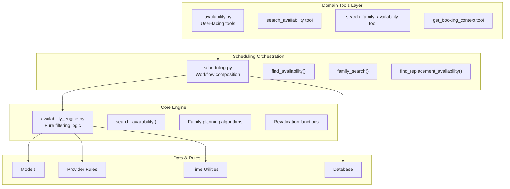
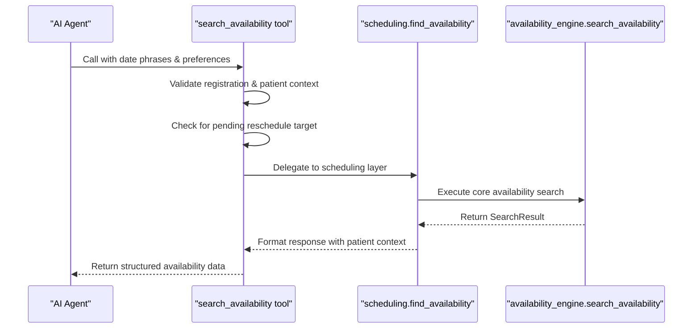
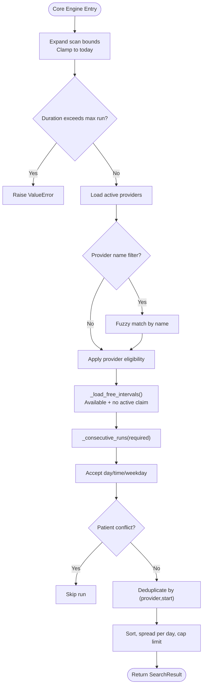
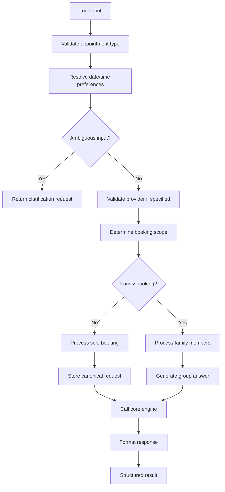
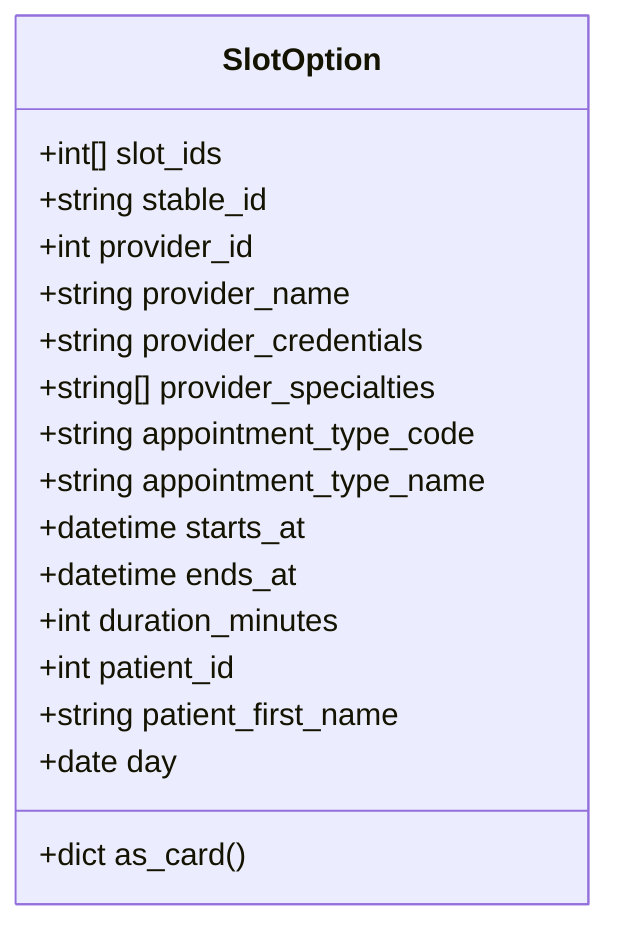
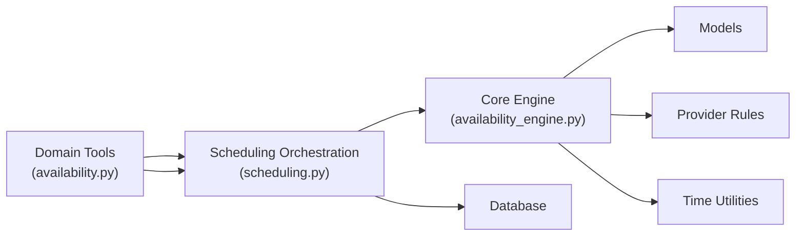

# Availability Calculation Engine

<cite>
**Referenced Files in This Document**   
- [availability.py](file://backend/app/agent/tools/domains/availability.py)
- [availability_engine.py](file://backend/app/services/availability_engine.py)
- [scheduling.py](file://backend/app/services/scheduling.py)
- [availability.py](file://backend/app/services/availability.py)
- [provider_rules.py](file://backend/app/services/provider_rules.py)
- [scheduling.py](file://backend/app/models/scheduling.py)
- [timeutil.py](file://backend/app/timeutil.py)
</cite>

## Update Summary
**Changes Made**   
- Updated architecture to reflect migration from standalone service to domain-specific tools
- Added new tool-based availability search interface in `backend/app/agent/tools/domains/availability.py`
- Updated scheduling orchestration layer to integrate with new domain tools
- Maintained core availability engine functionality in `availability_engine.py`
- Enhanced documentation for tool-based workflow and domain separation

## Table of Contents
1. [Introduction](#introduction)
2. [Architecture Overview](#architecture-overview)
3. [Domain Tools Layer](#domain-tools-layer)
4. [Core Availability Engine](#core-availability-engine)
5. [Scheduling Orchestration](#scheduling-orchestration)
6. [Detailed Component Analysis](#detailed-component-analysis)
7. [Dependency Analysis](#dependency-analysis)
8. [Performance Considerations](#performance-considerations)
9. [Troubleshooting Guide](#troubleshooting-guide)
10. [Conclusion](#conclusion)

## Introduction
The availability calculation engine has been restructured into a layered architecture where domain-specific tools provide user-facing interfaces while the core engine handles complex filtering logic. The system now operates through:

1. **Domain Tools**: User-facing tools that handle patient context, registration gates, and request validation
2. **Scheduling Orchestration**: Workflow layer that composes availability searches with booking policies
3. **Core Engine**: Pure availability calculation logic that filters provider slots based on multiple constraints

The engine filters raw 30-minute provider intervals through business hours, provider eligibility, appointment duration requirements, existing appointments, staff blocks, and active claims to return stable, deduplicated slot runs suitable for display and booking confirmation.

## Architecture Overview
The new architecture separates concerns across three distinct layers:

**Diagram sources**
- [availability.py:1-402](file://backend/app/agent/tools/domains/availability.py#L1-L402)
- [scheduling.py:393-592](file://backend/app/services/scheduling.py#L393-L592)
- [availability_engine.py:238-354](file://backend/app/services/availability_engine.py#L238-L354)

## Domain Tools Layer
The domain tools provide a clean interface for AI agents to interact with the availability system. Each tool encapsulates its own argument model, handler function, and specification.

### Tool-Based Availability Search
The `search_availability` tool is the primary entry point for solo patient bookings:

**Diagram sources**
- [availability.py:89-163](file://backend/app/agent/tools/domains/availability.py#L89-L163)
- [scheduling.py:393-592](file://backend/app/services/scheduling.py#L393-L592)

### Family Availability Tools
Family bookings use specialized tools that coordinate multiple patients:

- **`search_family_availability`**: Finds complete same-day plans for household members
- **`get_booking_context`**: Determines booking scope (solo vs family) and current state
- **`find_replacement_times`**: Handles rescheduling workflows for existing appointments

**Section sources**
- [availability.py:34-88](file://backend/app/agent/tools/domains/availability.py#L34-L88)
- [availability.py:165-179](file://backend/app/agent/tools/domains/availability.py#L165-L179)
- [availability.py:306-388](file://backend/app/agent/tools/domains/availability.py#L306-L388)

## Core Availability Engine
The core engine remains unchanged but is now accessed through the orchestration layer rather than directly by tools.

### Search Algorithm
The `search_availability` function performs the complete availability search pipeline:

1. **Date range expansion** using `preferences.scan_bounds`
2. **Provider matching** with fuzzy name support and eligibility filtering
3. **Free interval loading** excluding active claims and past times
4. **Run construction** creating contiguous blocks of required length
5. **Preference application** for days, times, and weekdays
6. **Conflict resolution** checking existing patient appointments
7. **Deduplication** by provider and start time
8. **Result shaping** with per-day spreading and limits

**Diagram sources**
- [availability_engine.py:238-354](file://backend/app/services/availability_engine.py#L238-L354)

**Section sources**
- [availability_engine.py:238-354](file://backend/app/services/availability_engine.py#L238-L354)

## Scheduling Orchestration
The scheduling layer acts as a mediator between tools and the core engine, handling workflow logic and response formatting.

### Request Processing Flow
The `find_availability` function orchestrates the complete scheduling workflow:

**Diagram sources**
- [scheduling.py:393-592](file://backend/app/services/scheduling.py#L393-L592)

**Section sources**
- [scheduling.py:393-592](file://backend/app/services/scheduling.py#L393-L592)

## Detailed Component Analysis

### SlotOption Data Structure
`SlotOption` represents one filtered, bookable run of intervals shown to the patient or used during confirmation.

Key fields and semantics:
- `slot_ids`: List of underlying `AvailabilitySlot.id` values forming the run
- `stable_id`: Deterministic identifier derived from provider and start time
- `provider_id`, `provider_name`, `provider_credentials`, `provider_specialties`: Provider context
- `appointment_type_code`, `appointment_type_name`: Type metadata
- `starts_at`, `ends_at`, `duration_minutes`: Interval boundaries and duration
- Optional patient fields: `patient_id`, `patient_first_name`
- Helper `as_card()` serializes the option into a UI-friendly dictionary

**Diagram sources**
- [availability_engine.py:51-89](file://backend/app/services/availability_engine.py#L51-L89)

**Section sources**
- [availability_engine.py:51-89](file://backend/app/services/availability_engine.py#L51-L89)

### Free Interval Loading and Active Claims
`_load_free_intervals` retrieves available intervals while excluding those with active claims.

Constraints enforced:
- `AvailabilitySlot.status == "available"`
- `AvailabilitySlot.starts_at >= max(window_start, now)`
- `AvailabilitySlot.starts_at < window_end`
- `AvailabilitySlot.id NOT IN (active SlotClaim.availability_slot_id)`

This ensures held or booked intervals are never advertised.

**Section sources**
- [availability_engine.py:143-172](file://backend/app/services/availability_engine.py#L143-L172)
- [scheduling.py:175-239](file://backend/app/models/scheduling.py#L175-L239)

### Consecutive Run Construction
`_consecutive_runs` groups an ordered list of intervals into runs of exactly `required` contiguous intervals on the same business day.

Algorithm highlights:
- Slides a window of size `required` over the ordered list
- Validates each adjacent pair has `next.starts_at == current.ends_at`
- Ensures the first and last interval share the same date

**Section sources**
- [availability_engine.py:175-189](file://backend/app/services/availability_engine.py#L175-L189)

### Patient Conflict Checking
`_patient_conflict` rejects candidate intervals that overlap any existing booked appointment for the provided patients.

Checks:
- Only considers appointments with status `booked`
- Overlap condition: `existing.starts_at < candidate.ends_at AND candidate.starts_at < existing.ends_at`

**Section sources**
- [availability_engine.py:192-208](file://backend/app/services/availability_engine.py#L192-L208)

### Revalidation Before Booking
`is_interval_bookable` and `_validate_run` ensure that a specific proposed interval remains valid at confirmation time.

Validation steps:
- Rejects non-business weekdays
- Computes expected end time based on required number of 30-minute slots
- Loads the exact interval rows for the provider and time range
- Verifies row count equals required slots and timestamps are perfectly contiguous
- Excludes self-holds and ignored appointments when necessary
- Checks for active claims on the target intervals
- Rechecks provider eligibility

**Section sources**
- [availability_engine.py:357-510](file://backend/app/services/availability_engine.py#L357-L510)
- [provider_rules.py:20-33](file://backend/app/services/provider_rules.py#L20-L33)

### Staff Blocks and Schedule Holds
Staff blocks are represented by `AvailabilitySlot.hold_reason`. A slot marked as blocked is not offered because:
- The availability loader excludes slots whose status is not `available`
- Blocked slots typically have a non-available status or are otherwise excluded by the query predicates

This separation keeps schedule holds (staff-level) distinct from proposal holds (patient-facing).

**Section sources**
- [scheduling.py:37-65](file://backend/app/models/scheduling.py#L37-L65)
- [availability_engine.py:143-172](file://backend/app/services/availability_engine.py#L143-L172)

### Business Hours and Weekday Constraints
Business hours and open days are centralized in `timeutil`:
- Clinic operates Monday through Saturday
- Open hours are 08:00 to 18:00
- `is_open_weekday` gates day-level availability
- `SLOT_MINUTES` defines the 30-minute grid

These constraints are applied both during initial search and during revalidation.

**Section sources**
- [timeutil.py:19-27](file://backend/app/timeutil.py#L19-L27)
- [timeutil.py:61-62](file://backend/app/timeutil.py#L61-L62)
- [availability_engine.py:294-295](file://backend/app/services/availability_engine.py#L294-L295)
- [availability_engine.py:408-410](file://backend/app/services/availability_engine.py#L408-L410)

## Dependency Analysis
The restructured availability system has clear dependency boundaries:

**Diagram sources**
- [availability.py:1-402](file://backend/app/agent/tools/domains/availability.py#L1-L402)
- [scheduling.py:41-49](file://backend/app/services/scheduling.py#L41-L49)
- [availability_engine.py:30-43](file://backend/app/services/availability_engine.py#L30-L43)

**Section sources**
- [availability.py:1-402](file://backend/app/agent/tools/domains/availability.py#L1-L402)
- [scheduling.py:41-49](file://backend/app/services/scheduling.py#L41-L49)
- [availability_engine.py:30-43](file://backend/app/services/availability_engine.py#L30-L43)

## Performance Considerations
The restructured architecture maintains performance optimizations while adding tool-based access patterns:

- **Bounded date windows**: Both old and new APIs cap scanning to prevent excessively large queries
- **Provider prefiltering**: Providers are narrowed by eligibility and optional name matching before querying slots
- **Indexed queries**: Database indexes on `starts_at` and composite indices optimize lookups
- **Contiguous run sliding window**: Single-pass algorithm avoids nested scans
- **Deduplication set**: In-memory set lookup prevents duplicate options without repeated database calls
- **Per-day spreading**: Limits output per day to reduce result volume and improve UX
- **Maximum run guard**: Prevents extremely long appointment durations from generating expensive searches

**New tool-based optimizations:**
- **Registration gates**: Early validation prevents unnecessary processing for unregistered patients
- **Context caching**: Booking context reduces repeated scope calculations
- **Request persistence**: Canonical request storage enables efficient re-searches
- **Family plan caching**: Complete family plans are cached to avoid recomputation

## Troubleshooting Guide
Common issues and diagnostics in the new architecture:

### Tool Layer Issues
- **Registration gate failures**: Ensure patient is registered before calling availability tools
- **Missing patient context**: Verify requester authentication and session validity
- **Invalid family member names**: Check that family members exist on the account

### Scheduling Orchestration Issues
- **Unknown appointment types**: Validate type codes against supported values
- **Provider name mismatches**: Check spelling against actual provider names
- **Ambiguous date parsing**: Review date phrase interpretation and fallback behavior

### Core Engine Issues
- **No options returned**: Check provider eligibility, business hours, and appointment duration constraints
- **Stale or taken slot IDs**: Client-provided slot IDs are hints; revalidation will reject stale intervals
- **Closed days in preferences**: Explicit preference days on closed weekdays are recorded as closed days

### Performance Diagnostics
- Log availability search events to understand provider consideration counts and raw option trimming
- Monitor family plan generation complexity for large household sizes
- Track database query performance for large date ranges

**Section sources**
- [availability.py:90-163](file://backend/app/agent/tools/domains/availability.py#L90-L163)
- [scheduling.py:419-489](file://backend/app/services/scheduling.py#L419-L489)
- [availability_engine.py:339-348](file://backend/app/services/availability_engine.py#L339-L348)

## Conclusion
The availability calculation engine has successfully migrated from a standalone service to a layered architecture with domain-specific tools. This restructuring provides:

1. **Clearer separation of concerns**: Tools handle user interaction, orchestration manages workflow, and the engine focuses on pure filtering logic
2. **Better testability**: Each layer can be tested independently with well-defined interfaces
3. **Enhanced maintainability**: Changes to user interfaces don't affect core algorithms
4. **Improved scalability**: Domain tools can be extended without modifying core engine logic
5. **Robust error handling**: Registration gates and context validation provide early failure detection

The core availability filtering algorithms remain unchanged, ensuring backward compatibility while providing a cleaner, more maintainable architecture for future enhancements. With indexed queries, bounded ranges, deterministic result shaping, and tool-based access patterns, the system scales to realistic scheduling workloads while remaining understandable and testable.