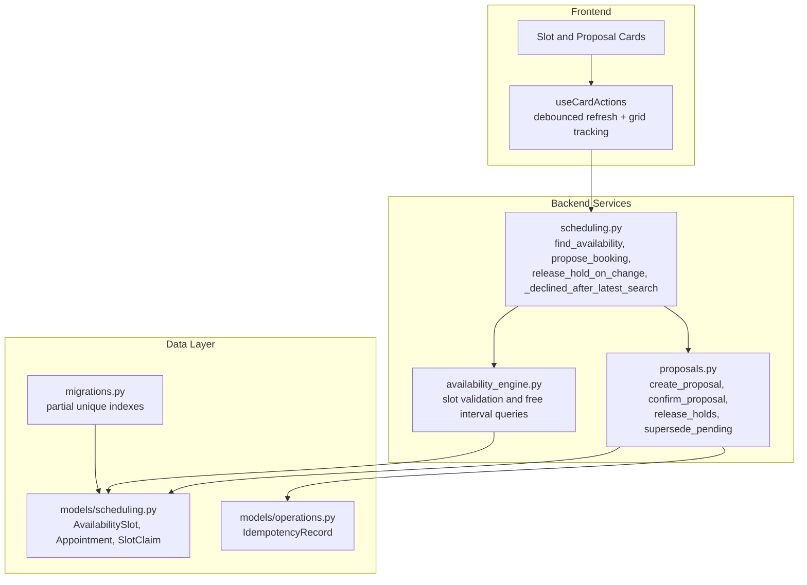
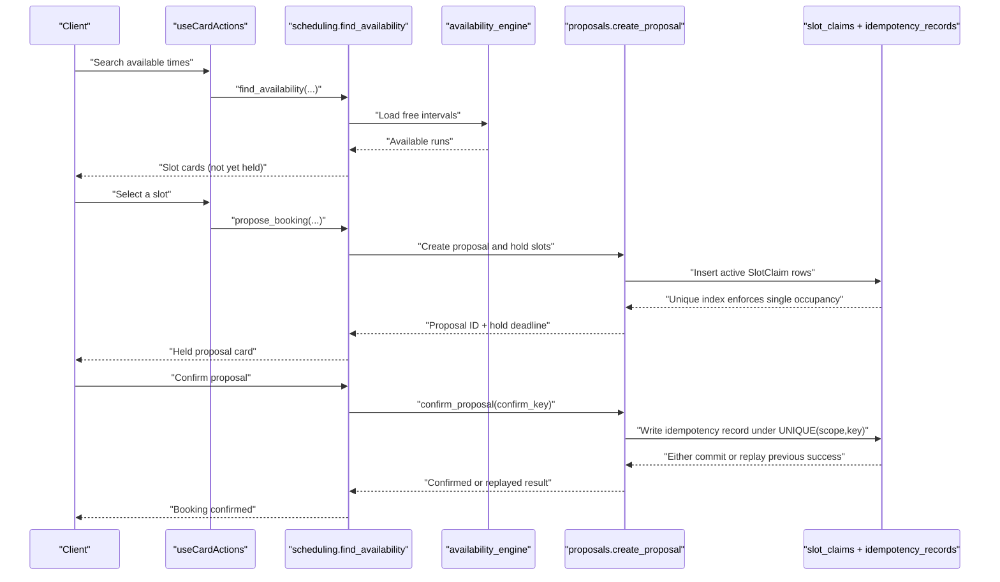
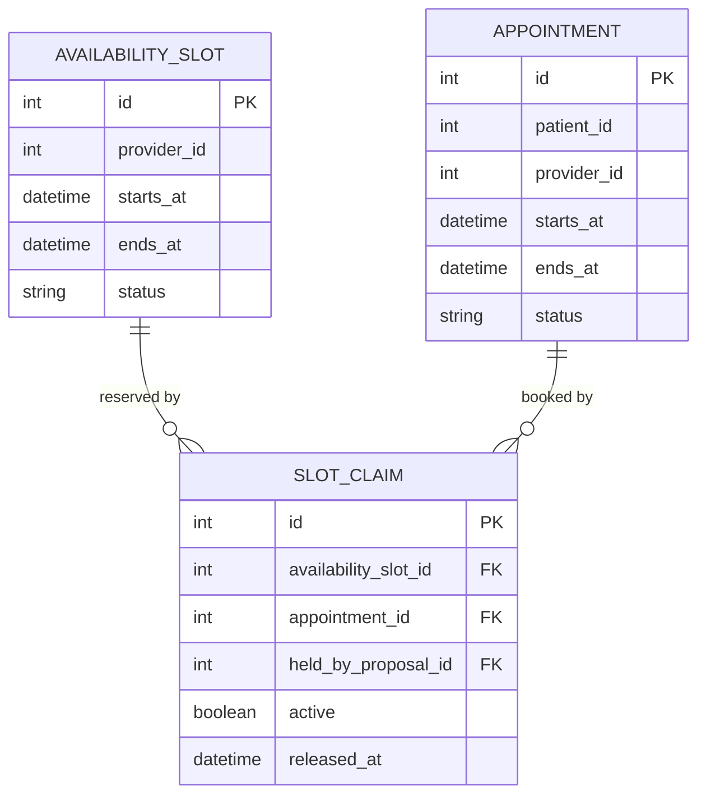
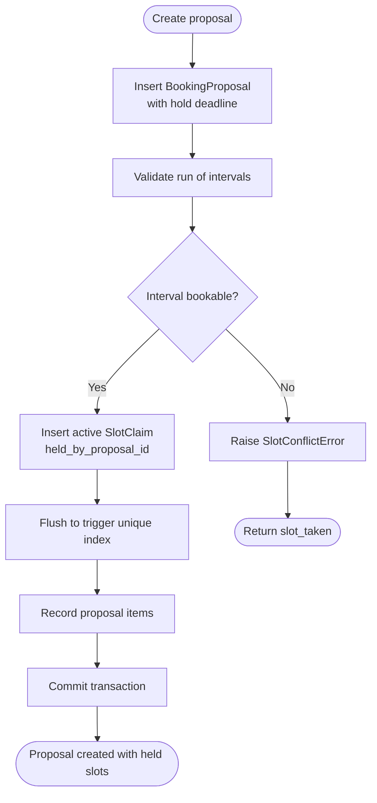
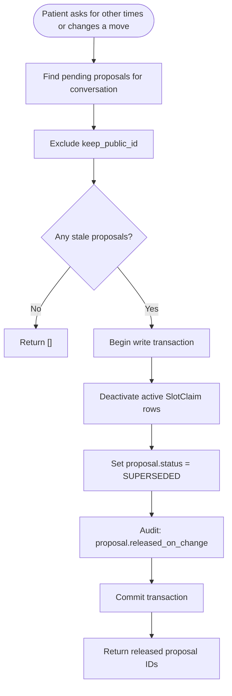
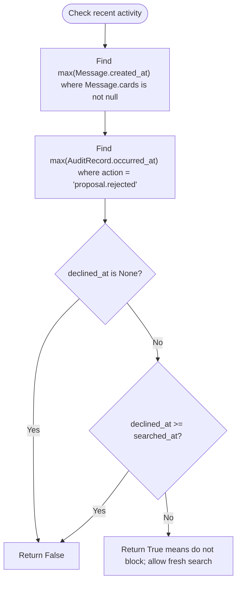
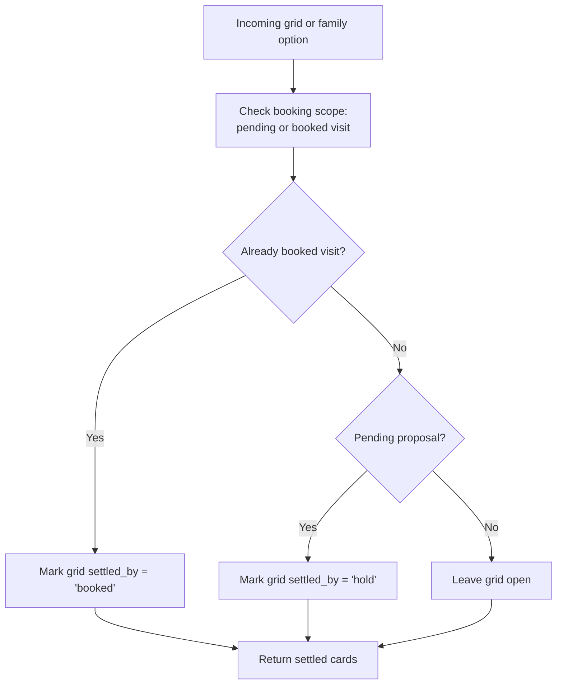
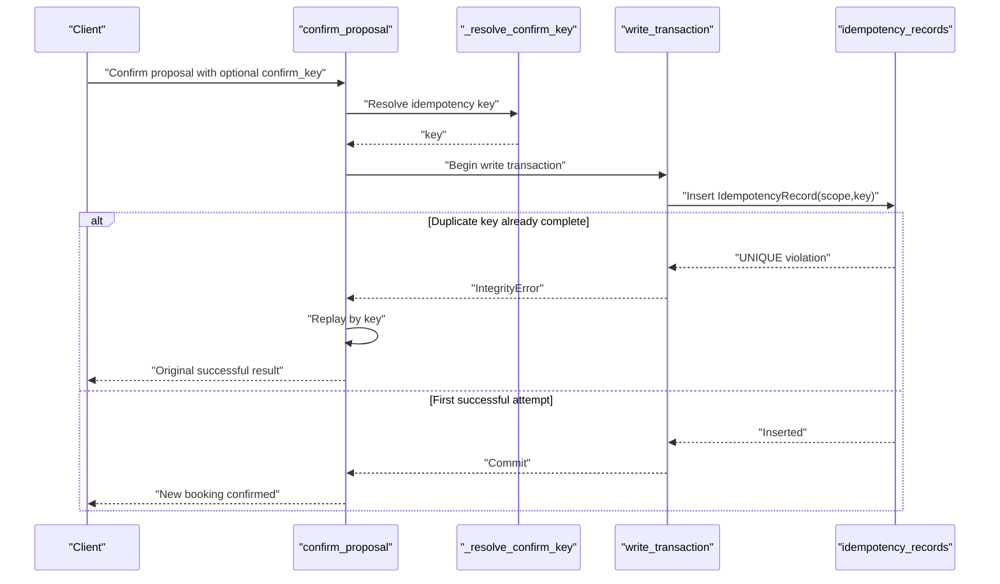
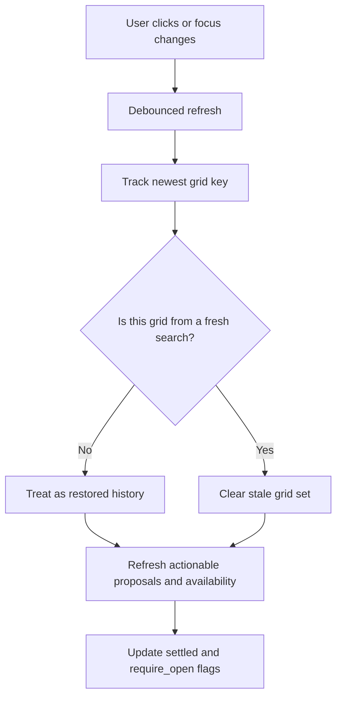
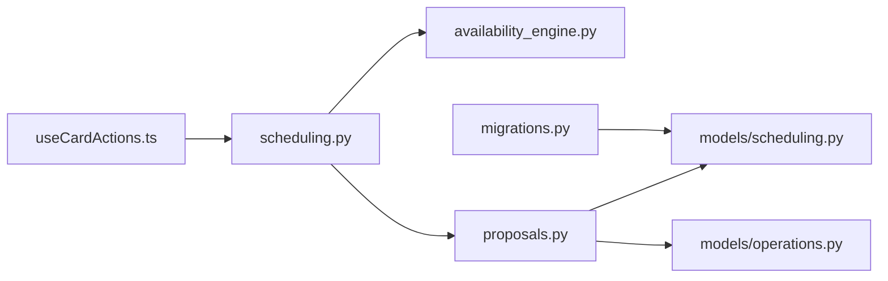

# Conflict Resolution and Idempotency

<cite>
**Referenced Files in This Document**
- [scheduling.py](file://backend/app/services/scheduling.py)
- [proposals.py](file://backend/app/services/proposals.py)
- [scheduling.py](file://backend/app/models/scheduling.py)
- [availability_engine.py](file://backend/app/services/availability_engine.py)
- [migrations.py](file://backend/app/migrations.py)
- [operations.py](file://backend/app/models/operations.py)
- [test_hold_release_on_change.py](file://backend/tests/test_hold_release_on_change.py)
- [test_settled_grids.py](file://backend/tests/test_settled_grids.py)
- [useCardActions.ts](file://frontend/src/hooks/useCardActions.ts)
</cite>

## Table of Contents
1. [Introduction](#introduction)
2. [Project Structure](#project-structure)
3. [Core Components](#core-components)
4. [Architecture Overview](#architecture-overview)
5. [Detailed Component Analysis](#detailed-component-analysis)
6. [Dependency Analysis](#dependency-analysis)
7. [Performance Considerations](#performance-considerations)
8. [Troubleshooting Guide](#troubleshooting-guide)
9. [Conclusion](#conclusion)

## Introduction
This document explains how the scheduling system prevents double-bookings, handles race conditions, and keeps user interfaces consistent when patients change their minds or network retries occur. It focuses on:
- Database-level slot claim uniqueness that enforces single occupancy per time slot.
- Hold creation, release, expiration, and replacement during rescheduling.
- The `release_hold_on_change` function that immediately frees slots when a patient changes their mind.
- The `_declined_after_latest_search` guard that allows fresh searches after an explicit decline.
- Settled card state management that stops re-offering already booked or held times.
- Idempotent confirmation through confirmation keys and idempotency records.
- Edge cases such as concurrent booking attempts, stale UI cards, network failures, and cleanup of orphaned claims.

## Project Structure
The conflict resolution logic spans backend services, database models, migrations, tests, and frontend card actions:
- Backend services implement availability search, proposal lifecycle, hold management, and scheduling coordination.
- Models define availability slots, appointments, slot claims, and idempotency records.
- Migrations install partial unique indexes that enforce concurrency safety.
- Tests validate hold release behavior, settled grids, and regression scenarios.
- Frontend debounces refreshes and tracks whether a grid is a fresh offer or restored history.

**Diagram sources**
- [scheduling.py:580-716](file://backend/app/services/scheduling.py#L580-L716)
- [proposals.py:282-529](file://backend/app/services/proposals.py#L282-L529)
- [availability_engine.py:143-172](file://backend/app/services/availability_engine.py#L143-L172)
- [scheduling.py:175-238](file://backend/app/models/scheduling.py#L175-L238)
- [operations.py:30-53](file://backend/app/models/operations.py#L30-L53)
- [migrations.py:109-159](file://backend/app/migrations.py#L109-L159)

**Section sources**
- [scheduling.py:580-716](file://backend/app/services/scheduling.py#L580-L716)
- [proposals.py:282-529](file://backend/app/services/proposals.py#L282-L529)
- [availability_engine.py:143-172](file://backend/app/services/availability_engine.py#L143-L172)
- [scheduling.py:175-238](file://backend/app/models/scheduling.py#L175-L238)
- [operations.py:30-53](file://backend/app/models/operations.py#L30-L53)
- [migrations.py:109-159](file://backend/app/migrations.py#L109-L159)

## Core Components
- Slot claim uniqueness: A partial unique index on active slot claims ensures only one active reservation exists per slot, regardless of whether it belongs to an appointment or a pending proposal.
- Proposal holds: Pending proposals reserve intervals by inserting active slot claims; these are released when the proposal expires, is declined, or is superseded.
- Change-of-mind handling: When a patient asks for other times or changes a move, held slots are released immediately rather than waiting for the hold window to expire.
- Decline-aware search gating: If the latest meaningful event is a decline, the system allows a new search instead of returning a stale waiting-hold response.
- Settled grid state: Once a request has a held or confirmed booking, ordinary grids are marked settled so they cannot be offered again as fresh options.
- Idempotent confirmation: Confirmation uses a stable key recorded in an idempotency record; duplicate requests replay the original successful outcome.

**Section sources**
- [scheduling.py:175-238](file://backend/app/models/scheduling.py#L175-L238)
- [proposals.py:200-274](file://backend/app/services/proposals.py#L200-L274)
- [scheduling.py:1153-1205](file://backend/app/services/scheduling.py#L1153-L1205)
- [scheduling.py:1065-1087](file://backend/app/services/scheduling.py#L1065-L1087)
- [test_settled_grids.py:44-76](file://backend/tests/test_settled_grids.py#L44-L76)
- [proposals.py:1734-1811](file://backend/app/services/proposals.py#L1734-L1811)

## Architecture Overview
The booking flow combines read-time availability checks with write-time uniqueness constraints:

**Diagram sources**
- [scheduling.py:580-716](file://backend/app/services/scheduling.py#L580-L716)
- [availability_engine.py:143-172](file://backend/app/services/availability_engine.py#L143-L172)
- [proposals.py:282-529](file://backend/app/services/proposals.py#L282-L529)
- [proposals.py:789-862](file://backend/app/services/proposals.py#L789-L862)
- [proposals.py:1734-1811](file://backend/app/services/proposals.py#L1734-L1811)
- [operations.py:30-53](file://backend/app/models/operations.py#L30-L53)

## Detailed Component Analysis

### Database-Level Slot Claim Uniqueness
The `slot_claims` table is the source of truth for slot occupancy:
- One active claim per `availability_slot_id`.
- One active claim per `(appointment_id, availability_slot_id)` pair.
- Partial unique indexes apply only when `active = 1`, allowing historical cancelled or released rows without blocking future bookings.
- Migrations ensure these indexes exist even on upgraded databases.

**Diagram sources**
- [scheduling.py:37-79](file://backend/app/models/scheduling.py#L37-L79)
- [scheduling.py:81-172](file://backend/app/models/scheduling.py#L81-L172)
- [scheduling.py:175-238](file://backend/app/models/scheduling.py#L175-L238)
- [migrations.py:109-159](file://backend/app/migrations.py#L109-L159)

**Section sources**
- [scheduling.py:175-238](file://backend/app/models/scheduling.py#L175-L238)
- [migrations.py:109-159](file://backend/app/migrations.py#L109-L159)

### Hold Creation and Validation
When a proposal is created:
- A pending proposal row is inserted with a short hold deadline.
- Each selected interval is validated and immediately reserved by inserting an active `SlotClaim` with `held_by_proposal_id`.
- If another process inserts an active claim for the same slot, the partial unique index fails, producing a slot-taken conflict.
- The validator also avoids holding intervals already owned by the target appointment during reschedule/cancellation.

**Diagram sources**
- [proposals.py:282-529](file://backend/app/services/proposals.py#L282-L529)
- [proposals.py:548-630](file://backend/app/services/proposals.py#L548-L630)

**Section sources**
- [proposals.py:282-529](file://backend/app/services/proposals.py#L282-L529)
- [proposals.py:548-630](file://backend/app/services/proposals.py#L548-L630)

### Release-Hold-on-Change
`release_hold_on_change` releases held slots when a patient changes their mind:
- It finds pending proposals in the conversation that are not the current choice being kept.
- It deactivates their active claims and marks them superseded.
- It audits the release with reason “patient_changed_their_mind”.
- It is called before checking for a waiting hold, so asking for alternatives does not get stuck behind a stale card.

**Diagram sources**
- [scheduling.py:1153-1205](file://backend/app/services/scheduling.py#L1153-L1205)
- [proposals.py:200-213](file://backend/app/services/proposals.py#L200-L213)

**Section sources**
- [scheduling.py:1153-1205](file://backend/app/services/scheduling.py#L1153-L1205)
- [test_hold_release_on_change.py:88-118](file://backend/tests/test_hold_release_on_change.py#L88-L118)

### Declined-After-Latest-Search Guard
`_declined_after_latest_search` decides whether a fresh search should proceed instead of returning a waiting-hold response:
- It compares the timestamp of the latest message containing cards with the timestamp of the latest audit record for proposal rejection.
- If no decline occurred, it returns false.
- If a decline happened after the last search, it returns true, allowing the system to show currently open times.

**Diagram sources**
- [scheduling.py:1065-1087](file://backend/app/services/scheduling.py#L1065-L1087)

**Section sources**
- [scheduling.py:1065-1087](file://backend/app/services/scheduling.py#L1065-L1087)

### Settled Card State Management
Once a request has a pending booking or an existing visit, ordinary grids must not offer additional holds:
- `settles_plain_grids` detects whether a conversation already has a hold or booking.
- `settle_superseded_grids` marks old grids as settled and sets `require_open` to false so they are not treated as freshly searched open slots.
- Explicitly requested extra visits remain clickable because they represent a different request context.

**Diagram sources**
- [scheduling.py:664-673](file://backend/app/services/scheduling.py#L664-L673)
- [test_settled_grids.py:44-76](file://backend/tests/test_settled_grids.py#L44-L76)

**Section sources**
- [scheduling.py:664-673](file://backend/app/services/scheduling.py#L664-L673)
- [test_settled_grids.py:44-76](file://backend/tests/test_settled_grids.py#L44-L76)

### Idempotent Confirmation and Replay
Confirmation is protected by a confirmation key and an idempotency record:
- `_resolve_confirm_key` chooses a key from caller input, a previously completed key, or generates a fresh random key.
- `_record_confirm_key` inserts an idempotency record inside the booking transaction; the unique index on `(scope, key)` prevents duplicate successful confirmations.
- On integrity errors caused by lost races, confirmation replays by key and returns the original successful outcome.

**Diagram sources**
- [proposals.py:789-862](file://backend/app/services/proposals.py#L789-L862)
- [proposals.py:1734-1811](file://backend/app/services/proposals.py#L1734-L1811)
- [operations.py:30-53](file://backend/app/models/operations.py#L30-L53)

**Section sources**
- [proposals.py:789-862](file://backend/app/services/proposals.py#L789-L862)
- [proposals.py:1734-1811](file://backend/app/services/proposals.py#L1734-L1811)
- [operations.py:30-53](file://backend/app/models/operations.py#L30-L53)

### Frontend Staleness Handling
The frontend reduces redundant refreshes and distinguishes between a fresh search and restored history:
- Debounced refresh collapses bursts of mutations into one round of requests.
- The newest grid becomes the reference grid for freshness checks.
- A grid appearing without a schedule search behind it is treated as history, not a new offer.
- A fresh search clears stale grid state so previously refused times are not carried over.

**Diagram sources**
- [useCardActions.ts:285-424](file://frontend/src/hooks/useCardActions.ts#L285-L424)

**Section sources**
- [useCardActions.ts:285-424](file://frontend/src/hooks/useCardActions.ts#L285-L424)

## Dependency Analysis
The following diagram shows how components depend on each other to enforce conflict resolution and idempotency:

**Diagram sources**
- [useCardActions.ts:285-424](file://frontend/src/hooks/useCardActions.ts#L285-L424)
- [scheduling.py:580-716](file://backend/app/services/scheduling.py#L580-L716)
- [availability_engine.py:143-172](file://backend/app/services/availability_engine.py#L143-L172)
- [proposals.py:282-529](file://backend/app/services/proposals.py#L282-L529)
- [scheduling.py:175-238](file://backend/app/models/scheduling.py#L175-L238)
- [operations.py:30-53](file://backend/app/models/operations.py#L30-L53)
- [migrations.py:109-159](file://backend/app/migrations.py#L109-L159)

**Section sources**
- [useCardActions.ts:285-424](file://frontend/src/hooks/useCardActions.ts#L285-L424)
- [scheduling.py:580-716](file://backend/app/services/scheduling.py#L580-L716)
- [availability_engine.py:143-172](file://backend/app/services/availability_engine.py#L143-L172)
- [proposals.py:282-529](file://backend/app/services/proposals.py#L282-L529)
- [scheduling.py:175-238](file://backend/app/models/scheduling.py#L175-L238)
- [operations.py:30-53](file://backend/app/models/operations.py#L30-L53)
- [migrations.py:109-159](file://backend/app/migrations.py#L109-L159)

## Performance Considerations
- Partial unique indexes on active claims make concurrent conflicts fail fast at the database layer, avoiding expensive rollback-and-retry loops.
- Flushing claims immediately after insertion exposes the constraint early, improving error clarity.
- Debounced refreshes in the frontend reduce repeated API calls during rapid user interactions.
- Holding slots for a short, configurable window limits calendar blocking while still giving patients time to confirm.
- Reusing the same `slot_claims` table for both booked appointments and proposal holds simplifies indexing and query paths.

[No sources needed since this section provides general guidance]

## Troubleshooting Guide

### Concurrent Booking Attempts
Symptoms:
- Two users select the same slot simultaneously.
- One receives a “slot taken” response.

Resolution strategy:
- The partial unique index on active slot claims rejects the second insert.
- The service converts the integrity error into a clear conflict response with stable slot identifiers.
- The client should refresh availability and present alternative times.

**Section sources**
- [proposals.py:490-511](file://backend/app/services/proposals.py#L490-L511)
- [scheduling.py:175-238](file://backend/app/models/scheduling.py#L175-L238)

### Stale UI Cards After a Hold Expires
Symptoms:
- A held slot remains clickable after its hold window passes.
- The UI still shows the old grid.

Resolution strategy:
- Expired holds are released by `release_expired_holds`, but the proposal stays pending so the patient can still confirm if the slot remains open.
- The frontend refreshes actionable proposals and revalidates availability.
- Settled grids are marked appropriately so they are not reoffered as fresh options.

**Section sources**
- [proposals.py:231-274](file://backend/app/services/proposals.py#L231-L274)
- [test_hold_release_on_change.py:205-243](file://backend/tests/test_hold_release_on_change.py#L205-L243)
- [test_settled_grids.py:44-76](file://backend/tests/test_settled_grids.py#L44-L76)

### Network Failures During Booking
Symptoms:
- The client retries confirmation after a timeout.
- The server may have already committed the booking.

Resolution strategy:
- Confirmation uses a stable idempotency key.
- Duplicate attempts either replay the original successful outcome or fail fast on the unique idempotency record.
- The client should treat a replayed success as final and update the UI accordingly.

**Section sources**
- [proposals.py:789-862](file://backend/app/services/proposals.py#L789-L862)
- [proposals.py:1734-1811](file://backend/app/services/proposals.py#L1734-L1811)
- [operations.py:30-53](file://backend/app/models/operations.py#L30-L53)

### Cleanup of Orphaned Claims
Symptoms:
- Active claims remain after cancellation or failed moves.

Resolution strategy:
- Cancellation and move flows deactivate claims atomically and flush before inserting replacement claims.
- Tests assert claim counts and active hold counts to detect leaks.
- Superseding and release-on-change mark proposals superseded and release their holds.

**Section sources**
- [proposals.py:1251-1280](file://backend/app/services/proposals.py#L1251-L1280)
- [test_reschedule_regression.py:709-728](file://backend/tests/test_reschedule_regression.py#L709-L728)
- [test_reschedule_regression.py:118-156](file://backend/tests/test_reschedule_regression.py#L118-L156)

### Examples of Conflict Detection Scenarios and Resolutions

- Two patients pick the same slot:
  - Detection: Unique active claim index violation.
  - Resolution: Return slot-taken conflict; refresh availability.

- Patient changes mind after selecting a replacement time:
  - Detection: New search or “change” action.
  - Resolution: `release_hold_on_change` releases the old hold immediately and marks the proposal superseded.

- Patient explicitly declines an offer:
  - Detection: Audit record for proposal rejection.
  - Resolution: `_declined_after_latest_search` allows a fresh search instead of returning a waiting-hold response.

- Old grid still visible after a hold:
  - Detection: Conversation scope has pending or booked visit.
  - Resolution: Grids are marked settled with reason “hold”; `require_open` is false.

- Retry after network failure:
  - Detection: Duplicate idempotency key.
  - Resolution: Replay the original successful confirmation.

**Section sources**
- [proposals.py:490-511](file://backend/app/services/proposals.py#L490-L511)
- [scheduling.py:1153-1205](file://backend/app/services/scheduling.py#L1153-L1205)
- [scheduling.py:1065-1087](file://backend/app/services/scheduling.py#L1065-L1087)
- [test_settled_grids.py:44-76](file://backend/tests/test_settled_grids.py#L44-L76)
- [proposals.py:789-862](file://backend/app/services/proposals.py#L789-L862)

## Conclusion
The system prevents double-bookings through layered safeguards:
- Read-time availability excludes slots with active claims.
- Write-time partial unique indexes enforce single occupancy per slot.
- Proposal holds are short-lived and explicitly released on change, decline, expiration, or supersession.
- Frontend staleness handling avoids offering outdated grids.
- Idempotent confirmation guarantees that retries do not create duplicate bookings.

Together, these mechanisms provide strong guarantees against race conditions while keeping the user experience predictable and recoverable under network failures and concurrent interactions.

[No sources needed since this section summarizes without analyzing specific files]