# Family Booking Coordination

<cite>
**Referenced Files in This Document**
- [family.py](file://backend/app/models/family.py)
- [availability_engine.py](file://backend/app/services/availability_engine.py)
- [scheduling.py](file://backend/app/services/scheduling.py)
- [scheduling.py API](file://backend/app/api/scheduling.py)
- [test_nearby_family_plans.py](file://backend/tests/test_nearby_family_plans.py)
- [e2e_demo.py](file://backend/scripts/e2e_demo.py)
- [transactions.py](file://backend/app/services/transactions.py)
</cite>

## Update Summary
**Changes Made**
- Updated transaction handling and session management for family booking lifecycle
- Enhanced state persistence with improved request revision tracking
- Added edge case handling for stale options and replay scenarios
- Improved atomic booking coordination with better conflict resolution
- Updated examples to reflect current implementation patterns

## Table of Contents
1. [Introduction](#introduction)
2. [Project Structure](#project-structure)
3. [Core Components](#core-components)
4. [Architecture Overview](#architecture-overview)
5. [Detailed Component Analysis](#detailed-component-analysis)
6. [Dependency Analysis](#dependency-analysis)
7. [Performance Considerations](#performance-considerations)
8. [Troubleshooting Guide](#troubleshooting-guide)
9. [Conclusion](#conclusion)

## Introduction
This document explains how the system coordinates family bookings: multiple patients are searched, validated, and booked atomically as one complete plan while preserving each patient's individual constraints. The coordination is split across three layers:

- **Data model**: family groups and members define who can be booked together.
- **Availability engine**: finds real, non-overlapping time runs for every member on the same day.
- **Scheduling service**: persists request context, merges partial inputs, builds UI cards, and converts a selected family plan into an atomic booking proposal.

The design ensures that a user never sees or confirms a partial family plan, and that authorization is enforced per household rather than by shared phone number alone. Recent improvements have enhanced transaction handling, state persistence, and edge case management for multi-patient bookings.

## Project Structure
Family booking coordination lives primarily in the backend services and models:

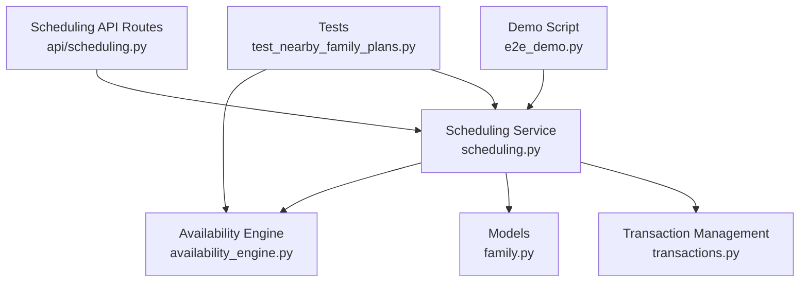

**Diagram sources**
- [family.py:21-60](file://backend/app/models/family.py#L21-L60)
- [availability_engine.py:538-770](file://backend/app/services/availability_engine.py#L538-L770)
- [scheduling.py:137-390](file://backend/app/services/scheduling.py#L137-L390)
- [scheduling.py API:256-362](file://backend/app/api/scheduling.py#L256-L362)
- [test_nearby_family_plans.py:1-56](file://backend/tests/test_nearby_family_plans.py#L1-L56)
- [e2e_demo.py:290-321](file://backend/scripts/e2e_demo.py#L290-L321)
- [transactions.py:85-162](file://backend/app/services/transactions.py#L85-L162)

**Section sources**
- [family.py:1-60](file://backend/app/models/family.py#L1-L60)
- [availability_engine.py:1-17](file://backend/app/services/availability_engine.py#L1-L17)
- [scheduling.py:1-12](file://backend/app/services/scheduling.py#L1-L12)
- [scheduling.py API:1-13](file://backend/app/api/scheduling.py#L1-L13)

## Core Components
The core components are:

| Component | Responsibility | Key Implementation |
|---|---|---|
| `FamilyGroup` and `FamilyMember` | Define households and membership links between patients | [family.py:21-60](file://backend/app/models/family.py#L21-L60) |
| `FamilyMemberRequest` | Lightweight representation of one person in a coordinated booking | [availability_engine.py:538-545](file://backend/app/services/availability_engine.py#L538-L545) |
| `search_nearby_family_plans` | Finds complete same-day plans with no overlapping appointments | [availability_engine.py:729-770](file://backend/app/services/availability_engine.py#L729-L770) |
| `family_option_cards` | Renders one selectable card per complete family plan | [scheduling.py:341-390](file://backend/app/services/scheduling.py#L341-L390) |
| `_remember_request` | Persists the canonical scheduling request and handles revisions | [scheduling.py:137-191](file://backend/app/services/scheduling.py#L137-L191) |
| `check_family_authorisation` | Returns other household members the current verified patient may book | [scheduling.py:2344-2371](file://backend/app/services/scheduling.py#L2344-L2371) |
| `_merge_family_member_inputs` | Merges partial conversational answers into stored family request state | [scheduling.py:194-219](file://backend/app/services/scheduling.py#L194-L219) |
| `hold_family_option` | Creates atomic family proposals with improved transaction handling | [scheduling.py:2693-2979](file://backend/app/services/scheduling.py#L2693-L2979) |

**Section sources**
- [family.py:21-60](file://backend/app/models/family.py#L21-L60)
- [availability_engine.py:538-545](file://backend/app/services/availability_engine.py#L538-L545)
- [availability_engine.py:729-770](file://backend/app/services/availability_engine.py#L729-L770)
- [scheduling.py:137-191](file://backend/app/services/scheduling.py#L137-L191)
- [scheduling.py:194-219](file://backend/app/services/scheduling.py#L194-L219)
- [scheduling.py:341-390](file://backend/app/services/scheduling.py#L341-L390)
- [scheduling.py:2344-2371](file://backend/app/services/scheduling.py#L2344-L2371)
- [scheduling.py:2693-2979](file://backend/app/services/scheduling.py#L2693-L2979)

## Architecture Overview
At a high level, family booking follows this flow:

1. A verified patient asks to book multiple people.
2. The system resolves authorized household members.
3. It persists a canonical scheduling request through `_remember_request`.
4. It searches for complete family plans using `search_nearby_family_plans`.
5. It renders complete family options as single booking units via `family_option_cards`.
6. Selecting a family option creates a proposal that books all members atomically.

Recent improvements include better transaction handling, ensuring that request state is committed before proposal creation, and enhanced handling of edge cases like stale options and replay scenarios.

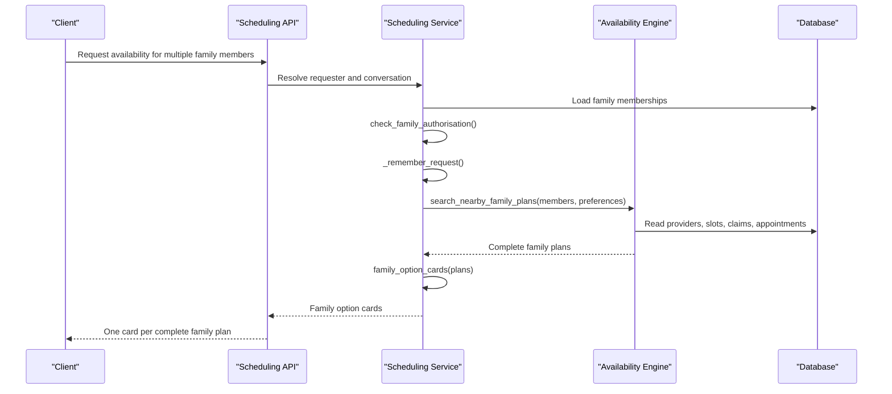

**Diagram sources**
- [scheduling.py API:256-362](file://backend/app/api/scheduling.py#L256-L362)
- [scheduling.py:310-390](file://backend/app/services/scheduling.py#L310-L390)
- [scheduling.py:137-191](file://backend/app/services/scheduling.py#L137-L191)
- [availability_engine.py:729-770](file://backend/app/services/availability_engine.py#L729-L770)

## Detailed Component Analysis

### Family Data Model
The family data model separates the idea of a household from any particular patient. A `FamilyGroup` represents the household, and `FamilyMember` links patients to that group.

Key properties:

| Field | Meaning |
|---|---|
| `FamilyGroup.id` | Primary key for the household |
| `FamilyGroup.shared_phone` | Optional shared contact used to match callers |
| `FamilyMember.family_group_id` | Links a membership row to a household |
| `FamilyMember.patient_id` | Links the membership to a specific patient |
| `FamilyMember.relation_to_primary` | Describes the relationship, such as self or child |
| `FamilyMember.is_primary_contact` | Marks the primary contact for the household |

Constraints ensure:

- A patient cannot appear twice in the same household.
- Household membership is indexed by patient for efficient lookup.
- Deleting a household cascades to its membership rows.

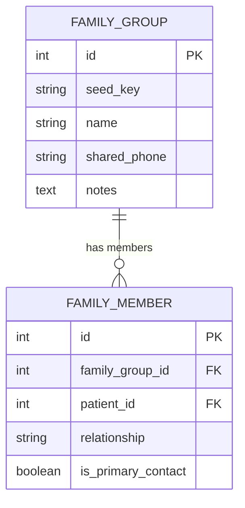

**Diagram sources**
- [family.py:21-60](file://backend/app/models/family.py#L21-L60)

**Section sources**
- [family.py:1-60](file://backend/app/models/family.py#L1-L60)

### Authorization for Household Members
Authorization is not based only on shared phone numbers. The system uses `check_family_authorisation`, which:

- Starts from the verified patient.
- Loads their family memberships.
- Collects other patients in the same household.
- Returns those patients as allowed additional participants.

Important policy:

- The verified adult can always book themselves.
- Other household members can be added for booking purposes.
- This grants booking access only; it does not expose another adult's private history or insurance in the conversation.
- Another adult is not automatically added just because they share a household; explicit matching or naming is required.

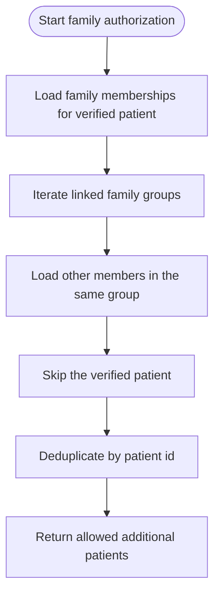

**Diagram sources**
- [scheduling.py:2344-2371](file://backend/app/services/scheduling.py#L2344-L2371)

**Section sources**
- [scheduling.py:2344-2371](file://backend/app/services/scheduling.py#L2344-L2371)

### FamilyMemberRequest Data Structure
`FamilyMemberRequest` is the internal representation of one person in a coordinated booking. It carries:

| Field | Purpose |
|---|---|
| `patient_id` | Stable identifier for the patient being considered |
| `patient_first_name` | Human-readable name used in UI and messages |
| `appointment_type` | The visit type for this person, including duration |
| `provider_name` | Optional preferred provider for this person |

It is intentionally lightweight: it does not contain database relationships. That keeps the availability engine focused on read-only scheduling logic while the scheduling service owns identity, authorization, and persistence.

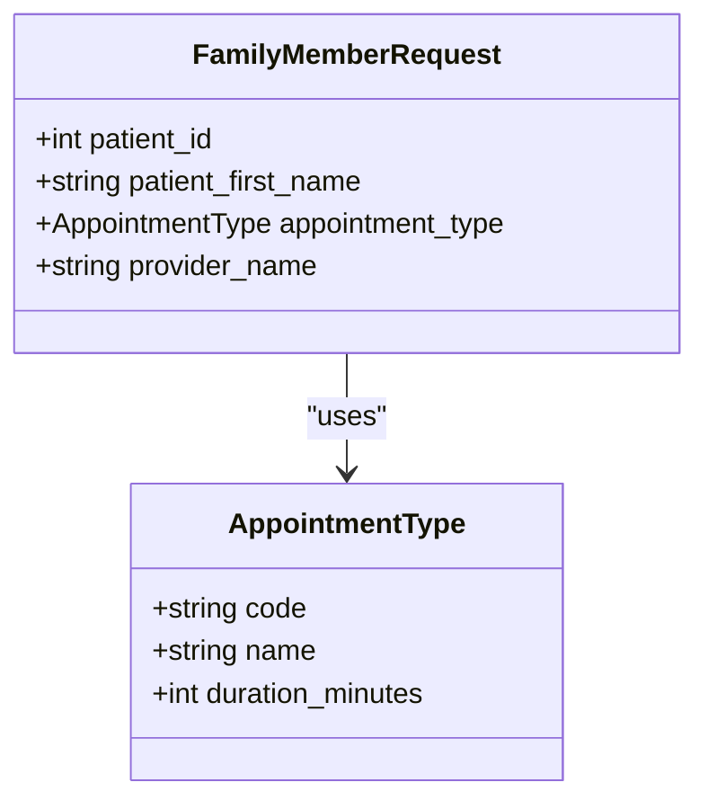

**Diagram sources**
- [availability_engine.py:538-545](file://backend/app/services/availability_engine.py#L538-L545)

**Section sources**
- [availability_engine.py:538-545](file://backend/app/services/availability_engine.py#L538-L545)

### Search Nearby Family Plans
`search_nearby_family_plans` finds complete same-day family plans ordered by proximity. Its behavior is:

1. Require at least one member.
2. Load active providers.
3. Clamp the scan window to business days and preference bounds.
4. For each accepted day, collect candidate runs for every member.
5. Combine candidates into complete plans where every member has exactly one slot.
6. Reject plans where any two appointments overlap.
7. Score plans by smallest total gap, then smallest maximum gap, then earliest start.
8. Return up to `max_plans` unique plans.

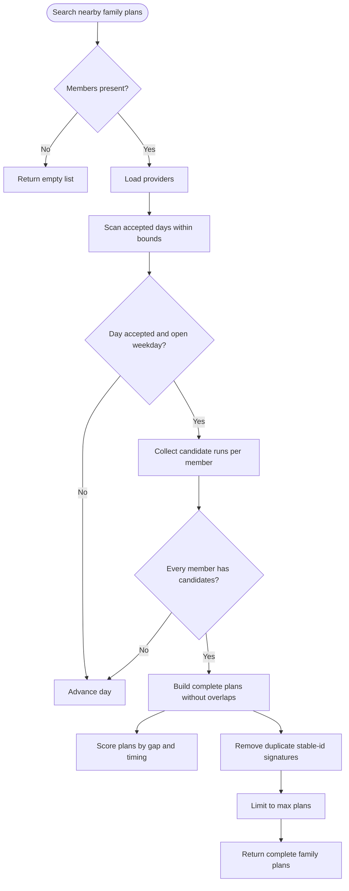

**Diagram sources**
- [availability_engine.py:729-770](file://backend/app/services/availability_engine.py#L729-L770)
- [availability_engine.py:687-726](file://backend/app/services/availability_engine.py#L687-L726)
- [availability_engine.py:663-684](file://backend/app/services/availability_engine.py#L663-L684)

Complexity considerations:

- Candidate collection is bounded per member by `MAX_FAMILY_CANDIDATES_PER_MEMBER`.
- Plan construction is exponential in the number of candidates per member, but capped by limits and early rejection of overlapping combinations.
- Duplicate plans are removed by stable slot signatures.
- Results are trimmed to `max_plans`, keeping UI response size predictable.

**Section sources**
- [availability_engine.py:579-684](file://backend/app/services/availability_engine.py#L579-L684)
- [availability_engine.py:687-770](file://backend/app/services/availability_engine.py#L687-L770)

### Family Option Cards
`family_option_cards` turns complete family plans into UI-ready cards. Each card represents one complete family plan and contains:

| Field | Meaning |
|---|---|
| `type` | Identifies the card as a family option |
| `option_id` | Stable identity for the plan |
| `option_index` | Position among returned plans |
| `option_identity` | Reusable identity for refresh and selection |
| `request_id` | Ties the card back to the persisted scheduling request |
| `slots` | Individual slot cards for each family member |
| `settled` | Indicates whether the request already has a hold or booking |
| `require_open` | Tells the client to re-check freshness when not settled |
| `back_to_back` | True if every member's slot is immediately after the previous one |
| `title` | User-facing label indicating one confirmation books everyone |
| `slot_count` | Number of family members included |
| `starts_at` / `ends_at` | Overall range of the family plan |

The function sorts each plan by start time, computes whether the plan is back-to-back, and wraps each member's slot in a standard slot card.

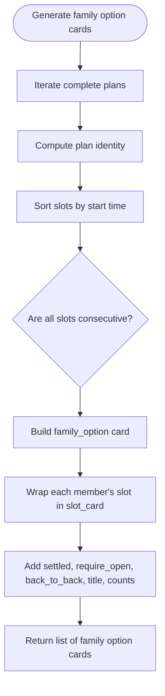

**Diagram sources**
- [scheduling.py:341-390](file://backend/app/services/scheduling.py#L341-L390)

Behavioral guarantees:

- A family option is always a complete plan: one click books all listed members.
- The card preserves enough metadata to survive page reloads and refreshes.
- Back-to-back detection helps the UI distinguish tightly chained visits from same-day visits with gaps.

**Section sources**
- [scheduling.py:341-390](file://backend/app/services/scheduling.py#L341-L390)
- [test_nearby_family_plans.py:41-56](file://backend/tests/test_nearby_family_plans.py#L41-L56)

### Persisting Family Booking Context with `_remember_request`
`_remember_request` stores the canonical scheduling request for a conversation. It is called whenever the system needs to remember who is being booked, what preferences apply, and whether the request is a family coordination.

Key behaviors:

- Builds a normalized shape from participants, preferences, and coordination flags.
- Compares the new shape against the previous stored request.
- If unchanged, returns the existing request id so repeated searches reuse the same context.
- If changed, retires pending booking proposals that are incompatible with the new shape.
- Creates a new request id and increments the revision number.
- Persists the request on the conversation object.

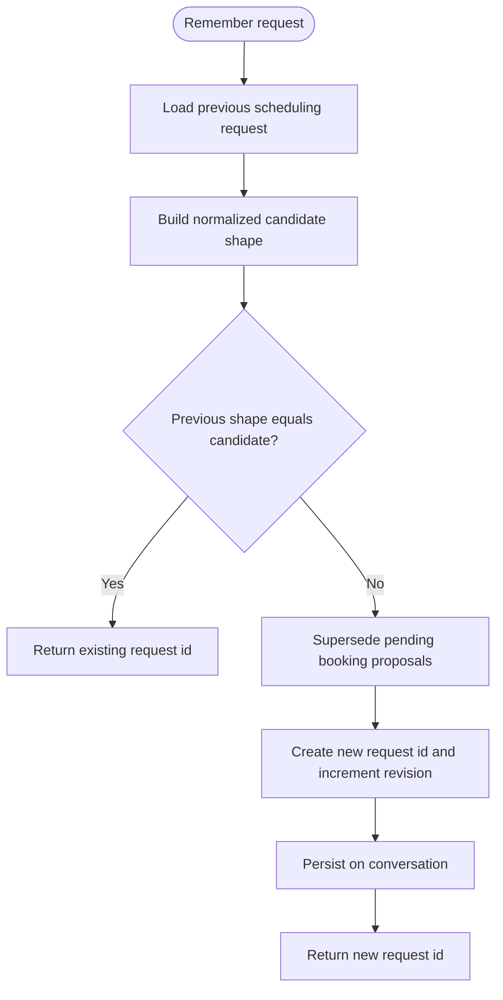

**Diagram sources**
- [scheduling.py:137-191](file://backend/app/services/scheduling.py#L137-L191)

Revision semantics:

- Changing participants, appointment types, providers, or preferences starts a new revision.
- Selecting another option within the same request keeps the request id, allowing old holds to be superseded safely.
- This prevents a later search from accidentally losing the family's requirements.

**Section sources**
- [scheduling.py:137-191](file://backend/app/services/scheduling.py#L137-L191)

### Participant Merging Logic
`_merge_family_member_inputs` supports multi-turn conversations where the user supplies partial information about family members. It:

1. Reads the stored scheduling request.
2. Converts stored participant rows back into `FamilyMemberInput` objects.
3. Overwrites fields supplied by the latest input while preserving previously supplied fields.
4. Returns the merged list of participants.

This allows the system to accept incremental details such as appointment type or provider preference for one family member without discarding earlier choices.

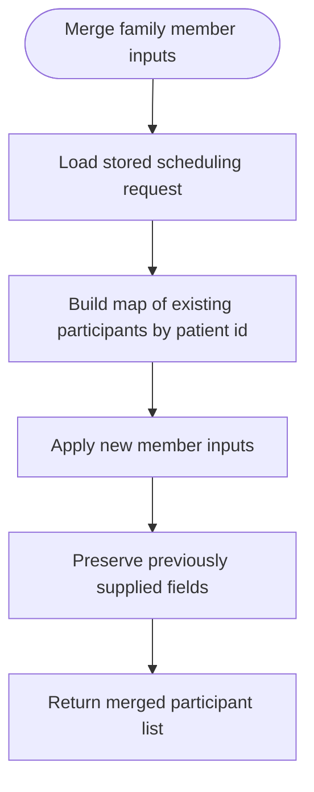

**Diagram sources**
- [scheduling.py:194-219](file://backend/app/services/scheduling.py#L194-L219)

**Section sources**
- [scheduling.py:194-219](file://backend/app/services/scheduling.py#L194-L219)

### Enhanced Transaction Handling and State Management
**Updated** Recent improvements have significantly enhanced the transaction handling and state management for family bookings:

#### Atomic Proposal Creation
The `hold_family_option` function now ensures proper transaction boundaries:

1. **Request Persistence First**: The family request is persisted and committed before attempting to create proposals
2. **Stale Option Detection**: Detects when clicked options are historical results and re-searches for fresh plans
3. **Replay Handling**: Recognizes repeated selections of the same option as replays rather than new holds
4. **Conflict Resolution**: Properly handles concurrent requests and existing pending bookings

#### Session Management Improvements
- Explicit `session.commit()` calls ensure request state is durable before proposal creation
- Better handling of implicit vs explicit transactions
- Improved error recovery when options become stale during processing

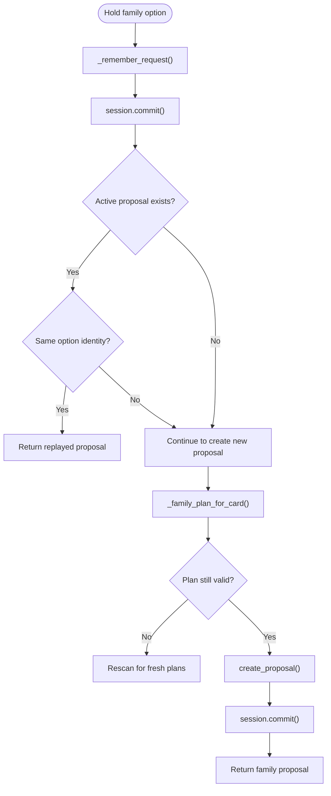

**Diagram sources**
- [scheduling.py:2780-2979](file://backend/app/services/scheduling.py#L2780-L2979)

**Section sources**
- [scheduling.py:2780-2979](file://backend/app/services/scheduling.py#L2780-L2979)

### Multi-Patient Booking Flow
A typical multi-patient booking flow is:

1. The client calls the scheduling API with family member names and preferences.
2. The API validates the patient session and conversation.
3. The scheduling service resolves authorized family members.
4. It persists the request through `_remember_request`.
5. It calls `search_nearby_family_plans` to find complete plans.
6. It renders family option cards.
7. The client selects one family option.
8. The system creates a proposal that holds all slots atomically.
9. Confirmation finalizes the booking for every member.

Recent improvements ensure better handling of edge cases like stale options, replay scenarios, and concurrent requests.

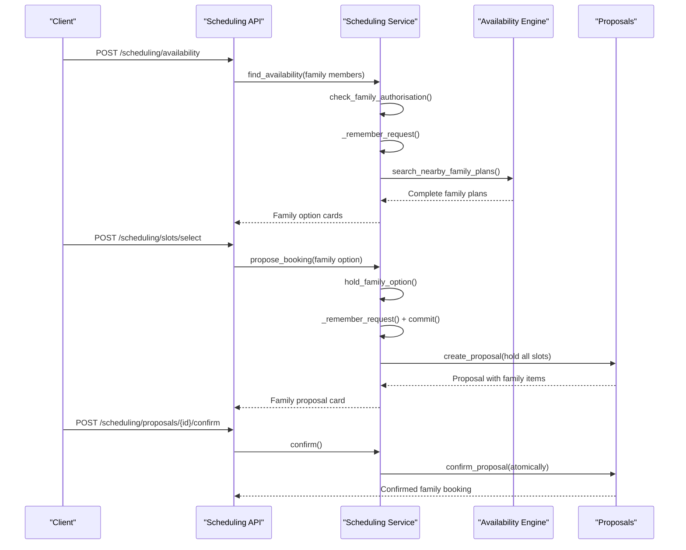

**Diagram sources**
- [scheduling.py API:256-362](file://backend/app/api/scheduling.py#L256-L362)
- [scheduling.py API:456-487](file://backend/app/api/scheduling.py#L456-L487)
- [scheduling.py:341-390](file://backend/app/services/scheduling.py#L341-L390)
- [scheduling.py:137-191](file://backend/app/services/scheduling.py#L137-L191)
- [availability_engine.py:729-770](file://backend/app/services/availability_engine.py#L729-L770)
- [scheduling.py:2780-2979](file://backend/app/services/scheduling.py#L2780-L2979)

**Section sources**
- [scheduling.py API:256-362](file://backend/app/api/scheduling.py#L256-L362)
- [scheduling.py API:456-487](file://backend/app/api/scheduling.py#L456-L487)
- [scheduling.py:341-390](file://backend/app/services/scheduling.py#L341-L390)
- [availability_engine.py:729-770](file://backend/app/services/availability_engine.py#L729-L770)
- [scheduling.py:2780-2979](file://backend/app/services/scheduling.py#L2780-L2979)

### Conflict Resolution When Family Members Have Different Constraints
Conflict resolution happens at several levels:

| Constraint | Resolution |
|---|---|
| Different appointment types | Each member's `FamilyMemberRequest` carries its own `AppointmentType`, so durations and eligibility are evaluated per person |
| Different provider preferences | Provider filtering applies per member; if a preferred provider is unavailable, other eligible providers are considered |
| Existing appointments | `_patient_conflict` rejects intervals that overlap a live booked appointment for the same patient |
| Overlapping family slots | Complete plans must be non-overlapping; overlapping combinations are rejected during plan construction |
| Partial availability | Only complete plans are returned; partial family plans are deliberately excluded |
| Stale options | Historical options trigger fresh rescanning to provide current availability |
| Concurrent requests | Transaction boundaries prevent double-booking and handle replay scenarios |

The scoring function prefers plans with smaller gaps between family members' appointments, then smaller maximum gaps, then earlier overall timing. This makes "close together" more attractive than widely separated times, even when exact back-to-back chaining is not possible.

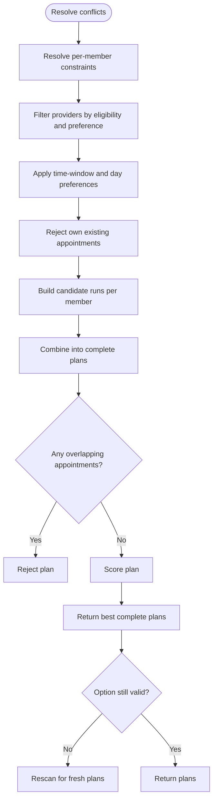

**Diagram sources**
- [availability_engine.py:663-684](file://backend/app/services/availability_engine.py#L663-L684)
- [availability_engine.py:687-726](file://backend/app/services/availability_engine.py#L687-L726)
- [availability_engine.py:192-208](file://backend/app/services/availability_engine.py#L192-L208)
- [scheduling.py:2834-2860](file://backend/app/services/scheduling.py#L2834-L2860)

**Section sources**
- [availability_engine.py:192-208](file://backend/app/services/availability_engine.py#L192-L208)
- [availability_engine.py:663-726](file://backend/app/services/availability_engine.py#L663-L726)
- [scheduling.py:2834-2860](file://backend/app/services/scheduling.py#L2834-L2860)

### Examples of Multi-Patient Booking Flows
The end-to-end demo shows a family booking scenario where a parent requests cleanings for a spouse and child with back-to-back timing. The test suite verifies that family option cards correctly mark gapped plans as same-day but not back-to-back.

Example flows:

- **Spouse and child requested together**: The system offers a family option card containing both members' slots.
- **Back-to-back preference**: The system tries to chain visits continuously; if impossible, it still offers same-day plans with gaps.
- **Selection and confirmation**: Selecting the family option creates a family proposal; confirming books all members atomically.
- **Edge case handling**: Stale options trigger fresh rescanning, and replay scenarios return existing proposals.

**Section sources**
- [e2e_demo.py:290-321](file://backend/scripts/e2e_demo.py#L290-L321)
- [test_nearby_family_plans.py:41-56](file://backend/tests/test_nearby_family_plans.py#L41-L56)

## Dependency Analysis
The main dependencies are:

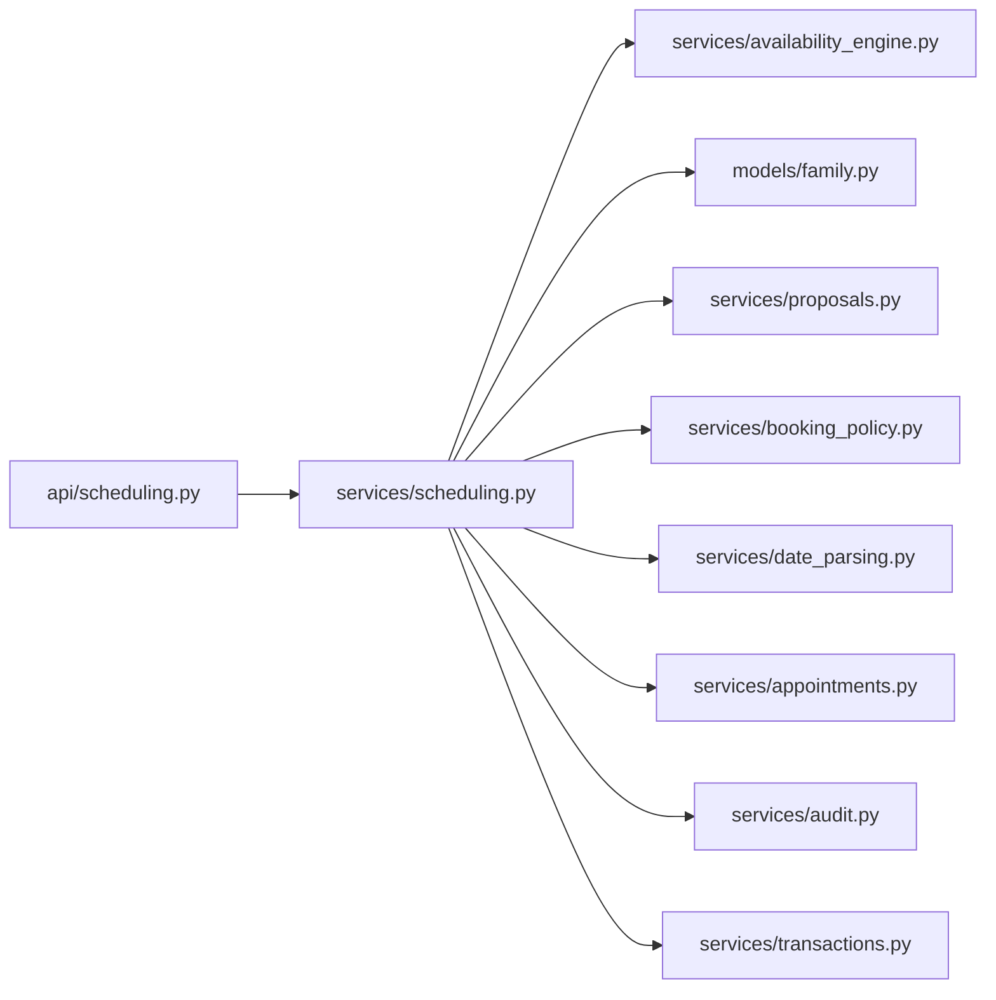

Coupling observations:

- The API layer depends on the scheduling service for deterministic actions.
- The scheduling service depends on the availability engine for read-only scheduling primitives.
- The family model is referenced by authorization and proposal ownership checks.
- Proposals and booking policy provide transactional and scope-related behavior.
- Transaction management provides robust session handling for family booking operations.

Potential circular dependencies are avoided by keeping the availability engine read-only and letting the scheduling service coordinate persistence and UI rendering.

**Diagram sources**
- [scheduling.py API:1-28](file://backend/app/api/scheduling.py#L1-L28)
- [scheduling.py:25-62](file://backend/app/services/scheduling.py#L25-L62)
- [availability_engine.py:30-43](file://backend/app/services/availability_engine.py#L30-L43)
- [family.py:15-18](file://backend/app/models/family.py#L15-L18)
- [transactions.py:85-162](file://backend/app/services/transactions.py#L85-L162)

**Section sources**
- [scheduling.py API:1-28](file://backend/app/api/scheduling.py#L1-L28)
- [scheduling.py:25-62](file://backend/app/services/scheduling.py#L25-L62)
- [availability_engine.py:30-43](file://backend/app/services/availability_engine.py#L30-L43)
- [family.py:15-18](file://backend/app/models/family.py#L15-L18)
- [transactions.py:85-162](file://backend/app/services/transactions.py#L85-L162)

## Performance Considerations
- **Candidate caps**: Each member's candidate runs are limited to avoid combinatorial explosion.
- **Plan deduplication**: Plans are deduplicated by stable slot signatures.
- **Result trimming**: Both family plan search and single-slot search cap results to keep responses small.
- **Read-only availability engine**: The availability engine performs reads without holding writes, reducing lock contention.
- **Preference clamping**: Scanning is bounded by preference date ranges and business-day filters.
- **Transaction optimization**: Explicit commits reduce implicit transaction overhead.
- **Cache usage**: Family plan caching improves performance for repeated searches.

Recommendations:

- Keep `max_plans` and `per_day` tuned to expected family sizes and clinic density.
- Avoid exposing raw candidate lists to clients; let the service return only rendered cards.
- Use refresh endpoints to validate stale family options instead of repeatedly searching.
- Leverage the improved transaction handling for better concurrency support.

[No sources needed since this section provides general guidance]

## Troubleshooting Guide

### Insufficient Permissions
Symptoms:

- Family member is not offered.
- Authorization fails when trying to book someone outside the verified patient's household.

Likely causes:

- The target patient is not in the same family group as the verified patient.
- The caller is not a verified patient session.
- The request tried to add another adult without explicit matching.

Resolution:

- Verify the caller's patient session.
- Ensure the target patient is linked to the same `FamilyGroup`.
- Use `check_family_authorisation` to determine allowed additional members.

**Section sources**
- [scheduling.py:2344-2371](file://backend/app/services/scheduling.py#L2344-L2371)
- [scheduling.py API:179-186](file://backend/app/api/scheduling.py#L179-L186)

### No Coordinated Slots Available
Symptoms:

- Family search returns no plans.
- Message indicates no complete set of open times was found.

Likely causes:

- No day satisfies preferences for all members.
- Providers do not have enough contiguous runs for every member.
- Existing appointments block all plausible combinations.
- Preferred provider is unavailable for one or more members.

Resolution:

- Widen date range or time windows.
- Allow different providers.
- Consider separate visits if family coordination is not required.
- Refresh availability to rule out transient holds.

**Section sources**
- [scheduling.py:719-792](file://backend/app/services/scheduling.py#L719-L792)
- [availability_engine.py:729-770](file://backend/app/services/availability_engine.py#L729-L770)

### Stale or Taken Family Options
**Updated** Recent improvements provide better handling of stale options:

Symptoms:

- A selected family option becomes stale before confirmation.
- The UI reports that a slot is no longer open.
- Historical options fail validation.

Likely causes:

- Another user booked one of the slots.
- A hold expired.
- The underlying schedule changed between search and confirmation.
- The clicked option was from a cached historical search result.

Resolution:

- The system now automatically rescans for fresh plans when stale options are detected.
- Refresh the grid using the availability refresh endpoint.
- Offer fresh complete family plans derived from the original request.
- Retire stale proposals and present updated family options.

**Section sources**
- [scheduling.py API:365-453](file://backend/app/api/scheduling.py#L365-L453)
- [scheduling.py:2511-2545](file://backend/app/services/scheduling.py#L2511-L2545)
- [scheduling.py:2834-2860](file://backend/app/services/scheduling.py#L2834-L2860)

### Request Revisions and Lost Context
**Updated** Enhanced state management provides better context preservation:

Symptoms:

- After changing preferences, the system loses the family context.
- Old holds are not properly superseded.
- Request state is inconsistent across sessions.

Likely causes:

- The request shape changed, creating a new revision.
- The client did not preserve `request_id` and `option_identity`.
- Transaction boundaries were not properly maintained.

Resolution:

- Always persist and resend `request_id` with family option selections.
- Use `_remember_request` to detect changes and retire incompatible proposals.
- Treat a new request id as a new coordination context.
- The system now ensures request state is committed before proposal creation.

**Section sources**
- [scheduling.py:137-191](file://backend/app/services/scheduling.py#L137-L191)
- [scheduling.py:2780-2801](file://backend/app/services/scheduling.py#L2780-L2801)

### Replay Scenarios and Concurrent Requests
**New** The system now handles replay scenarios and concurrent requests more robustly:

Symptoms:

- Multiple clicks on the same family option create duplicate proposals.
- Concurrent requests cause conflicts or lost updates.
- Repeated selections don't return the existing proposal.

Resolution:

- The system recognizes repeated selections as replays rather than new holds.
- Transaction boundaries prevent double-booking attempts.
- Existing proposals are returned when the same option is selected again.
- Better conflict resolution for concurrent family booking operations.

**Section sources**
- [scheduling.py:2802-2822](file://backend/app/services/scheduling.py#L2802-L2822)
- [scheduling.py:2862-2879](file://backend/app/services/scheduling.py#L2862-L2879)

## Conclusion
Family booking coordination is built around three principles:

1. **Atomic family plans**: Only complete plans are presented and confirmed, so every family member is booked together.
2. **Per-person constraints**: Each member's appointment type, provider preference, and existing appointments are respected independently.
3. **Persistent request context**: `_remember_request` keeps the family booking intent alive across turns, revisions, and refreshes.

Recent improvements have significantly enhanced the system's reliability through better transaction handling, improved state persistence, and robust edge case management. These enhancements ensure that family bookings remain atomic and consistent even under concurrent access, stale data conditions, and complex scheduling scenarios. Together, these mechanisms allow the system to offer realistic coordinated schedules while protecting privacy, avoiding overbooking, and providing clear error paths when permissions or availability are insufficient.