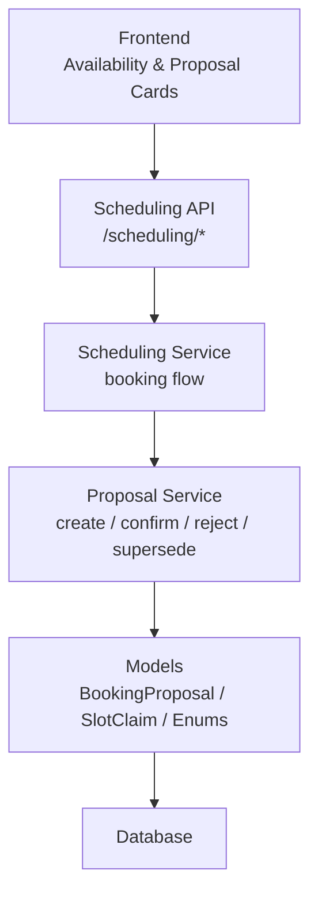
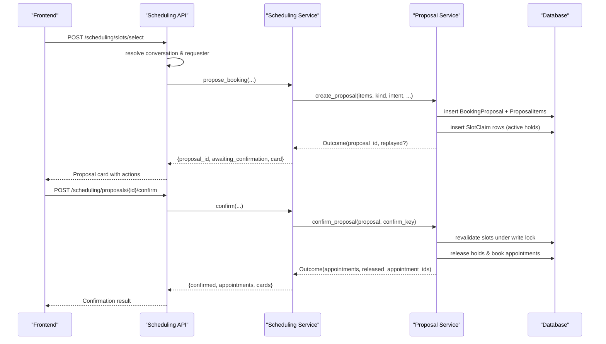
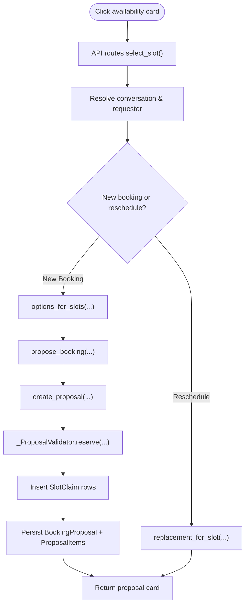
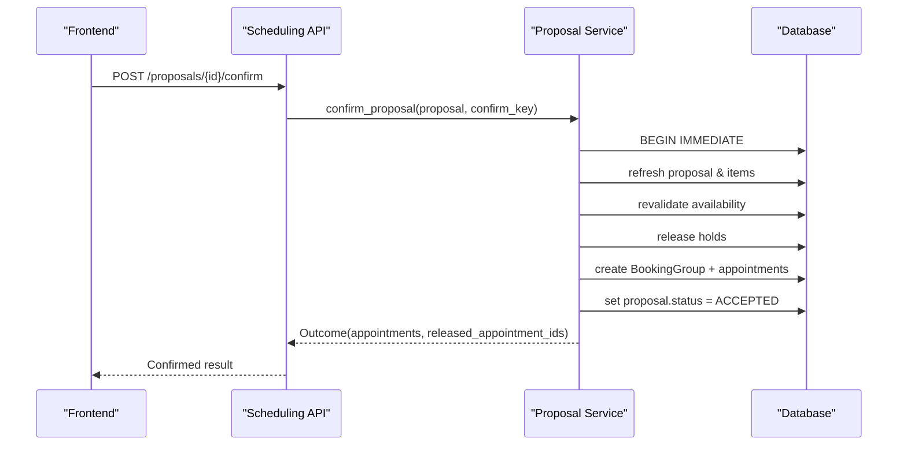
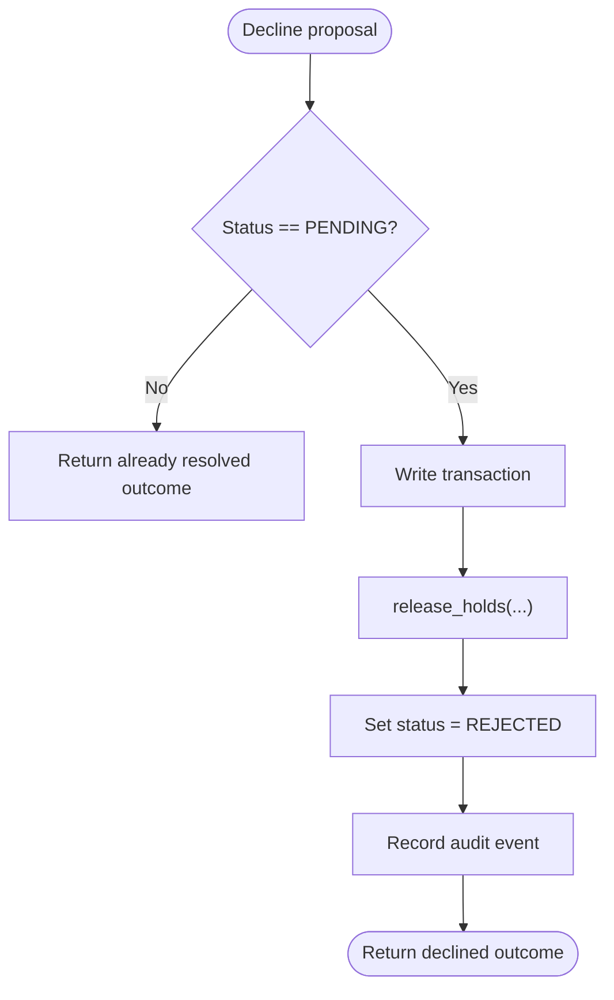
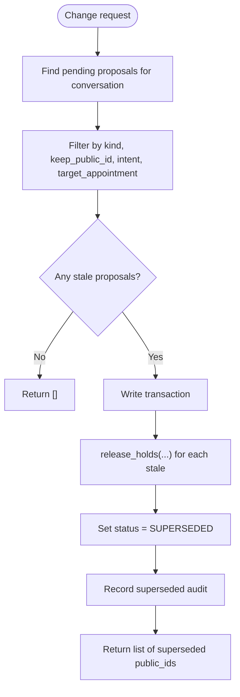
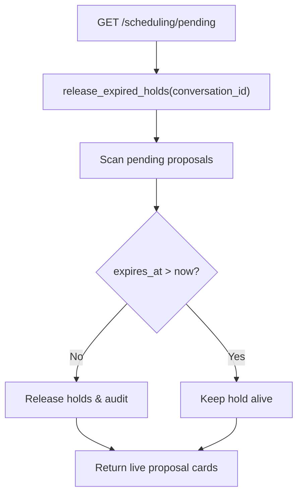
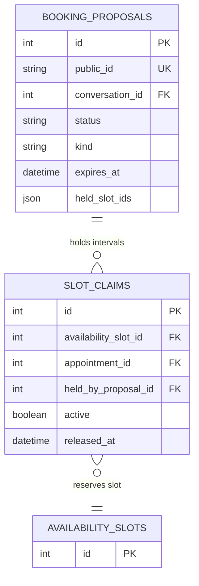
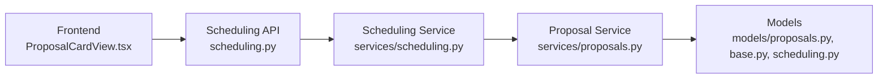

# Proposal and Hold Mechanism

<cite>
**Referenced Files in This Document**   
- [proposals.py](file://backend/app/models/proposals.py)
- [base.py](file://backend/app/models/base.py)
- [scheduling.py](file://backend/app/models/scheduling.py)
- [proposals_service.py](file://backend/app/services/proposals.py)
- [scheduling_api.py](file://backend/app/api/scheduling.py)
- [scheduling_service.py](file://backend/app/services/scheduling.py)
- [ProposalCardView.tsx](file://frontend/src/components/cards/ProposalCardView.tsx)
</cite>

## Table of Contents
1. [Introduction](#introduction)
2. [Project Structure](#project-structure)
3. [Core Components](#core-components)
4. [Architecture Overview](#architecture-overview)
5. [Detailed Component Analysis](#detailed-component-analysis)
6. [Dependency Analysis](#dependency-analysis)
7. [Performance Considerations](#performance-considerations)
8. [Troubleshooting Guide](#troubleshooting-guide)
9. [Conclusion](#conclusion)

## Introduction
This document explains the proposal and hold mechanism that manages pending booking requests. It covers how clicking an availability card creates a `BookingProposal` with a short hold, how proposals are created, confirmed, rejected, superseded, expired, and how they relate to slot claims and appointments. The goal is to make the lifecycle accessible to both developers and non-technical readers while preserving precise implementation details from the codebase.

## Project Structure
The proposal system spans models, services, API routes, and the frontend card view:

- **Models**: define `BookingProposal`, `ProposalItem`, `SlotClaim`, and shared enums such as `ProposalStatus`.
- **Services**: implement creation, holds, confirmation, rejection, supersession, expiration, and scheduling orchestration.
- **API**: expose deterministic endpoints for selecting slots, refreshing availability, confirming, declining, and expiring stale proposals.
- **Frontend**: renders proposal cards and maps user actions to backend endpoints.

**Diagram sources**
- [scheduling_api.py:256-362](file://backend/app/api/scheduling.py#L256-L362)
- [scheduling_service.py:950-1015](file://backend/app/services/scheduling.py#L950-L1015)
- [proposals_service.py:282-529](file://backend/app/services/proposals.py#L282-L529)
- [proposals.py:35-141](file://backend/app/models/proposals.py#L35-L141)
- [scheduling.py:175-238](file://backend/app/models/scheduling.py#L175-L238)

**Section sources**
- [scheduling_api.py:1-13](file://backend/app/api/scheduling.py#L1-L13)
- [proposals_service.py:1-46](file://backend/app/services/proposals.py#L1-L46)
- [proposals.py:1-19](file://backend/app/models/proposals.py#L1-L19)

## Core Components
- **BookingProposal**: represents a patient-facing suggestion awaiting explicit confirmation. It carries metadata such as public ID, status, kind, intent, summary, expiration, family group, and links to items and resulting bookings.
- **ProposalItem**: snapshots one proposed appointment row, including provider, type, time, and stable identifiers so the UI can render what the patient saw.
- **SlotClaim**: reserves an interval either for a booked appointment or for a pending proposal. Only one active claim per slot is allowed at the database level.
- **ProposalStatus**: enum with values `pending`, `accepted`, `rejected`, `expired`, and `superseded`.
- **HOLD_MINUTES**: the hold window used by proposals; it is intentionally short so held times do not block the schedule for long.

Key responsibilities:
- Creation sets status to `pending`, generates a unique public ID, records an expiration timestamp, and reserves intervals through `SlotClaim`.
- Confirmation revalidates live availability, releases holds, writes appointments, and transitions to `accepted`.
- Rejection releases holds and marks the proposal `rejected`.
- Supersession marks older pending proposals `superseded` and releases their holds when the patient changes their request.
- Expiration handling releases lapsed holds without changing the proposal’s status, keeping the card confirmable but no longer actionable.

**Section sources**
- [proposals.py:35-141](file://backend/app/models/proposals.py#L35-L141)
- [scheduling.py:175-238](file://backend/app/models/scheduling.py#L175-L238)
- [base.py:66-74](file://backend/app/models/base.py#L66-L74)
- [proposals_service.py:85-92](file://backend/app/services/proposals.py#L85-L92)

## Architecture Overview
The end-to-end flow starts when a user clicks an availability card. The API validates the request, resolves the correct conversation and requester, determines whether this is a new booking or a reschedule, and then calls into the scheduling service. That service may call `create_proposal`, which persists a `BookingProposal` and reserves intervals via `SlotClaim`. The frontend shows a proposal card with confirm/change/cancel actions. Confirming runs another write transaction that revalidates availability, releases holds, and books appointments atomically.

**Diagram sources**
- [scheduling_api.py:256-362](file://backend/app/api/scheduling.py#L256-L362)
- [scheduling_api.py:456-487](file://backend/app/api/scheduling.py#L456-L487)
- [scheduling_service.py:950-1015](file://backend/app/services/scheduling.py#L950-L1015)
- [proposals_service.py:282-529](file://backend/app/services/proposals.py#L282-L529)
- [proposals_service.py:762-889](file://backend/app/services/proposals.py#L762-L889)

## Detailed Component Analysis

### Availability Card Click and Proposal Creation
When a slot card is clicked, the client sends a selection payload containing slot identifiers, appointment type, optional intent, target appointment, and an idempotency key. The API:

1. Resolves the current patient session and conversation.
2. Determines whether the click means “reschedule” or “new booking.”
3. For a new booking, resolves the appointment type and builds options from the selected slot IDs.
4. Calls the scheduling service to propose a booking.
5. Returns the newly created proposal card if successful.

The scheduling service:
- Guards against an already-pending booking for the same request.
- Supersedes older pending booking proposals in the conversation.
- Builds `DraftItem` objects from the validated options.
- Calls `create_proposal` with kind `booking`, intent `new_booking`, and a generated request identifier.

`create_proposal`:
- Validates inputs: non-empty items, supported kinds, consistent intent, single-item constraints for reschedule/cancellation, maximum item count, and duplicate patients for bookings.
- Supports idempotent retries through `create_key`.
- Opens a write transaction, inserts `BookingProposal` with status `PENDING`, sets `expires_at` to now plus `HOLD_MINUTES`, and records generation and other metadata.
- Uses `_ProposalValidator` to validate each option and immediately insert `SlotClaim` rows for the selected intervals.
- Records proposal items with snapshot fields so the UI can show exactly what was offered.
- Audits creation and logs the event.
- On conflict or integrity errors, returns a structured error with conflict slot identifiers.

**Diagram sources**
- [scheduling_api.py:256-362](file://backend/app/api/scheduling.py#L256-L362)
- [scheduling_service.py:950-1015](file://backend/app/services/scheduling.py#L950-L1015)
- [proposals_service.py:282-529](file://backend/app/services/proposals.py#L282-L529)
- [proposals_service.py:548-630](file://backend/app/services/proposals.py#L548-L630)

**Section sources**
- [scheduling_api.py:40-67](file://backend/app/api/scheduling.py#L40-L67)
- [scheduling_api.py:256-362](file://backend/app/api/scheduling.py#L256-L362)
- [scheduling_service.py:950-1015](file://backend/app/services/scheduling.py#L950-L1015)
- [proposals_service.py:282-529](file://backend/app/services/proposals.py#L282-L529)

#### create_proposal Details
- Generates a unique public ID using a prefix and random token.
- Sets `status = PENDING`.
- Computes `expires_at` as current time plus `HOLD_MINUTES`.
- Stores `from_ui`, `create_key`, `family_group_id`, `target_appointment_id`, `intent`, `visit_shape`, and `request_id`.
- For reschedules and cancellations, stores original start times for display.
- Handles conflicts through `SlotConflictError` and `IntegrityError`, returning structured outcomes with conflict slot identifiers.

**Section sources**
- [proposals_service.py:137-142](file://backend/app/services/proposals.py#L137-L142)
- [proposals_service.py:169-170](file://backend/app/services/proposals.py#L169-L170)
- [proposals_service.py:282-529](file://backend/app/services/proposals.py#L282-L529)

### Confirm Proposal Workflow
Confirming a proposal revalidates every item under a write lock, releases holds, creates appointments, and marks the proposal accepted. It supports idempotent confirmation through a confirmation key.

Key steps:
1. Reject non-pending proposals with a clear message.
2. Resolve the confirmation key for idempotency.
3. Refresh the proposal inside the write transaction.
4. Revalidate all items; fail fast if any slot is unavailable.
5. Release this proposal’s own holds and, for reschedules, release the original appointment’s claims.
6. Create a `BookingGroup` and one appointment per item.
7. Record the outcome and audit trail.
8. Handle conflicts, busy transactions, and integrity errors gracefully.

**Diagram sources**
- [scheduling_api.py:456-487](file://backend/app/api/scheduling.py#L456-L487)
- [proposals_service.py:762-889](file://backend/app/services/proposals.py#L762-L889)
- [proposals_service.py:892-1000](file://backend/app/services/proposals.py#L892-L1000)

**Section sources**
- [proposals_service.py:762-889](file://backend/app/services/proposals.py#L762-L889)
- [proposals_service.py:892-1000](file://backend/app/services/proposals.py#L892-L1000)

### Reject Proposal Workflow
Rejecting a proposal releases its holds and marks it `rejected`. It is idempotent for already-resolved proposals and returns a user-friendly message indicating the proposal is no longer open.

**Diagram sources**
- [proposals_service.py:638-665](file://backend/app/services/proposals.py#L638-L665)

**Section sources**
- [proposals_service.py:638-665](file://backend/app/services/proposals.py#L638-L665)

### Supersede Pending Mechanism
When the patient changes their mind, `supersede_pending` marks older pending proposals as `superseded` and releases their holds. It supports filtering by kind, keeping a specific proposal ID, limiting by target appointment, and narrowing by intent.

Important behaviors:
- Does not treat superseded proposals as rejected; they were replaced.
- Releases holds immediately rather than waiting for expiration.
- Extends supersession to reschedule/cancellation proposals targeting the same visit when a newer proposal replaces them.
- Logs warnings if supersession fails under a write transaction.

**Diagram sources**
- [proposals_service.py:668-740](file://backend/app/services/proposals.py#L668-L740)

**Section sources**
- [proposals_service.py:668-740](file://backend/app/services/proposals.py#L668-L740)

### Hold Expiration Handling and Stale Card Detection
A proposal’s hold expires after `HOLD_MINUTES`. Expiration does not change the proposal’s status; it only releases held intervals. The card remains confirmable, but the backend revalidates availability during confirmation. If the slot is taken, the usual conflict path applies.

Expiration handling:
- `release_expired_holds` scans pending proposals for a conversation.
- Treats missing `expires_at` as lapsed for backward compatibility.
- Releases holds and audits the event.
- Returns affected proposal public IDs.

API integration:
- The pending endpoint calls `_expire_lapsed` on read, ensuring lapsed holds are retired before returning actionable proposals.
- An explicit expire endpoint allows the UI to trigger housekeeping.

Stale card detection:
- The frontend disables proposal cards when the server no longer reports them as pending.
- A refreshed availability endpoint returns rejected slot IDs for times that are no longer open.

**Diagram sources**
- [scheduling_api.py:216-253](file://backend/app/api/scheduling.py#L216-L253)
- [proposals_service.py:216-274](file://backend/app/services/proposals.py#L216-L274)

**Section sources**
- [proposals_service.py:216-274](file://backend/app/services/proposals.py#L216-L274)
- [scheduling_api.py:216-253](file://backend/app/api/scheduling.py#L216-L253)
- [scheduling_api.py:365-453](file://backend/app/api/scheduling.py#L365-L453)
- [ProposalCardView.tsx:44-80](file://frontend/src/components/cards/ProposalCardView.tsx#L44-L80)

### Relationship Between Proposals and Slot Claims
`SlotClaim` is the load-bearing concurrency primitive:
- One active claim per slot prevents double booking.
- Active claims can belong to either an appointment or a pending proposal.
- For reschedules and cancellations, the target appointment’s existing claims are reused; the proposal records those interval IDs in `held_slot_ids` so confirmation knows which intervals it frees.
- `release_holds` deactivates active claims owned by a proposal and records the release time.

**Diagram sources**
- [proposals.py:35-141](file://backend/app/models/proposals.py#L35-L141)
- [scheduling.py:175-238](file://backend/app/models/scheduling.py#L175-L238)

**Section sources**
- [scheduling.py:175-238](file://backend/app/models/scheduling.py#L175-L238)
- [proposals_service.py:200-213](file://backend/app/services/proposals.py#L200-L213)
- [proposals_service.py:548-630](file://backend/app/services/proposals.py#L548-L630)

### Examples of Proposal Lifecycle Management

#### Example 1: New Booking Hold and Confirmation
- User clicks an availability card.
- API routes to `select_slot`, which calls `propose_booking`.
- `create_proposal` inserts a `BookingProposal` with status `pending`, sets `expires_at` to now plus two minutes, and inserts active `SlotClaim` rows.
- Frontend displays a proposal card with confirm/change/cancel.
- User confirms; `confirm_proposal` revalidates, releases holds, books appointments, and sets proposal status to `accepted`.

**Section sources**
- [scheduling_api.py:256-362](file://backend/app/api/scheduling.py#L256-L362)
- [scheduling_service.py:950-1015](file://backend/app/services/scheduling.py#L950-L1015)
- [proposals_service.py:282-529](file://backend/app/services/proposals.py#L282-L529)
- [proposals_service.py:762-889](file://backend/app/services/proposals.py#L762-L889)

#### Example 2: Reschedule Replacement
- A reschedule proposal targets an existing appointment.
- At creation, it may reuse the target’s existing claims and record those interval IDs in `held_slot_ids`.
- Confirmation revalidates replacement slots, releases the original’s claims, retires the original appointment, and creates a replacement appointment.

**Section sources**
- [proposals_service.py:548-630](file://backend/app/services/proposals.py#L548-L630)
- [proposals_service.py:892-1000](file://backend/app/services/proposals.py#L892-L1000)

#### Example 3: Patient Changes Mind
- A new search or selection triggers `supersede_pending`.
- Older pending proposals are marked `superseded` and their holds are released immediately.
- The UI stops treating those cards as actionable.

**Section sources**
- [proposals_service.py:668-740](file://backend/app/services/proposals.py#L668-L740)
- [scheduling_service.py:1113-1149](file://backend/app/services/scheduling.py#L1113-L1149)

#### Example 4: Expired Hold
- A proposal’s hold passes `HOLD_MINUTES`.
- `release_expired_holds` deactivates its active claims.
- The proposal remains pending and confirmable; confirmation revalidates availability.

**Section sources**
- [proposals_service.py:216-274](file://backend/app/services/proposals.py#L216-L274)
- [scheduling_api.py:241-253](file://backend/app/api/scheduling.py#L241-L253)

### Error Handling for Expired or Conflicting Proposals
Common error scenarios:
- **Slot taken during creation**: `create_proposal` catches `SlotConflictError` and `IntegrityError`, returning a structured error with conflict slot identifiers.
- **Busy write transaction**: wrapped exceptions return a transient error.
- **Already resolved proposal**: rejection or confirmation returns a clear message based on the current status.
- **Confirmation conflict**: `confirm_proposal` handles `ConfirmationRefused`, `SlotConflictError`, `WriteTransactionError`, and `IntegrityError`, producing explainable outcomes.
- **Stale family option**: family booking flows detect stale options and return fresh alternatives instead of retrying the old selection.

**Section sources**
- [proposals_service.py:490-511](file://backend/app/services/proposals.py#L490-L511)
- [proposals_service.py:638-665](file://backend/app/services/proposals.py#L638-L665)
- [proposals_service.py:762-889](file://backend/app/services/proposals.py#L762-L889)
- [scheduling_service.py:2700-2899](file://backend/app/services/scheduling.py#L2700-L2899)

## Dependency Analysis
The proposal system has clear layering:

- API depends on services for business logic.
- Scheduling service orchestrates proposal creation and confirmation.
- Proposal service owns persistence, validation, and state transitions.
- Models provide schema, enums, and relationships.
- Frontend depends on API responses to render actionable states.

**Diagram sources**
- [ProposalCardView.tsx:44-80](file://frontend/src/components/cards/ProposalCardView.tsx#L44-L80)
- [scheduling_api.py:1-13](file://backend/app/api/scheduling.py#L1-L13)
- [scheduling_service.py:950-1015](file://backend/app/services/scheduling.py#L950-L1015)
- [proposals_service.py:282-529](file://backend/app/services/proposals.py#L282-L529)
- [proposals.py:35-141](file://backend/app/models/proposals.py#L35-L141)

**Section sources**
- [scheduling_api.py:1-13](file://backend/app/api/scheduling.py#L1-L13)
- [scheduling_service.py:950-1015](file://backend/app/services/scheduling.py#L950-L1015)
- [proposals_service.py:282-529](file://backend/app/services/proposals.py#L282-L529)
- [proposals.py:35-141](file://backend/app/models/proposals.py#L35-L141)

## Performance Considerations
- **Read-before-write separation**: availability search is read-only, avoiding blocking writers during LLM turns.
- **Short hold window**: `HOLD_MINUTES` is small so held slots rarely block the schedule.
- **Atomic write transactions**: creation and confirmation use `BEGIN IMMEDIATE` to ensure consistency and avoid partial updates.
- **Idempotency keys**: both creation and confirmation support idempotent retries, reducing duplicate work and race conditions.
- **Partial unique indexes**: `slot_claims` enforces one active claim per slot at the database level, preventing races even under high contention.

[No sources needed since this section provides general guidance]

## Troubleshooting Guide
Symptoms and likely causes:
- **“That time was just taken”**: Another request reserved the slot between selection and confirmation. The API returns a conflict outcome with slot identifiers; the UI should offer refreshed options.
- **“Proposal already exists” or “already waiting”**: A pending booking or reschedule is already present. The API returns the existing proposal card so the UI shows what to confirm.
- **“Proposal expired” or “was replaced”**: The proposal is no longer pending. The UI should stop offering buttons and treat it as history.
- **Hold still visible after timeout**: The pending endpoint should call expiration housekeeping; verify that `_expire_lapsed` is invoked and that `release_expired_holds` runs.
- **Family option stale**: Family flows detect stale options and return fresh plans; do not retry the old option.

Recommended checks:
- Verify `expires_at` is set for newly created proposals.
- Confirm `release_holds` is called on rejection, supersession, and confirmation.
- Ensure the pending endpoint calls expiration before returning actionable proposals.
- Inspect audit records for `proposal.created`, `proposal.rejected`, `proposal.superseded`, and `proposal.hold_lapsed`.

**Section sources**
- [proposals_service.py:216-274](file://backend/app/services/proposals.py#L216-L274)
- [proposals_service.py:490-511](file://backend/app/services/proposals.py#L490-L511)
- [proposals_service.py:638-665](file://backend/app/services/proposals.py#L638-L665)
- [proposals_service.py:762-889](file://backend/app/services/proposals.py#L762-L889)
- [scheduling_api.py:241-253](file://backend/app/api/scheduling.py#L241-L253)

## Conclusion
The proposal and hold mechanism provides a safe, user-friendly way to manage pending booking requests. Clicking an availability card creates a `BookingProposal` with a short hold, allowing the patient to review and confirm without immediately booking. Confirmation is atomic and idempotent, releasing holds and creating appointments only when all slots remain available. Rejection and supersession cleanly release holds, while expiration handling ensures stale holds do not block the schedule indefinitely. The design balances correctness, performance, and clarity, making it robust against races, stale cards, and conflicting requests.

[No sources needed since this section summarizes without analyzing specific files]