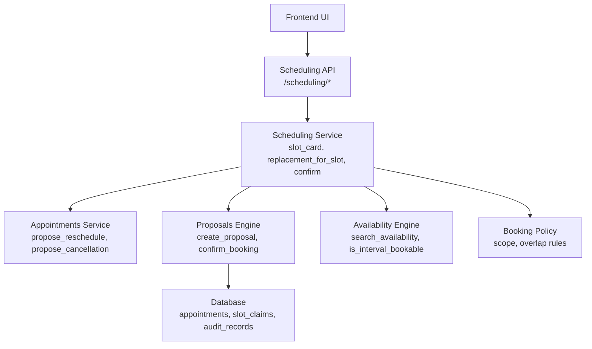
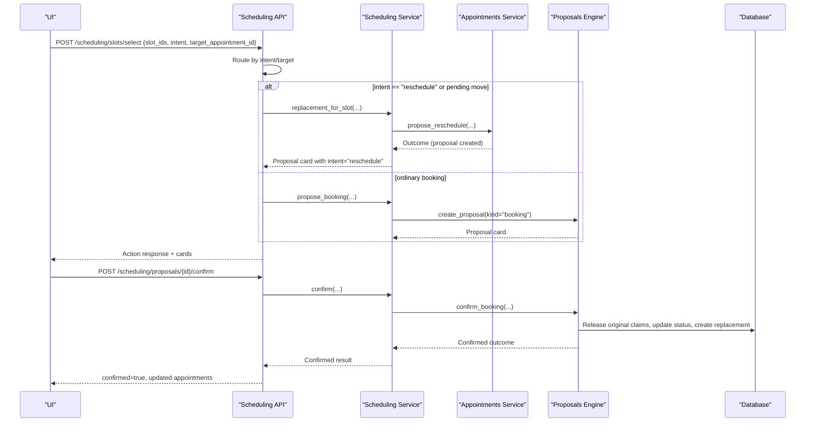
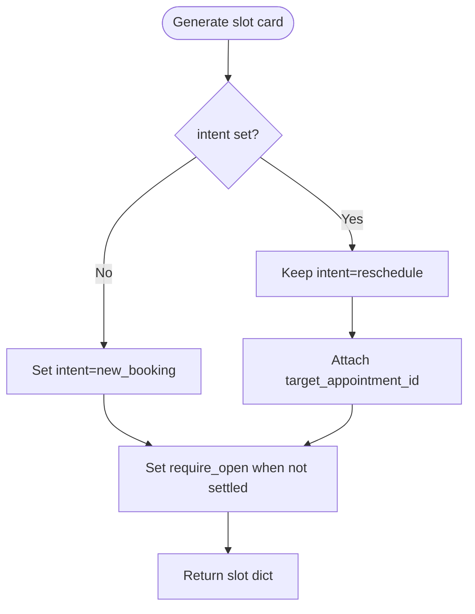
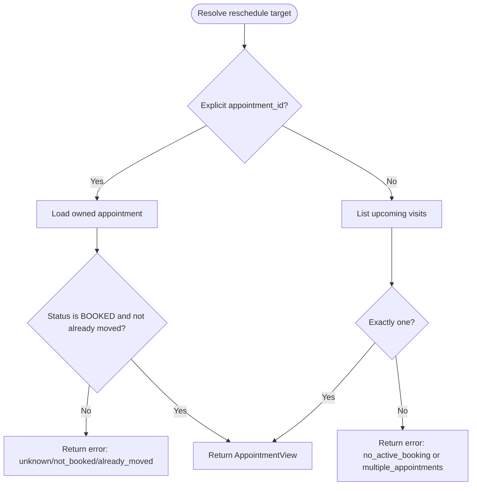
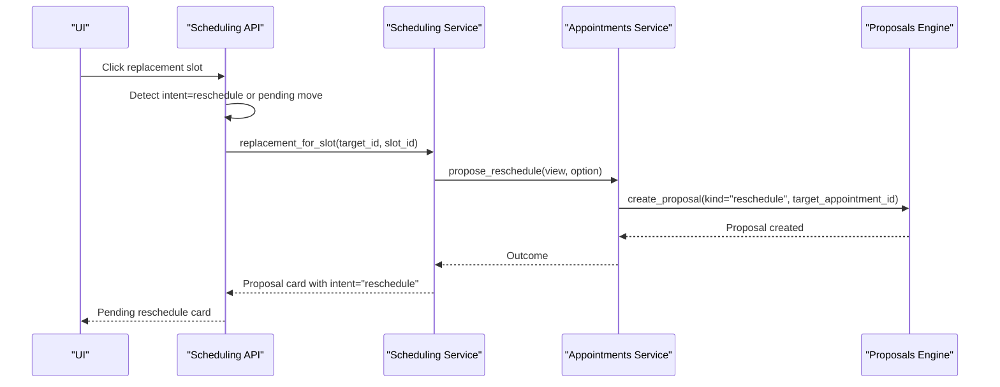
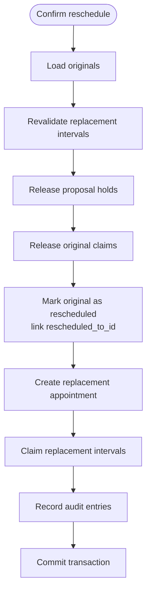
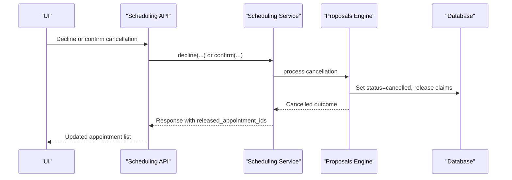
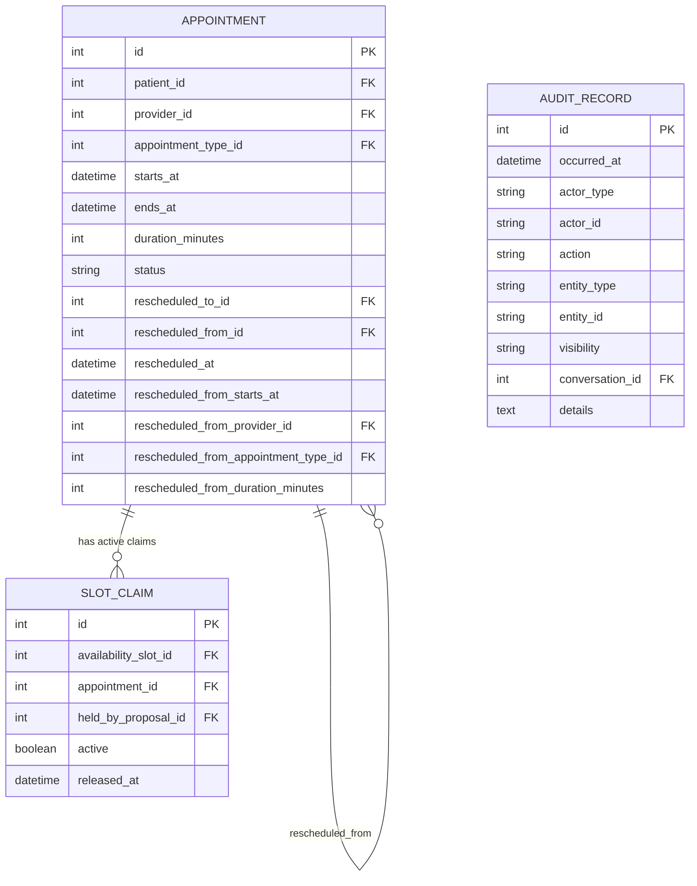
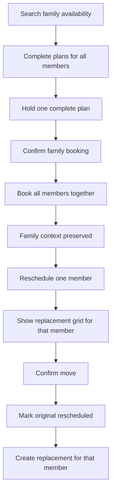
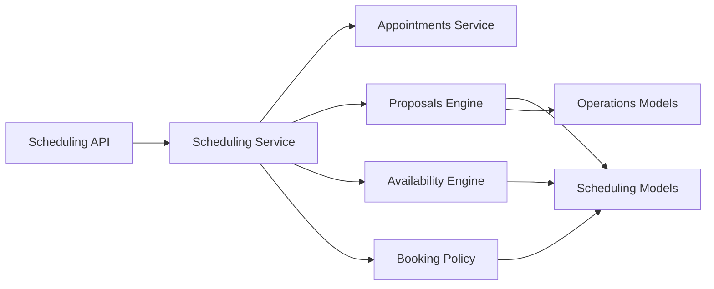

# Rescheduling Workflow

<cite>
**Referenced Files in This Document**   
- [scheduling.py](file://backend/app/services/scheduling.py)
- [scheduling_api.py](file://backend/app/api/scheduling.py)
- [appointments_service.py](file://backend/app/services/appointments.py)
- [proposals_service.py](file://backend/app/services/proposals.py)
- [scheduling_models.py](file://backend/app/models/scheduling.py)
- [operations_models.py](file://backend/app/models/operations.py)
- [availability_engine.py](file://backend/app/services/availability_engine.py)
- [booking_policy.py](file://backend/app/services/booking_policy.py)
- [test_reschedule_workflow.py](file://backend/tests/test_reschedule_workflow.py)
- [test_reschedule_regression.py](file://backend/tests/test_reschedule_regression.py)
- [test_reschedule_atomic_confirmation.py](file://backend/tests/test_reschedule_atomic_confirmation.py)
</cite>

## Table of Contents
1. [Introduction](#introduction)
2. [Project Structure](#project-structure)
3. [Core Components](#core-components)
4. [Architecture Overview](#architecture-overview)
5. [Detailed Component Analysis](#detailed-component-analysis)
6. [Dependency Analysis](#dependency-analysis)
7. [Performance Considerations](#performance-considerations)
8. [Troubleshooting Guide](#troubleshooting-guide)
9. [Conclusion](#conclusion)
10. [Appendices](#appendices)

## Introduction
This document explains the rescheduling workflow that preserves historical appointment data while creating new bookings. It focuses on how the system distinguishes a replacement move from a fresh booking, how the `intent='reschedule'` parameter and `target_appointment_id` keep the old and new appointments linked, and how cancellation releases slot claims and updates appointment status. It also covers historical data preservation, family bookings, emergency appointments, provider preferences, error handling for invalid targets, and data migration patterns for appointment history.

The implementation is split across:
- API endpoints that receive UI card clicks.
- A scheduling service that orchestrates availability, proposals, and confirmation.
- An appointments service that validates and proposes reschedules or cancellations.
- A proposal engine that atomically confirms moves, cancellations, or new bookings.
- Data models that store appointments, slot claims, and audit records.

## Project Structure
The rescheduling flow touches several layers:

**Diagram sources**
- [scheduling_api.py:256-362](file://backend/app/api/scheduling.py#L256-L362)
- [scheduling.py:1280-1458](file://backend/app/services/scheduling.py#L1280-L1458)
- [appointments_service.py:277-359](file://backend/app/services/appointments.py#L277-L359)
- [proposals_service.py:900-1071](file://backend/app/services/proposals.py#L900-L1071)
- [availability_engine.py:238-354](file://backend/app/services/availability_engine.py#L238-L354)
- [booking_policy.py:300-321](file://backend/app/services/booking_policy.py#L300-L321)

**Section sources**
- [scheduling_api.py:1-13](file://backend/app/api/scheduling.py#L1-L13)
- [scheduling.py:1-12](file://backend/app/services/scheduling.py#L1-L12)

## Core Components
- **Slot selection endpoint**: Accepts a clicked slot card and routes it to either a reschedule flow or a new booking flow based on `intent` and `target_appointment_id`.
- **Reschedule proposal creation**: Records intent to move an existing appointment without changing its row; the original stays booked until confirmation.
- **Atomic confirmation**: Revalidates slots, releases the original’s claims, marks the original as rescheduled, creates the replacement, and links both rows.
- **Cancellation flow**: Creates a cancellation proposal, then marks the target appointment cancelled and releases its claims.
- **Historical linkage**: Uses foreign keys and snapshot fields so either the original or replacement can explain the move.
- **Audit trail**: Append-only audit records capture holds, confirmations, and per-appointment changes.

**Section sources**
- [scheduling_api.py:40-72](file://backend/app/api/scheduling.py#L40-L72)
- [scheduling.py:1280-1334](file://backend/app/services/scheduling.py#L1280-L1334)
- [proposals_service.py:900-1071](file://backend/app/services/proposals.py#L900-L1071)
- [scheduling_models.py:81-172](file://backend/app/models/scheduling.py#L81-L172)
- [operations_models.py:56-86](file://backend/app/models/operations.py#L56-L86)

## Architecture Overview
The rescheduling workflow is driven by deterministic card actions rather than model prose. The key distinction is whether a click means “move this visit” or “book a new visit.”

**Diagram sources**
- [scheduling_api.py:256-362](file://backend/app/api/scheduling.py#L256-L362)
- [scheduling_api.py:456-487](file://backend/app/api/scheduling.py#L456-L487)
- [scheduling.py:1337-1458](file://backend/app/services/scheduling.py#L1337-L1458)
- [appointments_service.py:277-359](file://backend/app/services/appointments.py#L277-L359)
- [proposals_service.py:900-1071](file://backend/app/services/proposals.py#L900-L1071)

## Detailed Component Analysis

### Slot Card Generation and Intent Handling
The slot card carries the meaning of a click. For ordinary searches, the default intent is a new booking. For replacement times, every slot card includes `intent="reschedule"` plus the original appointment id. This prevents a replacement time from being mistaken for a second booking.

Key behaviors:
- `intent` distinguishes rescheduling from new bookings.
- `target_appointment_id` identifies the exact appointment being moved.
- `require_open` indicates whether the grid was freshly searched and should not be treated as already settled.
- `settled` marks times that are context only because the request already has a held or confirmed visit.

**Diagram sources**
- [scheduling.py:238-295](file://backend/app/services/scheduling.py#L238-L295)

**Section sources**
- [scheduling.py:238-295](file://backend/app/services/scheduling.py#L238-L295)
- [scheduling_api.py:40-72](file://backend/app/api/scheduling.py#L40-L72)

### Reschedule Target Resolution and Validation
Before proposing a reschedule, the system proves ownership and validity:
- The target must belong to the verified patient.
- The target must be in a bookable state.
- A target already moved cannot be moved again.
- If multiple upcoming appointments exist without a hint, the caller must clarify which one to move.

Errors include unknown appointment, not booked, already moved, and multiple appointments.

**Diagram sources**
- [appointments_service.py:377-432](file://backend/app/services/appointments.py#L377-L432)

**Section sources**
- [appointments_service.py:277-359](file://backend/app/services/appointments.py#L277-L359)
- [appointments_service.py:377-432](file://backend/app/services/appointments.py#L377-L432)

### Replacement Flow and Proposal Creation
When a replacement time is selected:
1. The API checks whether the click is a reschedule or a fresh booking.
2. If rescheduling, it resolves the target and validates the chosen slot.
3. The appointments service creates a reschedule proposal referencing the original appointment.
4. The original remains booked; no slot claim is moved yet.
5. The UI shows a reschedule proposal card awaiting confirmation.

**Diagram sources**
- [scheduling_api.py:256-362](file://backend/app/api/scheduling.py#L256-L362)
- [scheduling.py:1337-1458](file://backend/app/services/scheduling.py#L1337-L1458)
- [appointments_service.py:277-359](file://backend/app/services/appointments.py#L277-L359)

**Section sources**
- [scheduling_api.py:256-362](file://backend/app/api/scheduling.py#L256-L362)
- [scheduling.py:1280-1458](file://backend/app/services/scheduling.py#L1280-L1458)
- [appointments_service.py:277-359](file://backend/app/services/appointments.py#L277-L359)

### Atomic Confirmation of Reschedules
Confirmation runs inside a single write transaction:
1. Load originals referenced by the reschedule proposal.
2. Revalidate every proposed replacement interval.
3. Release the proposal’s own holds.
4. Release the original appointment’s active slot claims.
5. Mark the original as `rescheduled` and link it to the replacement.
6. Create the replacement appointment and claim its intervals.
7. Record audit entries for the proposal and each affected appointment.

If any step fails, the entire transaction rolls back, ensuring the original is never left released without a replacement.

**Diagram sources**
- [proposals_service.py:900-1071](file://backend/app/services/proposals.py#L900-L1071)
- [scheduling_models.py:120-172](file://backend/app/models/scheduling.py#L120-L172)

**Section sources**
- [proposals_service.py:900-1071](file://backend/app/services/proposals.py#L900-L1071)
- [scheduling_models.py:81-172](file://backend/app/models/scheduling.py#L81-L172)

### Cancellation Flow and Slot Claim Release
A cancellation proposal references the appointment to cancel. On confirmation:
- The target appointment status becomes `cancelled`.
- Its `cancelled_at` timestamp is recorded.
- Its active slot claims are released.
- The proposal stores the cancelled appointment details.
- Audit records capture the cancellation.

Unlike rescheduling, cancellation does not create a replacement appointment.

**Diagram sources**
- [scheduling_api.py:490-508](file://backend/app/api/scheduling.py#L490-L508)
- [proposals_service.py:979-995](file://backend/app/services/proposals.py#L979-L995)

**Section sources**
- [scheduling_api.py:490-508](file://backend/app/api/scheduling.py#L490-L508)
- [proposals_service.py:979-995](file://backend/app/services/proposals.py#L979-L995)

### Historical Data Preservation Strategy
The system preserves history through:
- Original appointment row remains, marked `rescheduled`, pointing to the replacement via `rescheduled_to_id`.
- Replacement appointment points back via `rescheduled_from_id`.
- Snapshot fields (`rescheduled_from_starts_at`, `rescheduled_from_provider_id`, `rescheduled_from_appointment_type_id`, `rescheduled_from_duration_minutes`) preserve the original context.
- Audit records are append-only and capture action, entity, conversation, and details.
- Idempotency records prevent duplicate side effects from retried requests.

**Diagram sources**
- [scheduling_models.py:81-172](file://backend/app/models/scheduling.py#L81-L172)
- [scheduling_models.py:175-238](file://backend/app/models/scheduling.py#L175-L238)
- [operations_models.py:56-86](file://backend/app/models/operations.py#L56-L86)

**Section sources**
- [scheduling_models.py:81-172](file://backend/app/models/scheduling.py#L81-L172)
- [operations_models.py:56-86](file://backend/app/models/operations.py#L56-L86)

### Interaction with Family Bookings
Family bookings hold one complete plan covering multiple patients. Rescheduling interacts with family bookings as follows:
- A pending family booking blocks additional overlapping holds unless explicitly requested as an additional visit.
- Rescheduling a family member’s visit uses the same reschedule proposal mechanism; the original remains booked until confirmation.
- Availability search returns complete family plans, and replacement grids preserve the family context.
- When a family option becomes stale, the system re-searches and offers fresh complete plans rather than partial single-slot options.

**Diagram sources**
- [scheduling.py:341-390](file://backend/app/services/scheduling.py#L341-L390)
- [scheduling.py:2693-2973](file://backend/app/services/scheduling.py#L2693-L2973)
- [availability_engine.py:548-570](file://backend/app/services/availability_engine.py#L548-L570)

**Section sources**
- [scheduling.py:341-390](file://backend/app/services/scheduling.py#L341-L390)
- [scheduling.py:2693-2973](file://backend/app/services/scheduling.py#L2693-L2973)
- [availability_engine.py:548-570](file://backend/app/services/availability_engine.py#L548-L570)

### Interaction with Emergency Appointments
Emergency appointments are resolved through the same appointment type resolution used for normal bookings. The availability engine treats them like other types, subject to provider eligibility and schedule constraints. There is no special bypass of overlap rules; emergency slots must still be available and valid under provider rules.

**Section sources**
- [availability_engine.py:112-140](file://backend/app/services/availability_engine.py#L112-L140)
- [availability_engine.py:238-354](file://backend/app/services/availability_engine.py#L238-L354)

### Interaction with Provider Preferences
Provider preferences are respected throughout:
- User-provided provider names are matched against loaded providers.
- Provider eligibility is enforced per appointment type.
- Availability search filters by provider and business hours.
- Replacement slots must match the requested or inherited appointment type and provider eligibility.

**Section sources**
- [scheduling.py:471-488](file://backend/app/services/scheduling.py#L471-L488)
- [availability_engine.py:211-235](file://backend/app/services/availability_engine.py#L211-L235)
- [availability_engine.py:238-354](file://backend/app/services/availability_engine.py#L238-L354)

## Dependency Analysis
The rescheduling workflow depends on coordinated services and models:

**Diagram sources**
- [scheduling_api.py:256-362](file://backend/app/api/scheduling.py#L256-L362)
- [scheduling.py:1280-1458](file://backend/app/services/scheduling.py#L1280-L1458)
- [appointments_service.py:277-359](file://backend/app/services/appointments.py#L277-L359)
- [proposals_service.py:900-1071](file://backend/app/services/proposals.py#L900-L1071)
- [availability_engine.py:238-354](file://backend/app/services/availability_engine.py#L238-L354)
- [booking_policy.py:300-321](file://backend/app/services/booking_policy.py#L300-L321)

**Section sources**
- [scheduling_api.py:256-362](file://backend/app/api/scheduling.py#L256-L362)
- [scheduling.py:1280-1458](file://backend/app/services/scheduling.py#L1280-L1458)
- [appointments_service.py:277-359](file://backend/app/services/appointments.py#L277-L359)
- [proposals_service.py:900-1071](file://backend/app/services/proposals.py#L900-L1071)
- [availability_engine.py:238-354](file://backend/app/services/availability_engine.py#L238-L354)
- [booking_policy.py:300-321](file://backend/app/services/booking_policy.py#L300-L321)

## Performance Considerations
- Availability search limits returned options and spreads results across days to avoid overwhelming the UI.
- Family plan generation caps candidate counts and sorts by proximity to reduce combinatorial explosion.
- Slot validation avoids offering held or occupied intervals, preventing unnecessary conflicts.
- Audit records are append-only; queries should filter by visibility and entity where appropriate.
- Idempotency records prevent repeated side effects from client retries.

[No sources needed since this section provides general guidance]

## Troubleshooting Guide

### Common Reschedule Errors
- **Unknown appointment**: The target does not belong to the verified patient or cannot be found.
- **Not booked**: The target is cancelled, completed, or otherwise not movable.
- **Already moved**: The target was already replaced by another reschedule.
- **Multiple appointments**: More than one upcoming appointment exists without enough context to choose.
- **Invalid replacement**: The chosen slot belongs to a different patient or matches the current time/provider exactly.
- **Slot unavailable**: The replacement slot is no longer open after the user selected it.

**Section sources**
- [appointments_service.py:277-359](file://backend/app/services/appointments.py#L277-L359)
- [appointments_service.py:377-432](file://backend/app/services/appointments.py#L377-L432)
- [scheduling.py:1292-1318](file://backend/app/services/scheduling.py#L1292-L1318)
- [scheduling.py:1402-1458](file://backend/app/services/scheduling.py#L1402-L1458)

### Invalid Target Handling
The system refuses reschedules for:
- Foreign appointment ids.
- Already moved appointments.
- Non-bookable statuses.
- Slots belonging to other patients.
- Slots identical to the current appointment’s time and provider.

These cases return structured errors with `appointment_unchanged=True` so the UI knows no state changed.

**Section sources**
- [appointments_service.py:297-327](file://backend/app/services/appointments.py#L297-L327)
- [scheduling.py:1292-1318](file://backend/app/services/scheduling.py#L1292-L1318)

### Data Migration Patterns for Appointment History
To migrate legacy appointment histories into the reschedule-aware model:
1. Identify pairs of appointments where an older row was replaced by a newer row.
2. Set the older row’s `status` to `rescheduled` and populate `rescheduled_to_id` with the newer row.
3. Set the newer row’s `rescheduled_from_id` to the older row.
4. Copy original context into `rescheduled_from_starts_at`, `rescheduled_from_provider_id`, `rescheduled_from_appointment_type_id`, and `rescheduled_from_duration_minutes`.
5. Ensure slot claims are attached to the replacement and the original’s claims are inactive or removed according to business rules.
6. Write audit records documenting the migration for traceability.

**Section sources**
- [scheduling_models.py:120-172](file://backend/app/models/scheduling.py#L120-L172)
- [operations_models.py:56-86](file://backend/app/models/operations.py#L56-L86)

## Conclusion
The rescheduling workflow cleanly separates movement of an existing appointment from creation of a new booking. The `intent='reschedule'` parameter and `target_appointment_id` ensure replacement clicks are routed correctly. Cancellation properly releases slot claims and updates appointment status. Historical linkage and audit records provide a durable trail of changes. Family bookings, emergency appointments, and provider preferences are integrated without compromising atomicity or safety guarantees.

[No sources needed since this section summarizes without analyzing specific files]

## Appendices

### Example Rescheduling Flows

#### Successful Reschedule
1. Patient selects a replacement time.
2. System creates a reschedule proposal referencing the original.
3. Patient confirms the proposal.
4. Original becomes `rescheduled`; replacement becomes `booked`.
5. Original’s slot claims are released; replacement claims are created.

**Section sources**
- [test_reschedule_regression.py:537-577](file://backend/tests/test_reschedule_regression.py#L537-L577)
- [proposals_service.py:900-1071](file://backend/app/services/proposals.py#L900-L1071)

#### Failed Reschedule Due to Stale Slot
1. Patient selects a replacement time.
2. Between selection and confirmation, the slot becomes unavailable.
3. Confirmation fails with a conflict; original remains unchanged.
4. The pending proposal remains actionable so the patient can retry.

**Section sources**
- [test_reschedule_workflow.py:1-25](file://backend/tests/test_reschedule_workflow.py#L1-L25)
- [test_reschedule_regression.py:730-747](file://backend/tests/test_reschedule_regression.py#L730-L747)

#### Concurrent Confirmations
1. Two clients confirm the same reschedule concurrently.
2. Database uniqueness and transaction isolation ensure only one succeeds.
3. The other replay returns the same committed result without duplicating the appointment.

**Section sources**
- [test_reschedule_workflow.py:1-25](file://backend/tests/test_reschedule_workflow.py#L1-L25)
- [test_reschedule_atomic_confirmation.py:107-146](file://backend/tests/test_reschedule_atomic_confirmation.py#L107-L146)