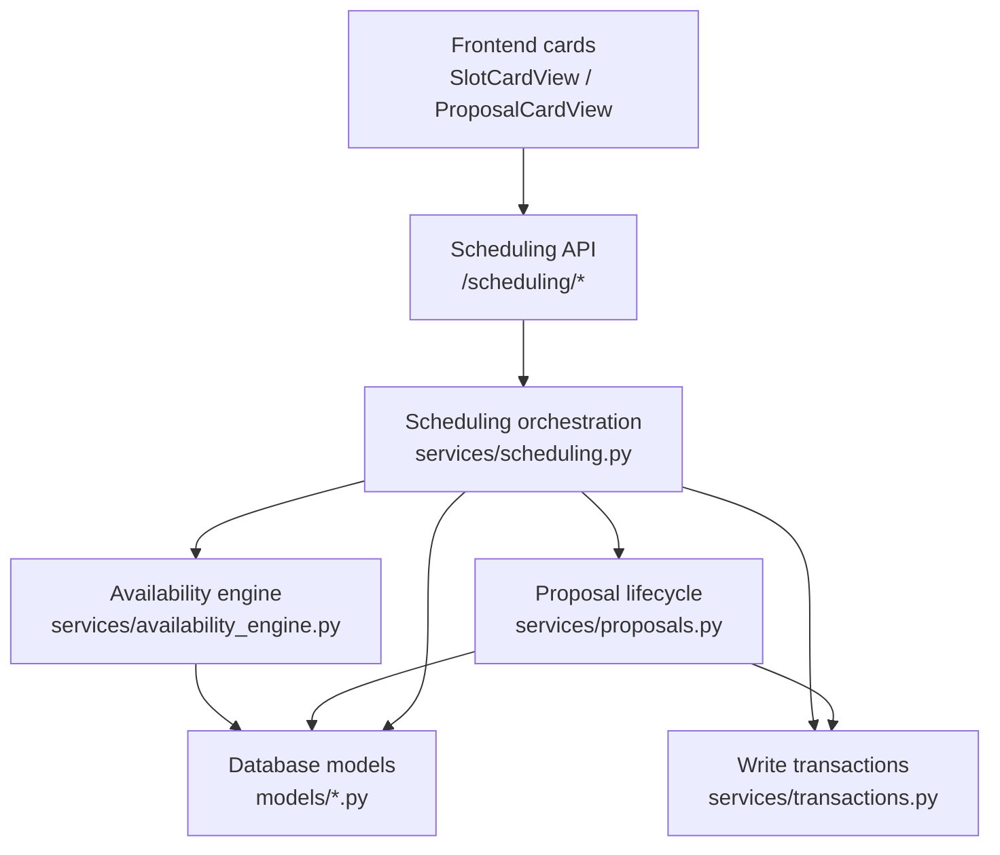
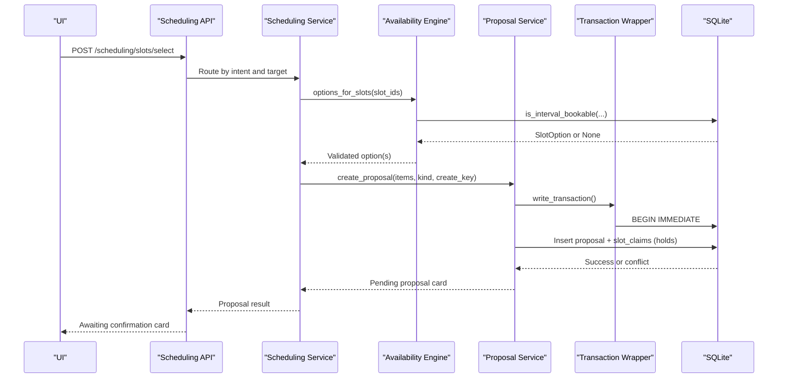
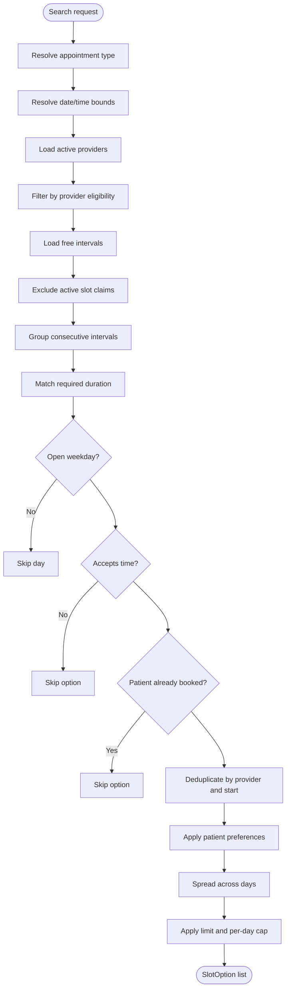
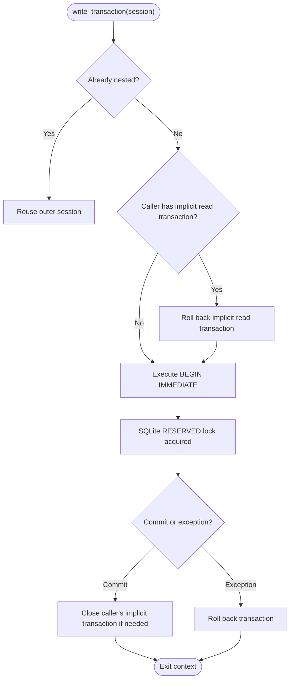
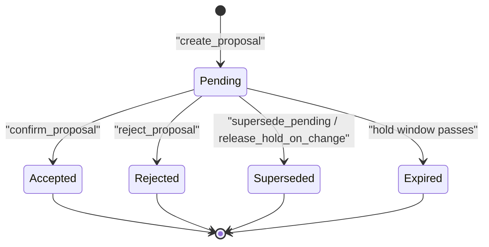
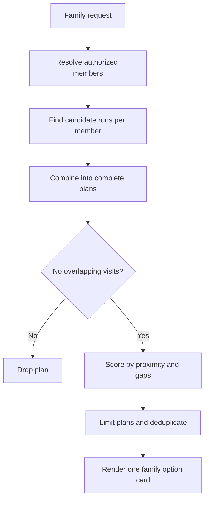
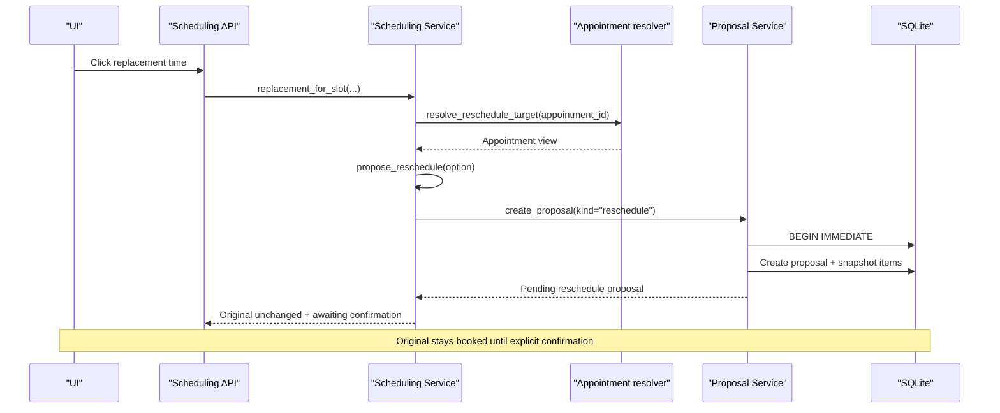
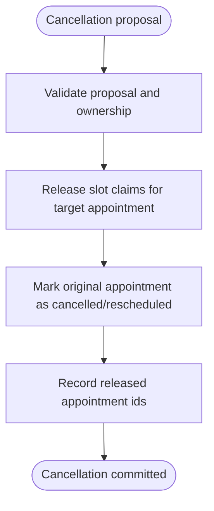
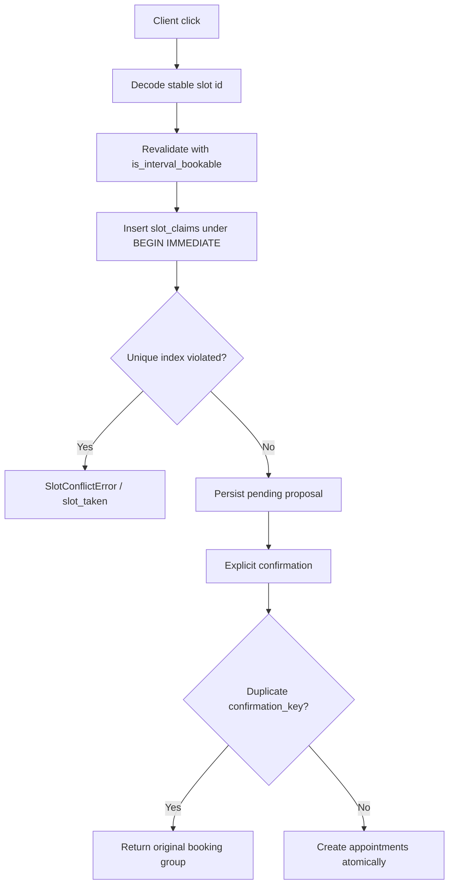
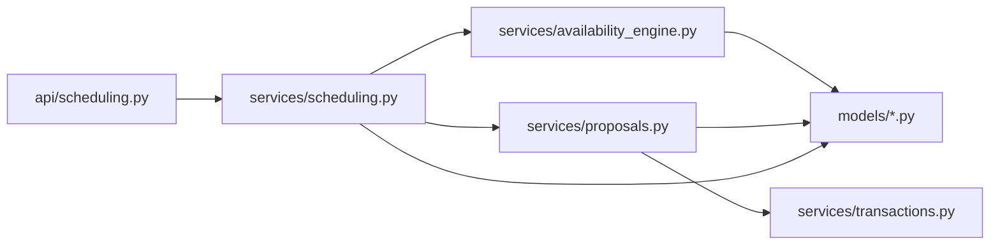

# Scheduling System

<cite>
**Referenced Files in This Document**   
- [availability_engine.py](file://backend/app/services/availability_engine.py)
- [scheduling.py](file://backend/app/services/scheduling.py)
- [proposals.py](file://backend/app/services/proposals.py)
- [transactions.py](file://backend/app/services/transactions.py)
- [api_scheduling.py](file://backend/app/api/scheduling.py)
- [models_proposals.py](file://backend/app/models/proposals.py)
- [models_scheduling.py](file://backend/app/models/scheduling.py)
- [models_base.py](file://backend/app/models/base.py)
</cite>

## Table of Contents
1. [Introduction](#introduction)
2. [Project Structure](#project-structure)
3. [Core Components](#core-components)
4. [Architecture Overview](#architecture-overview)
5. [Detailed Component Analysis](#detailed-component-analysis)
6. [Dependency Analysis](#dependency-analysis)
7. [Performance Considerations](#performance-considerations)
8. [Troubleshooting Guide](#troubleshooting-guide)
9. [Conclusion](#conclusion)

## Introduction
This document explains the scheduling and booking system that turns a patient’s time preference into a real appointment while preventing double-bookings, stale offers, and inconsistent family plans. The system separates three phases:

| Phase | Responsibility | Concurrency model |
|---|---|---|
| Availability search | Answers “what could be booked?” without blocking writers | Read-only queries |
| Proposal and hold | Creates a pending proposal and reserves intervals for two minutes | Exclusive `BEGIN IMMEDIATE` transaction |
| Confirmation | Revalidates and atomically books or moves appointments | Exclusive `BEGIN IMMEDIATE` transaction |

The UI never trusts raw slot identifiers; every click is decoded and revalidated against live database state. A clicked card creates a pending proposal with a short hold window rather than immediately booking an appointment. Explicit confirmation then performs the final atomic mutation.

## Project Structure
The scheduling logic lives primarily in the backend service layer, with API routes providing deterministic endpoints for card actions.

**Diagram sources**
- [api_scheduling.py:1-150](file://backend/app/api/scheduling.py#L1-L150)
- [scheduling.py:1-120](file://backend/app/services/scheduling.py#L1-L120)
- [availability_engine.py:1-50](file://backend/app/services/availability_engine.py#L1-L50)
- [proposals.py:1-46](file://backend/app/services/proposals.py#L1-L46)
- [transactions.py:1-32](file://backend/app/services/transactions.py#L1-L32)
- [models_scheduling.py:1-12](file://backend/app/models/scheduling.py#L1-L12)
- [models_proposals.py:1-19](file://backend/app/models/proposals.py#L1-L19)

**Section sources**
- [api_scheduling.py:1-150](file://backend/app/api/scheduling.py#L1-L150)
- [scheduling.py:1-120](file://backend/app/services/scheduling.py#L1-L120)

## Core Components
| Component | Purpose | Key behavior |
|---|---|---|
| Availability engine | Computes bookable runs from 30-minute slots | Filters by business hours, provider eligibility, duration, existing appointments, staff blocks, active claims, and patient preferences |
| Scheduling service | Orchestrates availability, proposals, reschedules, and confirmations | Builds cards, enforces one-at-a-time holds, and routes clicks to the correct workflow |
| Proposal service | Manages pending, accepted, rejected, expired, and superseded proposals | Holds slots for two minutes, releases them on decline/change/expiry, and atomically confirms bookings |
| Transaction wrapper | Guarantees exclusive SQLite write locks | Uses `BEGIN IMMEDIATE` before reads inside write paths |
| API layer | Exposes deterministic card actions | Routes slot selection, refresh, confirm, decline, and pending reads through verified sessions |
| Data models | Define slots, claims, appointments, proposals, and groups | Enforce uniqueness constraints that prevent overlapping bookings |

**Section sources**
- [availability_engine.py:1-17](file://backend/app/services/availability_engine.py#L1-L17)
- [scheduling.py:1-12](file://backend/app/services/scheduling.py#L1-L12)
- [proposals.py:1-46](file://backend/app/services/proposals.py#L1-L46)
- [transactions.py:1-32](file://backend/app/services/transactions.py#L1-L32)
- [api_scheduling.py:1-13](file://backend/app/api/scheduling.py#L1-L13)
- [models_scheduling.py:1-12](file://backend/app/models/scheduling.py#L1-L12)
- [models_proposals.py:1-19](file://backend/app/models/proposals.py#L1-L19)

## Architecture Overview
The scheduling flow is intentionally layered so that expensive reasoning can happen without holding database resources, while only the actual reservation and booking steps acquire an exclusive lock.

**Diagram sources**
- [api_scheduling.py:256-362](file://backend/app/api/scheduling.py#L256-L362)
- [scheduling.py:801-888](file://backend/app/services/scheduling.py#L801-L888)
- [availability_engine.py:357-410](file://backend/app/services/availability_engine.py#L357-L410)
- [proposals.py:282-529](file://backend/app/services/proposals.py#L282-L529)
- [transactions.py:85-134](file://backend/app/services/transactions.py#L85-L134)

## Detailed Component Analysis

### Availability Calculation Engine
The availability engine answers what could be booked. It does not perform writes and deliberately avoids blocking concurrent booking operations.

#### Filtering Pipeline

**Diagram sources**
- [availability_engine.py:238-354](file://backend/app/services/availability_engine.py#L238-L354)
- [availability_engine.py:143-189](file://backend/app/services/availability_engine.py#L143-L189)
- [availability_engine.py:192-208](file://backend/app/services/availability_engine.py#L192-L208)

#### Key Constraints
| Constraint | Implementation detail |
|---|---|
| Business hours and open weekdays | Checked before emitting options and during interval validation |
| Provider eligibility | Providers are filtered by rules tied to the appointment type |
| Appointment duration | Converted into a required number of 30-minute intervals |
| Existing appointments | Patient overlap check prevents offering times where the patient is already booked |
| Staff blocks and schedule holds | Only `available` slots are loaded; blocked slots are excluded |
| Active claims | Slots referenced by active `slot_claims` are excluded from availability |
| Preference narrowing | Days, time windows, weekday filters, and requested provider narrow results |
| Deterministic spread | Results are spread across days and capped per day |

**Section sources**
- [availability_engine.py:1-17](file://backend/app/services/availability_engine.py#L1-L17)
- [availability_engine.py:143-189](file://backend/app/services/availability_engine.py#L143-L189)
- [availability_engine.py:238-354](file://backend/app/services/availability_engine.py#L238-L354)
- [availability_engine.py:357-410](file://backend/app/services/availability_engine.py#L357-L410)

### Atomic Transaction System
All booking mutations run under `BEGIN IMMEDIATE`. This is critical because SQLAlchemy’s default deferred transactions would allow two requests to read “slot is free” before either writes.

**Diagram sources**
- [transactions.py:85-134](file://backend/app/services/transactions.py#L85-L134)

#### Transaction Rules
| Rule | Reason |
|---|---|
| Use `BEGIN IMMEDIATE` | Acquires the write lock before any read inside the write path |
| Do not rely on `session.begin()` alone | Deferred transactions leave a race window between read and write |
| Discard implicit read transactions | They cannot become write transactions and must not commit new rows |
| Leave no implicit transaction open after commit | Prevents another writer from waiting the full busy timeout |
| Wrap failures in domain errors | `WriteTransactionError` and `SlotConflictError` separate lock/busy failures from slot conflicts |

**Section sources**
- [transactions.py:1-32](file://backend/app/services/transactions.py#L1-L32)
- [transactions.py:50-67](file://backend/app/services/transactions.py#L50-L67)
- [transactions.py:85-134](file://backend/app/services/transactions.py#L85-L134)

### Proposal and Hold Mechanism
Clicking an availability card does not book. It creates a pending proposal and reserves the selected intervals for two minutes.

**Diagram sources**
- [models_proposals.py:7-19](file://backend/app/models/proposals.py#L7-L19)
- [proposals.py:85-92](file://backend/app/services/proposals.py#L85-L92)
- [proposals.py:282-529](file://backend/app/services/proposals.py#L282-L529)

#### Hold Behavior
| Aspect | Detail |
|---|---|
| Hold duration | Two minutes |
| Hold storage | `slot_claims` with `held_by_proposal_id` set |
| Hold expiry | Releases held intervals but leaves the proposal pending and confirmable |
| Decline | Releases holds and marks the proposal rejected |
| Change of mind | Immediately releases holds instead of waiting for expiry |
| Stale card | Refresh endpoint rejects slot ids that are no longer bookable |

**Section sources**
- [proposals.py:85-92](file://backend/app/services/proposals.py#L85-L92)
- [proposals.py:200-274](file://backend/app/services/proposals.py#L200-L274)
- [scheduling.py:1153-1205](file://backend/app/services/scheduling.py#L1153-L1205)
- [api_scheduling.py:365-453](file://backend/app/api/scheduling.py#L365-L453)

### Family Booking Coordination
Family plans coordinate multiple participants atomically. The system supports both nearby same-day plans and strict back-to-back chains.

**Diagram sources**
- [availability_engine.py:548-570](file://backend/app/services/availability_engine.py#L548-L570)
- [availability_engine.py:729-770](file://backend/app/services/availability_engine.py#L729-L770)
- [availability_engine.py:865-916](file://backend/app/services/availability_engine.py#L865-L916)
- [scheduling.py:341-390](file://backend/app/services/scheduling.py#L341-L390)

#### Family Invariants
| Invariant | Enforcement |
|---|---|
| One complete plan per card | Partial plans are never returned |
| No overlapping visits within the family plan | Plans are validated before being offered |
| Authorization enforced | Only the verified adult plus explicitly named household members are included |
| Atomic confirmation | All family members are booked in one transaction |
| Historical grouping | Confirmed family bookings share a booking group and family group |

**Section sources**
- [availability_engine.py:538-570](file://backend/app/services/availability_engine.py#L538-L570)
- [availability_engine.py:663-684](file://backend/app/services/availability_engine.py#L663-L684)
- [availability_engine.py:729-770](file://backend/app/services/availability_engine.py#L729-L770)
- [models_proposals.py:202-236](file://backend/app/models/proposals.py#L202-L236)

### Rescheduling Workflow
Rescheduling preserves historical appointment data while creating a replacement. The original appointment is not overwritten.

**Diagram sources**
- [api_scheduling.py:256-362](file://backend/app/api/scheduling.py#L256-L362)
- [scheduling.py:1337-1458](file://backend/app/services/scheduling.py#L1337-L1458)
- [scheduling.py:1271-1334](file://backend/app/services/scheduling.py#L1271-L1334)
- [proposals.py:282-529](file://backend/app/services/proposals.py#L282-L529)

#### Reschedule History Model
| Field | Meaning |
|---|---|
| `rescheduled_to_id` | Replacement appointment created by confirming the move |
| `rescheduled_from_id` | Original appointment moved out |
| `rescheduled_at` | When the move was confirmed |
| `rescheduled_from_starts_at` | Snapshot of the original time |
| `rescheduled_from_provider_id` | Snapshot of the original provider |
| `rescheduled_from_appointment_type_id` | Snapshot of the original visit type |
| `rescheduled_from_duration_minutes` | Snapshot of the original duration |

**Section sources**
- [models_scheduling.py:120-140](file://backend/app/models/scheduling.py#L120-L140)
- [scheduling.py:1208-1268](file://backend/app/services/scheduling.py#L1208-L1268)

### Cancellation Process
A cancellation proposal targets an existing appointment. Confirming it releases the appointment’s slot claims and records the cancellation.

**Diagram sources**
- [models_proposals.py:102-110](file://backend/app/models/proposals.py#L102-L110)
- [proposals.py:282-353](file://backend/app/services/proposals.py#L282-L353)

### Conflict Resolution, Uniqueness, and Idempotency
The system uses layered guards: application-level checks produce readable errors, while database constraints provide the final guarantee.

| Mechanism | Role |
|---|---|
| Partial unique index on `slot_claims.availability_slot_id` | Ensures only one active claim per slot |
| Partial unique index on `(appointment_id, availability_slot_id)` | Ensures one active claim per appointment-slot pair |
| `booking_groups.confirmation_key` uniqueness | Prevents duplicate confirmed booking groups |
| `create_key` idempotency | Retriggered slot selection returns the same proposal |
| `confirm_key` idempotency | Retriggered confirmation returns the original result |
| `is_interval_bookable` revalidation | Rechecks availability inside the write lock |
| `ignore_appointment_id` | Allows a reschedule/cancellation to treat its own current claims as available to itself |

**Diagram sources**
- [models_scheduling.py:175-239](file://backend/app/models/scheduling.py#L175-L239)
- [models_proposals.py:202-236](file://backend/app/models/proposals.py#L202-L236)
- [proposals.py:368-379](file://backend/app/services/proposals.py#L368-L379)
- [proposals.py:762-800](file://backend/app/services/proposals.py#L762-L800)
- [availability_engine.py:395-510](file://backend/app/services/availability_engine.py#L395-L510)

**Section sources**
- [models_scheduling.py:175-239](file://backend/app/models/scheduling.py#L175-L239)
- [models_proposals.py:202-236](file://backend/app/models/proposals.py#L202-L236)
- [proposals.py:368-379](file://backend/app/services/proposals.py#L368-L379)
- [proposals.py:762-800](file://backend/app/services/proposals.py#L762-L800)
- [availability_engine.py:395-510](file://backend/app/services/availability_engine.py#L395-L510)

## Dependency Analysis
The scheduling system has clear boundaries between read-heavy availability computation and write-heavy proposal/confirmation logic.

**Diagram sources**
- [api_scheduling.py:1-150](file://backend/app/api/scheduling.py#L1-L150)
- [scheduling.py:1-120](file://backend/app/services/scheduling.py#L1-L120)
- [availability_engine.py:1-50](file://backend/app/services/availability_engine.py#L1-L50)
- [proposals.py:1-46](file://backend/app/services/proposals.py#L1-L46)
- [transactions.py:1-32](file://backend/app/services/transactions.py#L1-L32)

### Coupling and Cohesion
| Relationship | Assessment |
|---|---|
| API → Scheduling service | Low coupling; API delegates all business logic |
| Scheduling service → Availability engine | Read-only dependency; availability engine has no side effects |
| Scheduling service → Proposal service | Write coordination; proposal service owns persistence and holds |
| Proposal service → Transaction wrapper | Strong dependency; all mutations go through `BEGIN IMMEDIATE` |
| Models → Base enums | Shared status and timestamp machinery |

**Section sources**
- [api_scheduling.py:1-150](file://backend/app/api/scheduling.py#L1-L150)
- [scheduling.py:1-120](file://backend/app/services/scheduling.py#L1-L120)
- [availability_engine.py:1-50](file://backend/app/services/availability_engine.py#L1-L50)
- [proposals.py:1-46](file://backend/app/services/proposals.py#L1-L46)
- [transactions.py:1-32](file://backend/app/services/transactions.py#L1-L32)
- [models_base.py:50-74](file://backend/app/models/base.py#L50-L74)

## Performance Considerations
- Availability search is read-only and avoids blocking writers.
- Candidate lists are bounded (`MAX_OPTIONS`, `MAX_RUN_SLOTS`, family candidate limits).
- Results are spread across days to avoid overwhelming the UI with clustered options.
- Family plan generation caps candidates per member and limits total plans.
- `BEGIN IMMEDIATE` serializes conflicting writes, trading concurrency for correctness.
- Stale grid refresh is lightweight: it decodes client slot ids and revalidates them without booking.

[No sources needed since this section provides general guidance]

## Troubleshooting Guide

### Common Failure Modes
| Symptom | Likely cause | Recommended action |
|---|---|---|
| “That time is no longer open” | Slot became occupied, claimed, closed, or outside business hours | Refresh the grid and offer fresh options |
| “One of those times was just taken” | Lost race condition on slot claim | Show current availability; do not retry silently |
| “Could not obtain the database write lock” | Another writer holds the SQLite lock | Retry later; surface a busy message |
| “Pending booking exists” | A proposal is already waiting for confirmation | Return the existing proposal card instead of creating another |
| “Unknown proposal” | Proposal expired, rejected, or replayed elsewhere | Treat as stale and refresh pending proposals |
| “Slot unavailable” for reschedule | Same time/provider as current appointment or invalid target | Explain that the move is unnecessary or invalid |
| Family plan disappears | No complete non-overlapping plan exists for all members | Offer separate visits or widen dates/providers |

**Section sources**
- [api_scheduling.py:256-362](file://backend/app/api/scheduling.py#L256-L362)
- [api_scheduling.py:365-453](file://backend/app/api/scheduling.py#L365-L453)
- [scheduling.py:919-1015](file://backend/app/services/scheduling.py#L919-L1015)
- [scheduling.py:1337-1458](file://backend/app/services/scheduling.py#L1337-L1458)
- [proposals.py:490-511](file://backend/app/services/proposals.py#L490-L511)
- [proposals.py:638-665](file://backend/app/services/proposals.py#L638-L665)

### Edge Cases and Recovery
| Edge case | Handling strategy |
|---|---|
| Expired hold | `release_expired_holds` frees intervals; proposal remains confirmable and revalidates on confirmation |
| Stale card | `/scheduling/availability` rejects slot ids that fail `is_interval_bookable`; UI disables them |
| Race condition | `BEGIN IMMEDIATE` + partial unique index on active claims makes races database-level conflicts |
| Double-click confirmation | `booking_groups.confirmation_key` uniqueness triggers replay of the original result |
| Double-click slot selection | `create_key` idempotency returns the same pending proposal |
| Rollback scenario | Exceptions inside `write_transaction` roll back all changes; no partial booking is left |
| Stale transcript card | Pending proposal read is refreshed from SQLite; cards without a live proposal are retired |
| Reschedule vs booking confusion | Intent and target fields enforce routing; a reschedule cannot accidentally become a second booking |

**Section sources**
- [proposals.py:231-274](file://backend/app/services/proposals.py#L231-L274)
- [api_scheduling.py:365-453](file://backend/app/api/scheduling.py#L365-L453)
- [transactions.py:85-134](file://backend/app/services/transactions.py#L85-L134)
- [models_proposals.py:202-236](file://backend/app/models/proposals.py#L202-L236)
- [proposals.py:368-379](file://backend/app/services/proposals.py#L368-L379)
- [proposals.py:762-800](file://backend/app/services/proposals.py#L762-L800)

## Conclusion
The scheduling system is built around three guarantees:

1. **Correct availability:** Slots are computed from real intervals, filtered by business rules, provider eligibility, duration, existing appointments, staff blocks, active claims, and patient preferences.
2. **Atomic reservations:** Proposals use `BEGIN IMMEDIATE` to reserve slots for two minutes, with database uniqueness constraints as the final protection against double-bookings.
3. **Explicit confirmation:** Clicking a card creates a pending proposal; only explicit confirmation books, moves, or cancels appointments, with full rollback support and idempotent retries.

Family bookings extend these guarantees to multi-participant workflows by requiring complete, non-overlapping plans and committing all participants together. Rescheduling preserves historical appointment data by retiring the original and creating a linked replacement, while cancellations release slot claims cleanly. The API layer ensures that deterministic user actions are routed correctly, independent of conversational wording, and that stale or expired state is always reconciled against live database records.

[No sources needed since this section summarizes without analyzing specific files]