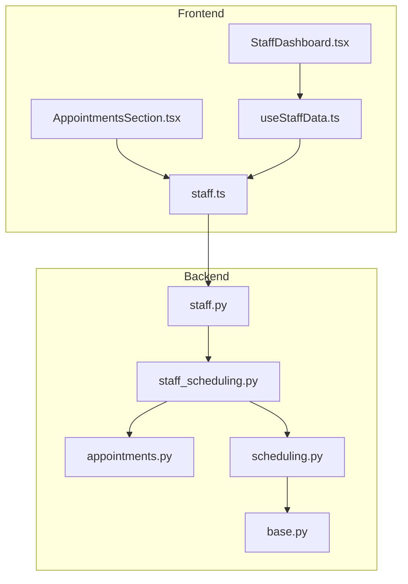
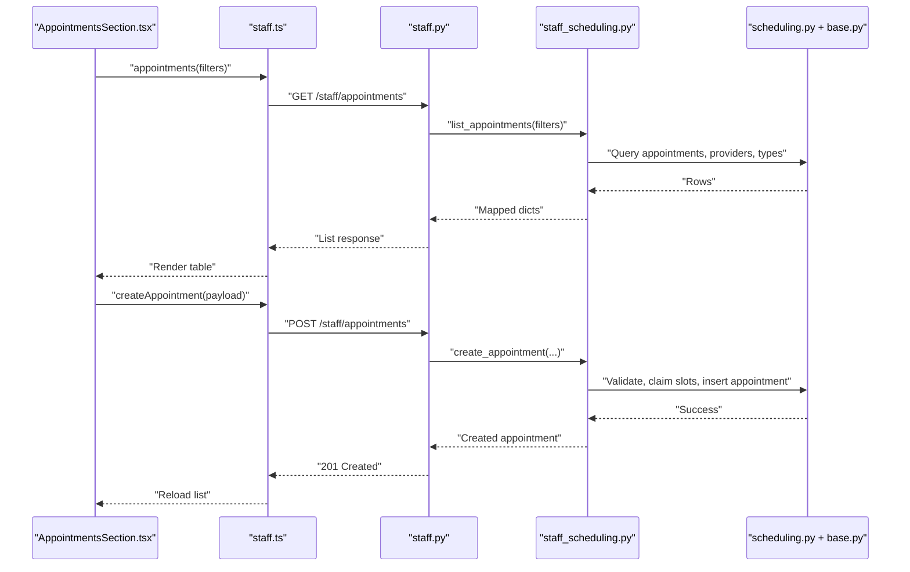
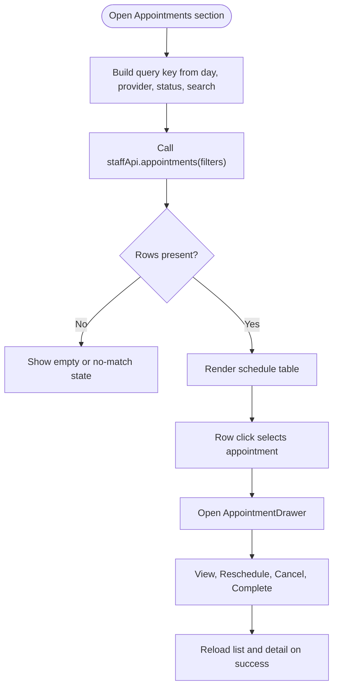
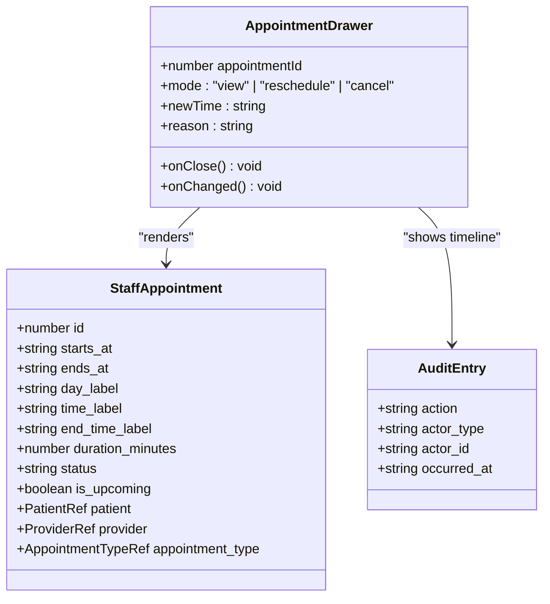
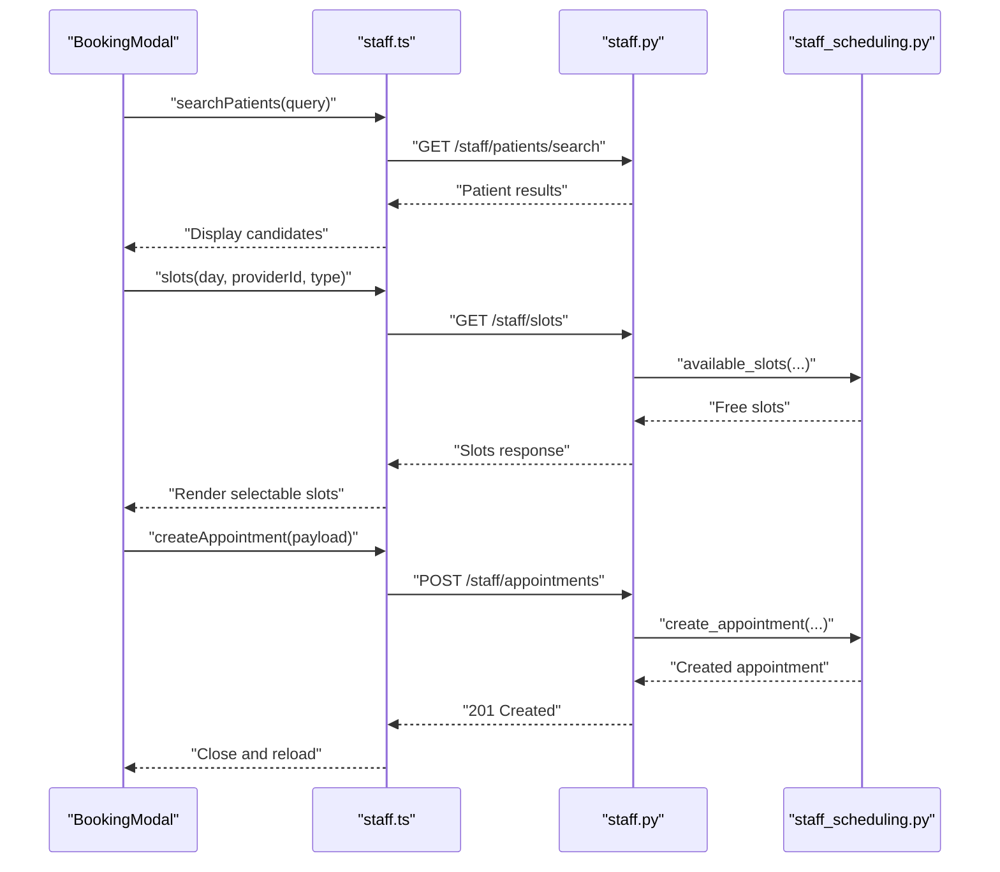
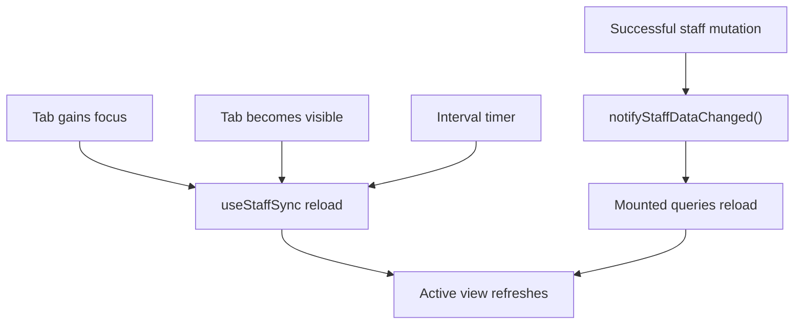
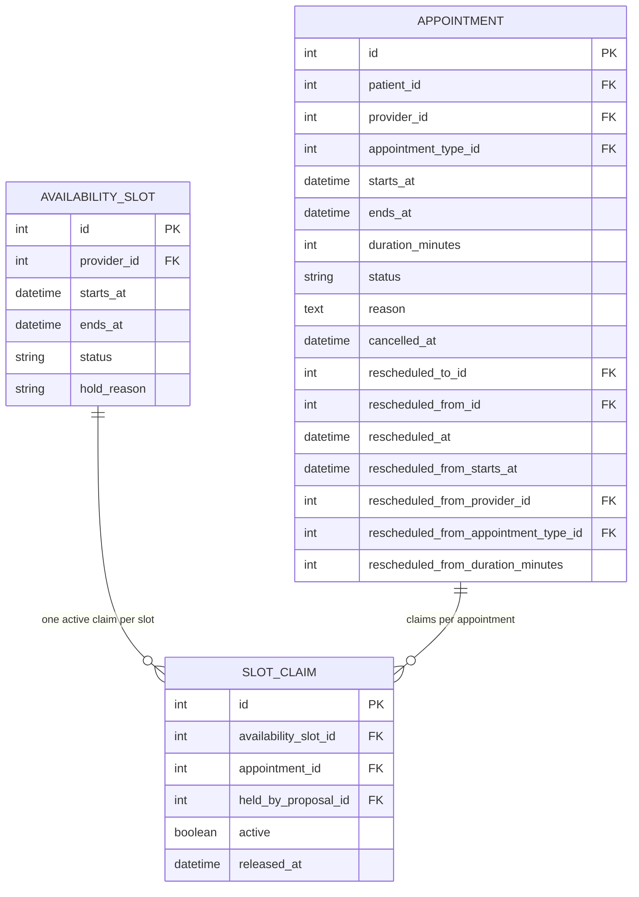
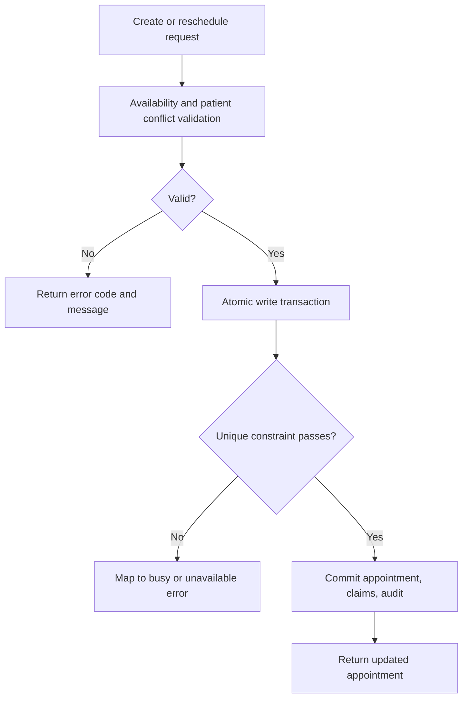
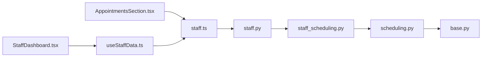

# Appointment Management Interface

<cite>
**Referenced Files in This Document**   
- [AppointmentsSection.tsx](file://frontend/src/pages/staff/sections/AppointmentsSection.tsx)
- [StaffDashboard.tsx](file://frontend/src/pages/staff/StaffDashboard.tsx)
- [useStaffData.ts](file://frontend/src/pages/staff/useStaffData.ts)
- [staff.ts](file://frontend/src/api/staff.ts)
- [staff.py](file://backend/app/api/staff.py)
- [staff_scheduling.py](file://backend/app/services/staff_scheduling.py)
- [appointments.py](file://backend/app/services/appointments.py)
- [scheduling.py](file://backend/app/models/scheduling.py)
- [base.py](file://backend/app/models/base.py)
</cite>

## Table of Contents
1. [Introduction](#introduction)
2. [Project Structure](#project-structure)
3. [Core Components](#core-components)
4. [Architecture Overview](#architecture-overview)
5. [Detailed Component Analysis](#detailed-component-analysis)
6. [Dependency Analysis](#dependency-analysis)
7. [Performance Considerations](#performance-considerations)
8. [Troubleshooting Guide](#troubleshooting-guide)
9. [Conclusion](#conclusion)

## Introduction
This document explains the appointment management interface used by staff in the clinic dashboard. It covers how scheduled appointments are displayed, how provider availability is shown, and how patient information is presented alongside each visit. It also documents every staff action: creating an appointment manually, rescheduling, cancelling, completing, and updating status through the UI. The data model, filtering, search, conflict resolution, scheduling engine integration, real-time refresh behavior, and performance considerations for large lists are explained with concrete references to the source files.

The interface is designed so that staff actions go through the same scheduling rules as the patient chatbot. Availability is validated server-side, slot conflicts are enforced at the database level, and changes are audited inside atomic transactions.

## Project Structure
The appointment management feature spans both frontend and backend:

- Frontend
  - `AppointmentsSection.tsx`: filter bar, schedule table, detail drawer, manual booking modal.
  - `StaffDashboard.tsx`: dashboard chrome, navigation, and periodic refresh coordination.
  - `useStaffData.ts`: query/mutation hooks, change broadcast, focus/visibility/polling sync.
  - `staff.ts`: typed API client for staff endpoints, CSRF handling, and request helpers.

- Backend
  - `staff.py`: FastAPI routes for authentication, appointments, slots, patients, alerts, and requests.
  - `staff_scheduling.py`: staff-facing scheduling service implementing list, create, reschedule, cancel, complete, and available slots.
  - `appointments.py`: shared appointment view and proposal logic used by patient flows.
  - `scheduling.py`: SQLAlchemy models for availability slots, appointments, and slot claims.
  - `base.py`: shared enums such as appointment status and base ORM types.

**Diagram sources**
- [AppointmentsSection.tsx:1-777](file://frontend/src/pages/staff/sections/AppointmentsSection.tsx#L1-L777)
- [StaffDashboard.tsx:1-213](file://frontend/src/pages/staff/StaffDashboard.tsx#L1-L213)
- [useStaffData.ts:1-231](file://frontend/src/pages/staff/useStaffData.ts#L1-L231)
- [staff.ts:1-405](file://frontend/src/api/staff.ts#L1-L405)
- [staff.py:1-717](file://backend/app/api/staff.py#L1-L717)
- [staff_scheduling.py:1-797](file://backend/app/services/staff_scheduling.py#L1-L797)
- [appointments.py:1-456](file://backend/app/services/appointments.py#L1-L456)
- [scheduling.py:1-239](file://backend/app/models/scheduling.py#L1-L239)
- [base.py:1-120](file://backend/app/models/base.py#L1-L120)

**Section sources**
- [AppointmentsSection.tsx:1-777](file://frontend/src/pages/staff/sections/AppointmentsSection.tsx#L1-L777)
- [StaffDashboard.tsx:1-213](file://frontend/src/pages/staff/StaffDashboard.tsx#L1-L213)
- [useStaffData.ts:1-231](file://frontend/src/pages/staff/useStaffData.ts#L1-L231)
- [staff.ts:1-405](file://frontend/src/api/staff.ts#L1-L405)
- [staff.py:1-717](file://backend/app/api/staff.py#L1-L717)
- [staff_scheduling.py:1-797](file://backend/app/services/staff_scheduling.py#L1-L797)
- [appointments.py:1-456](file://backend/app/services/appointments.py#L1-L456)
- [scheduling.py:1-239](file://backend/app/models/scheduling.py#L1-L239)
- [base.py:1-120](file://backend/app/models/base.py#L1-L120)

## Core Components
The appointment management interface consists of five core pieces:

1. **Schedule list and filters**
   - Displays a filtered table of appointments with columns for patient, time range, visit type, dentist, status, and creation time.
   - Supports filtering by date, provider, status, and patient name or phone.
   - Shows providers dynamically from the backend.

2. **Appointment detail drawer**
   - Opens when a row is selected.
   - Shows full appointment metadata, patient details, audit trail, and allowed actions.
   - Allows rescheduling, cancellation, and completion for booked appointments.

3. **Manual booking modal**
   - Lets staff select a patient, visit type, provider, day, and open slot.
   - Loads genuinely free slots using the scheduling engine.
   - Creates an appointment only after validation succeeds.

4. **Real-time refresh system**
   - Uses a change-broadcast mechanism, tab focus/visibility events, and polling to keep the active view fresh.
   - Avoids background work when the tab is hidden.

5. **Staff API client**
   - Sends authenticated requests with CSRF headers.
   - Exposes typed functions for listing, fetching details, searching patients, loading slots, and mutating appointments.

**Section sources**
- [AppointmentsSection.tsx:40-263](file://frontend/src/pages/staff/sections/AppointmentsSection.tsx#L40-L263)
- [AppointmentsSection.tsx:269-496](file://frontend/src/pages/staff/sections/AppointmentsSection.tsx#L269-L496)
- [AppointmentsSection.tsx:502-777](file://frontend/src/pages/staff/sections/AppointmentsSection.tsx#L502-L777)
- [useStaffData.ts:31-231](file://frontend/src/pages/staff/useStaffData.ts#L31-L231)
- [staff.ts:213-405](file://frontend/src/api/staff.ts#L213-L405)

## Architecture Overview
The appointment flow follows a layered architecture:

- The React UI renders the schedule, opens drawers/modals, and calls the staff API client.
- The FastAPI layer validates input, enforces session and CSRF security, and delegates to the scheduling service.
- The scheduling service applies business rules, checks availability, updates the database atomically, and records audit entries.
- The database enforces slot uniqueness so overlapping bookings cannot be created even under race conditions.

**Diagram sources**
- [AppointmentsSection.tsx:502-777](file://frontend/src/pages/staff/sections/AppointmentsSection.tsx#L502-L777)
- [staff.ts:304-339](file://frontend/src/api/staff.ts#L304-L339)
- [staff.py:380-464](file://backend/app/api/staff.py#L380-L464)
- [staff_scheduling.py:432-526](file://backend/app/services/staff_scheduling.py#L432-L526)
- [scheduling.py:81-172](file://backend/app/models/scheduling.py#L81-L172)
- [base.py:56-64](file://backend/app/models/base.py#L56-L64)

## Detailed Component Analysis

### Schedule List and Filters
The schedule list is the primary real-time view. It composes a key from the current date, provider, status, and search text, then fetches appointments through the staff API. The backend returns appointments, provider options, and appointment types.

Key behaviors:
- Date filter uses a single-day selector.
- Provider filter selects from active providers returned by the backend.
- Status filter supports all, booked, completed, and cancelled.
- Patient search matches against name or phone.
- Rows show patient name and phone, formatted day/time labels, visit type and duration, provider name, status badge, and creation timestamp.
- Cancelled rows are visually muted.
- A refresh button reloads the list; a clear-filters button resets state.

**Diagram sources**
- [AppointmentsSection.tsx:40-76](file://frontend/src/pages/staff/sections/AppointmentsSection.tsx#L40-L76)
- [AppointmentsSection.tsx:78-180](file://frontend/src/pages/staff/sections/AppointmentsSection.tsx#L78-L180)
- [AppointmentsSection.tsx:182-237](file://frontend/src/pages/staff/sections/AppointmentsSection.tsx#L182-L237)
- [staff.py:380-409](file://backend/app/api/staff.py#L380-L409)

**Section sources**
- [AppointmentsSection.tsx:40-263](file://frontend/src/pages/staff/sections/AppointmentsSection.tsx#L40-L263)
- [staff.py:380-409](file://backend/app/api/staff.py#L380-L409)
- [staff_scheduling.py:191-249](file://backend/app/services/staff_scheduling.py#L191-L249)

### Appointment Detail Drawer
The detail drawer loads one appointment and its audit history. It shows:
- Visit type, duration, provider, timestamps, cancellation time, notes.
- Patient phone, date of birth, insurance provider, member ID.
- Audit trail entries showing action, actor type, actor id, and timestamp.

Actions are conditionally shown based on appointment status. For booked appointments, staff can:
- Reschedule to a new start time.
- Cancel with an optional reason.
- Mark completed.

After any mutation, the drawer reloads its own detail and triggers a list reload.

**Diagram sources**
- [AppointmentsSection.tsx:269-496](file://frontend/src/pages/staff/sections/AppointmentsSection.tsx#L269-L496)
- [staff.ts:60-96](file://frontend/src/api/staff.ts#L60-L96)
- [staff.ts:119-125](file://frontend/src/api/staff.ts#L119-L125)

**Section sources**
- [AppointmentsSection.tsx:269-496](file://frontend/src/pages/staff/sections/AppointmentsSection.tsx#L269-L496)
- [staff.ts:60-96](file://frontend/src/api/staff.ts#L60-L96)
- [staff.ts:114-125](file://frontend/src/api/staff.ts#L114-L125)

### Manual Booking Modal
The booking modal walks staff through selecting a patient, visit type, provider, day, and an open slot. It integrates with the scheduling engine to display only genuinely free intervals.

Workflow:
1. Search patients by name or phone.
2. Choose visit type and provider.
3. Pick a day and load available slots.
4. Select a stable slot.
5. Optionally add a reason.
6. Confirm booking.

Conflict handling:
- If the chosen slot is taken between the moment it was loaded and confirmation, the backend rejects it.
- The modal bumps an epoch counter to force re-reading the slot grid after writes, preventing stale selections.

**Diagram sources**
- [AppointmentsSection.tsx:502-777](file://frontend/src/pages/staff/sections/AppointmentsSection.tsx#L502-L777)
- [staff.ts:319-339](file://frontend/src/api/staff.ts#L319-L339)
- [staff.py:421-464](file://backend/app/api/staff.py#L421-L464)
- [staff_scheduling.py:731-778](file://backend/app/services/staff_scheduling.py#L731-L778)

**Section sources**
- [AppointmentsSection.tsx:502-777](file://frontend/src/pages/staff/sections/AppointmentsSection.tsx#L502-L777)
- [staff.ts:319-339](file://frontend/src/api/staff.ts#L319-L339)
- [staff.py:421-464](file://backend/app/api/staff.py#L421-L464)
- [staff_scheduling.py:731-778](file://backend/app/services/staff_scheduling.py#L731-L778)

### Real-Time Updates and Refresh Behavior
The dashboard does not use WebSockets. Instead, it keeps the active view fresh through three mechanisms:

1. **Change coordination:** Successful mutations call a global notifier. Every mounted query listens and reloads.
2. **Focus and visibility:** When the tab regains focus or becomes visible again, the active view reloads once.
3. **Polling:** While the tab is visible, the active view polls at a fixed interval. Hidden tabs do not poll.

The dashboard component remounts the active section when its internal epoch changes, ensuring that sections refetch their data.

**Diagram sources**
- [useStaffData.ts:53-118](file://frontend/src/pages/staff/useStaffData.ts#L53-L118)
- [useStaffData.ts:133-182](file://frontend/src/pages/staff/useStaffData.ts#L133-L182)
- [StaffDashboard.tsx:73-83](file://frontend/src/pages/staff/StaffDashboard.tsx#L73-L83)
- [StaffDashboard.tsx:199-201](file://frontend/src/pages/staff/StaffDashboard.tsx#L199-L201)

**Section sources**
- [useStaffData.ts:1-231](file://frontend/src/pages/staff/useStaffData.ts#L1-L231)
- [StaffDashboard.tsx:73-83](file://frontend/src/pages/staff/StaffDashboard.tsx#L73-L83)
- [StaffDashboard.tsx:199-201](file://frontend/src/pages/staff/StaffDashboard.tsx#L199-L201)

### Data Model
The appointment data model centers on three tables:

- `AvailabilitySlot`: 30-minute intervals per provider with status and indexes.
- `Appointment`: visits linked to patient, provider, and appointment type, including reschedule links and timestamps.
- `SlotClaim`: reserves one or more intervals for an appointment or proposal, enforcing uniqueness per active slot.

**Diagram sources**
- [scheduling.py:37-79](file://backend/app/models/scheduling.py#L37-L79)
- [scheduling.py:81-172](file://backend/app/models/scheduling.py#L81-L172)
- [scheduling.py:175-239](file://backend/app/models/scheduling.py#L175-L239)
- [base.py:56-64](file://backend/app/models/base.py#L56-L64)

**Section sources**
- [scheduling.py:1-239](file://backend/app/models/scheduling.py#L1-L239)
- [base.py:56-64](file://backend/app/models/base.py#L56-L64)

### Filtering and Search
Filtering is implemented server-side through `AppointmentFilters`. Supported filters include:

- Single day.
- Date range via `day_from` and `day_to`.
- Provider.
- Status.
- Upcoming-only.
- Patient search matching name or phone.
- Limit capped at a maximum value.

When no explicit day is provided, the backend orders upcoming visits first (soonest first), followed by past visits (most recent first).

**Section sources**
- [staff_scheduling.py:80-92](file://backend/app/services/staff_scheduling.py#L80-L92)
- [staff_scheduling.py:191-249](file://backend/app/services/staff_scheduling.py#L191-L249)
- [staff.py:380-409](file://backend/app/api/staff.py#L380-L409)

### Staff Actions and Status Updates
The supported staff actions map directly to backend services:

| Action | Frontend trigger | Backend route | Service function | Result |
|---|---|---|---|---|
| Create appointment | Booking modal confirm | `POST /staff/appointments` | `create_appointment` | New booked appointment with slot claims and audit entry |
| Reschedule appointment | Drawer reschedule mode | `POST /staff/appointments/{id}/reschedule` | `reschedule_appointment` | Original marked rescheduled; replacement created |
| Cancel appointment | Drawer cancel mode | `POST /staff/appointments/{id}/cancel` | `cancel_appointment` | Appointment cancelled; slots released |
| Complete appointment | Drawer complete button | `POST /staff/appointments/{id}/complete` | `complete_appointment` | Status changed to completed |
| View appointment | Row selection | `GET /staff/appointments/{id}` | `get_appointment` + `appointment_history` | Appointment detail and audit trail |
| Load available slots | Booking modal slot load | `GET /staff/slots` | `available_slots` | Read-only free intervals |

**Section sources**
- [AppointmentsSection.tsx:383-471](file://frontend/src/pages/staff/sections/AppointmentsSection.tsx#L383-L471)
- [staff.py:446-512](file://backend/app/api/staff.py#L446-L512)
- [staff_scheduling.py:432-728](file://backend/app/services/staff_scheduling.py#L432-L728)

### Conflict Resolution
Conflicts are handled at multiple layers:

- **Business rule validation:** The scheduling service checks provider eligibility, business hours, duration, contiguity, existing claims, and patient overlap before writing.
- **Database uniqueness:** `slot_claims` has a partial unique index on active claims per slot, making race conditions fail safely.
- **Error mapping:** Business errors become HTTP 409 or 400 responses; unknown entities become 404; busy conditions become 503.
- **Frontend feedback:** Errors are surfaced inline in modals and drawers, and the UI reloads to reflect the authoritative database state.

**Diagram sources**
- [staff_scheduling.py:396-429](file://backend/app/services/staff_scheduling.py#L396-L429)
- [staff_scheduling.py:432-526](file://backend/app/services/staff_scheduling.py#L432-L526)
- [staff_scheduling.py:529-658](file://backend/app/services/staff_scheduling.py#L529-L658)
- [staff.py:207-218](file://backend/app/api/staff.py#L207-L218)
- [scheduling.py:175-239](file://backend/app/models/scheduling.py#L175-L239)

**Section sources**
- [staff_scheduling.py:396-429](file://backend/app/services/staff_scheduling.py#L396-L429)
- [staff_scheduling.py:432-526](file://backend/app/services/staff_scheduling.py#L432-L526)
- [staff_scheduling.py:529-658](file://backend/app/services/staff_scheduling.py#L529-L658)
- [staff.py:207-218](file://backend/app/api/staff.py#L207-L218)
- [scheduling.py:175-239](file://backend/app/models/scheduling.py#L175-L239)

### Integration with the Scheduling Engine
Staff actions reuse the same scheduling primitives as the patient chatbot:

- `is_interval_bookable` validates whether a proposed interval is bookable.
- `resolve_appointment_type` normalizes appointment type codes.
- `stable_slot_id` provides stable identifiers for UI slot selection.
- `write_transaction` ensures check-and-write atomicity.

This design prevents the dashboard from bypassing scheduling rules and guarantees consistency between patient-initiated and staff-initiated bookings.

**Section sources**
- [staff_scheduling.py:1-31](file://backend/app/services/staff_scheduling.py#L1-L31)
- [staff_scheduling.py:56-63](file://backend/app/services/staff_scheduling.py#L56-L63)
- [staff_scheduling.py:731-778](file://backend/app/services/staff_scheduling.py#L731-L778)

### Examples of Appointment Workflows

#### Workflow: Manual Booking
1. Staff opens the dashboard and navigates to Appointments.
2. Clicks New appointment.
3. Searches for a patient by name or phone.
4. Chooses visit type and provider.
5. Picks a day and loads open times.
6. Selects a slot.
7. Confirms booking.
8. The list reloads automatically.

**Section sources**
- [AppointmentsSection.tsx:502-777](file://frontend/src/pages/staff/sections/AppointmentsSection.tsx#L502-L777)
- [staff.py:446-464](file://backend/app/api/staff.py#L446-L464)
- [staff_scheduling.py:432-526](file://backend/app/services/staff_scheduling.py#L432-L526)

#### Workflow: Reschedule
1. Staff selects an appointment.
2. Chooses Reschedule.
3. Enters a new start time.
4. Confirms move.
5. The original appointment is marked rescheduled and a replacement is created.
6. The audit trail records both the move and the replacement.

**Section sources**
- [AppointmentsSection.tsx:402-436](file://frontend/src/pages/staff/sections/AppointmentsSection.tsx#L402-L436)
- [staff.py:467-484](file://backend/app/api/staff.py#L467-L484)
- [staff_scheduling.py:529-658](file://backend/app/services/staff_scheduling.py#L529-L658)

#### Workflow: Cancel
1. Staff selects a booked appointment.
2. Chooses Cancel appointment.
3. Optionally enters a reason.
4. Confirms cancellation.
5. Slots are released and the appointment becomes cancelled.

**Section sources**
- [AppointmentsSection.tsx:439-471](file://frontend/src/pages/staff/sections/AppointmentsSection.tsx#L439-L471)
- [staff.py:487-501](file://backend/app/api/staff.py#L487-L501)
- [staff_scheduling.py:661-705](file://backend/app/services/staff_scheduling.py#L661-L705)

#### Workflow: Complete
1. Staff selects a booked appointment.
2. Clicks Mark completed.
3. The appointment status changes to completed.
4. The audit trail records the completion.

**Section sources**
- [AppointmentsSection.tsx:392-398](file://frontend/src/pages/staff/sections/AppointmentsSection.tsx#L392-L398)
- [staff.py:504-512](file://backend/app/api/staff.py#L504-L512)
- [staff_scheduling.py:708-728](file://backend/app/services/staff_scheduling.py#L708-L728)

## Dependency Analysis
The appointment management feature has clear separation between presentation, data coordination, API transport, routing, service logic, and persistence.

**Diagram sources**
- [AppointmentsSection.tsx:1-777](file://frontend/src/pages/staff/sections/AppointmentsSection.tsx#L1-L777)
- [StaffDashboard.tsx:1-213](file://frontend/src/pages/staff/StaffDashboard.tsx#L1-L213)
- [useStaffData.ts:1-231](file://frontend/src/pages/staff/useStaffData.ts#L1-L231)
- [staff.ts:1-405](file://frontend/src/api/staff.ts#L1-L405)
- [staff.py:1-717](file://backend/app/api/staff.py#L1-L717)
- [staff_scheduling.py:1-797](file://backend/app/services/staff_scheduling.py#L1-L797)
- [scheduling.py:1-239](file://backend/app/models/scheduling.py#L1-L239)
- [base.py:1-120](file://backend/app/models/base.py#L1-L120)

**Section sources**
- [AppointmentsSection.tsx:1-777](file://frontend/src/pages/staff/sections/AppointmentsSection.tsx#L1-L777)
- [StaffDashboard.tsx:1-213](file://frontend/src/pages/staff/StaffDashboard.tsx#L1-L213)
- [useStaffData.ts:1-231](file://frontend/src/pages/staff/useStaffData.ts#L1-L231)
- [staff.ts:1-405](file://frontend/src/api/staff.ts#L1-L405)
- [staff.py:1-717](file://backend/app/api/staff.py#L1-L717)
- [staff_scheduling.py:1-797](file://backend/app/services/staff_scheduling.py#L1-L797)
- [scheduling.py:1-239](file://backend/app/models/scheduling.py#L1-L239)
- [base.py:1-120](file://backend/app/models/base.py#L1-L120)

## Performance Considerations
For large appointment lists, the implementation uses several strategies:

- **Server-side limits:** List queries cap results at a maximum limit, defaulting to a reasonable value.
- **Ordered queries:** Results are ordered by start time, with upcoming-first ordering when no explicit day is selected.
- **Selective loading:** Only the active dashboard view polls; other views remain idle.
- **Visibility-aware polling:** Polling pauses when the tab is hidden.
- **Abort signals:** Queries support abort signals to cancel stale requests.
- **Stable keys:** Query keys include filters, reducing unnecessary refetches.
- **Read-only slot loading:** Available slots are computed without holding resources, avoiding blocking other users.

Recommendations for further optimization:
- Consider pagination if daily schedules grow beyond the configured limit.
- Debounce patient search input if needed.
- Cache provider and appointment-type options longer than appointment rows.
- Monitor database indexes on provider, patient, and appointment start times.

[No sources needed since this section provides general guidance]

## Troubleshooting Guide

### Appointment Does Not Appear After Creation
Symptoms:
- The list does not show the newly created appointment immediately.

Likely causes:
- The mutation did not succeed.
- The active view did not reload.
- The wrong filter is applied.

Checks:
- Verify the mutation error state in the modal or drawer.
- Use the Refresh button.
- Clear filters and reload.
- Confirm the backend returned a successful response.

**Section sources**
- [AppointmentsSection.tsx:251-260](file://frontend/src/pages/staff/sections/AppointmentsSection.tsx#L251-L260)
- [useStaffData.ts:205-230](file://frontend/src/pages/staff/useStaffData.ts#L205-L230)

### Slot Is No Longer Available
Symptoms:
- Reschedule or booking fails with a message that the time is unavailable.

Likely causes:
- Another user took the slot between load and confirmation.
- The provider is not available at that time.
- The appointment type duration does not fit.

Resolution:
- Reload the slot grid.
- Choose another provider or time.
- Check the error message for the exact conflict code.

**Section sources**
- [staff_scheduling.py:396-429](file://backend/app/services/staff_scheduling.py#L396-L429)
- [staff_scheduling.py:731-778](file://backend/app/services/staff_scheduling.py#L731-L778)
- [staff.py:207-218](file://backend/app/api/staff.py#L207-L218)

### Session or Authorization Error
Symptoms:
- Requests return unauthorized or forbidden errors.

Likely causes:
- Session expired.
- CSRF header missing or mismatched.
- Browser blocked cookies.

Resolution:
- Reload the page and sign in again.
- Ensure cookies are enabled for the dashboard origin.
- Confirm the CSRF cookie is present and echoed in mutating requests.

**Section sources**
- [staff.ts:1-15](file://frontend/src/api/staff.ts#L1-L15)
- [staff.ts:213-267](file://frontend/src/api/staff.ts#L213-L267)
- [staff.py:1-30](file://backend/app/api/staff.py#L1-L30)
- [useStaffData.ts:186-195](file://frontend/src/pages/staff/useStaffData.ts#L186-L195)

### Appointment History Missing
Symptoms:
- The audit trail in the detail drawer is empty.

Likely causes:
- No staff actions have been recorded for that appointment.
- The audit query is limited to recent entries.

Resolution:
- Perform an action such as reschedule, cancel, or complete.
- Check the most recent audit entries.

**Section sources**
- [AppointmentsSection.tsx:474-490](file://frontend/src/pages/staff/sections/AppointmentsSection.tsx#L474-L490)
- [staff_scheduling.py:272-298](file://backend/app/services/staff_scheduling.py#L272-L298)

### Synchronization Stale Data
Symptoms:
- Numbers or statuses appear outdated until a manual refresh.

Likely causes:
- Tab is hidden and not polling.
- Change notification did not reach the active view.
- Network request failed.

Resolution:
- Bring the tab into focus.
- Click Refresh.
- Retry the mutation if it failed.
- Check the sync indicator in the dashboard header.

**Section sources**
- [useStaffData.ts:71-118](file://frontend/src/pages/staff/useStaffData.ts#L71-L118)
- [StaffDashboard.tsx:168-178](file://frontend/src/pages/staff/StaffDashboard.tsx#L168-L178)

## Conclusion
The appointment management interface provides a secure, consistent, and real-time staff experience. It displays scheduled appointments, provider availability, and patient information while enforcing the same scheduling rules used by the patient chatbot. Staff can create, reschedule, cancel, and complete appointments, with conflicts resolved server-side and persisted atomically. The refresh system balances responsiveness with performance by polling only the active view and pausing when the tab is hidden. For large datasets, server-side limits, ordered queries, and selective loading help maintain usability, while clear error messages and audit trails support troubleshooting and accountability.