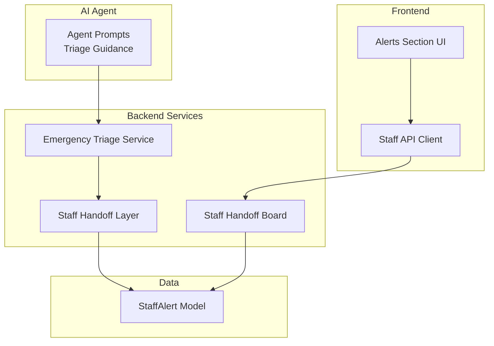
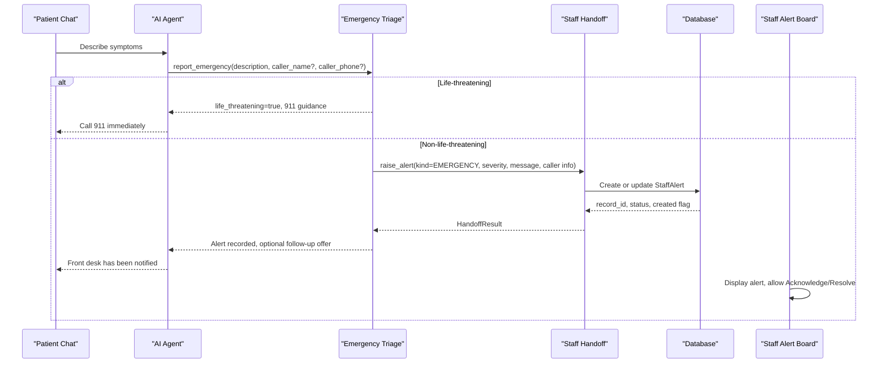
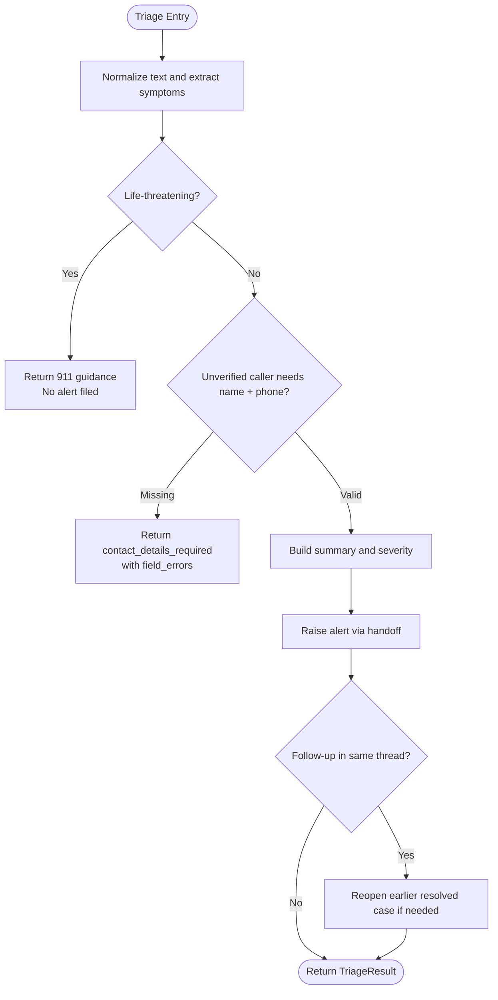
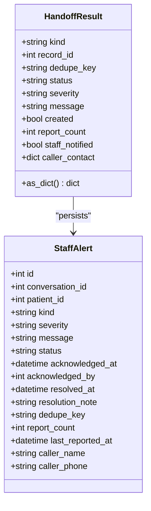
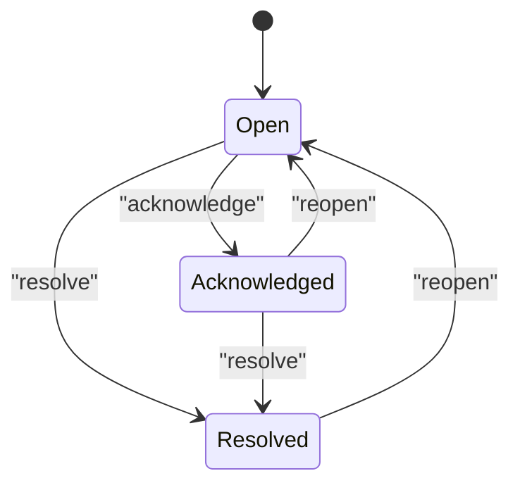
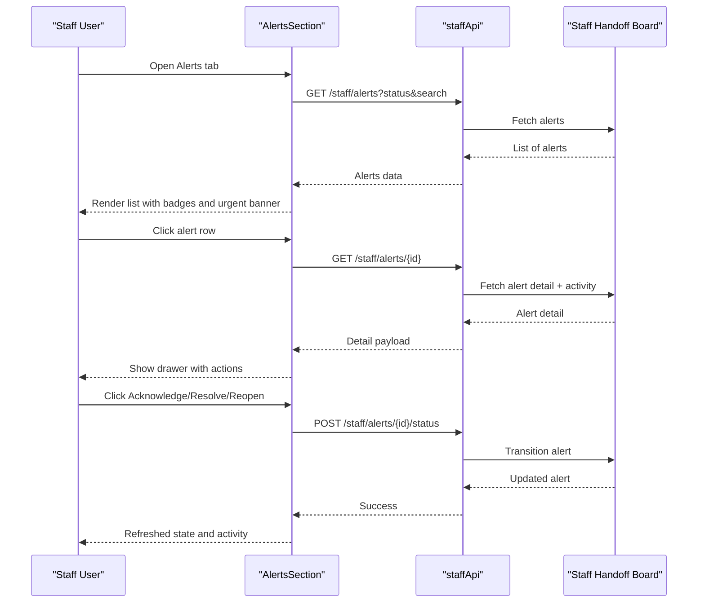
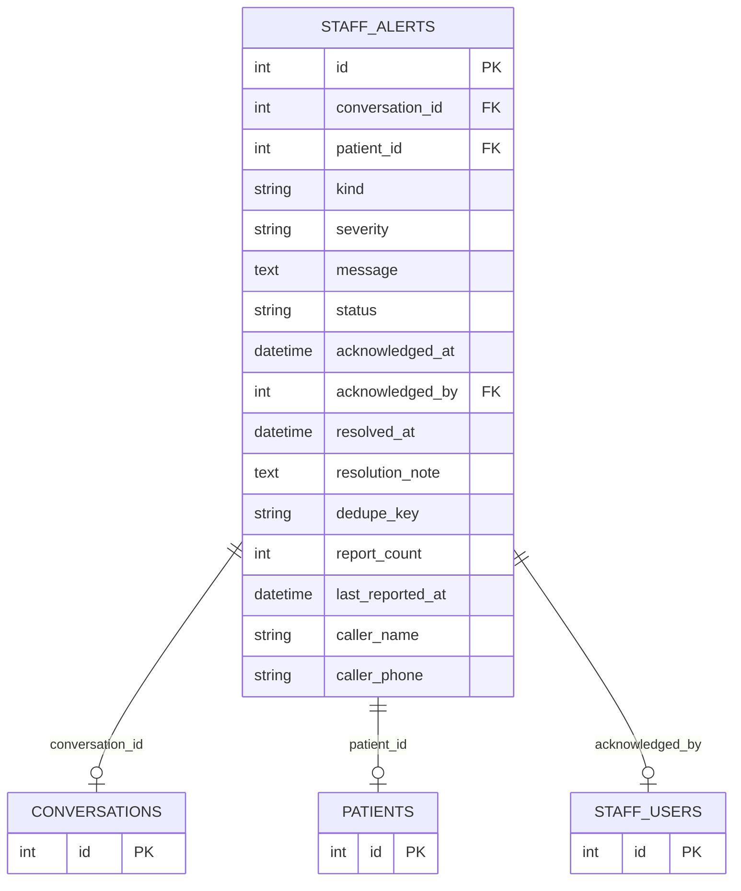
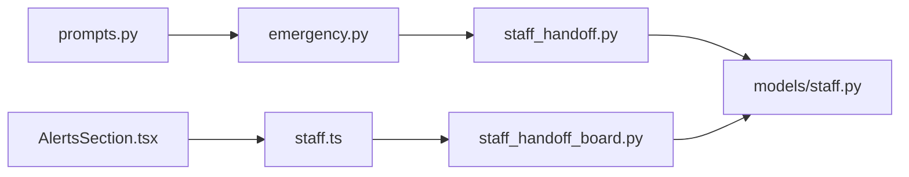

# Emergency Alert System

<cite>
**Referenced Files in This Document**
- [emergency.py](file://backend/app/services/emergency.py)
- [staff_handoff.py](file://backend/app/services/staff_handoff.py)
- [staff_handoff_board.py](file://backend/app/services/staff_handoff_board.py)
- [staff.py](file://backend/app/models/staff.py)
- [AlertsSection.tsx](file://frontend/src/pages/staff/sections/AlertsSection.tsx)
- [staff.ts](file://frontend/src/api/staff.ts)
- [prompts.py](file://backend/app/agent/prompts.py)
- [smoke_phase3.py](file://backend/scripts/smoke_phase3.py)
</cite>

## Table of Contents
1. [Introduction](#introduction)
2. [Project Structure](#project-structure)
3. [Core Components](#core-components)
4. [Architecture Overview](#architecture-overview)
5. [Detailed Component Analysis](#detailed-component-analysis)
6. [Dependency Analysis](#dependency-analysis)
7. [Performance Considerations](#performance-considerations)
8. [Troubleshooting Guide](#troubleshooting-guide)
9. [Operational Best Practices](#operational-best-practices)
10. [Conclusion](#conclusion)

## Introduction
This document explains the emergency alert system that surfaces critical patient situations requiring immediate staff intervention. It covers how the AI agent’s triage logic creates alerts, how alerts are prioritized and categorized, and how the real-time staff alert board displays and manages them. It also documents staff actions such as acknowledgment, escalation through severity, resolution workflows, communication with patients, and integration with the handoff system. Finally, it describes the alert data model, notification mechanisms, monitoring, performance characteristics, and operational best practices for handling high-priority situations.

## Project Structure
The emergency alert system spans backend services, database models, API client types, and a staff-facing React interface:

- Backend triage service: classifies symptoms, decides whether 911 guidance is required, validates caller contact details, and raises alerts.
- Handoff layer: deduplicates alerts, persists them, and logs creation events.
- Staff handoff board: provides queries, transitions, audit logging, and summary counts.
- Data model: defines `StaffAlert`, statuses, severities, deduplication keys, and caller fields.
- Frontend alert board: lists, filters, searches, acknowledges, resolves, and reopens alerts; shows activity history.
- Agent prompt guidance: instructs the AI to call the emergency tool, handle life-threatening cases first, and collect callback details when needed.

**Diagram sources**
- [prompts.py:186-197](file://backend/app/agent/prompts.py#L186-L197)
- [emergency.py:258-366](file://backend/app/services/emergency.py#L258-L366)
- [staff_handoff.py:98-200](file://backend/app/services/staff_handoff.py#L98-L200)
- [staff_handoff_board.py:230-257](file://backend/app/services/staff_handoff_board.py#L230-L257)
- [staff.py:87-136](file://backend/app/models/staff.py#L87-L136)
- [AlertsSection.tsx:39-189](file://frontend/src/pages/staff/sections/AlertsSection.tsx#L39-L189)
- [staff.ts:362-375](file://frontend/src/api/staff.ts#L362-L375)

**Section sources**
- [prompts.py:186-197](file://backend/app/agent/prompts.py#L186-L197)
- [emergency.py:1-31](file://backend/app/services/emergency.py#L1-L31)
- [staff_handoff.py:1-16](file://backend/app/services/staff_handoff.py#L1-L16)
- [staff_handoff_board.py:1-34](file://backend/app/services/staff_handoff_board.py#L1-L34)
- [AlertsSection.tsx:1-10](file://frontend/src/pages/staff/sections/AlertsSection.tsx#L1-L10)

## Core Components
- Emergency triage service: Determines if a report is life-threatening, extracts symptom labels, summarizes concerns, validates caller contact information, and raises or updates an alert.
- Staff handoff layer: Creates or updates alerts with deduplication, appends callback information, and emits observability events.
- Staff handoff board: Provides filtering, sorting, status transitions, severity changes, approval rules, and audit recording.
- Alert data model: Stores conversation linkage, patient linkage, kind, severity, message, status, timestamps, dedupe key, report count, and caller contact fields.
- Frontend alert board: Displays active and resolved alerts, highlights urgent items, supports search and filter controls, and exposes acknowledge/resolve/reopen actions with activity timelines.
- Agent prompts: Direct the AI to prioritize life-threatening emergencies, call the emergency reporting tool, and collect callback details when identity is not verified.

**Section sources**
- [emergency.py:117-148](file://backend/app/services/emergency.py#L117-L148)
- [staff_handoff.py:53-80](file://backend/app/services/staff_handoff.py#L53-L80)
- [staff_handoff_board.py:97-129](file://backend/app/services/staff_handoff_board.py#L97-L129)
- [staff.py:87-136](file://backend/app/models/staff.py#L87-L136)
- [AlertsSection.tsx:39-189](file://frontend/src/pages/staff/sections/AlertsSection.tsx#L39-L189)
- [prompts.py:186-197](file://backend/app/agent/prompts.py#L186-L197)

## Architecture Overview
The emergency alert flow begins with the AI agent receiving a patient description. The agent follows prompt instructions to call the emergency reporting tool. The triage service determines whether the situation is life-threatening. If so, it returns immediate 911 guidance without creating a clinic alert. For non-life-threatening reports, it validates contact details (unless the patient is already verified), summarizes symptoms, and raises an alert through the handoff layer. The handoff layer deduplicates by conversation and subject, updates existing open or acknowledged alerts, and logs creation. The staff board then surfaces the alert for acknowledgment and resolution, with full audit trails.

**Diagram sources**
- [prompts.py:186-197](file://backend/app/agent/prompts.py#L186-L197)
- [emergency.py:258-366](file://backend/app/services/emergency.py#L258-L366)
- [staff_handoff.py:98-200](file://backend/app/services/staff_handoff.py#L98-L200)
- [AlertsSection.tsx:191-347](file://frontend/src/pages/staff/sections/AlertsSection.tsx#L191-L347)

## Detailed Component Analysis

### Emergency Triage Service
The triage service implements keyword-driven classification rather than relying on LLM judgment for safety-critical decisions. It:
- Detects life-threatening phrases and returns immediate 911 guidance without filing a front-desk alert.
- Extracts recognized symptom labels from the description.
- Produces a short, staff-readable summary.
- Validates caller name and phone for unverified callers, returning structured field errors when missing or invalid.
- Records normalized contact details on the session for future use.
- Raises an alert via the handoff layer with appropriate severity and subject.
- Handles follow-ups by merging worsening details into the same alert and reopening resolved cases when necessary.

**Diagram sources**
- [emergency.py:219-255](file://backend/app/services/emergency.py#L219-L255)
- [emergency.py:258-366](file://backend/app/services/emergency.py#L258-L366)
- [emergency.py:390-455](file://backend/app/services/emergency.py#L390-L455)

**Section sources**
- [emergency.py:1-31](file://backend/app/services/emergency.py#L1-L31)
- [emergency.py:117-148](file://backend/app/services/emergency.py#L117-L148)
- [emergency.py:151-180](file://backend/app/services/emergency.py#L151-L180)
- [emergency.py:183-210](file://backend/app/services/emergency.py#L183-L210)
- [emergency.py:219-255](file://backend/app/services/emergency.py#L219-L255)
- [emergency.py:258-366](file://backend/app/services/emergency.py#L258-L366)
- [emergency.py:390-455](file://backend/app/services/emergency.py#L390-L455)
- [emergency.py:458-517](file://backend/app/services/emergency.py#L458-L517)

### Staff Handoff Layer
The handoff layer ensures idempotent alert creation and updates:
- Deduplicates alerts using a stable key composed of kind, conversation ID, and subject.
- Updates existing open or acknowledged alerts with new messages and severity when changed.
- Appends callback information to the alert message and stores caller fields separately.
- Logs alert creation events with warning level.
- Returns a consistent result object describing kind, record ID, status, severity, message, creation flag, report count, and caller contact.

**Diagram sources**
- [staff_handoff.py:53-80](file://backend/app/services/staff_handoff.py#L53-L80)
- [staff.py:87-136](file://backend/app/models/staff.py#L87-L136)

**Section sources**
- [staff_handoff.py:1-16](file://backend/app/services/staff_handoff.py#L1-L16)
- [staff_handoff.py:98-200](file://backend/app/services/staff_handoff.py#L98-L200)
- [staff_handoff.py:203-261](file://backend/app/services/staff_handoff.py#L203-L261)
- [staff_handoff.py:264-317](file://backend/app/services/staff_handoff.py#L264-L317)

### Staff Handoff Board
The staff handoff board provides:
- Filtering by status, kind, severity, and free-text search across message and patient name.
- Sorting that prioritizes unresolved items, higher urgency, and newer entries.
- Status transitions with strict state machines: open ↔ acknowledged ↔ resolved.
- Severity changes with audit logging.
- Approval rules derived from request type, ensuring routine requests do not require approval.
- Summary counts for dashboard tiles including open and urgent alerts.
- Activity retrieval from audit records for each alert.

**Diagram sources**
- [staff_handoff_board.py:77-87](file://backend/app/services/staff_handoff_board.py#L77-L87)
- [staff_handoff_board.py:380-429](file://backend/app/services/staff_handoff_board.py#L380-L429)

**Section sources**
- [staff_handoff_board.py:1-34](file://backend/app/services/staff_handoff_board.py#L1-L34)
- [staff_handoff_board.py:97-129](file://backend/app/services/staff_handoff_board.py#L97-L129)
- [staff_handoff_board.py:230-257](file://backend/app/services/staff_handoff_board.py#L230-L257)
- [staff_handoff_board.py:325-372](file://backend/app/services/staff_handoff_board.py#L325-L372)
- [staff_handoff_board.py:380-429](file://backend/app/services/staff_handoff_board.py#L380-L429)
- [staff_handoff_board.py:432-457](file://backend/app/services/staff_handoff_board.py#L432-L457)
- [staff_handoff_board.py:504-542](file://backend/app/services/staff_handoff_board.py#L504-L542)
- [staff_handoff_board.py:545-574](file://backend/app/services/staff_handoff_board.py#L545-L574)

### Frontend Alert Board Interface
The frontend alert board:
- Loads alerts via the staff API client with optional status and search filters.
- Highlights urgent concerns with a banner and row styling.
- Shows patient or caller identity, kind badge, severity badge, status badge, and relative timestamps.
- Opens a detail drawer showing alert facts, optional caller fields, timestamps, conversation ID, resolution note, and activity timeline.
- Allows acknowledging open alerts, marking resolved, and reopening resolved alerts.
- Persists transitions through the API and refreshes local state.

**Diagram sources**
- [AlertsSection.tsx:39-189](file://frontend/src/pages/staff/sections/AlertsSection.tsx#L39-L189)
- [AlertsSection.tsx:191-347](file://frontend/src/pages/staff/sections/AlertsSection.tsx#L191-L347)
- [staff.ts:362-375](file://frontend/src/api/staff.ts#L362-L375)

**Section sources**
- [AlertsSection.tsx:1-10](file://frontend/src/pages/staff/sections/AlertsSection.tsx#L1-L10)
- [AlertsSection.tsx:39-189](file://frontend/src/pages/staff/sections/AlertsSection.tsx#L39-L189)
- [AlertsSection.tsx:191-347](file://frontend/src/pages/staff/sections/AlertsSection.tsx#L191-L347)
- [staff.ts:139-167](file://frontend/src/api/staff.ts#L139-L167)
- [staff.ts:362-375](file://frontend/src/api/staff.ts#L362-L375)

### Alert Data Model
The `StaffAlert` model captures all essential fields for emergency alerts:
- Conversation and patient linkage.
- Kind and severity.
- Message and status.
- Timestamps for creation, acknowledgement, resolution, last reported, and updated.
- Deduplication key and report count.
- Caller name and phone for unverified callers.
- Resolution note and audit linkage.

**Diagram sources**
- [staff.py:87-136](file://backend/app/models/staff.py#L87-L136)

**Section sources**
- [staff.py:87-136](file://backend/app/models/staff.py#L87-L136)

### Notification Mechanisms
- Creation logging: When an alert is created, a warning-level event is logged with alert ID, kind, severity, and conversation ID.
- Audit trail: Every staff transition (acknowledge, resolve, reopen) and severity change is recorded with actor type, actor ID, entity type, entity ID, and safe details.
- Frontend notifications: The UI reflects status changes immediately after successful mutations and reloads detail and activity.

**Section sources**
- [staff_handoff.py:182-190](file://backend/app/services/staff_handoff.py#L182-L190)
- [staff_handoff_board.py:545-574](file://backend/app/services/staff_handoff_board.py#L545-L574)
- [AlertsSection.tsx:191-347](file://frontend/src/pages/staff/sections/AlertsSection.tsx#L191-L347)

### Integration with the Handoff System
The emergency triage service integrates with the handoff system by:
- Using `AlertKind.EMERGENCY`.
- Computing severity based on life-threatening status and symptom set.
- Passing conversation ID, optional patient ID, summary message, subject, and caller contact fields.
- Handling repeat reports and reopened cases to keep one case per conversation thread.

**Section sources**
- [emergency.py:336-346](file://backend/app/services/emergency.py#L336-L346)
- [emergency.py:390-455](file://backend/app/services/emergency.py#L390-L455)
- [staff_handoff.py:98-200](file://backend/app/services/staff_handoff.py#L98-L200)

### Examples of Emergency Scenarios and Response Procedures
- Severe pain and facial swelling:
  - Triage detects urgent symptoms and creates an emergency alert with high severity.
  - Front desk receives an alert with summary and caller contact if provided.
  - Staff acknowledges and resolves after clinical evaluation.
- Airway compromise:
  - Triage identifies life-threatening keywords and returns immediate 911 guidance.
  - No clinic alert is filed; the assistant directs the patient to emergency services.
- Follow-up worsening:
  - A later message indicates worsening; the system merges details into the existing alert and may reopen a previously resolved case.
  - Staff sees updated message, increased report count, and refreshed timestamp.

These scenarios are validated by smoke tests that exercise triage outcomes, alert reuse, and life-threatening routing.

**Section sources**
- [smoke_phase3.py:150-170](file://backend/scripts/smoke_phase3.py#L150-L170)
- [emergency.py:258-366](file://backend/app/services/emergency.py#L258-L366)
- [emergency.py:458-517](file://backend/app/services/emergency.py#L458-L517)

## Dependency Analysis
Key dependencies and relationships:
- Agent prompts depend on clinic policy and instruct calling the emergency tool.
- Emergency triage depends on validation utilities, staff handoff, and alert models.
- Staff handoff depends on alert models and observability logging.
- Staff handoff board depends on alert and request models, audit service, and transaction utilities.
- Frontend alert board depends on staff API client types and methods.

**Diagram sources**
- [prompts.py:186-197](file://backend/app/agent/prompts.py#L186-L197)
- [emergency.py:258-366](file://backend/app/services/emergency.py#L258-L366)
- [staff_handoff.py:98-200](file://backend/app/services/staff_handoff.py#L98-L200)
- [staff_handoff_board.py:230-257](file://backend/app/services/staff_handoff_board.py#L230-L257)
- [AlertsSection.tsx:39-189](file://frontend/src/pages/staff/sections/AlertsSection.tsx#L39-L189)
- [staff.ts:362-375](file://frontend/src/api/staff.ts#L362-L375)

**Section sources**
- [prompts.py:186-197](file://backend/app/agent/prompts.py#L186-L197)
- [emergency.py:258-366](file://backend/app/services/emergency.py#L258-L366)
- [staff_handoff.py:98-200](file://backend/app/services/staff_handoff.py#L98-L200)
- [staff_handoff_board.py:230-257](file://backend/app/services/staff_handoff_board.py#L230-L257)
- [AlertsSection.tsx:39-189](file://frontend/src/pages/staff/sections/AlertsSection.tsx#L39-L189)
- [staff.ts:362-375](file://frontend/src/api/staff.ts#L362-L375)

## Performance Considerations
- Keyword-based triage avoids expensive LLM calls for safety-critical classification, reducing latency and cost.
- Deduplication uses indexed columns (`dedupe_key`) to prevent duplicate alerts and reduce load.
- Alert listing applies server-side limits and sorts efficiently, prioritizing unresolved and urgent items.
- Summary counts use aggregate queries to avoid loading full rows.
- Frontend uses memoized query keys and controlled pagination to minimize unnecessary re-renders.

[No sources needed since this section provides general guidance]

## Troubleshooting Guide
Common issues and resolutions:
- Missing caller details:
  - Symptom: Triage returns `contact_details_required` with field errors.
  - Resolution: Collect caller name and valid US phone number; retry the report.
- Duplicate alerts:
  - Symptom: Multiple alerts for the same concern.
  - Resolution: Ensure conversation-scoped subjects and rely on dedupe key; check follow-up merging logic.
- Invalid status transitions:
  - Symptom: Error indicating invalid transition.
  - Resolution: Use allowed transitions: open → acknowledged → resolved; resolved → open.
- Busy dashboard:
  - Symptom: Error stating dashboard is busy.
  - Resolution: Retry after a short delay; ensure single-writer transactions succeed.
- Urgent banner not appearing:
  - Symptom: Urgent alerts not highlighted.
  - Resolution: Verify `is_urgent` computation includes severity and kind; confirm UI filters exclude resolved.

**Section sources**
- [emergency.py:151-180](file://backend/app/services/emergency.py#L151-L180)
- [staff_handoff_board.py:380-429](file://backend/app/services/staff_handoff_board.py#L380-L429)
- [AlertsSection.tsx:53-74](file://frontend/src/pages/staff/sections/AlertsSection.tsx#L53-L74)

## Operational Best Practices
- Always treat life-threatening descriptions as immediate 911 guidance before any registration or scheduling steps.
- Require callback name and phone for non-life-threatening reports unless the patient is verified.
- Keep one alert per conversation thread; merge worsening details and reopen resolved cases when appropriate.
- Use severity judiciously: reserve urgent/high for airway compromise, severe pain, facial swelling, possible abscess, dental trauma.
- Acknowledge alerts promptly to signal ownership; resolve only after clinical action or appropriate disposition.
- Record resolution notes sparingly; audit captures presence of notes without storing sensitive content.
- Monitor urgent alert counts and open alert metrics regularly to detect backlog.
- Avoid claiming personal staff notification; the system records only that an alert was created or updated.

[No sources needed since this section provides general guidance]

## Conclusion
The emergency alert system combines deterministic triage logic, robust handoff persistence, and a clear staff workflow to ensure critical patient situations are surfaced, prioritized, and managed safely. Life-threatening cases bypass clinic operations and direct patients to emergency services, while non-life-threatening emergencies create actionable alerts with deduplication, caller contact capture, and audit trails. The staff alert board provides intuitive controls for acknowledgment, escalation, and resolution, supporting effective operational response and continuous monitoring.

[No sources needed since this section summarizes without analyzing specific files]