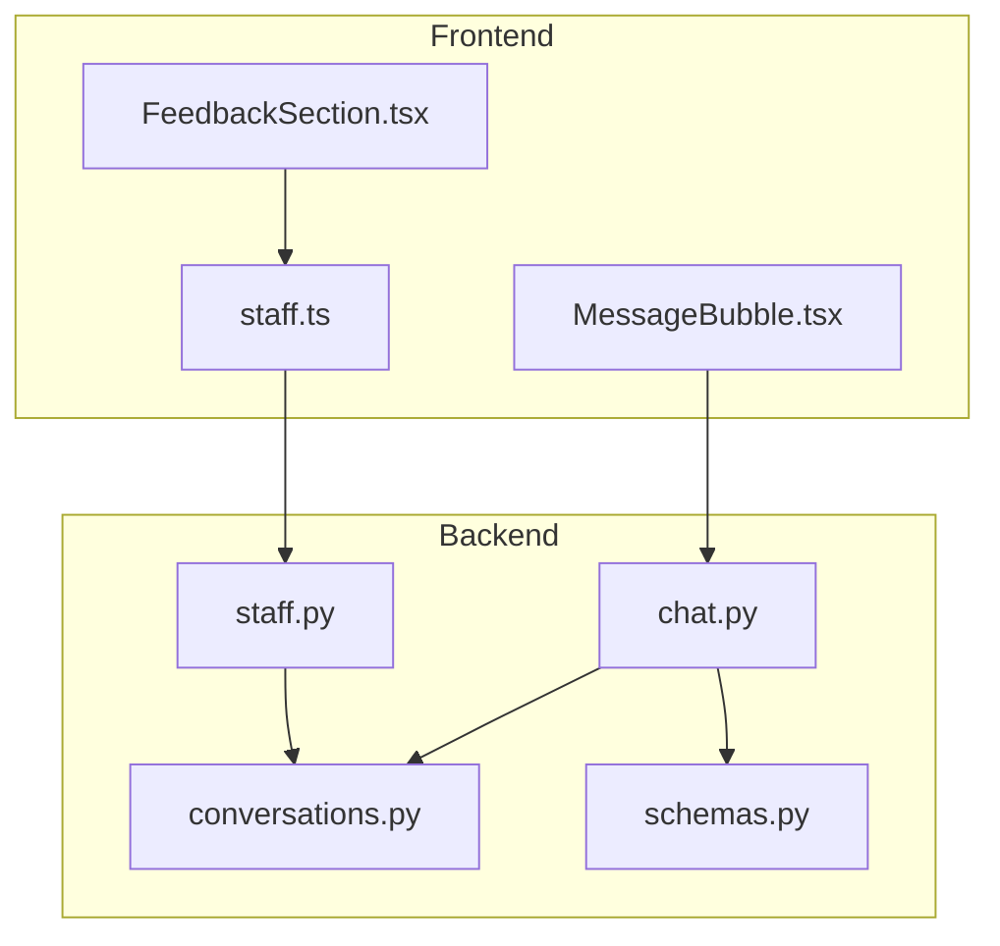
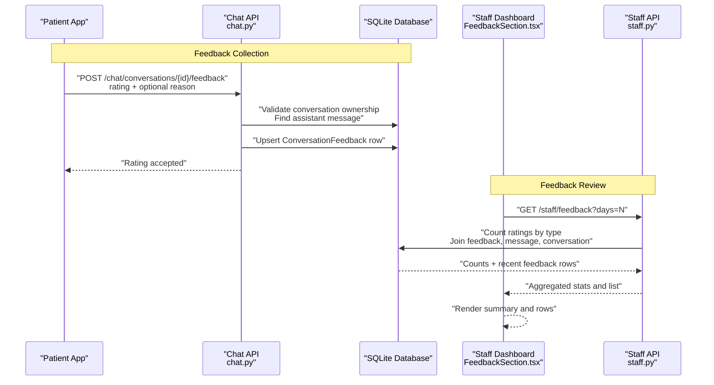
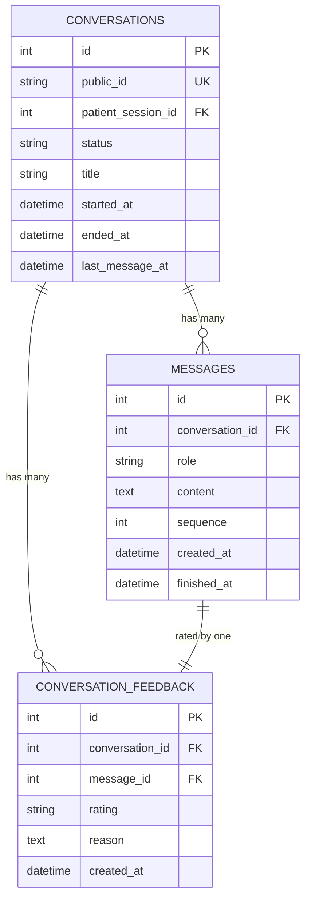
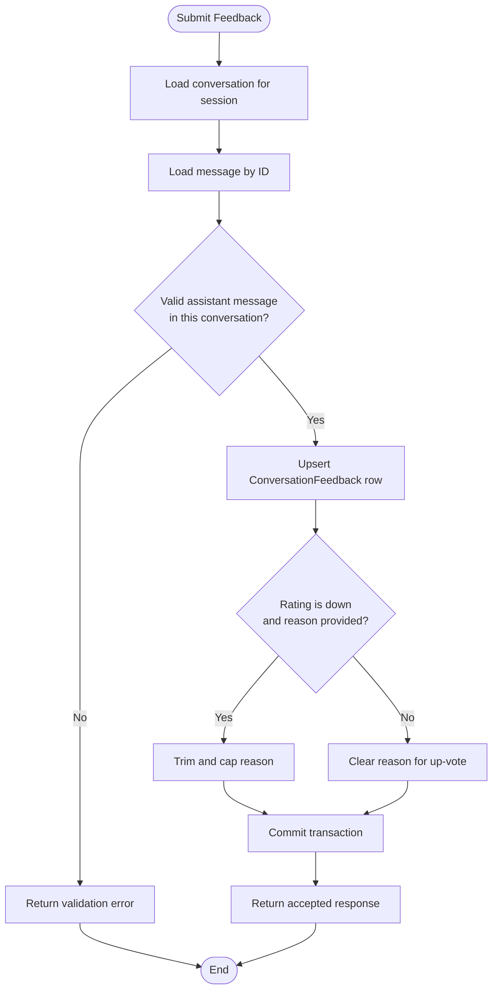
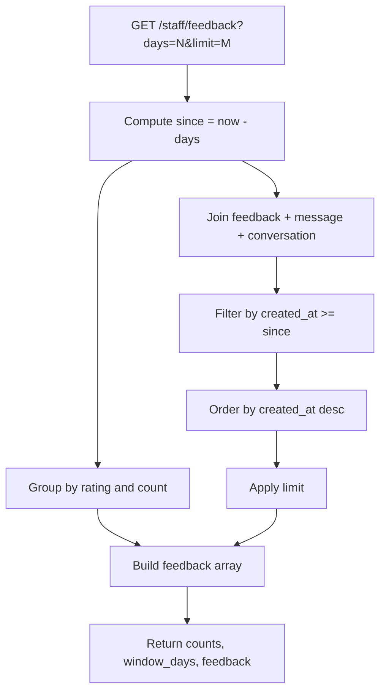
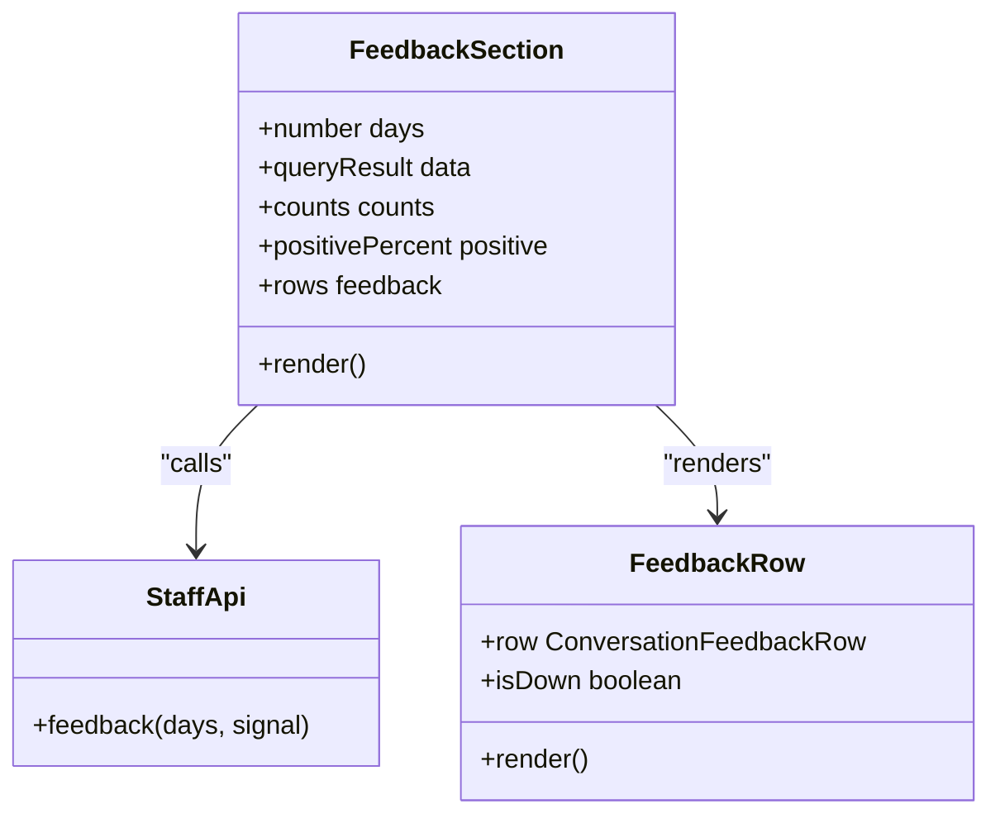
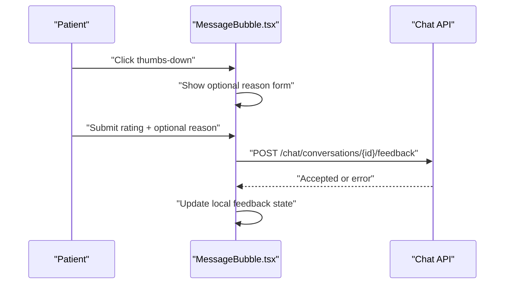
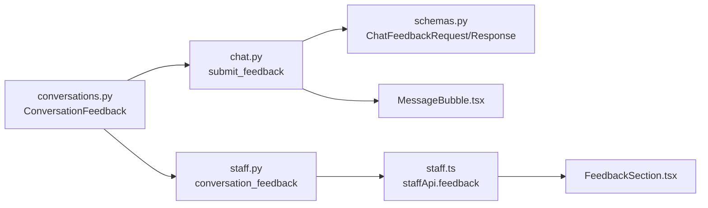

# Feedback Review System

<cite>
**Referenced Files in This Document**
- [conversations.py](file://backend/app/models/conversations.py)
- [chat.py](file://backend/app/api/chat.py)
- [staff.py](file://backend/app/api/staff.py)
- [schemas.py](file://backend/app/schemas.py)
- [FeedbackSection.tsx](file://frontend/src/pages/staff/sections/FeedbackSection.tsx)
- [staff.ts](file://frontend/src/api/staff.ts)
- [MessageBubble.tsx](file://frontend/src/components/chat/MessageBubble.tsx)
</cite>

## Table of Contents
1. [Introduction](#introduction)
2. [Project Structure](#project-structure)
3. [Core Components](#core-components)
4. [Architecture Overview](#architecture-overview)
5. [Detailed Component Analysis](#detailed-component-analysis)
6. [Dependency Analysis](#dependency-analysis)
7. [Performance Considerations](#performance-considerations)
8. [Troubleshooting Guide](#troubleshooting-guide)
9. [Conclusion](#conclusion)

## Introduction
This document explains the feedback review system that captures patient ratings of assistant responses and presents them to staff for evaluation. The system has three main parts:

- **Feedback collection**: Patients rate individual assistant replies from within their chat conversation. A thumbs-down can include an optional reason.
- **Data model and linkage**: Each rating is tied to one stored assistant message and one conversation, enabling staff to understand context without exposing patient identity through the feedback view.
- **Staff review interface**: Staff see a time-windowed summary of positive and negative ratings, plus recent feedback rows with the rated reply excerpt, conversation title, optional reason, and timestamp.

The implementation uses a SQLite-backed backend with FastAPI endpoints and a React-based staff dashboard. Patient-facing feedback submission goes through the public chat API, while staff feedback review is exposed through the authenticated staff dashboard API.

## Project Structure
The feedback feature spans both backend and frontend code:

**Diagram sources**
- [FeedbackSection.tsx:28-35](file://frontend/src/pages/staff/sections/FeedbackSection.tsx#L28-L35)
- [MessageBubble.tsx:92-103](file://frontend/src/components/chat/MessageBubble.tsx#L92-L103)
- [staff.ts:301-302](file://frontend/src/api/staff.ts#L301-L302)
- [chat.py:277-322](file://backend/app/api/chat.py#L277-L322)
- [staff.py:325-372](file://backend/app/api/staff.py#L325-L372)
- [conversations.py:129-157](file://backend/app/models/conversations.py#L129-L157)
- [schemas.py:241-257](file://backend/app/schemas.py#L241-L257)

**Section sources**
- [FeedbackSection.tsx:1-140](file://frontend/src/pages/staff/sections/FeedbackSection.tsx#L1-L140)
- [MessageBubble.tsx:92-197](file://frontend/src/components/chat/MessageBubble.tsx#L92-L197)
- [staff.ts:192-205](file://frontend/src/api/staff.ts#L192-L205)
- [chat.py:277-322](file://backend/app/api/chat.py#L277-L322)
- [staff.py:325-372](file://backend/app/api/staff.py#L325-L372)
- [conversations.py:129-157](file://backend/app/models/conversations.py#L129-L157)
- [schemas.py:241-257](file://backend/app/schemas.py#L241-L257)

## Core Components
The feedback review system is built around these core components:

| Component | Responsibility | Key Implementation Details |
|---|---|---|
| `ConversationFeedback` model | Stores one rating per assistant message | Links to `conversation_id` and `message_id`; enforces one row per message; indexes by conversation and creation time |
| Chat feedback endpoint | Accepts patient ratings for assistant turns | Validates ownership, message role, and updates or creates one feedback row |
| Staff feedback endpoint | Returns aggregated counts and recent feedback rows | Filters by a configurable day window; joins feedback, message content, and conversation title |
| Staff feedback UI | Displays summary stats and recent feedback rows | Supports 7/30/90-day windows, refresh, and shows helpful/not-helpful indicators |
| Patient feedback UI | Lets patients rate the latest assistant reply | Shows thumbs-up/down and optional reason prompt for thumbs-down |
| Pydantic schemas | Define request/response contracts | Enforce allowed rating values and length limits |

**Section sources**
- [conversations.py:129-157](file://backend/app/models/conversations.py#L129-L157)
- [chat.py:277-322](file://backend/app/api/chat.py#L277-L322)
- [staff.py:325-372](file://backend/app/api/staff.py#L325-L372)
- [FeedbackSection.tsx:28-109](file://frontend/src/pages/staff/sections/FeedbackSection.tsx#L28-L109)
- [MessageBubble.tsx:92-197](file://frontend/src/components/chat/MessageBubble.tsx#L92-L197)
- [schemas.py:241-257](file://backend/app/schemas.py#L241-L257)

## Architecture Overview
The feedback flow connects patient interactions, backend persistence, and staff review.

**Diagram sources**
- [chat.py:277-322](file://backend/app/api/chat.py#L277-L322)
- [staff.py:325-372](file://backend/app/api/staff.py#L325-L372)
- [conversations.py:129-157](file://backend/app/models/conversations.py#L129-L157)
- [FeedbackSection.tsx:28-35](file://frontend/src/pages/staff/sections/FeedbackSection.tsx#L28-L35)

## Detailed Component Analysis

### Feedback Data Model
The data model centers on `ConversationFeedback`, which stores one patient rating per assistant message. It links back to the owning conversation and the exact message turn.

Key properties:
- One feedback row per message, enforced by a unique constraint on `message_id`.
- Indexed by `conversation_id` and `created_at` for efficient staff queries.
- Optional `reason` field used primarily when the rating is negative.
- Cascade deletion ensures feedback is removed when its parent conversation or message is deleted.

**Diagram sources**
- [conversations.py:39-84](file://backend/app/models/conversations.py#L39-L84)
- [conversations.py:87-127](file://backend/app/models/conversations.py#L87-L127)
- [conversations.py:129-157](file://backend/app/models/conversations.py#L129-L157)

**Section sources**
- [conversations.py:129-157](file://backend/app/models/conversations.py#L129-L157)

### Feedback Collection Endpoint
The patient-facing feedback endpoint records how a specific assistant turn landed. It validates that:
- The conversation belongs to the current patient session.
- The target message exists.
- The target message is an assistant turn.
- Re-rating the same message updates the existing row rather than stacking multiple ratings.

When a thumbs-down includes a reason, the server trims whitespace and caps it at a fixed length. An up-vote does not retain a previous reason.

**Diagram sources**
- [chat.py:277-322](file://backend/app/api/chat.py#L277-L322)
- [schemas.py:241-257](file://backend/app/schemas.py#L241-L257)

**Section sources**
- [chat.py:277-322](file://backend/app/api/chat.py#L277-L322)
- [schemas.py:241-257](file://backend/app/schemas.py#L241-L257)

### Staff Feedback Query and Aggregation
The staff feedback endpoint provides:
- A count of positive and negative ratings within a configurable time window.
- Recent feedback rows ordered newest first.
- For each row: feedback ID, rating, optional reason, creation time, conversation title, and a truncated excerpt of the rated assistant reply.

The query joins feedback with the message and conversation tables, filters by `created_at`, groups by rating for counts, and applies a limit to keep the response manageable.

**Diagram sources**
- [staff.py:325-372](file://backend/app/api/staff.py#L325-L372)

**Section sources**
- [staff.py:325-372](file://backend/app/api/staff.py#L325-L372)

### Staff Feedback Interface
The staff feedback page displays:
- A time window selector for 7, 30, or 90 days.
- Summary statistics: positive percentage, helpful count, and needs-a-look count.
- A list of recent feedback entries showing conversation title, helpfulness badge, reply excerpt, optional reason, and relative timestamp.

The component calls the staff API client with the selected window and renders loading, empty, error, and success states.

**Diagram sources**
- [FeedbackSection.tsx:28-109](file://frontend/src/pages/staff/sections/FeedbackSection.tsx#L28-L109)
- [FeedbackSection.tsx:111-139](file://frontend/src/pages/staff/sections/FeedbackSection.tsx#L111-L139)
- [staff.ts:192-205](file://frontend/src/api/staff.ts#L192-L205)
- [staff.ts:301-302](file://frontend/src/api/staff.ts#L301-L302)

**Section sources**
- [FeedbackSection.tsx:28-139](file://frontend/src/pages/staff/sections/FeedbackSection.tsx#L28-L139)
- [staff.ts:192-205](file://frontend/src/api/staff.ts#L192-L205)
- [staff.ts:301-302](file://frontend/src/api/staff.ts#L301-L302)

### Patient Feedback Interaction
In the patient chat UI, each assistant message can be rated. When a patient selects thumbs-down, the UI optionally asks for a short reason before submitting. On success, the UI updates the local feedback state; on failure, it shows an error state.

**Diagram sources**
- [MessageBubble.tsx:92-103](file://frontend/src/components/chat/MessageBubble.tsx#L92-L103)
- [MessageBubble.tsx:165-197](file://frontend/src/components/chat/MessageBubble.tsx#L165-L197)
- [chat.py:277-322](file://backend/app/api/chat.py#L277-L322)

**Section sources**
- [MessageBubble.tsx:92-197](file://frontend/src/components/chat/MessageBubble.tsx#L92-L197)
- [chat.py:277-322](file://backend/app/api/chat.py#L277-L322)

## Dependency Analysis
The feedback system has clear separation between patient-facing mutation and staff-facing read operations.

**Diagram sources**
- [conversations.py:129-157](file://backend/app/models/conversations.py#L129-L157)
- [chat.py:277-322](file://backend/app/api/chat.py#L277-L322)
- [staff.py:325-372](file://backend/app/api/staff.py#L325-L372)
- [schemas.py:241-257](file://backend/app/schemas.py#L241-L257)
- [staff.ts:301-302](file://frontend/src/api/staff.ts#L301-L302)
- [FeedbackSection.tsx:28-35](file://frontend/src/pages/staff/sections/FeedbackSection.tsx#L28-L35)
- [MessageBubble.tsx:92-103](file://frontend/src/components/chat/MessageBubble.tsx#L92-L103)

**Section sources**
- [conversations.py:129-157](file://backend/app/models/conversations.py#L129-L157)
- [chat.py:277-322](file://backend/app/api/chat.py#L277-L322)
- [staff.py:325-372](file://backend/app/api/staff.py#L325-L372)
- [schemas.py:241-257](file://backend/app/schemas.py#L241-L257)
- [staff.ts:301-302](file://frontend/src/api/staff.ts#L301-L302)
- [FeedbackSection.tsx:28-35](file://frontend/src/pages/staff/sections/FeedbackSection.tsx#L28-L35)
- [MessageBubble.tsx:92-103](file://frontend/src/components/chat/MessageBubble.tsx#L92-L103)

## Performance Considerations
The current design supports moderate-scale feedback processing through several mechanisms:

- **One row per message**: The unique constraint on `message_id` prevents duplicate feedback rows for the same assistant turn, keeping storage predictable.
- **Indexes**: Indexes on `conversation_id` and `created_at` support common filtering patterns, especially the staff feedback time-window query.
- **Time-window filtering**: The staff endpoint computes a cutoff based on the requested number of days, limiting the dataset scanned.
- **Result limiting**: The staff feedback query applies a limit to the returned rows, preventing unbounded result sets.
- **Truncated excerpts**: The staff response truncates the assistant reply excerpt to a fixed length, reducing payload size.
- **Reason capping**: The feedback submission endpoint caps the reason length, protecting storage and downstream display logic.

For large-scale deployments, consider:
- Monitoring query latency for the staff feedback join under high volume.
- Adding database-level partitioning or archival strategies if feedback grows significantly.
- Introducing precomputed aggregates for longer time windows if needed.
- Caching staff feedback summaries for short intervals to reduce repeated aggregation workloads.

[No sources needed since this section provides general guidance]

## Troubleshooting Guide

### Common Issues and Resolutions

| Symptom | Likely Cause | Resolution |
|---|---|---|
| Patient cannot submit feedback | Message ID does not belong to the current conversation or is not an assistant message | Verify the message belongs to the active conversation and has role `assistant` |
| Feedback appears but no reason is shown | Rating was changed to up or reason was omitted | Reasons are only stored for down-ratings; re-rating to up clears the reason |
| Staff feedback list is empty | No feedback in the selected time window | Increase the day window or check whether patients have rated any assistant replies |
| Positive percentage shows as missing | No rated messages in the selected window | The percentage calculation requires at least one total rating |
| Feedback submission fails with validation error | Invalid payload, such as invalid rating value or missing required fields | Ensure rating is `up` or `down`, and message ID is valid |

**Section sources**
- [chat.py:277-322](file://backend/app/api/chat.py#L277-L322)
- [schemas.py:241-257](file://backend/app/schemas.py#L241-L257)
- [FeedbackSection.tsx:33-35](file://frontend/src/pages/staff/sections/FeedbackSection.tsx#L33-L35)
- [FeedbackSection.tsx:92-97](file://frontend/src/pages/staff/sections/FeedbackSection.tsx#L92-L97)

## Conclusion
The feedback review system provides a focused loop for improving assistant response quality:

- Patients can quickly rate assistant replies, with optional reasons for negative feedback.
- The backend enforces clear ownership, message validity, and one-feedback-per-message semantics.
- Staff receive actionable signals: aggregate satisfaction metrics and recent feedback with enough context to investigate problematic conversations.
- The design intentionally avoids exposing patient identity in the feedback view, focusing attention on response quality rather than personal details.

To extend the system further, you could add:
- Time-series analytics for positive/negative trends.
- Filtering by conversation topic or provider.
- Integration with training workflows that highlight recurring issues.
- Exportable reports for quality assurance and coaching.

[No sources needed since this section summarizes without analyzing specific files]