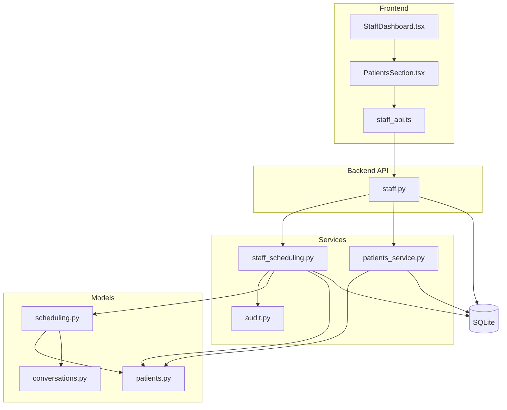
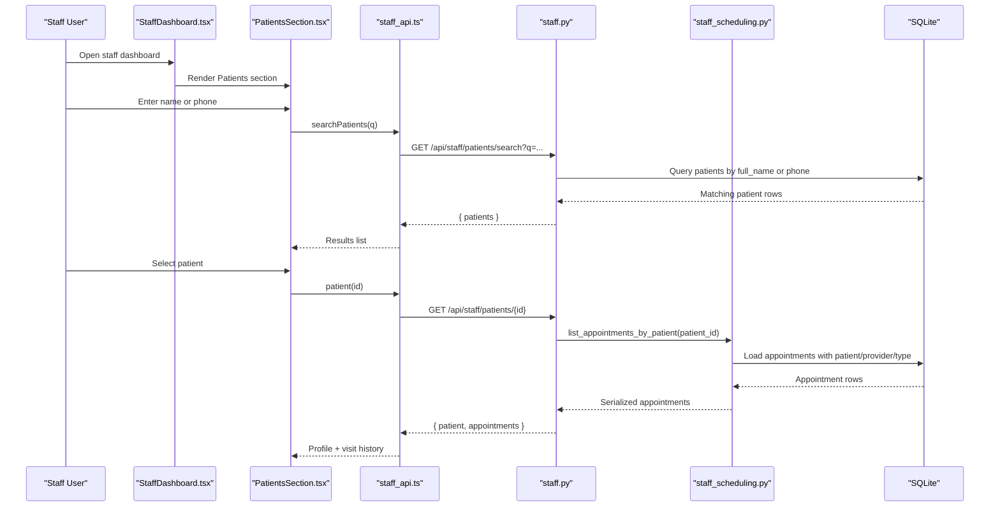
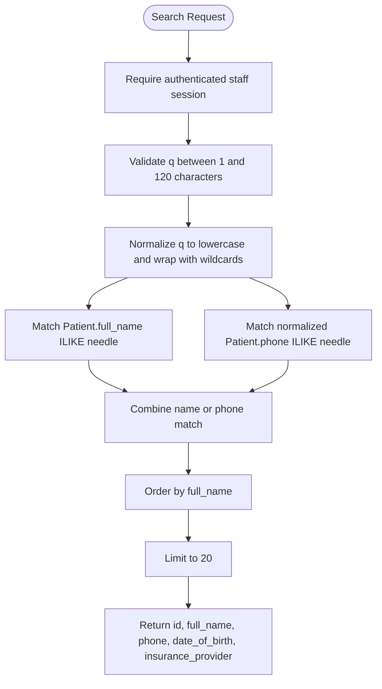
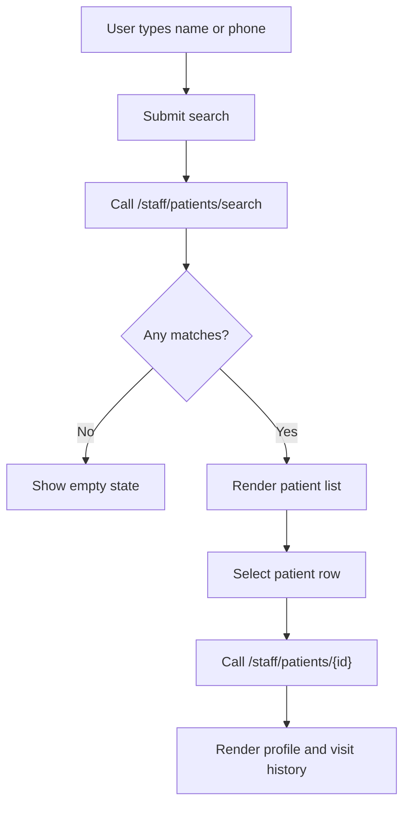
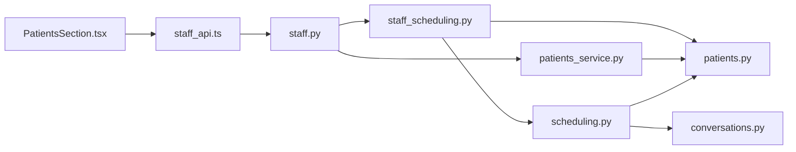
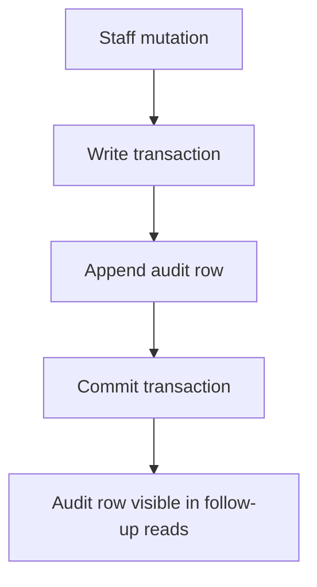
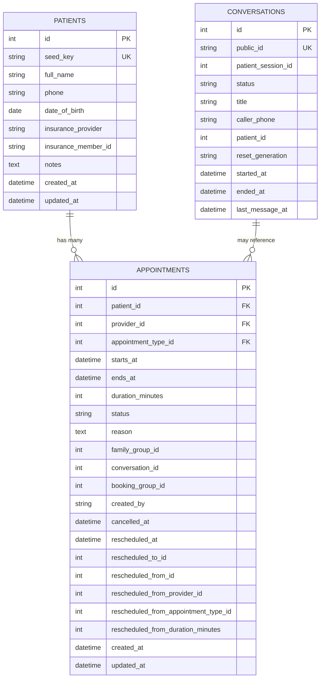

# Patient Records Access

<cite>
**Referenced Files in This Document**
- [README.md](file://README.md)
- [staff.py](file://backend/app/api/staff.py)
- [patients.py](file://backend/app/models/patients.py)
- [scheduling.py](file://backend/app/models/scheduling.py)
- [conversations.py](file://backend/app/models/conversations.py)
- [staff_scheduling.py](file://backend/app/services/staff_scheduling.py)
- [patients_service.py](file://backend/app/services/patients.py)
- [audit.py](file://backend/app/services/audit.py)
- [security.py](file://backend/app/services/security.py)
- [StaffDashboard.tsx](file://frontend/src/pages/staff/StaffDashboard.tsx)
- [PatientsSection.tsx](file://frontend/src/pages/staff/sections/PatientsSection.tsx)
- [staff_api.ts](file://frontend/src/api/staff.ts)
</cite>

## Table of Contents
1. [Introduction](#introduction)
2. [Project Structure](#project-structure)
3. [Core Components](#core-components)
4. [Architecture Overview](#architecture-overview)
5. [Detailed Component Analysis](#detailed-component-analysis)
6. [Dependency Analysis](#dependency-analysis)
7. [Performance Considerations](#performance-considerations)
8. [Privacy, Security, and Compliance](#privacy-security-and-compliance)
9. [Data Model and Relationships](#data-model-and-relationships)
10. [Query Examples and Search Filters](#query-examples-and-search-filters)
11. [Troubleshooting Guide](#troubleshooting-guide)
12. [Conclusion](#conclusion)

## Introduction
This document explains the patient records access interface exposed by the staff dashboard. It covers how staff search for patients, view a patient profile, inspect appointment history, and understand the privacy, security, audit, and performance characteristics of those operations. The staff dashboard shares the same SQLite database used by the conversational patient interface, so patient records, appointments, conversations, and audit trails are consistent across both frontends.

The patient records feature is intentionally limited: authenticated staff can search by name or phone, open a patient detail page, and see that patient’s appointment history. There is no dedicated medical notes editor, clinical diagnosis field, or data export endpoint in this repository. Sensitive fields such as insurance member ID and notes are included only because the payload targets authenticated staff; they are not public API responses.

## Project Structure
The patient records capability spans backend routes, SQLAlchemy models, scheduling services, and the React staff dashboard.

**Diagram sources**
- [StaffDashboard.tsx:66-124](file://frontend/src/pages/staff/StaffDashboard.tsx#L66-L124)
- [PatientsSection.tsx:17-32](file://frontend/src/pages/staff/sections/PatientsSection.tsx#L17-L32)
- [staff_api.ts:399-403](file://frontend/src/api/staff.ts#L399-L403)
- [staff.py:662-716](file://backend/app/api/staff.py#L662-L716)
- [staff_scheduling.py:91-175](file://backend/app/services/staff_scheduling.py#L91-L175)
- [patients_service.py:242-255](file://backend/app/services/patients.py#L242-L255)
- [patients.py:18-46](file://backend/app/models/patients.py#L18-L46)
- [scheduling.py:81-172](file://backend/app/models/scheduling.py#L81-L172)
- [conversations.py:39-84](file://backend/app/models/conversations.py#L39-L84)

**Section sources**
- [README.md:30-38](file://README.md#L30-L38)
- [README.md:52-65](file://README.md#L52-L65)

## Core Components
- Staff authentication and session handling protect every route except login.
- `/staff/patients/search` returns a short list of matching patients by name or phone.
- `/staff/patients/{patient_id}` returns the patient profile plus their appointment history.
- `PatientsSection.tsx` provides the search UI and right-hand record panel.
- `staff_scheduling.list_appointments_by_patient` orders visits with upcoming first, then past most recent.
- Audit records capture staff mutations to appointments; patient read operations do not create audit rows.

Key responsibilities:
- **API layer**: validates inputs, enforces staff authentication, and maps service results to JSON.
- **Service layer**: performs queries, applies business rules, and serializes domain objects.
- **Model layer**: defines tables, relationships, indexes, and constraints.
- **Frontend**: renders search input, result list, patient details, and visit table.

**Section sources**
- [staff.py:3-30](file://backend/app/api/staff.py#L3-L30)
- [staff.py:662-716](file://backend/app/api/staff.py#L662-L716)
- [staff_scheduling.py:256-269](file://backend/app/services/staff_scheduling.py#L256-L269)
- [PatientsSection.tsx:17-32](file://frontend/src/pages/staff/sections/PatientsSection.tsx#L17-L32)

## Architecture Overview
The patient records flow is a simple authenticated lookup followed by a detail query.

**Diagram sources**
- [StaffDashboard.tsx:105-124](file://frontend/src/pages/staff/StaffDashboard.tsx#L105-L124)
- [PatientsSection.tsx:22-32](file://frontend/src/pages/staff/sections/PatientsSection.tsx#L22-L32)
- [staff_api.ts:399-403](file://frontend/src/api/staff.ts#L399-L403)
- [staff.py:662-716](file://backend/app/api/staff.py#L662-L716)
- [staff_scheduling.py:256-269](file://backend/app/services/staff_scheduling.py#L256-L269)

## Detailed Component Analysis

### Staff Authentication and Authorization
Every staff route except login requires an active HttpOnly session cookie and CSRF protection on writes. Anonymous requests receive a safe response without exposing user data. Login sets two cookies:
- An HttpOnly session cookie containing the staff session token.
- A readable CSRF cookie echoed back by the frontend on mutating requests.

This design prevents XSS from reading the session cookie while still allowing the dashboard to send the CSRF header required by the server.

**Section sources**
- [staff.py:3-30](file://backend/app/api/staff.py#L3-L30)
- [staff.py:133-158](file://backend/app/api/staff.py#L133-L158)
- [staff.py:226-269](file://backend/app/api/staff.py#L226-L269)
- [staff.py:272-311](file://backend/app/api/staff.py#L272-L311)
- [staff_api.ts:1-15](file://frontend/src/api/staff.ts#L1-L15)
- [staff_api.ts:213-245](file://frontend/src/api/staff.ts#L213-L245)

### Patient Search Endpoint
`GET /staff/patients/search?q=...` is restricted to authenticated staff. It matches either:
- `full_name` using case-insensitive substring search.
- `phone` after removing spaces, treating the search term as a normalized digit sequence.

Results are limited to 20 rows and ordered by full name. The response includes identity-safe fields: id, full name, phone, date of birth, and insurance provider. It does not include sensitive fields like insurance member ID or notes.

**Diagram sources**
- [staff.py:662-696](file://backend/app/api/staff.py#L662-L696)

**Section sources**
- [staff.py:662-696](file://backend/app/api/staff.py#L662-L696)

### Patient Detail Endpoint
`GET /staff/patients/{patient_id}` loads the patient by primary key and returns:
- Basic profile fields: id, full name, phone, date of birth, insurance provider, insurance member ID, and notes.
- All appointments linked to that patient, serialized through the appointment serializer.

If the patient does not exist, it returns a 404. This endpoint does not perform ownership verification because it is intended for authenticated staff who already have clinic access.

**Section sources**
- [staff.py:699-716](file://backend/app/api/staff.py#L699-L716)

### Frontend Patient Search and Profile View
The `PatientsSection` component:
- Accepts a search term.
- Calls `staffApi.searchPatients`.
- Displays results in a left panel.
- Loads the selected patient’s detail via `staffApi.patient`.
- Shows profile facts and a visit history table.

The detail view displays:
- Date of birth.
- Insurance provider.
- Optional insurance member ID.
- Visit history including day/time labels, visit type, provider, status, and booking timestamp.

**Diagram sources**
- [PatientsSection.tsx:17-38](file://frontend/src/pages/staff/sections/PatientsSection.tsx#L17-L38)
- [PatientsSection.tsx:89-115](file://frontend/src/pages/staff/sections/PatientsSection.tsx#L89-L115)
- [PatientsSection.tsx:118-193](file://frontend/src/pages/staff/sections/PatientsSection.tsx#L118-L193)

**Section sources**
- [PatientsSection.tsx:17-198](file://frontend/src/pages/staff/sections/PatientsSection.tsx#L17-L198)

### Appointment History Ordering
The service function `list_appointments_by_patient` loads all appointments for a patient, sorts them chronologically, splits them into upcoming and past lists, and returns upcoming first followed by past visits sorted most recent last. This ordering makes the current and next visits immediately visible in the patient record.

**Section sources**
- [staff_scheduling.py:256-269](file://backend/app/services/staff_scheduling.py#L256-L269)

### Medical History Access
There is no dedicated medical history table or clinical note editor in this repository. The patient model contains:
- `notes`: optional free-text field.
- `insurance_provider`, `insurance_member_id`: administrative insurance fields.
- Appointment-level `reason`: optional reason attached to an appointment.

The patient detail endpoint exposes these fields to authenticated staff. Conversations and messages are stored separately and are not part of the patient detail response.

**Section sources**
- [patients.py:18-46](file://backend/app/models/patients.py#L18-L46)
- [scheduling.py:81-101](file://backend/app/models/scheduling.py#L81-L101)
- [staff.py:699-716](file://backend/app/api/staff.py#L699-L716)
- [conversations.py:39-123](file://backend/app/models/conversations.py#L39-L123)

### Data Export Capabilities
This repository does not implement a patient data export endpoint. The available endpoints return small, filtered views suitable for the dashboard:
- Patient search returns up to 20 short references.
- Patient detail returns one patient and their appointments.
- Appointment listing supports filtering and pagination-like limits.
- Feedback and handoff endpoints support review but not bulk export.

For compliance-driven exports, a new endpoint would need to be added with explicit authorization, scope, format, retention policy, and audit logging.

**Section sources**
- [staff.py:380-409](file://backend/app/api/staff.py#L380-L409)
- [staff.py:662-716](file://backend/app/api/staff.py#L662-L716)

## Dependency Analysis
The patient records feature depends on several layers:

**Diagram sources**
- [PatientsSection.tsx:17-32](file://frontend/src/pages/staff/sections/PatientsSection.tsx#L17-L32)
- [staff_api.ts:399-403](file://frontend/src/api/staff.ts#L399-L403)
- [staff.py:662-716](file://backend/app/api/staff.py#L662-L716)
- [staff_scheduling.py:43-63](file://backend/app/services/staff_scheduling.py#L43-L63)
- [patients_service.py:18-31](file://backend/app/services/patients.py#L18-L31)
- [patients.py:18-46](file://backend/app/models/patients.py#L18-L46)
- [scheduling.py:81-172](file://backend/app/models/scheduling.py#L81-L172)
- [conversations.py:39-84](file://backend/app/models/conversations.py#L39-L84)

**Section sources**
- [staff.py:43-57](file://backend/app/api/staff.py#L43-L57)
- [staff_scheduling.py:43-63](file://backend/app/services/staff_scheduling.py#L43-L63)

## Performance Considerations
- Patient search uses indexed columns `phone` and `full_name`, but the search pattern is a leading wildcard (`%needle%`). Leading-wildcard searches cannot use B-tree indexes effectively and may scan large tables.
- The search limit is hard-coded to 20 rows, which bounds response size.
- Patient detail loads one patient row and then calls the appointment list service, which eagerly loads related patient, provider, and appointment type data.
- Appointment listing uses eager loading through `selectinload` to avoid N+1 queries.
- No caching layer is present; repeated searches and detail loads hit the database directly.
- For production scale, consider:
  - Full-text search or trigram indexes for name lookups.
  - Pagination beyond the current 20-row limit.
  - Read replicas if the database becomes a bottleneck.
  - Caching frequently accessed patient profiles behind a short-lived cache with invalidation on updates.

**Section sources**
- [patients.py:43-46](file://backend/app/models/patients.py#L43-L46)
- [staff.py:673-684](file://backend/app/api/staff.py#L673-L684)
- [staff_scheduling.py:178-183](file://backend/app/services/staff_scheduling.py#L178-L183)
- [staff_scheduling.py:191-249](file://backend/app/services/staff_scheduling.py#L191-L249)

## Privacy, Security, and Compliance

### Privacy Controls
- Patient search is restricted to authenticated staff.
- Search results exclude sensitive fields such as insurance member ID and notes.
- Patient detail includes more fields because it targets authenticated staff, but it does not expose conversation transcripts or internal tool metadata.
- Existing patient verification logic ensures that unauthenticated patients cannot access their own records through the conversational interface.

**Section sources**
- [staff.py:662-696](file://backend/app/api/staff.py#L662-L696)
- [staff.py:699-716](file://backend/app/api/staff.py#L699-L716)
- [patients_service.py:7-11](file://backend/app/services/patients.py#L7-L11)

### Data Access Permissions
- Staff sessions are separate from patient sessions.
- Login endpoints do not reveal whether a username exists.
- Session validation occurs at the FastAPI dependency layer.
- Mutating requests require a CSRF header paired with the HttpOnly session cookie.

**Section sources**
- [staff.py:3-30](file://backend/app/api/staff.py#L3-L30)
- [staff.py:226-269](file://backend/app/api/staff.py#L226-L269)
- [staff_api.ts:1-15](file://frontend/src/api/staff.ts#L1-L15)

### Compliance Considerations
- Patient data is stored in SQLite, which is appropriate for a demo but not a production-grade HIPAA-ready system.
- Passwords use PBKDF2-HMAC-SHA256 with a fixed iteration count.
- Session tokens are hashed before storage.
- Audit records store actor, entity, action, timestamp, and structured details, but sensitive values should remain out of audit payloads.
- Conversation metadata and tool-call internals are marked internal-only and are not serialized to clients.

**Section sources**
- [security.py:1-47](file://backend/app/services/security.py#L1-L47)
- [audit.py:15-51](file://backend/app/services/audit.py#L15-L51)
- [conversations.py:106-123](file://backend/app/models/conversations.py#L106-L123)

### Audit Trails
Audit records are appended inside transactions where applicable. Staff appointment mutations write audit rows with actor type `staff`, entity type `appointment`, and details containing identifiers and timestamps rather than health information. Appointment detail retrieval includes a limited audit trail query returning the most recent entries.

**Diagram sources**
- [audit.py:15-51](file://backend/app/services/audit.py#L15-L51)
- [staff_scheduling.py:327-350](file://backend/app/services/staff_scheduling.py#L327-L350)

**Section sources**
- [audit.py:15-51](file://backend/app/services/audit.py#L15-L51)
- [staff_scheduling.py:272-298](file://backend/app/services/staff_scheduling.py#L272-L298)

## Data Model and Relationships

### Patient Data Model
The `Patient` model stores identity and administrative fields. Phone numbers are not unique because family members may share a household number. Indexes exist on `phone` and `full_name`.

**Diagram sources**
- [patients.py:18-46](file://backend/app/models/patients.py#L18-L46)
- [scheduling.py:81-172](file://backend/app/models/scheduling.py#L81-L172)
- [conversations.py:39-84](file://backend/app/models/conversations.py#L39-L84)

### Relationship Mappings
- `Patient.appointments`: one-to-many relationship to appointments.
- `Appointment.patient`: many-to-one relationship to patient.
- `Appointment.provider`: many-to-one relationship to provider.
- `Appointment.appointment_type`: many-to-one relationship to appointment type.
- `Appointment.conversation_id`: optional link to the conversation thread that produced the booking.
- `Conversation.patient_id`: optional link to the verified patient associated with the conversation.

**Section sources**
- [patients.py:36-41](file://backend/app/models/patients.py#L36-L41)
- [scheduling.py:141-147](file://backend/app/models/scheduling.py#L141-L147)
- [conversations.py:59-77](file://backend/app/models/conversations.py#L59-L77)

### Data Export Capabilities
As noted earlier, there is no export endpoint. If export is required, it should:
- Require explicit staff permission.
- Support scoped filters (patient id, date range).
- Return a stable, documented format.
- Log the export request and recipient.
- Avoid exporting unnecessary sensitive fields unless explicitly requested.

**Section sources**
- [staff.py:380-409](file://backend/app/api/staff.py#L380-L409)
- [staff.py:662-716](file://backend/app/api/staff.py#L662-L716)

## Query Examples and Search Filters

### Common Patient Record Queries
- Find a patient by full name substring.
- Find a patient by phone number, ignoring formatting differences.
- View a patient’s profile and visit history.
- Filter appointments by day, provider, status, or search term.

These queries map to:
- `GET /staff/patients/search?q=`
- `GET /staff/patients/{patient_id}`
- `GET /staff/appointments?day=&provider_id=&status=&search=&upcoming_only=`

**Section sources**
- [staff.py:380-409](file://backend/app/api/staff.py#L380-L409)
- [staff.py:662-716](file://backend/app/api/staff.py#L662-L716)

### Search Filters
- **Patient search**: single query parameter `q`; matches name or phone; limited to 20 results.
- **Appointment list**:
  - `day`: exact day filter.
  - `day_from` / `day_to`: inclusive range.
  - `provider_id`: filter by provider.
  - `status`: filter by appointment status.
  - `search`: substring match against patient name or phone.
  - `upcoming_only`: shows live booked appointments excluding rescheduled originals.
  - `limit`: bounded by service constants.

**Section sources**
- [staff.py:380-409](file://backend/app/api/staff.py#L380-L409)
- [staff.py:662-696](file://backend/app/api/staff.py#L662-L696)
- [staff_scheduling.py:80-92](file://backend/app/services/staff_scheduling.py#L80-L92)

### Data Interpretation Guidelines
- `date_of_birth` may be null in some records; display a neutral placeholder.
- `insurance_provider` may be null; treat missing insurance as self-pay when presenting to staff.
- `insurance_member_id` is optional and may be absent.
- `notes` is free text and may be null.
- Appointment `status` values include booked, cancelled, completed, and rescheduled.
- Reschedule history is represented by both the original row marked rescheduled and a replacement row; the dashboard should show movement rather than duplicate visits.
- Upcoming vs past classification is based on clinic time, not just start time.

**Section sources**
- [staff.py:699-716](file://backend/app/api/staff.py#L699-L716)
- [staff_scheduling.py:99-175](file://backend/app/services/staff_scheduling.py#L99-L175)
- [scheduling.py:152-160](file://backend/app/models/scheduling.py#L152-L160)

## Troubleshooting Guide

### Cannot See Patient Search Results
- Verify the staff session is active.
- Confirm the search term is not empty.
- Try searching by phone digits instead of formatted phone numbers.
- Check that the backend is reachable and the database contains patient records.

**Section sources**
- [staff.py:662-696](file://backend/app/api/staff.py#L662-L696)
- [PatientsSection.tsx:43-87](file://frontend/src/pages/staff/sections/PatientsSection.tsx#L43-L87)

### Patient Detail Returns 404
- The patient id may be invalid or deleted.
- The frontend may be requesting a stale id after a reset or reseed.

**Section sources**
- [staff.py:699-703](file://backend/app/api/staff.py#L699-L703)

### Appointment History Looks Incorrect
- Remember that rescheduled originals are marked rescheduled and replaced by a new row.
- Upcoming appointments appear before past appointments.
- Past appointments are sorted most recent last.

**Section sources**
- [staff_scheduling.py:256-269](file://backend/app/services/staff_scheduling.py#L256-L269)
- [staff_scheduling.py:152-160](file://backend/app/services/staff_scheduling.py#L152-L160)

### Audit Trail Missing
- Reading a patient or appointment does not create audit rows.
- Only mutations such as staff-created, rescheduled, cancelled, or completed appointments write audit records.
- The appointment detail history endpoint returns the most recent audit entries.

**Section sources**
- [staff_scheduling.py:272-298](file://backend/app/services/staff_scheduling.py#L272-L298)
- [audit.py:15-51](file://backend/app/services/audit.py#L15-L51)

## Conclusion
The patient records access interface provides authenticated staff with a focused way to locate patients by name or phone, view basic profile information, and inspect appointment history. It deliberately avoids exposing conversation transcripts, internal tool metadata, or bulk export capabilities. Security relies on staff sessions, CSRF protection, and careful serialization. Audit trails capture staff mutations, while read operations remain lightweight. For production use, additional controls such as role-based permissions, encryption, retention policies, full-text search, pagination, and compliance exports would be necessary.