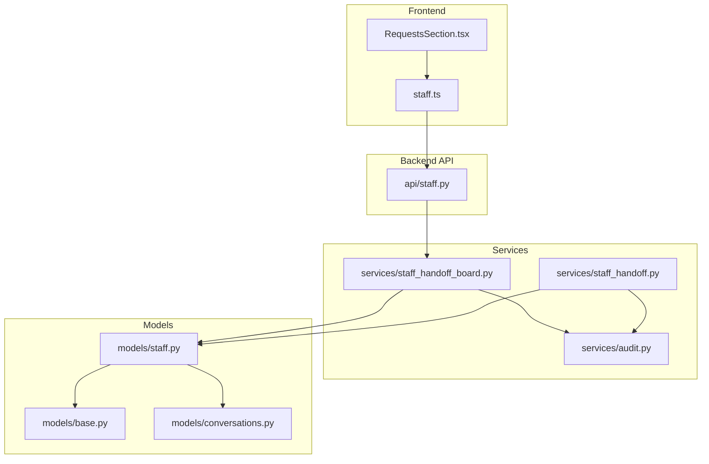
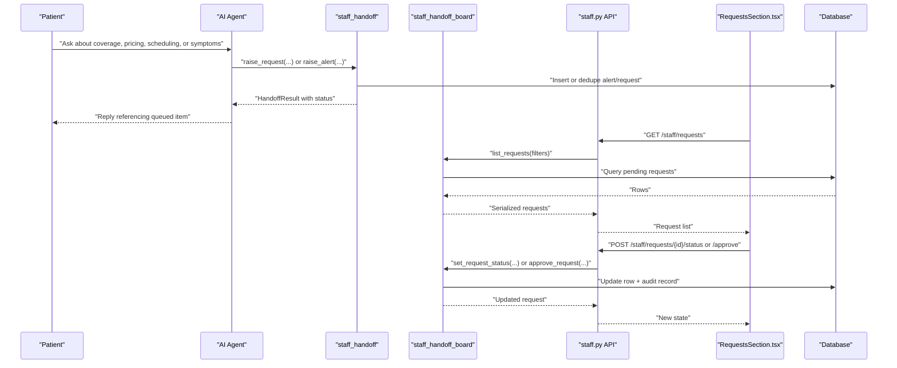
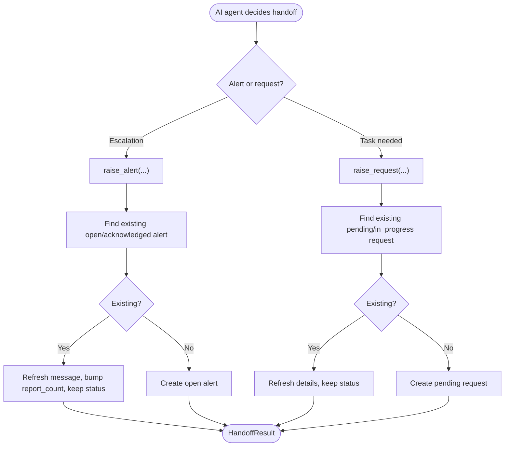
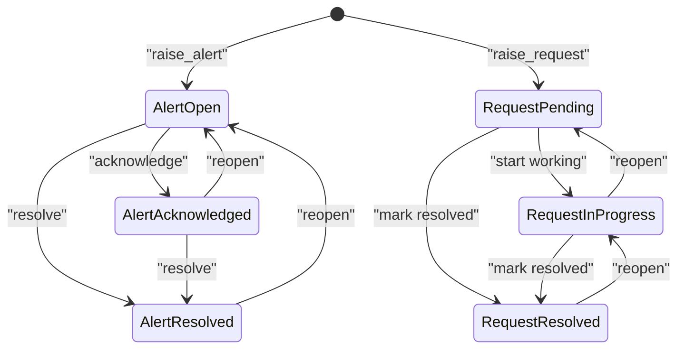
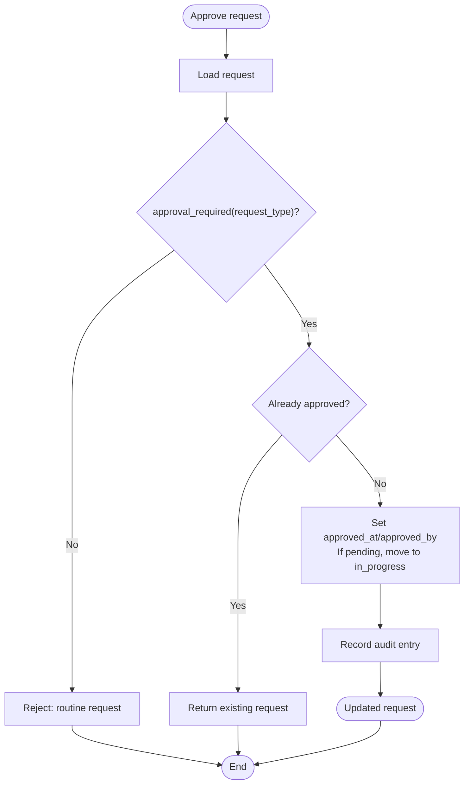
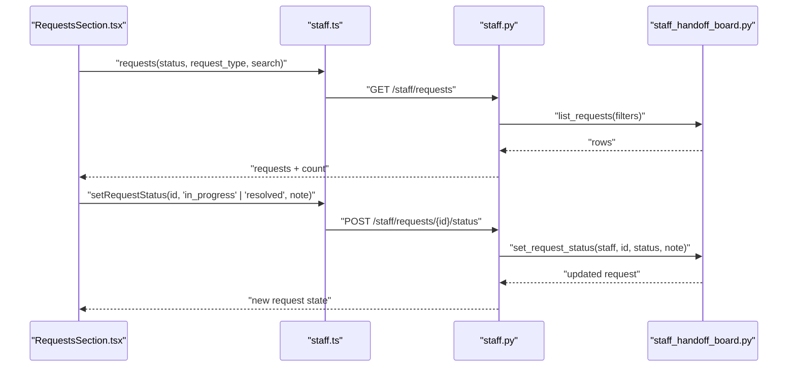
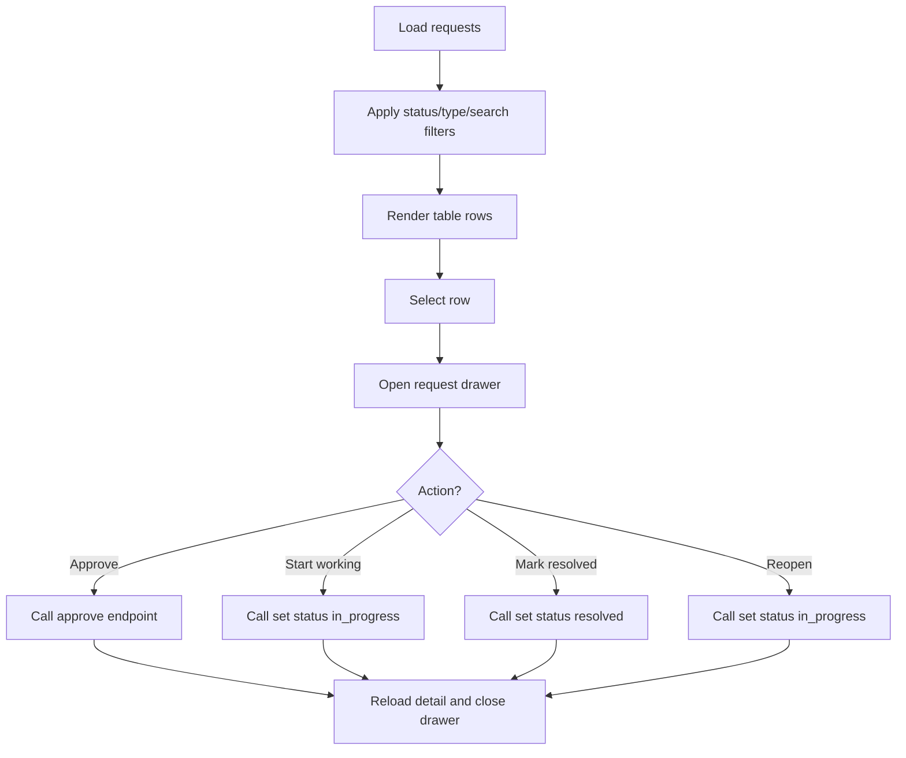
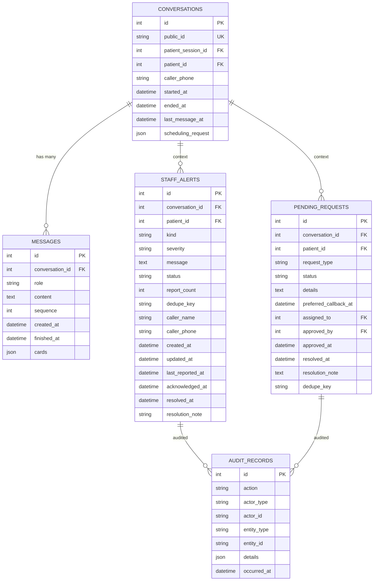
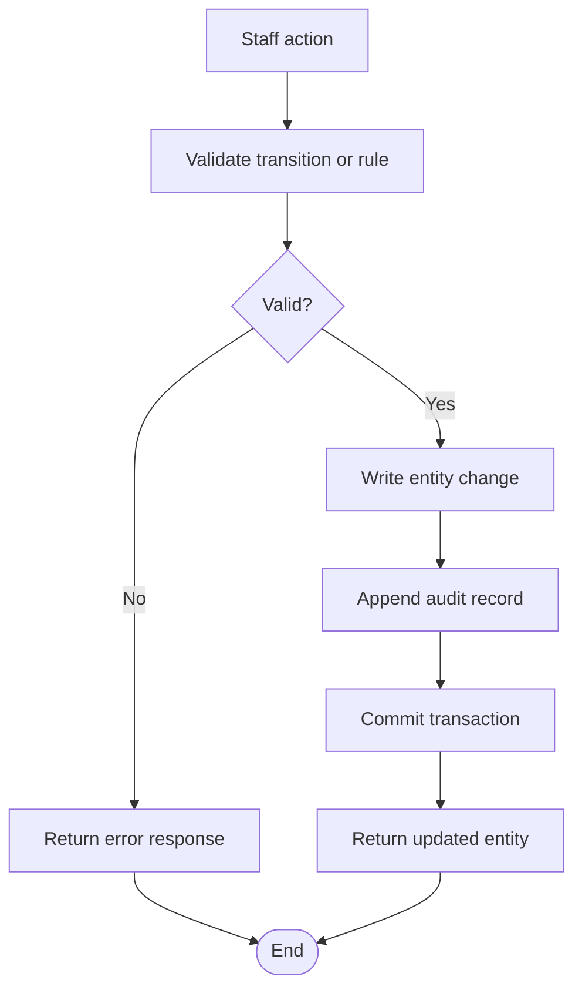
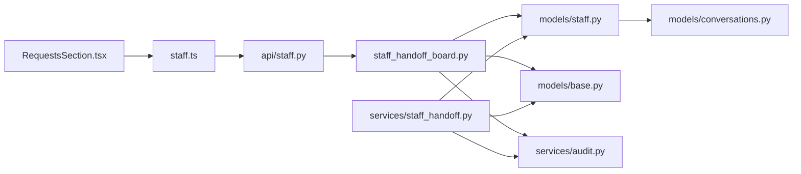

# Pending Requests Queue

<cite>
**Referenced Files in This Document**
- [staff_handoff.py](file://backend/app/services/staff_handoff.py)
- [staff_handoff_board.py](file://backend/app/services/staff_handoff_board.py)
- [staff.py](file://backend/app/api/staff.py)
- [base.py](file://backend/app/models/base.py)
- [conversations.py](file://backend/app/models/conversations.py)
- [staff.py](file://backend/app/models/staff.py)
- [audit.py](file://backend/app/services/audit.py)
- [RequestsSection.tsx](file://frontend/src/pages/staff/sections/RequestsSection.tsx)
- [staff.ts](file://frontend/src/api/staff.ts)
</cite>

## Table of Contents
1. [Introduction](#introduction)
2. [Project Structure](#project-structure)
3. [Core Components](#core-components)
4. [Architecture Overview](#architecture-overview)
5. [Detailed Component Analysis](#detailed-component-analysis)
6. [Dependency Analysis](#dependency-analysis)
7. [Performance Considerations](#performance-considerations)
8. [Troubleshooting Guide](#troubleshooting-guide)
9. [Conclusion](#conclusion)

## Introduction
This document explains the pending requests queue that surfaces conversations requiring human intervention after the AI agent cannot resolve a patient request. It covers:

- How the system identifies handoffs from the AI agent.
- Request categorization and prioritization.
- The staff queue management interface.
- Staff actions: review, continuation, proposal approval/rejection, and manual intervention.
- The request data model, status transitions, and audit logging.
- Common handoff scenarios, resolution strategies, and quality assurance processes.
- Queue performance, real-time update behavior, and operational monitoring for backlog management.

The design separates two kinds of handoff items:

| Item | Purpose | Typical lifecycle |
|---|---|---|
| Alert | Awareness or escalation raised by the assistant (for example, emergency report, insurance mismatch, urgent callback). | Open → Acknowledged → Resolved |
| Pending request | A task the assistant could not complete (callback, reschedule, clinical question, billing/insurance). | Pending → In progress → Resolved; some require explicit approval before proceeding. |

## Project Structure
The pending requests queue spans backend services, API routes, database models, and the staff dashboard frontend.

**Diagram sources**
- [RequestsSection.tsx:1-367](file://frontend/src/pages/staff/sections/RequestsSection.tsx#L1-L367)
- [staff.ts:1-405](file://frontend/src/api/staff.ts#L1-L405)
- [staff.py:515-654](file://backend/app/api/staff.py#L515-L654)
- [staff_handoff_board.py:1-599](file://backend/app/services/staff_handoff_board.py#L1-L599)
- [staff_handoff.py:1-326](file://backend/app/services/staff_handoff.py#L1-L326)
- [audit.py:1-76](file://backend/app/services/audit.py#L1-L76)
- [base.py:94-120](file://backend/app/models/base.py#L94-L120)
- [conversations.py:39-84](file://backend/app/models/conversations.py#L39-L84)
- [staff.py:142-185](file://backend/app/models/staff.py#L142-L185)

**Section sources**
- [staff_handoff.py:1-326](file://backend/app/services/staff_handoff.py#L1-L326)
- [staff_handoff_board.py:1-599](file://backend/app/services/staff_handoff_board.py#L1-L599)
- [staff.py:515-654](file://backend/app/api/staff.py#L515-L654)
- [RequestsSection.tsx:1-367](file://frontend/src/pages/staff/sections/RequestsSection.tsx#L1-L367)
- [staff.ts:169-206](file://frontend/src/api/staff.ts#L169-L206)

## Core Components
The queue is built around three layers:

1. **Handoff creation layer**: Converts AI-agent uncertainty into structured alerts and pending requests.
2. **Board service layer**: Provides triage queries, state transitions, approval logic, summaries, and audit recording.
3. **Staff API and UI layer**: Exposes endpoints and renders the queue with filters, detail drawers, activity timelines, and action buttons.

Key responsibilities:

- `staff_handoff.raise_alert` creates or updates an alert when the assistant needs awareness or escalation.
- `staff_handoff.raise_request` creates or updates a pending request when the assistant cannot answer or act.
- `staff_handoff.request_status` returns all open items for a conversation so the assistant can tell the patient what is waiting.
- `staff_handoff_board` defines allowed transitions, approval rules, list filtering, serialization, mutations, and audit hooks.
- `api/staff.py` exposes `/staff/alerts`, `/staff/requests`, summary counts, and mutation endpoints.
- `RequestsSection.tsx` renders the pending requests queue, filters, drawer, and staff actions.

**Section sources**
- [staff_handoff.py:98-261](file://backend/app/services/staff_handoff.py#L98-L261)
- [staff_handoff_board.py:119-128](file://backend/app/services/staff_handoff_board.py#L119-L128)
- [staff_handoff_board.py:230-285](file://backend/app/services/staff_handoff_board.py#L230-L285)
- [staff.py:520-654](file://backend/app/api/staff.py#L520-L654)
- [RequestsSection.tsx:44-214](file://frontend/src/pages/staff/sections/RequestsSection.tsx#L44-L214)

## Architecture Overview
The handoff flow starts in the AI agent path and ends in the staff dashboard.

**Diagram sources**
- [staff_handoff.py:98-261](file://backend/app/services/staff_handoff.py#L98-L261)
- [staff_handoff_board.py:260-285](file://backend/app/services/staff_handoff_board.py#L260-L285)
- [staff_handoff_board.py:460-542](file://backend/app/services/staff_handoff_board.py#L460-L542)
- [staff.py:590-654](file://backend/app/api/staff.py#L590-L654)
- [RequestsSection.tsx:55-75](file://frontend/src/pages/staff/sections/RequestsSection.tsx#L55-L75)

## Detailed Component Analysis

### Handoff Creation: Alerts and Pending Requests
The handoff module distinguishes between awareness escalations and actionable requests.

- **Alerts** are created through `raise_alert`. They include kind, severity, message, optional caller contact details, and idempotency via `dedupe_key`. Repeated reports bump `report_count` and can refresh the message if details worsen.
- **Pending requests** are created through `raise_request`. They capture `conversation_id`, optional `patient_id`, `request_type`, free-text `details`, and a deduplication key scoped to request type and subject.
- Both functions return a `HandoffResult` describing whether the record was newly created, its current status, severity, and metadata suitable for the assistant’s reply wording.
- `request_status` aggregates alerts and requests for a conversation, newest first, so the assistant can inform the patient that something is queued.

**Diagram sources**
- [staff_handoff.py:98-200](file://backend/app/services/staff_handoff.py#L98-L200)
- [staff_handoff.py:203-261](file://backend/app/services/staff_handoff.py#L203-L261)

**Section sources**
- [staff_handoff.py:40-80](file://backend/app/services/staff_handoff.py#L40-L80)
- [staff_handoff.py:98-200](file://backend/app/services/staff_handoff.py#L98-L200)
- [staff_handoff.py:203-261](file://backend/app/services/staff_handoff.py#L203-L261)
- [staff_handoff.py:264-309](file://backend/app/services/staff_handoff.py#L264-L309)

### Board Service: Triage, Filtering, Transitions, and Approval
The board service owns the queue’s business rules.

#### Categorization and Prioritization
- **Request types**: callback, reschedule, clinical_question, billing.
- **Severity levels**: low, normal, high, urgent.
- **Approval gating**: derived from request type rather than stored boolean. Billing and reschedule requests require explicit approval unless tied to an already booked appointment.
- **Sorting**: unresolved items appear first; within unresolved rows, urgency and recency determine order.

#### Allowed Status Transitions
- **Alerts**: open ↔ acknowledged ↔ resolved.
- **Requests**: pending ↔ in_progress ↔ resolved.

**Diagram sources**
- [staff_handoff_board.py:77-87](file://backend/app/services/staff_handoff_board.py#L77-L87)
- [staff_handoff_board.py:460-501](file://backend/app/services/staff_handoff_board.py#L460-L501)

#### Approval Workflow
Approval is only available for approval-gated requests. Approving moves a pending request into in progress and records who approved it and when. Routine requests reject approval attempts.

**Diagram sources**
- [staff_handoff_board.py:119-128](file://backend/app/services/staff_handoff_board.py#L119-L128)
- [staff_handoff_board.py:504-542](file://backend/app/services/staff_handoff_board.py#L504-L542)

**Section sources**
- [staff_handoff_board.py:68-87](file://backend/app/services/staff_handoff_board.py#L68-L87)
- [staff_handoff_board.py:119-132](file://backend/app/services/staff_handoff_board.py#L119-L132)
- [staff_handoff_board.py:230-285](file://backend/app/services/staff_handoff_board.py#L230-L285)
- [staff_handoff_board.py:380-542](file://backend/app/services/staff_handoff_board.py#L380-L542)

### API Layer: Staff Dashboard Endpoints
The staff API provides authenticated endpoints for:

- Listing and detailing alerts.
- Listing and detailing pending requests.
- Changing alert status and severity.
- Changing request status.
- Approving approval-gated requests.
- Fetching summary counts for dashboard tiles.

All mutating endpoints validate input, delegate to the board service, and translate service errors into HTTP responses.

**Diagram sources**
- [staff.py:590-654](file://backend/app/api/staff.py#L590-L654)
- [staff_handoff_board.py:260-285](file://backend/app/services/staff_handoff_board.py#L260-L285)
- [staff_handoff_board.py:460-501](file://backend/app/services/staff_handoff_board.py#L460-L501)
- [RequestsSection.tsx:315-342](file://frontend/src/pages/staff/sections/RequestsSection.tsx#L315-L342)
- [staff.ts:377-397](file://frontend/src/api/staff.ts#L377-L397)

**Section sources**
- [staff.py:515-654](file://backend/app/api/staff.py#L515-L654)
- [staff.ts:377-397](file://frontend/src/api/staff.ts#L377-L397)

### Frontend Queue Interface
The pending requests section provides:

- Filters for status, request type, and free-text search.
- A table showing patient name, phone, request type, detail text, status badge, and received time.
- Counts for pending items and approval-required items.
- A detail drawer with:
  - Approval button when required and not yet approved.
  - Start working button for pending requests.
  - Mark resolved or reopen buttons depending on current status.
  - Internal note field.
  - Activity timeline showing staff actions.

**Diagram sources**
- [RequestsSection.tsx:44-214](file://frontend/src/pages/staff/sections/RequestsSection.tsx#L44-L214)
- [RequestsSection.tsx:216-367](file://frontend/src/pages/staff/sections/RequestsSection.tsx#L216-L367)

**Section sources**
- [RequestsSection.tsx:1-367](file://frontend/src/pages/staff/sections/RequestsSection.tsx#L1-L367)
- [staff.ts:169-206](file://frontend/src/api/staff.ts#L169-L206)

### Data Model: Alerts, Pending Requests, Conversations, and Audit
The relevant entities are:

| Entity | Purpose | Key fields |
|---|---|---|
| `Conversation` | Chat thread linking patient session, messages, proposals, and handoff context. | `public_id`, `patient_session_id`, `patient_id`, `caller_phone`, `started_at`, `last_message_at`, `scheduling_request` |
| `Message` | Individual turns in a conversation. | `conversation_id`, `role`, `content`, `sequence`, `created_at`, `cards` |
| `StaffAlert` | Assistant-created awareness or escalation. | `kind`, `severity`, `message`, `status`, `report_count`, `caller_name`, `caller_phone`, `dedupe_key` |
| `PendingRequest` | Task needing human follow-up. | `request_type`, `status`, `details`, `preferred_callback_at`, `assigned_to`, `approved_by`, `approved_at`, `dedupe_key` |
| `AuditRecord` | Append-only log of staff/system actions. | `action`, `actor_type`, `actor_id`, `entity_type`, `entity_id`, `details`, `occurred_at` |

**Diagram sources**
- [conversations.py:39-123](file://backend/app/models/conversations.py#L39-L123)
- [staff.py:142-185](file://backend/app/models/staff.py#L142-L185)
- [audit.py:15-51](file://backend/app/services/audit.py#L15-L51)

**Section sources**
- [conversations.py:39-123](file://backend/app/models/conversations.py#L39-L123)
- [staff.py:142-185](file://backend/app/models/staff.py#L142-L185)
- [audit.py:15-51](file://backend/app/services/audit.py#L15-L51)

### Status Transitions and Audit Logging
Every meaningful state change is validated and recorded:

- Alert status changes must follow allowed transitions.
- Request status changes must follow allowed transitions.
- Severity changes are logged but do not imply resolution.
- Approval is separate from resolution: approval clears the approval gate; resolution marks the work done.
- Audit entries store actor, target, action, and safe details. Free-text notes are not copied verbatim into audit payloads; only their presence is recorded.

**Diagram sources**
- [staff_handoff_board.py:380-457](file://backend/app/services/staff_handoff_board.py#L380-L457)
- [staff_handoff_board.py:460-542](file://backend/app/services/staff_handoff_board.py#L460-L542)
- [audit.py:15-51](file://backend/app/services/audit.py#L15-L51)

**Section sources**
- [staff_handoff_board.py:77-87](file://backend/app/services/staff_handoff_board.py#L77-L87)
- [staff_handoff_board.py:380-542](file://backend/app/services/staff_handoff_board.py#L380-L542)
- [audit.py:15-51](file://backend/app/services/audit.py#L15-L51)

### Common Handoff Scenarios and Resolution Strategies

| Scenario | System Behavior | Recommended Staff Action |
|---|---|---|
| Patient asks about insurance coverage and the agent cannot confirm eligibility. | Creates a billing-type pending request; approval is required. | Review details, verify coverage, approve if appropriate, then mark resolved after follow-up. |
| Patient wants to reschedule but the agent cannot find a valid replacement slot. | Creates a reschedule-type pending request; approval is required. | Check provider availability, propose new times, approve if policy allows, then mark resolved. |
| Caller reports severe pain without a verified patient account. | Creates an urgent alert with caller contact details; may include call-back marker. | Call back using provided contact, assess urgency, acknowledge, then resolve with a note. |
| Patient leaves feedback indicating confusion or dissatisfaction. | Feedback is surfaced separately; it signals where to inspect conversation history. | Review the flagged conversation transcript and consider improving agent handling or escalating to staff. |
| Assistant detects an emergency symptom pattern. | Raises an emergency alert with high or urgent severity. | Immediately acknowledge, escalate per clinic protocol, and resolve once handled. |

Resolution strategies should distinguish:

- **Routine tasks**: callback, clinical question, reschedule without approval gate.
- **Approval-gated tasks**: billing and reschedule where policy requires a decision.
- **Awareness-only items**: alerts that need acknowledgment and later resolution but are not approvals.

**Section sources**
- [staff_handoff_board.py:68-75](file://backend/app/services/staff_handoff_board.py#L68-L75)
- [staff_handoff_board.py:119-128](file://backend/app/services/staff_handoff_board.py#L119-L128)
- [staff_handoff.py:98-200](file://backend/app/services/staff_handoff.py#L98-L200)

### Quality Assurance Processes
Quality assurance is supported by:

- Conversation feedback collection, including thumbs-down ratings and optional reasons.
- Staff feedback endpoint exposing recent negative feedback with conversation excerpts.
- Audit trails for every triage action.
- Summary counts for open alerts, urgent alerts, pending requests, and approvals required.

Recommended QA practices:

- Monitor negative feedback trends and inspect related transcripts.
- Review unresolved alerts and urgent alerts regularly.
- Track approval turnaround time for billing and reschedule requests.
- Use audit logs to investigate missed steps or invalid transitions.
- Periodically review request types to ensure categorization remains accurate.

**Section sources**
- [staff.py:325-372](file://backend/app/api/staff.py#L325-L372)
- [staff_handoff_board.py:325-372](file://backend/app/services/staff_handoff_board.py#L325-L372)
- [audit.py:15-51](file://backend/app/services/audit.py#L15-L51)

## Dependency Analysis
The following diagram shows how components depend on each other during queue operations.

**Diagram sources**
- [RequestsSection.tsx:1-367](file://frontend/src/pages/staff/sections/RequestsSection.tsx#L1-L367)
- [staff.ts:1-405](file://frontend/src/api/staff.ts#L1-L405)
- [staff.py:515-654](file://backend/app/api/staff.py#L515-L654)
- [staff_handoff_board.py:1-599](file://backend/app/services/staff_handoff_board.py#L1-L599)
- [staff_handoff.py:1-326](file://backend/app/services/staff_handoff.py#L1-L326)
- [staff.py:142-185](file://backend/app/models/staff.py#L142-L185)
- [base.py:94-120](file://backend/app/models/base.py#L94-L120)
- [conversations.py:39-84](file://backend/app/models/conversations.py#L39-L84)
- [audit.py:1-76](file://backend/app/services/audit.py#L1-L76)

**Section sources**
- [staff_handoff_board.py:1-599](file://backend/app/services/staff_handoff_board.py#L1-L599)
- [staff_handoff.py:1-326](file://backend/app/services/staff_handoff.py#L1-L326)
- [staff.py:515-654](file://backend/app/api/staff.py#L515-L654)

## Performance Considerations
Queue performance is designed around bounded reads, server-side sorting, and minimal payload sizes.

- **List limits**: Default and maximum list limits prevent unbounded result sets.
- **Server-side filtering**: Status, kind, severity, request type, and search filters are applied in SQL.
- **Search scope**: Search matches against message/details and patient names using case-insensitive patterns.
- **Summary counts**: Dashboard counts use aggregate queries without loading full rows.
- **Concurrency**: Mutations run in thread pools and use write transactions; concurrent writes raise a busy error mapped to a service unavailable response.
- **Real-time updates**: The frontend uses query keys and reload calls; there is no persistent WebSocket connection shown in these files. Real-time-like behavior comes from polling or explicit refreshes.

Recommendations for backlog management:

- Keep default list limits reasonable and monitor slow queries under heavy search load.
- Use summary counts to detect growing backlogs.
- Alert on increasing counts of urgent alerts or approvals required.
- Avoid excessive client-side filtering; rely on server filters for large queues.
- Consider adding pagination if lists grow beyond current limits.

**Section sources**
- [staff_handoff_board.py:65-66](file://backend/app/services/staff_handoff_board.py#L65-L66)
- [staff_handoff_board.py:230-285](file://backend/app/services/staff_handoff_board.py#L230-L285)
- [staff_handoff_board.py:325-372](file://backend/app/services/staff_handoff_board.py#L325-L372)
- [staff.py:207-218](file://backend/app/api/staff.py#L207-L218)

## Troubleshooting Guide

### Common Errors and Responses
| Symptom | Likely Cause | Resolution |
|---|---|---|
| Invalid transition error when changing alert or request status | Attempted an unsupported state change. | Follow allowed transitions: open → acknowledged → resolved for alerts; pending → in_progress → resolved for requests. |
| Unknown alert or unknown request | ID does not exist or was removed. | Refresh the list and retry; check if the item was resolved or moved. |
| Busy error | Concurrent write conflict or backend saturation. | Retry after a short delay; reduce simultaneous mutations. |
| Not approvable error | Trying to approve a routine request. | Only billing and reschedule requests require approval; use status transitions instead. |
| CSRF or authentication failure | Missing or mismatched session/CSRF cookies. | Ensure the dashboard is authenticated and CSRF headers are included for mutating requests. |

### Operational Monitoring Checklist
- Verify summary counts reflect expected backlog size.
- Inspect urgent alerts and ensure they are acknowledged promptly.
- Review approval-required requests and track approval latency.
- Check audit logs for unexpected reopens or invalid transitions.
- Monitor negative feedback for recurring conversation issues.

**Section sources**
- [staff_handoff_board.py:90-95](file://backend/app/services/staff_handoff_board.py#L90-L95)
- [staff_handoff_board.py:380-542](file://backend/app/services/staff_handoff_board.py#L380-L542)
- [staff.py:207-218](file://backend/app/api/staff.py#L207-L218)
- [staff.py:325-372](file://backend/app/api/staff.py#L325-L372)

## Conclusion
The pending requests queue provides a clear separation between awareness escalations and actionable follow-ups. The AI agent hands off uncertain or incomplete patient interactions into structured alerts and pending requests. Staff triage those items through a filtered, searchable dashboard, apply allowed status transitions, approve policy-gated decisions, and record every meaningful action in an audit trail.

For reliable operations:

- Treat alerts as awareness and escalation signals.
- Treat pending requests as work items with clear status progression.
- Use approval only for approval-gated request types.
- Monitor summary counts, urgent alerts, and negative feedback.
- Rely on audit logs for accountability and troubleshooting.
- Keep list sizes bounded and prefer server-side filtering for performance.