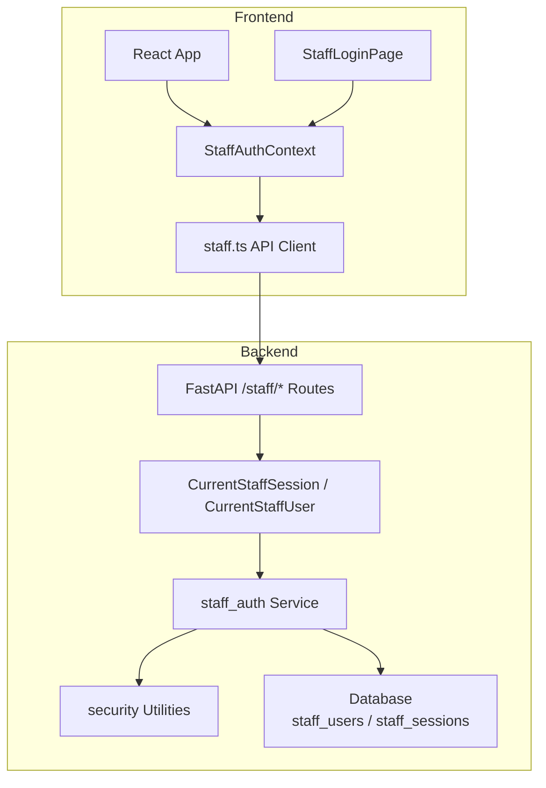
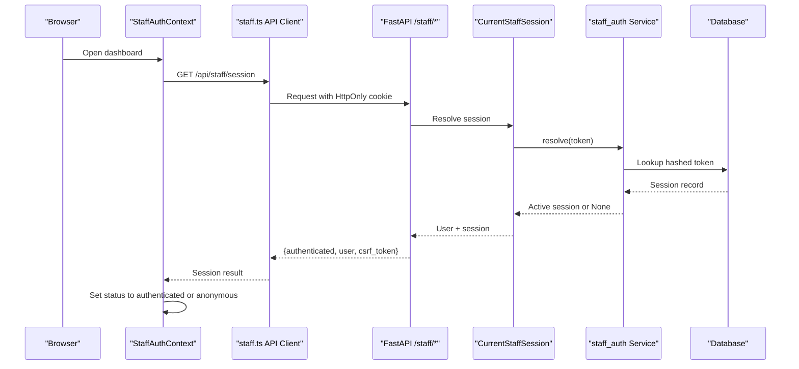
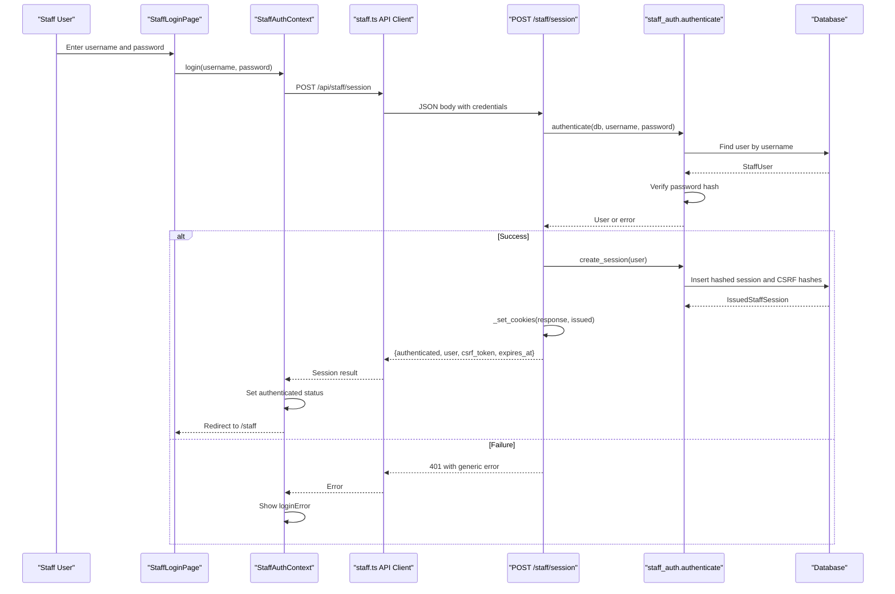
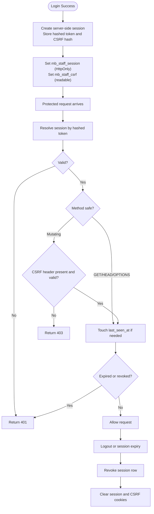
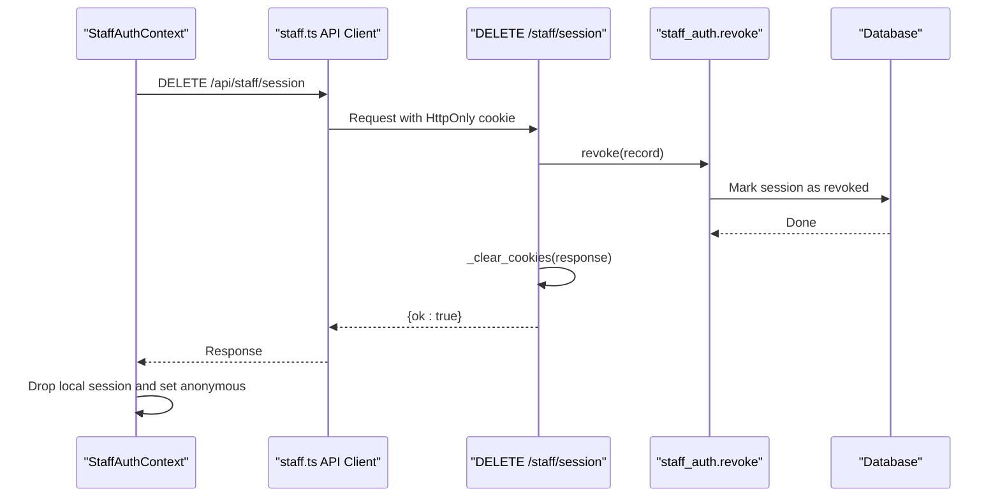
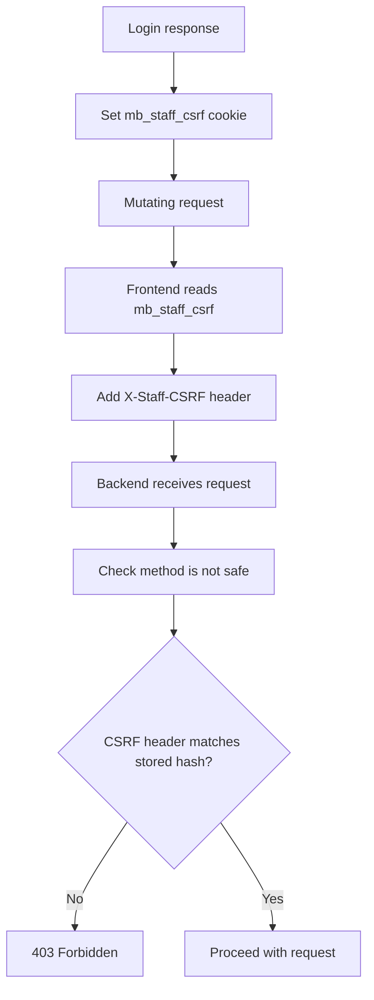
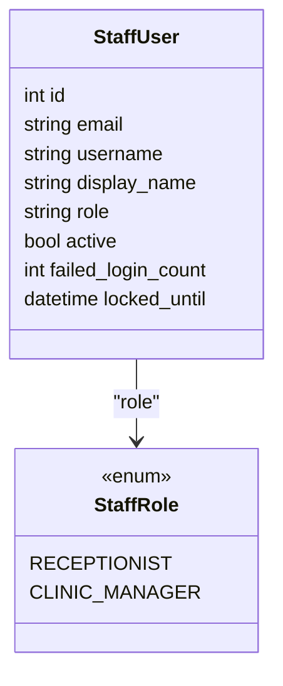
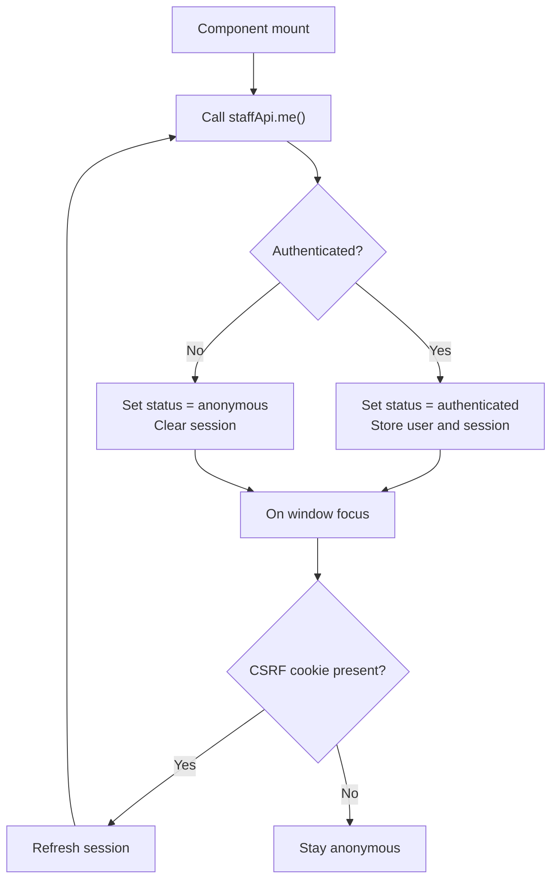
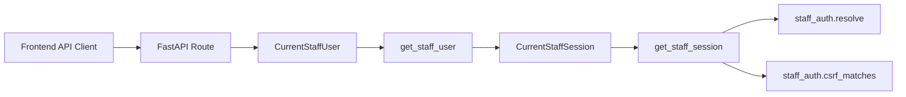

# Staff Authentication & Authorization

<cite>
**Referenced Files in This Document**
- [staff_auth.py](file://backend/app/services/staff_auth.py)
- [staff.py](file://backend/app/api/staff.py)
- [deps.py](file://backend/app/api/deps.py)
- [security.py](file://backend/app/services/security.py)
- [staff.ts](file://frontend/src/api/staff.ts)
- [StaffAuthContext.tsx](file://frontend/src/pages/staff/StaffAuthContext.tsx)
- [StaffLoginPage.tsx](file://frontend/src/pages/staff/StaffLoginPage.tsx)
- [staff.py](file://backend/app/models/staff.py)
- [base.py](file://backend/app/models/base.py)
</cite>

## Table of Contents
1. [Introduction](#introduction)
2. [Project Structure](#project-structure)
3. [Core Components](#core-components)
4. [Architecture Overview](#architecture-overview)
5. [Detailed Component Analysis](#detailed-component-analysis)
6. [Dependency Analysis](#dependency-analysis)
7. [Performance Considerations](#performance-considerations)
8. [Troubleshooting Guide](#troubleshooting-guide)
9. [Conclusion](#conclusion)

## Introduction
This document explains the staff authentication and authorization system for the clinic dashboard. It covers:
- Server-side session management using HttpOnly cookies.
- CSRF protection for write operations.
- Role-based access control between `clinic_manager` and `receptionist`.
- The login flow, session lifecycle, logout process, and security measures.
- The frontend `StaffAuthContext` component that manages authentication state, protected routes, and redirects.
- Example API call patterns, error handling, and security best practices.

The system is intentionally designed so that the backend remains the authority: the frontend may show a logged-in or logged-out UI, but every protected endpoint independently validates the session and CSRF token.

## Project Structure
The authentication implementation spans both backend and frontend:

- Backend
  - Session creation, validation, CSRF matching, and account lockout live in the staff authentication service.
  - FastAPI endpoints set and clear cookies, resolve sessions, and enforce CSRF on mutating requests.
  - Dependencies resolve the current staff session and user from cookies and headers.
  - Models define staff users, roles, and server-side sessions.
  - Security utilities provide password hashing and token hashing.

- Frontend
  - The staff API client sends credentials via an HttpOnly cookie and echoes the CSRF token for mutating requests.
  - `StaffAuthContext` queries the server to determine whether the user is authenticated.
  - The login page collects credentials and redirects to the dashboard after successful login.

**Diagram sources**
- [staff.ts:229-267](file://frontend/src/api/staff.ts#L229-L267)
- [StaffAuthContext.tsx:42-123](file://frontend/src/pages/staff/StaffAuthContext.tsx#L42-L123)
- [staff.py:226-311](file://backend/app/api/staff.py#L226-L311)
- [deps.py:73-97](file://backend/app/api/deps.py#L73-L97)
- [staff_auth.py:93-187](file://backend/app/services/staff_auth.py#L93-L187)
- [security.py:18-46](file://backend/app/services/security.py#L18-L46)

**Section sources**
- [staff_auth.py:1-33](file://backend/app/services/staff_auth.py#L1-L33)
- [staff.py:1-30](file://backend/app/api/staff.py#L1-L30)
- [deps.py:54-97](file://backend/app/api/deps.py#L54-L97)
- [staff.ts:1-15](file://frontend/src/api/staff.ts#L1-L15)

## Core Components
- **Server-side session service**: Creates sessions, resolves active sessions, enforces expiry and reset generation, matches CSRF tokens, touches activity timestamps, and revokes sessions.
- **FastAPI staff routes**: Provide login, current session inspection, logout, and protected dashboard endpoints. They set HttpOnly session cookies and readable CSRF cookies.
- **FastAPI dependencies**: Resolve the current staff session from the HttpOnly cookie and require a matching CSRF header for non-safe HTTP methods.
- **Security utilities**: Hash passwords with PBKDF2-HMAC-SHA256 and hash session/CSRF tokens before storing them.
- **Frontend API client**: Sends requests with `credentials: "same-origin"` and adds `X-Staff-CSRF` for mutating requests.
- **Frontend auth context**: Queries `/api/staff/session`, tracks login status, handles login/logout errors, and refreshes the session when the tab regains focus.
- **Models**: Define staff users, roles (`receptionist`, `clinic_manager`), and server-side sessions with hashed tokens and CSRF digests.

**Section sources**
- [staff_auth.py:66-187](file://backend/app/services/staff_auth.py#L66-L187)
- [staff.py:133-164](file://backend/app/api/staff.py#L133-L164)
- [deps.py:67-97](file://backend/app/api/deps.py#L67-L97)
- [security.py:1-46](file://backend/app/services/security.py#L1-L46)
- [staff.ts:213-267](file://frontend/src/api/staff.ts#L213-L267)
- [StaffAuthContext.tsx:27-123](file://frontend/src/pages/staff/StaffAuthContext.tsx#L27-L123)
- [staff.py:25-84](file://backend/app/models/staff.py#L25-L84)
- [base.py:89-91](file://backend/app/models/base.py#L89-L91)

## Architecture Overview
The authentication architecture uses browser cookies rather than bearer tokens:

- On login, the backend issues two cookies:
  - `mb_staff_session`: HttpOnly, SameSite=Lax, containing the raw session token.
  - `mb_staff_csrf`: Not HttpOnly, SameSite=Lax, containing the raw CSRF token.
- For every request, the browser automatically sends the HttpOnly session cookie.
- For mutating requests, the frontend reads the readable CSRF cookie and sends it as `X-Staff-CSRF`.
- The backend dependency checks:
  - Whether the session exists, is not expired, is not revoked, and belongs to the current reset generation.
  - Whether the CSRF header matches the stored CSRF digest for non-safe methods.
- The frontend context treats the server response as the source of truth and redirects unauthenticated users.

**Diagram sources**
- [StaffAuthContext.tsx:48-69](file://frontend/src/pages/staff/StaffAuthContext.tsx#L48-L69)
- [staff.ts:287-297](file://frontend/src/api/staff.ts#L287-L297)
- [staff.py:272-290](file://backend/app/api/staff.py#L272-L290)
- [deps.py:73-85](file://backend/app/api/deps.py#L73-L85)
- [staff_auth.py:153-168](file://backend/app/services/staff_auth.py#L153-L168)

## Detailed Component Analysis

### Login Flow
The login flow authenticates credentials, creates a server-side session, sets cookies, and returns a public user object.

**Diagram sources**
- [StaffLoginPage.tsx:30-36](file://frontend/src/pages/staff/StaffLoginPage.tsx#L30-L36)
- [StaffAuthContext.tsx:81-95](file://frontend/src/pages/staff/StaffAuthContext.tsx#L81-L95)
- [staff.ts:287-293](file://frontend/src/api/staff.ts#L287-L293)
- [staff.py:226-269](file://backend/app/api/staff.py#L226-L269)
- [staff_auth.py:93-150](file://backend/app/services/staff_auth.py#L93-L150)
- [security.py:18-41](file://backend/app/services/security.py#L18-L41)

**Section sources**
- [staff.py:226-269](file://backend/app/api/staff.py#L226-L269)
- [staff_auth.py:93-150](file://backend/app/services/staff_auth.py#L93-L150)
- [security.py:18-41](file://backend/app/services/security.py#L18-L41)
- [StaffAuthContext.tsx:81-95](file://frontend/src/pages/staff/StaffAuthContext.tsx#L81-L95)
- [StaffLoginPage.tsx:30-36](file://frontend/src/pages/staff/StaffLoginPage.tsx#L30-L36)

### Session Lifecycle
The session lifecycle includes creation, validation, activity touching, expiry, revocation, and cleanup.

**Diagram sources**
- [staff_auth.py:127-187](file://backend/app/services/staff_auth.py#L127-L187)
- [staff_auth.py:153-187](file://backend/app/services/staff_auth.py#L153-L187)
- [staff.py:133-164](file://backend/app/api/staff.py#L133-L164)
- [deps.py:73-85](file://backend/app/api/deps.py#L73-L85)

**Section sources**
- [staff_auth.py:127-187](file://backend/app/services/staff_auth.py#L127-L187)
- [staff.py:133-164](file://backend/app/api/staff.py#L133-L164)
- [deps.py:73-85](file://backend/app/api/deps.py#L73-L85)

### Logout Process
Logout revokes the server-side session and clears both cookies. The frontend ignores logout failures because the server-side session will expire and the cookie clearing is handled by the response.

**Diagram sources**
- [StaffAuthContext.tsx:97-106](file://frontend/src/pages/staff/StaffAuthContext.tsx#L97-L106)
- [staff.ts:297-297](file://frontend/src/api/staff.ts#L297-L297)
- [staff.py:293-311](file://backend/app/api/staff.py#L293-L311)
- [staff_auth.py:186-187](file://backend/app/services/staff_auth.py#L186-L187)

**Section sources**
- [staff.py:293-311](file://backend/app/api/staff.py#L293-L311)
- [staff_auth.py:186-187](file://backend/app/services/staff_auth.py#L186-L187)
- [StaffAuthContext.tsx:97-106](file://frontend/src/pages/staff/StaffAuthContext.tsx#L97-L106)

### CSRF Protection Implementation
CSRF protection relies on pairing a readable CSRF cookie with an HttpOnly session cookie:

- The backend sets `mb_staff_csrf` as a readable cookie and stores only its hash.
- The frontend reads `mb_staff_csrf` and sends it as `X-Staff-CSRF` for mutating requests.
- The backend dependency requires the CSRF header for non-safe methods and compares the presented value against the stored hash using constant-time comparison.

**Diagram sources**
- [staff.py:133-164](file://backend/app/api/staff.py#L133-L164)
- [staff.ts:213-235](file://frontend/src/api/staff.ts#L213-L235)
- [deps.py:67-85](file://backend/app/api/deps.py#L67-L85)
- [staff_auth.py:171-175](file://backend/app/services/staff_auth.py#L171-L175)

**Section sources**
- [staff.py:133-164](file://backend/app/api/staff.py#L133-L164)
- [staff.ts:213-235](file://frontend/src/api/staff.ts#L213-L235)
- [deps.py:67-85](file://backend/app/api/deps.py#L67-L85)
- [staff_auth.py:171-175](file://backend/app/services/staff_auth.py#L171-L175)

### Role-Based Access Control
Roles are defined as `receptionist` and `clinic_manager`. The model enforces these values through a database check constraint. The current implementation exposes the role in the public user object; additional route-level authorization can be added by checking the role after resolving `CurrentStaffUser`.

**Diagram sources**
- [base.py:89-91](file://backend/app/models/base.py#L89-L91)
- [staff.py:25-55](file://backend/app/models/staff.py#L25-L55)

**Section sources**
- [base.py:89-91](file://backend/app/models/base.py#L89-L91)
- [staff.py:25-55](file://backend/app/models/staff.py#L25-L55)
- [staff_auth.py:230-238](file://backend/app/services/staff_auth.py#L230-L238)

### Frontend Authentication State Management
`StaffAuthContext` is the single source of truth for dashboard authentication state:

- On mount, it calls `/api/staff/session` to determine whether the user is authenticated.
- It listens for window focus events and refreshes the session when the CSRF cookie is present.
- It provides `login`, `logout`, and `refresh` functions.
- It stores `status`, `user`, `session`, `loginError`, and `loggingIn`.

**Diagram sources**
- [StaffAuthContext.tsx:42-79](file://frontend/src/pages/staff/StaffAuthContext.tsx#L42-L79)
- [staff.ts:287-297](file://frontend/src/api/staff.ts#L287-L297)

**Section sources**
- [StaffAuthContext.tsx:27-123](file://frontend/src/pages/staff/StaffAuthContext.tsx#L27-L123)
- [staff.ts:287-297](file://frontend/src/api/staff.ts#L287-L297)

### Security Measures
- Passwords are never stored in plaintext; they are hashed with PBKDF2-HMAC-SHA256.
- Session tokens and CSRF tokens are hashed before storage.
- The session cookie is HttpOnly and SameSite=Lax.
- CSRF protection requires a matching header for mutating requests.
- Brute-force protection locks accounts temporarily after repeated failures.
- Sessions are validated against the current reset generation, allowing bulk invalidation.
- Generic error messages prevent user enumeration.

**Section sources**
- [security.py:1-46](file://backend/app/services/security.py#L1-L46)
- [staff_auth.py:10-33](file://backend/app/services/staff_auth.py#L10-L33)
- [staff_auth.py:58-63](file://backend/app/services/staff_auth.py#L58-L63)
- [staff_auth.py:93-124](file://backend/app/services/staff_auth.py#L93-L124)
- [staff_auth.py:153-175](file://backend/app/services/staff_auth.py#L153-L175)

## Dependency Analysis
The authentication dependencies form a layered chain:

- FastAPI routes depend on `CurrentStaffSession` and `CurrentStaffUser`.
- `CurrentStaffSession` depends on `get_staff_session`, which resolves the session from the HttpOnly cookie and validates CSRF.
- `CurrentStaffUser` depends on `get_staff_user`, which loads the staff user and checks activation.
- The frontend API client ensures credentials are sent via cookies and CSRF headers for mutating requests.

**Diagram sources**
- [staff.py:43-57](file://backend/app/api/staff.py#L43-L57)
- [deps.py:73-97](file://backend/app/api/deps.py#L73-L97)
- [staff_auth.py:153-175](file://backend/app/services/staff_auth.py#L153-L175)
- [staff.ts:229-267](file://frontend/src/api/staff.ts#L229-L267)

**Section sources**
- [deps.py:73-97](file://backend/app/api/deps.py#L73-L97)
- [staff.py:43-57](file://backend/app/api/staff.py#L43-L57)
- [staff_auth.py:153-175](file://backend/app/services/staff_auth.py#L153-L175)
- [staff.ts:229-267](file://frontend/src/api/staff.ts#L229-L267)

## Performance Considerations
- Session activity is touched at most once per minute to avoid writing on every request.
- Expired and revoked session rows are purged during login to keep the session table small.
- Password verification uses a tuned PBKDF2 iteration count to resist brute force without making login excessively slow.
- CSRF comparison uses constant-time comparison to avoid timing leaks.

**Section sources**
- [staff_auth.py:178-187](file://backend/app/services/staff_auth.py#L178-L187)
- [staff_auth.py:206-227](file://backend/app/services/staff_auth.py#L206-L227)
- [security.py:14-15](file://backend/app/services/security.py#L14-L15)
- [staff_auth.py:171-175](file://backend/app/services/staff_auth.py#L171-L175)

## Troubleshooting Guide
Common authentication issues and how to diagnose them:

- **401 Unauthorized**
  - Missing or invalid session cookie.
  - Expired or revoked session.
  - Disabled staff account.
  - Reset generation mismatch after demo reset.

- **403 Forbidden**
  - Mutating request missing `X-Staff-CSRF`.
  - CSRF header does not match the stored CSRF hash.

- **Login always fails**
  - Incorrect username or password.
  - Account locked due to repeated failures.
  - Demo credential issue: verify seeded root account usage.

- **Dashboard shows anonymous after refresh**
  - Session expired while tab was open.
  - CSRF cookie absent or stale.
  - Frontend did not refresh session on focus.

- **CSRF-related failures after reload**
  - Ensure the readable CSRF cookie is present.
  - Ensure mutating requests include `X-Staff-CSRF`.
  - Confirm the backend echo of CSRF token on `/api/staff/session`.

Recommended debugging steps:
1. Check browser cookies for `mb_staff_session` and `mb_staff_csrf`.
2. Inspect network requests for `X-Staff-CSRF` on mutating calls.
3. Verify `/api/staff/session` returns `authenticated: true` and a CSRF token.
4. Review backend logs for account lockout warnings.
5. Confirm HTTPS deployment behavior for cookie `Secure` flag.

**Section sources**
- [staff_auth.py:58-63](file://backend/app/services/staff_auth.py#L58-L63)
- [staff_auth.py:93-124](file://backend/app/services/staff_auth.py#L93-L124)
- [staff_auth.py:153-175](file://backend/app/services/staff_auth.py#L153-L175)
- [deps.py:67-85](file://backend/app/api/deps.py#L67-L85)
- [staff.py:272-290](file://backend/app/api/staff.py#L272-L290)
- [staff.ts:213-235](file://frontend/src/api/staff.ts#L213-L235)

## Conclusion
The staff authentication and authorization system uses secure, server-side sessions backed by HttpOnly cookies and CSRF protection for write operations. The frontend defers to the backend for all authorization decisions, while providing a responsive login experience and automatic session refresh. Roles are modeled and constrained at the database level, enabling future route-level enforcement. The design emphasizes defense in depth: even if the frontend is bypassed, the backend still enforces session validity, CSRF integrity, account status, and reset generation.