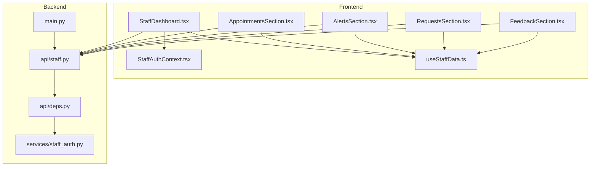
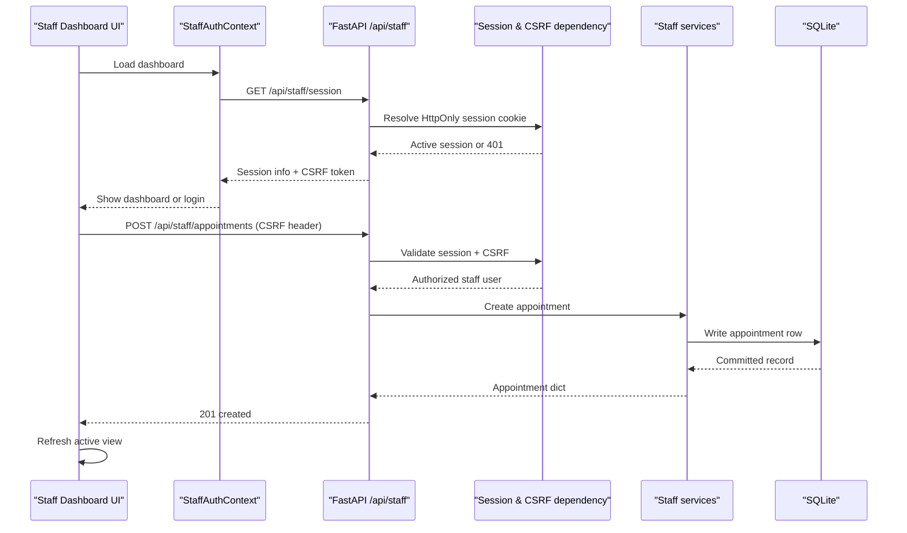
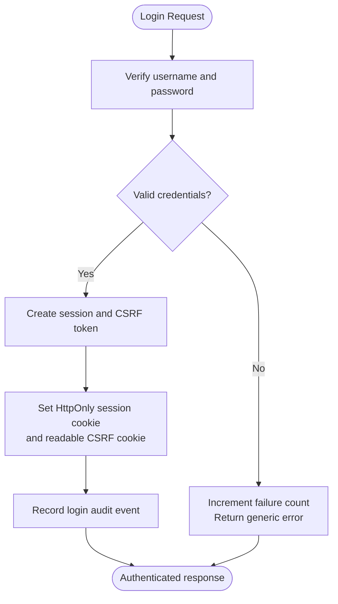
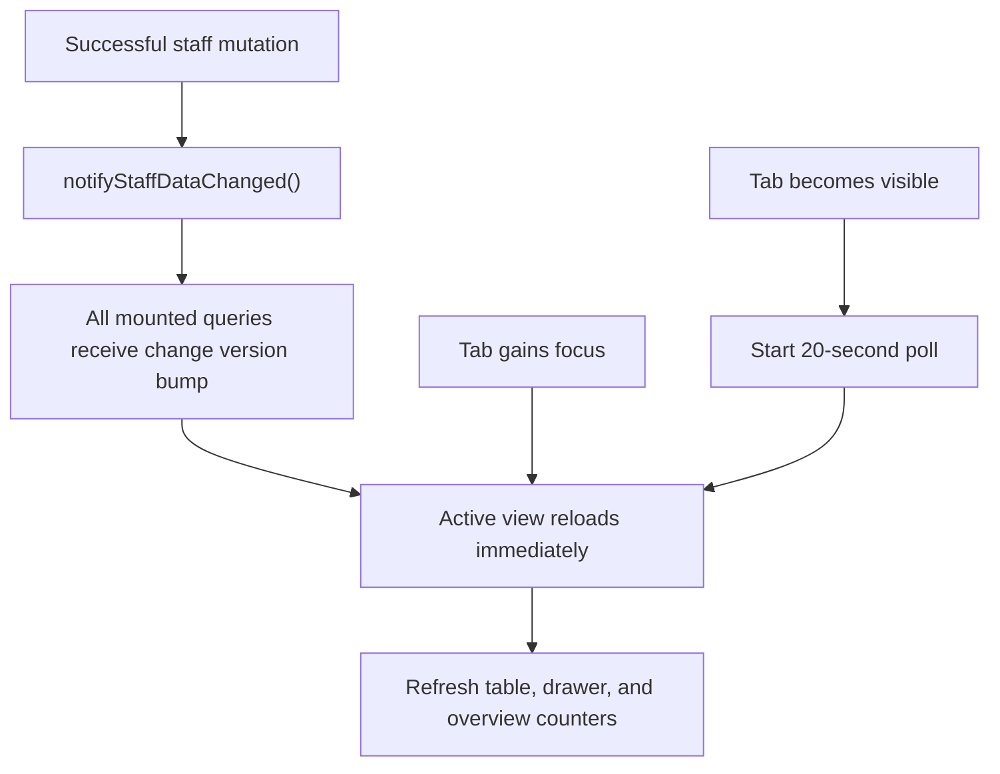
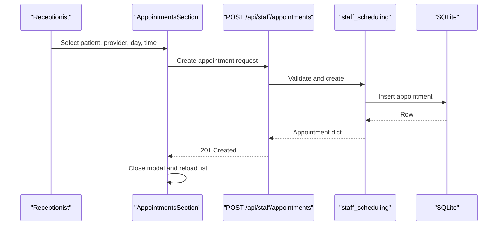
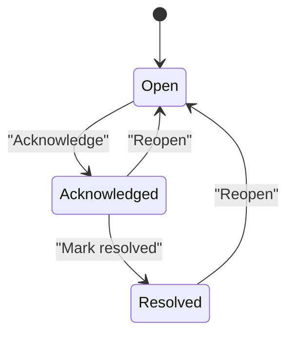
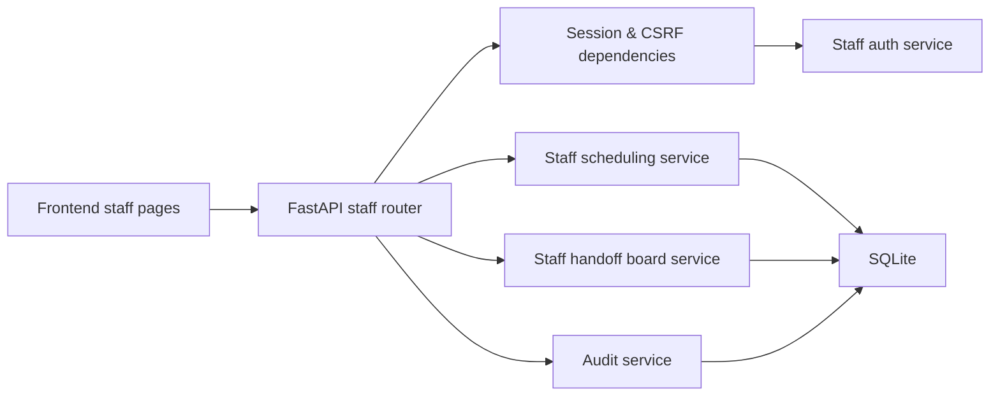

# Staff Dashboard

<cite>
**Referenced Files in This Document**   
- [README.md](file://README.md)
- [main.py](file://backend/app/main.py)
- [staff.py](file://backend/app/api/staff.py)
- [deps.py](file://backend/app/api/deps.py)
- [staff_auth.py](file://backend/app/services/staff_auth.py)
- [StaffDashboard.tsx](file://frontend/src/pages/staff/StaffDashboard.tsx)
- [StaffAuthContext.tsx](file://frontend/src/pages/staff/StaffAuthContext.tsx)
- [useStaffData.ts](file://frontend/src/pages/staff/useStaffData.ts)
- [AppointmentsSection.tsx](file://frontend/src/pages/staff/sections/AppointmentsSection.tsx)
- [AlertsSection.tsx](file://frontend/src/pages/staff/sections/AlertsSection.tsx)
- [RequestsSection.tsx](file://frontend/src/pages/staff/sections/RequestsSection.tsx)
- [FeedbackSection.tsx](file://frontend/src/pages/staff/sections/FeedbackSection.tsx)
</cite>

## Table of Contents
1. [Introduction](#introduction)
2. [Project Structure](#project-structure)
3. [Core Components](#core-components)
4. [Architecture Overview](#architecture-overview)
5. [Detailed Component Analysis](#detailed-component-analysis)
6. [Dependency Analysis](#dependency-analysis)
7. [Performance Considerations](#performance-considerations)
8. [Troubleshooting Guide](#troubleshooting-guide)
9. [Conclusion](#conclusion)

## Introduction
The staff operations dashboard is a separate React interface that shares the same SQLite database as the patient chat system. It lets receptionists and clinic managers view appointments, patients, pending handoff requests, emergency alerts, and conversation feedback, and perform manual scheduling actions such as creating, rescheduling, cancelling, and completing appointments. It also surfaces conversations requiring human intervention and captures patient ratings of assistant replies.

The README describes the staff dashboard as part of Phase 4: it provides demo staff authentication with server-side sessions, an HttpOnly session cookie, CSRF protection for writes, appointment and patient records, pending request and handoff queues, emergency alert acknowledgement/resolution, conversation feedback review, and dashboard refresh after mutations.

**Section sources**
- [README.md:30-38](file://README.md#L30-L38)

## Project Structure
The staff dashboard spans two layers:

- Backend FastAPI routes under `/api/staff` expose authenticated endpoints for sessions, summaries, appointments, slots, alerts, requests, patients, and feedback.
- Frontend React components under `frontend/src/pages/staff` render the dashboard shell, authentication context, polling/sync logic, and per-section views.



**Diagram sources**
- [StaffDashboard.tsx:1-213](file://frontend/src/pages/staff/StaffDashboard.tsx#L1-L213)
- [StaffAuthContext.tsx:1-132](file://frontend/src/pages/staff/StaffAuthContext.tsx#L1-L132)
- [useStaffData.ts:1-231](file://frontend/src/pages/staff/useStaffData.ts#L1-L231)
- [AppointmentsSection.tsx:1-777](file://frontend/src/pages/staff/sections/AppointmentsSection.tsx#L1-L777)
- [AlertsSection.tsx:1-348](file://frontend/src/pages/staff/sections/AlertsSection.tsx#L1-L348)
- [RequestsSection.tsx:1-367](file://frontend/src/pages/staff/sections/RequestsSection.tsx#L1-L367)
- [FeedbackSection.tsx:1-140](file://frontend/src/pages/staff/sections/FeedbackSection.tsx#L1-L140)
- [main.py:202-256](file://backend/app/main.py#L202-L256)
- [staff.py:1-717](file://backend/app/api/staff.py#L1-L717)
- [deps.py:1-98](file://backend/app/api/deps.py#L1-L98)
- [staff_auth.py:1-265](file://backend/app/services/staff_auth.py#L1-L265)

**Section sources**
- [README.md:305-337](file://README.md#L305-L337)
- [main.py:202-256](file://backend/app/main.py#L202-L256)

## Core Components
The staff dashboard has five operational pillars:

| Area | Purpose | Key backend route(s) | Key frontend component(s) |
|---|---|---|---|
| Authentication | Server-side staff login, session cookies, CSRF validation, logout | `POST /api/staff/session`, `GET /api/staff/session`, `DELETE /api/staff/session` | `StaffAuthContext.tsx` |
| Appointments | View, filter, create, reschedule, cancel, complete | `/appointments`, `/slots`, `/appointments/{id}`, mutation routes | `AppointmentsSection.tsx` |
| Alerts | Emergency and escalation board with acknowledge/resolve | `/alerts`, `/alerts/{id}`, status/severity routes | `AlertsSection.tsx` |
| Requests | Pending handoff queue with status moves and approvals | `/requests`, `/requests/{id}`, status/approve routes | `RequestsSection.tsx` |
| Feedback | Patient ratings of assistant replies with counts and excerpts | `/feedback` | `FeedbackSection.tsx` |

All write endpoints require an active staff session and a matching CSRF header. Read endpoints require only an active session. The frontend uses polling, focus events, and change coordination to keep displayed data fresh without WebSockets.

**Section sources**
- [staff.py:1-30](file://backend/app/api/staff.py#L1-L30)
- [staff.py:226-311](file://backend/app/api/staff.py#L226-L311)
- [staff.py:319-372](file://backend/app/api/staff.py#L319-L372)
- [staff.py:380-512](file://backend/app/api/staff.py#L380-L512)
- [staff.py:520-654](file://backend/app/api/staff.py#L520-L654)
- [staff.py:662-716](file://backend/app/api/staff.py#L662-L716)
- [StaffDashboard.tsx:66-213](file://frontend/src/pages/staff/StaffDashboard.tsx#L66-L213)
- [useStaffData.ts:1-25](file://frontend/src/pages/staff/useStaffData.ts#L1-L25)

## Architecture Overview
The staff dashboard follows a thin-client pattern: the browser owns navigation, filtering, and user interaction, while the FastAPI backend owns authorization, validation, scheduling rules, handoff state transitions, and persistence.



**Diagram sources**
- [StaffAuthContext.tsx:42-95](file://frontend/src/pages/staff/StaffAuthContext.tsx#L42-L95)
- [staff.py:226-269](file://backend/app/api/staff.py#L226-L269)
- [staff.py:446-464](file://backend/app/api/staff.py#L446-L464)
- [deps.py:73-93](file://backend/app/api/deps.py#L73-L93)

**Section sources**
- [README.md:52-69](file://README.md#L52-L69)
- [main.py:220-244](file://backend/app/main.py#L220-L244)

## Detailed Component Analysis

### Authentication System
The staff authentication system uses server-side sessions rather than client-stored tokens.

- Login sets two cookies:
  - `mb_staff_session`: HttpOnly, SameSite=Lax, path `/`. JavaScript cannot read this cookie.
  - `mb_staff_csrf`: readable by JavaScript so the dashboard can echo it as `X-Staff-CSRF`.
- Every non-safe HTTP method requires both the HttpOnly session cookie and a matching CSRF header. Safe methods (`GET`, `HEAD`, `OPTIONS`) do not require the CSRF header.
- Sessions expire after eight hours, are invalidated by reset generation, and can be revoked on logout.
- Failed logins increment a counter; repeated failures lock the account briefly.
- Unknown usernames, wrong passwords, disabled accounts, expired sessions, revoked sessions, and reset-incompatible sessions all return safe, non-leaking responses.



**Diagram sources**
- [staff_auth.py:93-124](file://backend/app/services/staff_auth.py#L93-L124)
- [staff_auth.py:127-150](file://backend/app/services/staff_auth.py#L127-L150)
- [staff.py:133-158](file://backend/app/api/staff.py#L133-L158)
- [staff.py:226-269](file://backend/app/api/staff.py#L226-L269)

#### Security Considerations
- Passwords are stored as PBKDF2 digests; plaintext never reaches the database.
- Session and CSRF tokens are hashed before storage.
- XSS cannot steal the session cookie because it is HttpOnly.
- CSRF protection prevents cross-site form posts from driving staff mutations.
- Brute-force protection limits repeated failed attempts.
- Logout revokes the session server-side and clears cookies.

**Section sources**
- [staff_auth.py:1-33](file://backend/app/services/staff_auth.py#L1-L33)
- [staff_auth.py:51-63](file://backend/app/services/staff_auth.py#L51-L63)
- [staff_auth.py:153-187](file://backend/app/services/staff_auth.py#L153-L187)
- [deps.py:67-93](file://backend/app/api/deps.py#L67-L93)
- [staff.py:293-311](file://backend/app/api/staff.py#L293-L311)

### Dashboard Interface and Real-Time Behavior
The dashboard shell renders a sidebar, header, active section, user identity, sign-out control, and a footer. Navigation is driven by component state mirrored into the URL hash.

Real-time updates use three mechanisms:

1. **Change coordination:** successful mutations broadcast a global change event so every mounted query reloads.
2. **Focus and visibility:** when the tab regains focus or becomes visible again, the active view reloads once.
3. **Polling:** while visible, the active view polls every 20 seconds. Hidden tabs do no work.

The header shows a “Synced …” timestamp so users understand why numbers may change without a manual refresh.



**Diagram sources**
- [useStaffData.ts:53-60](file://frontend/src/pages/staff/useStaffData.ts#L53-L60)
- [useStaffData.ts:82-118](file://frontend/src/pages/staff/useStaffData.ts#L82-L118)
- [useStaffData.ts:133-183](file://frontend/src/pages/staff/useStaffData.ts#L133-L183)
- [useStaffData.ts:205-229](file://frontend/src/pages/staff/useStaffData.ts#L205-L229)
- [StaffDashboard.tsx:73-83](file://frontend/src/pages/staff/StaffDashboard.tsx#L73-L83)
- [StaffDashboard.tsx:168-178](file://frontend/src/pages/staff/StaffDashboard.tsx#L168-L178)

**Section sources**
- [StaffDashboard.tsx:1-213](file://frontend/src/pages/staff/StaffDashboard.tsx#L1-L213)
- [useStaffData.ts:1-231](file://frontend/src/pages/staff/useStaffData.ts#L1-L231)

### Appointments Section
The appointments section provides:

- A filter bar for date, provider, status, and patient name/phone search.
- A clickable schedule table showing patient, time range, visit type, provider, status, and creation time.
- An appointment detail drawer supporting view, reschedule, cancel, and complete actions.
- A new-appointment modal that searches patients, lists providers and appointment types, loads genuinely free slots, and creates an appointment through the backend availability engine.

Staff actions include:

| Action | When available | Backend behavior |
|---|---|---|
| Manual appointment creation | From the New appointment button | Validates clinic-local time, provider, patient, and appointment type; returns conflict or validation errors. |
| Reschedule | For booked appointments | Requires a future clinic-local start time; preserves original booking if invalid. |
| Cancel | For booked appointments | Releases the slot immediately and records cancellation metadata. |
| Complete | For booked appointments | Marks the visit completed. |



**Diagram sources**
- [AppointmentsSection.tsx:502-777](file://frontend/src/pages/staff/sections/AppointmentsSection.tsx#L502-L777)
- [staff.py:446-464](file://backend/app/api/staff.py#L446-L464)

**Section sources**
- [AppointmentsSection.tsx:1-777](file://frontend/src/pages/staff/sections/AppointmentsSection.tsx#L1-L777)
- [staff.py:380-512](file://backend/app/api/staff.py#L380-L512)

### Emergency Alert Board
The alerts board surfaces emergencies and escalations raised by the assistant. Each alert shows kind, severity, status, patient or caller information, message, timestamps, report count, and conversation link.

Staff actions include:

| Action | Meaning |
|---|---|
| Acknowledge | Someone is handling the alert. |
| Mark resolved | The issue is closed. |
| Reopen | A previously resolved alert is reopened. |
| Change severity | Adjust urgency level. |

Urgent unresolved alerts are highlighted with an urgent banner and tinted rows. Status changes persist the acting staff member and write audit activity.



**Diagram sources**
- [AlertsSection.tsx:39-189](file://frontend/src/pages/staff/sections/AlertsSection.tsx#L39-L189)
- [AlertsSection.tsx:191-348](file://frontend/src/pages/staff/sections/AlertsSection.tsx#L191-L348)
- [staff.py:520-582](file://backend/app/api/staff.py#L520-L582)

**Section sources**
- [AlertsSection.tsx:1-348](file://frontend/src/pages/staff/sections/AlertsSection.tsx#L1-L348)
- [staff.py:520-582](file://backend/app/api/staff.py#L520-L582)

### Pending Request Queue
Pending requests represent conversations the assistant could not resolve automatically. Types include callback, reschedule, clinical question, and billing/insurance.

The queue distinguishes routine follow-ups from decisions requiring approval:

- Routine requests move through `pending → in_progress → resolved`.
- Billing-style requests show an Approve action when approval is required and not yet granted.
- All transitions record activity and optional notes.

```mermaid
flowchart TD
Start(["New handoff request"]) --> Pending["Pending"]
Pending --> InProgress["In progress"]
InProgress --> Resolved["Resolved"]
Pending --> Approval["Approval required"]
Approval --> Resolved
Resolved --> InProgress : "Reopen"
```

**Diagram sources**
- [RequestsSection.tsx:44-214](file://frontend/src/pages/staff/sections/RequestsSection.tsx#L44-L214)
- [RequestsSection.tsx:216-367](file://frontend/src/pages/staff/sections/RequestsSection.tsx#L216-L367)
- [staff.py:590-654](file://backend/app/api/staff.py#L590-L654)

**Section sources**
- [RequestsSection.tsx:1-367](file://frontend/src/pages/staff/sections/RequestsSection.tsx#L1-L367)
- [staff.py:590-654](file://backend/app/api/staff.py#L590-L654)

### Conversation Feedback Review
The feedback section shows patient ratings of assistant replies. It displays positive share, thumbs-up and thumbs-down counts, and recent feedback entries with conversation title, rating, optional reason, reply excerpt, and timestamp.

This view helps staff identify transcripts worth reviewing rather than relying on metrics alone.

**Section sources**
- [FeedbackSection.tsx:1-140](file://frontend/src/pages/staff/sections/FeedbackSection.tsx#L1-L140)
- [staff.py:325-372](file://backend/app/api/staff.py#L325-L372)
- [README.md:153-159](file://README.md#L153-L159)

### Handoff System
The handoff system surfaces items that need human intervention:

- Emergency alerts appear on the alert board.
- Conversations that cannot be fully automated become pending requests.
- Both paths provide status tracking, optional notes, activity logs, and links back to the originating conversation.
- The dashboard refreshes these views automatically after mutations, so operators see new handoffs without reloading the page.

**Section sources**
- [README.md:30-38](file://README.md#L30-L38)
- [AlertsSection.tsx:1-348](file://frontend/src/pages/staff/sections/AlertsSection.tsx#L1-L348)
- [RequestsSection.tsx:1-367](file://frontend/src/pages/staff/sections/RequestsSection.tsx#L1-L367)
- [useStaffData.ts:1-25](file://frontend/src/pages/staff/useStaffData.ts#L1-L25)

### Data Access Controls
Authorization is enforced at the FastAPI layer:

- Patient routes reject staff credentials.
- Staff routes require an active session.
- State-changing staff routes require a matching CSRF header.
- Disabled staff users lose access even with a live cookie.
- The current implementation does not implement full role-based access control; roles exist in the model but the documented security boundary is staff versus patient access.

**Section sources**
- [deps.py:1-48](file://backend/app/api/deps.py#L1-L48)
- [deps.py:54-93](file://backend/app/api/deps.py#L54-L93)
- [staff.py:1-30](file://backend/app/api/staff.py#L1-L30)

## Dependency Analysis
The staff dashboard depends on a small set of tightly coupled modules:



**Diagram sources**
- [staff.py:43-57](file://backend/app/api/staff.py#L43-L57)
- [deps.py:73-93](file://backend/app/api/deps.py#L73-L93)
- [staff_auth.py:127-187](file://backend/app/services/staff_auth.py#L127-L187)

Key relationships:

- `api/staff.py` is the public surface for the dashboard.
- `api/deps.py` centralizes session resolution and CSRF checks.
- `services/staff_auth.py` implements credential verification, session lifecycle, CSRF comparison, and brute-force protection.
- Frontend sections depend on shared hooks for queries, mutations, and synchronization.

**Section sources**
- [staff.py:43-57](file://backend/app/api/staff.py#L43-L57)
- [deps.py:73-93](file://backend/app/api/deps.py#L73-L93)
- [staff_auth.py:127-187](file://backend/app/services/staff_auth.py#L127-L187)

## Performance Considerations
The dashboard avoids WebSockets and instead uses lightweight browser-side synchronization:

- Only the active view polls, reducing background load.
- Polling pauses when the tab is hidden.
- Mutations trigger immediate reloads through a global change event.
- Database errors are mapped to stable error codes and messages.
- Busy database conditions return a retryable response.
- Integrity constraint violations return a conflict response so clients refetch rather than assume success.

For production scale, the README proposes moving transactional data to PostgreSQL, adding tenant isolation, durable background jobs, metrics, traces, rate limits, and centralized logging.

**Section sources**
- [useStaffData.ts:1-25](file://frontend/src/pages/staff/useStaffData.ts#L1-L25)
- [useStaffData.ts:82-118](file://frontend/src/pages/staff/useStaffData.ts#L82-L118)
- [main.py:124-167](file://backend/app/main.py#L124-L167)
- [README.md:275-291](file://README.md#L275-L291)

## Troubleshooting Guide

### Cannot sign in
**Symptoms:**
- Dashboard redirects to login.
- Login fails with a generic error.

**Likely causes:**
- Wrong username or password.
- Account locked after repeated failures.
- Disabled staff account.
- Expired or revoked session.

**Steps:**
1. Confirm the correct demo credentials.
2. Wait briefly if the account is locked.
3. Check whether the staff account is active.
4. Clear browser state and reload to force a fresh session check.

**Section sources**
- [staff_auth.py:93-124](file://backend/app/services/staff_auth.py#L93-L124)
- [staff_auth.py:153-187](file://backend/app/services/staff_auth.py#L153-L187)
- [StaffAuthContext.tsx:48-95](file://frontend/src/pages/staff/StaffAuthContext.tsx#L48-L95)

### Write operations fail with unauthorized or forbidden
**Symptoms:**
- Creating, rescheduling, cancelling, completing, acknowledging, resolving, or approving fails.
- Error mentions session or CSRF.

**Likely causes:**
- Session expired or revoked.
- Missing or mismatched `X-Staff-CSRF` header.
- Stale dashboard tab after logout or reset.

**Steps:**
1. Reload the dashboard.
2. Ensure the CSRF cookie is present.
3. Retry the operation.
4. If the problem persists, sign out and sign in again.

**Section sources**
- [deps.py:67-93](file://backend/app/api/deps.py#L67-L93)
- [staff.py:133-158](file://backend/app/api/staff.py#L133-L158)
- [useStaffData.ts:186-195](file://frontend/src/pages/staff/useStaffData.ts#L186-L195)

### Appointment creation or reschedule fails
**Symptoms:**
- Slot appears open but booking fails.
- Reschedule reports a conflict.

**Likely causes:**
- Another writer took the slot.
- Time is in the past or ambiguous.
- Provider or appointment type is invalid.
- Database integrity constraint fired.

**Steps:**
1. Refresh the slot grid.
2. Choose another time or provider.
3. Use clinic-local times without timezone offsets.
4. Retry after the database recovers.

**Section sources**
- [staff.py:166-204](file://backend/app/api/staff.py#L166-L204)
- [staff.py:421-464](file://backend/app/api/staff.py#L421-L464)
- [main.py:143-167](file://backend/app/main.py#L143-L167)

### Dashboard data looks stale
**Symptoms:**
- Numbers do not update.
- Changes made elsewhere do not appear.

**Likely causes:**
- Tab is hidden.
- Polling interval has not fired.
- Network error prevented reload.

**Steps:**
1. Bring the tab to the foreground.
2. Click Refresh.
3. Check the “Synced …” indicator.
4. Reload the page if the session is expired.

**Section sources**
- [useStaffData.ts:82-118](file://frontend/src/pages/staff/useStaffData.ts#L82-L118)
- [StaffDashboard.tsx:73-83](file://frontend/src/pages/staff/StaffDashboard.tsx#L73-L83)
- [StaffDashboard.tsx:168-178](file://frontend/src/pages/staff/StaffDashboard.tsx#L168-L178)

### Emergency alert is not visible
**Symptoms:**
- No alert appears on the board.
- Urgent banner is missing.

**Likely causes:**
- Alert was already resolved.
- Filter hides resolved alerts.
- Search term filters it out.
- Assistant did not raise an alert for the input.

**Steps:**
1. Switch status to open, acknowledged, or all active.
2. Clear search.
3. Check the alert detail and activity log.
4. Review the originating conversation if available.

**Section sources**
- [AlertsSection.tsx:39-189](file://frontend/src/pages/staff/sections/AlertsSection.tsx#L39-L189)
- [AlertsSection.tsx:191-348](file://frontend/src/pages/staff/sections/AlertsSection.tsx#L191-L348)

### Feedback entry is missing
**Symptoms:**
- Feedback panel shows no entries.
- Positive share is unavailable.

**Likely causes:**
- No rated replies in the selected window.
- Window is too narrow.
- Rating was submitted outside the queried period.

**Steps:**
1. Expand the window to 30 or 90 days.
2. Refresh the panel.
3. Confirm the patient rated the final assistant turn.

**Section sources**
- [FeedbackSection.tsx:22-109](file://frontend/src/pages/staff/sections/FeedbackSection.tsx#L22-L109)
- [staff.py:325-372](file://backend/app/api/staff.py#L325-L372)

## Conclusion
The staff dashboard is a focused operations tool built around deterministic backend boundaries. Authentication relies on server-side sessions, HttpOnly cookies, and CSRF protection. The interface exposes real-time-ish views of appointments, patients, handoff requests, emergency alerts, and conversation feedback, with clear staff actions for scheduling and case management. Real-time behavior is achieved through polling, focus/visibility handling, and change coordination rather than WebSockets. Security focuses on separating staff and patient access, protecting session cookies, validating CSRF headers, limiting brute-force attempts, and returning safe, non-leaking errors. Operational monitoring is currently centered on structured logs, audit records, and dashboard refresh indicators, with production scaling guidance outlined in the repository documentation.