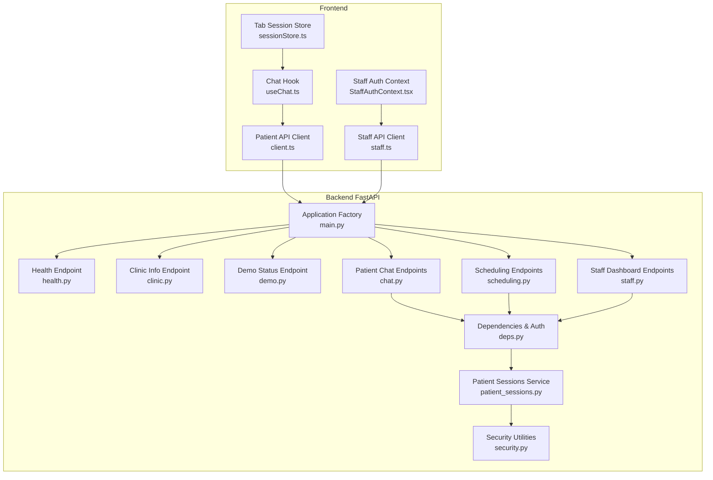
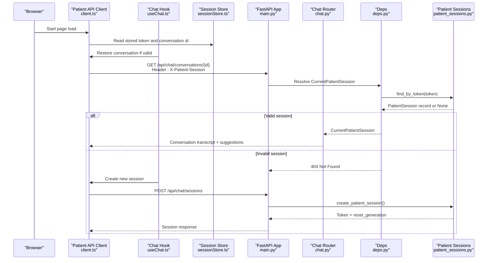
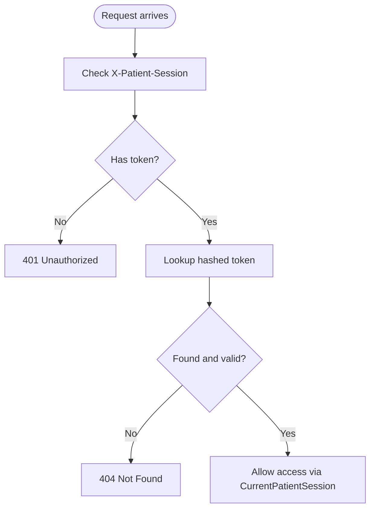
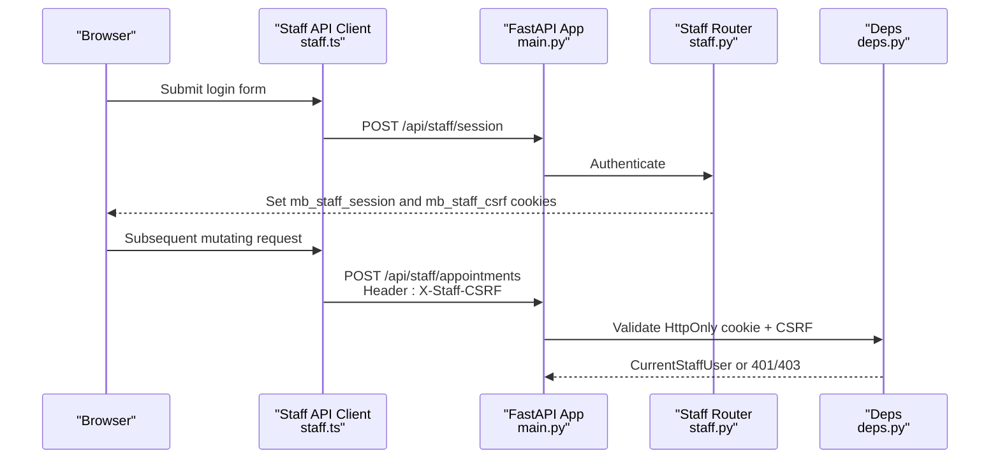
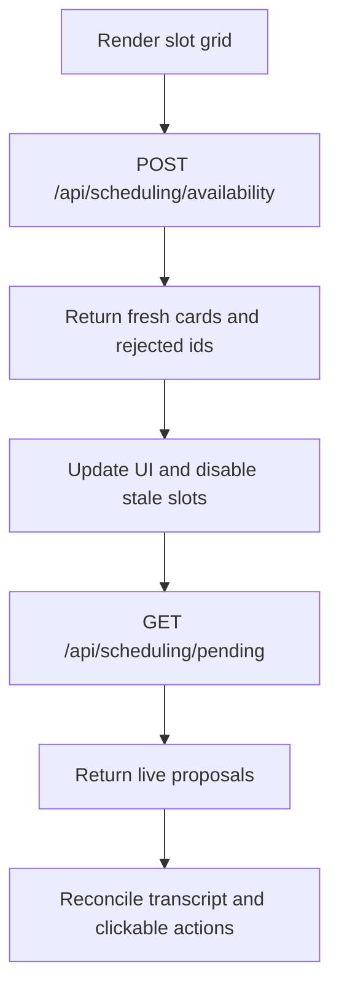
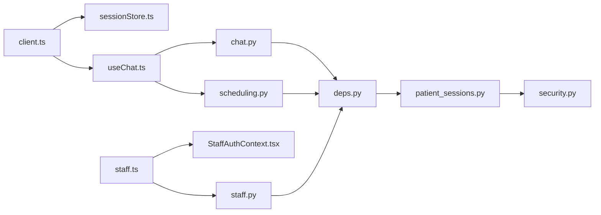

# API Communication

<cite>
**Referenced Files in This Document**
- [main.py](file://backend/app/main.py)
- [health.py](file://backend/app/api/health.py)
- [clinic.py](file://backend/app/api/clinic.py)
- [demo.py](file://backend/app/api/demo.py)
- [chat.py](file://backend/app/api/chat.py)
- [scheduling.py](file://backend/app/api/scheduling.py)
- [staff.py](file://backend/app/api/staff.py)
- [deps.py](file://backend/app/api/deps.py)
- [security.py](file://backend/app/services/security.py)
- [patient_sessions.py](file://backend/app/services/patient_sessions.py)
- [client.ts](file://frontend/src/api/client.ts)
- [staff.ts](file://frontend/src/api/staff.ts)
- [sessionStore.ts](file://frontend/src/lib/sessionStore.ts)
- [useChat.ts](file://frontend/src/hooks/useChat.ts)
- [StaffAuthContext.tsx](file://frontend/src/pages/staff/StaffAuthContext.tsx)
- [StaffLoginPage.tsx](file://frontend/src/pages/staff/StaffLoginPage.tsx)
</cite>

## Table of Contents
1. [Introduction](#introduction)
2. [Project Structure](#project-structure)
3. [Core Components](#core-components)
4. [Architecture Overview](#architecture-overview)
5. [Detailed Component Analysis](#detailed-component-analysis)
6. [Dependency Analysis](#dependency-analysis)
7. [Performance Considerations](#performance-considerations)
8. [Troubleshooting Guide](#troubleshooting-guide)
9. [Conclusion](#conclusion)

## Introduction
This document explains how the frontend and backend communicate through RESTful APIs, including authentication, session handling, CSRF protection, request/response schemas, error handling, and real-time behavior. The system has two distinct user flows:

- Patient chat flow: uses an opaque session token sent in the `X-Patient-Session` header.
- Staff dashboard flow: uses an HttpOnly session cookie plus a CSRF token echoed in `X-Staff-CSRF`.

There is no WebSocket implementation; real-time-like updates are achieved by polling deterministic scheduling endpoints and reconciling server state with client-side cards.

## Project Structure
The API surface is organized under `/api`:

- System and configuration endpoints: health, clinic, demo status.
- Patient chat endpoints: sessions, conversations, messages, feedback.
- Scheduling endpoints: slot selection, availability refresh, proposal confirmation/decline, pending proposals.
- Staff dashboard endpoints: login, session management, appointments, alerts, requests, patient lookup.

**Diagram sources**
- [main.py:202-244](file://backend/app/main.py#L202-L244)
- [health.py:23-57](file://backend/app/api/health.py#L23-L57)
- [clinic.py:14-32](file://backend/app/api/clinic.py#L14-L32)
- [demo.py:15-22](file://backend/app/api/demo.py#L15-L22)
- [chat.py:51-346](file://backend/app/api/chat.py#L51-L346)
- [scheduling.py:32-553](file://backend/app/api/scheduling.py#L32-L553)
- [staff.py:61-716](file://backend/app/api/staff.py#L61-L716)
- [deps.py:1-98](file://backend/app/api/deps.py#L1-L98)
- [patient_sessions.py:1-123](file://backend/app/services/patient_sessions.py#L1-L123)
- [security.py:1-47](file://backend/app/services/security.py#L1-L47)
- [client.ts:104-307](file://frontend/src/api/client.ts#L104-L307)
- [staff.ts:19-404](file://frontend/src/api/staff.ts#L19-L404)
- [sessionStore.ts:1-138](file://frontend/src/lib/sessionStore.ts#L1-L138)
- [useChat.ts:271-749](file://frontend/src/hooks/useChat.ts#L271-L749)
- [StaffAuthContext.tsx:42-131](file://frontend/src/pages/staff/StaffAuthContext.tsx#L42-L131)

**Section sources**
- [main.py:202-244](file://backend/app/main.py#L202-L244)
- [client.ts:104-307](file://frontend/src/api/client.ts#L104-L307)
- [staff.ts:19-404](file://frontend/src/api/staff.ts#L19-L404)

## Core Components
- Application factory and middleware:
  - Adds CORS, request ID propagation, timing, structured logging, and global exception handlers.
  - Exposes OpenAPI documentation at `/docs`, `/redoc`, and `/openapi.json`.
- Public endpoints:
  - `/api/health`: liveness and database probe.
  - `/api/clinic`: public clinic configuration.
  - `/api/demo/status`: safe aggregate counts and reset generation.
- Patient chat endpoints:
  - `/api/chat/sessions`: creates a session token and initial conversation.
  - `/api/chat/conversations`: list and create conversations.
  - `/api/chat/conversations/{id}`: restore a conversation transcript.
  - `/api/chat/conversations/{id}/messages`: send a message and run one assistant turn.
  - `/api/chat/conversations/{id}/feedback`: rate an assistant turn.
- Scheduling endpoints:
  - `/api/scheduling/slots/select`: hold a slot and create a proposal card.
  - `/api/scheduling/availability`: re-check rendered slots without booking.
  - `/api/scheduling/proposals/{id}/confirm` and `/decline`: confirm or decline a proposal.
  - `/api/scheduling/pending`: live actionable proposals for reconciliation.
- Staff dashboard endpoints:
  - `/api/staff/session`: login (POST), current session (GET), logout (DELETE).
  - `/api/staff/summary`, `/feedback`, `/appointments`, `/alerts`, `/requests`, `/patients/search`, etc.

**Section sources**
- [main.py:45-244](file://backend/app/main.py#L45-L244)
- [health.py:23-57](file://backend/app/api/health.py#L23-L57)
- [clinic.py:14-32](file://backend/app/api/clinic.py#L14-L32)
- [demo.py:15-22](file://backend/app/api/demo.py#L15-L22)
- [chat.py:111-346](file://backend/app/api/chat.py#L111-L346)
- [scheduling.py:216-553](file://backend/app/api/scheduling.py#L216-L553)
- [staff.py:226-716](file://backend/app/api/staff.py#L226-L716)

## Architecture Overview
The architecture separates concerns between presentation, API clients, and backend routers:

- Frontend patient client sends an opaque token in `X-Patient-Session`.
- Frontend staff client uses cookies and CSRF headers for mutating operations.
- Backend dependencies enforce authorization before route handlers execute.
- Long-running model calls are offloaded to a thread pool to avoid blocking the event loop.

**Diagram sources**
- [client.ts:220-301](file://frontend/src/api/client.ts#L220-L301)
- [useChat.ts:445-514](file://frontend/src/hooks/useChat.ts#L445-L514)
- [sessionStore.ts:70-137](file://frontend/src/lib/sessionStore.ts#L70-L137)
- [main.py:202-244](file://backend/app/main.py#L202-L244)
- [chat.py:111-163](file://backend/app/api/chat.py#L111-L163)
- [deps.py:27-51](file://backend/app/api/deps.py#L27-L51)
- [patient_sessions.py:50-85](file://backend/app/services/patient_sessions.py#L50-L85)

## Detailed Component Analysis

### RESTful API Design Principles
- Resource-oriented paths:
  - `/api/chat/sessions`, `/api/chat/conversations`, `/api/chat/conversations/{id}`, `/api/chat/conversations/{id}/messages`, `/api/chat/conversations/{id}/feedback`.
  - `/api/scheduling/slots/select`, `/api/scheduling/availability`, `/api/scheduling/proposals/{id}/confirm`, `/api/scheduling/proposals/{id}/decline`, `/api/scheduling/pending`.
  - `/api/staff/session`, `/api/staff/appointments`, `/api/staff/alerts`, `/api/staff/requests`, `/api/staff/patients/search`.
- HTTP methods:
  - GET for reads, POST for mutations, DELETE for logout.
- Idempotency:
  - Scheduling actions accept client-generated keys (`create_key`, `confirm_key`) so retries do not duplicate work.
- Consistent error shape:
  - Global exception handlers return `detail`, `error`, and `request_id`.
- Versioning and discovery:
  - OpenAPI schema available at `/openapi.json`; UI docs at `/docs` and `/redoc`.

**Section sources**
- [main.py:110-179](file://backend/app/main.py#L110-L179)
- [main.py:202-244](file://backend/app/main.py#L202-L244)
- [scheduling.py:40-148](file://backend/app/api/scheduling.py#L40-L148)

### Request and Response Schemas

#### Health and Configuration
- `/api/health` returns service status, version, timestamp, database health, schema version, reset generation, seed status, and clinic time.
- `/api/clinic` returns clinic name, address, phone, email, timezone, slot length, business hours, closed days, policies, insurance overview, and self-pay label.
- `/api/demo/status` returns aggregate counts, reset generation, seeding metadata, and next available slot.

**Section sources**
- [health.py:23-57](file://backend/app/api/health.py#L23-L57)
- [clinic.py:14-32](file://backend/app/api/clinic.py#L14-L32)
- [demo.py:15-22](file://backend/app/api/demo.py#L15-L22)
- [client.ts:11-92](file://frontend/src/api/client.ts#L11-L92)

#### Patient Chat
- `POST /api/chat/sessions`:
  - Optional body includes `resume_conversation_id`.
  - Returns session token, session state, reset generation, conversation id, greeting, suggestions, and clinic name.
- `GET /api/chat/conversations`:
  - Requires `X-Patient-Session`.
  - Returns conversation summaries and session state.
- `POST /api/chat/conversations`:
  - Creates a new conversation and adds a greeting message.
- `GET /api/chat/conversations/{conversation_id}`:
  - Restores full transcript, suggestions, session state, and pending proposals.
- `POST /api/chat/conversations/{conversation_id}/messages`:
  - Sends a message and runs one assistant turn.
  - Supports optional action payload for family option clicks.
  - Returns reply, updated messages, cards, session state, and degraded flag.
- `POST /api/chat/conversations/{conversation_id}/feedback`:
  - Rates an assistant message within the same session-owned conversation.

**Section sources**
- [chat.py:111-346](file://backend/app/api/chat.py#L111-L346)
- [client.ts:137-301](file://frontend/src/api/client.ts#L137-L301)
- [useChat.ts:548-623](file://frontend/src/hooks/useChat.ts#L548-L623)

#### Scheduling Actions
- `POST /api/scheduling/slots/select`:
  - Holds a slot and creates an awaiting-confirmation proposal.
  - Uses intent and target appointment context to decide whether this is a new booking or a reschedule.
  - Accepts `create_key` for idempotency.
- `POST /api/scheduling/availability`:
  - Re-checks rendered slot ids against SQLite.
  - Returns fresh cards, rejected ids, and still-pending proposals.
- `POST /api/scheduling/proposals/{proposal_id}/confirm`:
  - Revalidates and books atomically.
  - Uses `confirm_key` for idempotency.
- `POST /api/scheduling/proposals/{proposal_id}/decline`:
  - Releases a proposal without booking.
- `GET /api/scheduling/pending`:
  - Returns live proposals and handoff entries for reconciliation.

**Section sources**
- [scheduling.py:40-148](file://backend/app/api/scheduling.py#L40-L148)
- [scheduling.py:216-553](file://backend/app/api/scheduling.py#L216-L553)
- [client.ts:313-464](file://frontend/src/api/client.ts#L313-L464)

#### Staff Dashboard
- `POST /api/staff/session`:
  - Authenticates username/password.
  - Sets HttpOnly session cookie and readable CSRF cookie.
  - Returns authenticated flag, user info, CSRF token, expiry, clinic time, and demo notice.
- `GET /api/staff/session`:
  - Returns current session state without leaking sensitive data.
- `DELETE /api/staff/session`:
  - Revokes session server-side and clears cookies.
- Other staff endpoints:
  - Summary, feedback, appointments CRUD, slots listing, alerts lifecycle, requests lifecycle, patient search and detail.

**Section sources**
- [staff.py:73-158](file://backend/app/api/staff.py#L73-L158)
- [staff.py:226-311](file://backend/app/api/staff.py#L226-L311)
- [staff.py:319-716](file://backend/app/api/staff.py#L319-L716)
- [staff.ts:21-404](file://frontend/src/api/staff.ts#L21-L404)

### Authentication and Authorization

#### Patient Session-Based Authentication
- The only unauthenticated route is session creation.
- Every other patient endpoint requires `X-Patient-Session`.
- Tokens are URL-safe random values returned once; only their hash is stored.
- Sessions are scoped to a reset generation; after a reset, old tokens become unknown.
- Dependencies reject staff credentials on patient routes.

**Diagram sources**
- [deps.py:27-51](file://backend/app/api/deps.py#L27-L51)
- [patient_sessions.py:50-85](file://backend/app/services/patient_sessions.py#L50-L85)
- [security.py:44-47](file://backend/app/services/security.py#L44-L47)

**Section sources**
- [deps.py:1-51](file://backend/app/api/deps.py#L1-L51)
- [patient_sessions.py:1-123](file://backend/app/services/patient_sessions.py#L1-L123)
- [security.py:1-47](file://backend/app/services/security.py#L1-L47)

#### Staff Session and CSRF Protection
- Login sets two cookies:
  - `mb_staff_session`: HttpOnly, SameSite=Lax, secure when over HTTPS.
  - `mb_staff_csrf`: readable by JavaScript, used to echo `X-Staff-CSRF`.
- Mutating staff requests require both the HttpOnly cookie and matching CSRF header.
- Safe methods bypass CSRF checks.
- Frontend staff client automatically attaches CSRF for mutating requests and uses `credentials: "same-origin"`.

**Diagram sources**
- [staff.ts:1-15](file://frontend/src/api/staff.ts#L1-L15)
- [staff.ts:215-267](file://frontend/src/api/staff.ts#L215-L267)
- [staff.py:133-158](file://backend/app/api/staff.py#L133-L158)
- [staff.py:226-311](file://backend/app/api/staff.py#L226-L311)
- [deps.py:67-98](file://backend/app/api/deps.py#L67-L98)

**Section sources**
- [staff.py:1-30](file://backend/app/api/staff.py#L1-L30)
- [staff.py:133-158](file://backend/app/api/staff.py#L133-L158)
- [staff.py:226-311](file://backend/app/api/staff.py#L226-L311)
- [deps.py:67-98](file://backend/app/api/deps.py#L67-L98)
- [staff.ts:1-15](file://frontend/src/api/staff.ts#L1-L15)
- [staff.ts:215-267](file://frontend/src/api/staff.ts#L215-L267)

### Real-Time Communication Patterns
- No WebSocket usage is present.
- Real-time-like behavior is implemented by:
  - Polling `/api/scheduling/pending` to reconcile live proposals.
  - Calling `/api/scheduling/availability` to refresh slot grids.
  - Using optimistic UI with retry and failure states in the chat hook.
  - Detecting demo resets via `/api/demo/status` and resetting local session state.

**Diagram sources**
- [scheduling.py:216-238](file://backend/app/api/scheduling.py#L216-L238)
- [scheduling.py:365-453](file://backend/app/api/scheduling.py#L365-L453)
- [client.ts:370-464](file://frontend/src/api/client.ts#L370-L464)
- [useChat.ts:107-175](file://frontend/src/hooks/useChat.ts#L107-L175)

**Section sources**
- [useChat.ts:107-175](file://frontend/src/hooks/useChat.ts#L107-L175)
- [useChat.ts:445-514](file://frontend/src/hooks/useChat.ts#L445-L514)
- [client.ts:370-464](file://frontend/src/api/client.ts#L370-L464)

### Common API Interactions and Error Scenarios

#### Starting a Patient Chat Session
- Flow:
  - Frontend restores stored token and conversation id.
  - If invalid, frontend creates a new session and optionally resumes a conversation id hint.
  - Frontend then fetches the full conversation transcript.
- Errors:
  - Missing token: 401.
  - Unknown/expired/reset token: 404.
  - Network failure: frontend throws `ApiError`.

**Section sources**
- [useChat.ts:445-514](file://frontend/src/hooks/useChat.ts#L445-L514)
- [useChat.ts:548-623](file://frontend/src/hooks/useChat.ts#L548-L623)
- [client.ts:220-301](file://frontend/src/api/client.ts#L220-L301)
- [deps.py:27-51](file://backend/app/api/deps.py#L27-L51)

#### Sending a Message
- Flow:
  - Optimistic patient message added to UI.
  - Backend validates non-empty message.
  - Assistant turn runs in a thread pool.
  - Frontend reconciles returned cards and marks live proposals.
- Errors:
  - Empty message: 422.
  - Session invalid: 401/404 handled by restarting session.
  - Degraded assistant: warning banner shown.

**Section sources**
- [chat.py:233-274](file://backend/app/api/chat.py#L233-L274)
- [useChat.ts:548-623](file://frontend/src/hooks/useChat.ts#L548-L623)
- [client.ts:265-301](file://frontend/src/api/client.ts#L265-L301)

#### Holding and Confirming a Slot
- Flow:
  - Select slot: creates a proposal card with idempotent key.
  - Availability refresh: validates slot ids and returns fresh cards.
  - Confirm: revalidates and books atomically with idempotent key.
- Errors:
  - Registration incomplete: action returns error state.
  - Slot unavailable: action returns error state.
  - Unknown proposal: 404.

**Section sources**
- [scheduling.py:256-363](file://backend/app/api/scheduling.py#L256-L363)
- [scheduling.py:365-453](file://backend/app/api/scheduling.py#L365-L453)
- [scheduling.py:456-508](file://backend/app/api/scheduling.py#L456-L508)
- [client.ts:370-464](file://frontend/src/api/client.ts#L370-L464)

#### Staff Login and CSRF
- Flow:
  - Login sets HttpOnly session cookie and CSRF cookie.
  - Frontend reads CSRF cookie and echoes it in `X-Staff-CSRF` for mutating requests.
  - Dashboard refreshes session on mount and tab focus.
- Errors:
  - Wrong credentials: 401.
  - Missing CSRF on mutation: 403.
  - Expired or revoked session: 401.

**Section sources**
- [staff.py:226-311](file://backend/app/api/staff.py#L226-L311)
- [staff.ts:215-267](file://frontend/src/api/staff.ts#L215-L267)
- [StaffAuthContext.tsx:42-131](file://frontend/src/pages/staff/StaffAuthContext.tsx#L42-L131)
- [StaffLoginPage.tsx:30-36](file://frontend/src/pages/staff/StaffLoginPage.tsx#L30-L36)

## Dependency Analysis
- Frontend patient client depends on:
  - `sessionStore` for tab-scoped token and conversation id.
  - `useChat` for bootstrapping, restoring, sending, and reconciling.
- Frontend staff client depends on:
  - CSRF cookie reading and automatic header injection.
  - `credentials: "same-origin"` for HttpOnly cookie transport.
- Backend dependencies:
  - `CurrentPatientSession` enforces patient token presence and validity.
  - `CurrentStaffSession` and `CurrentStaffUser` enforce staff cookie and CSRF.
  - Services encapsulate hashing, session issuance, and business logic.

**Diagram sources**
- [client.ts:104-307](file://frontend/src/api/client.ts#L104-L307)
- [staff.ts:19-404](file://frontend/src/api/staff.ts#L19-L404)
- [sessionStore.ts:70-137](file://frontend/src/lib/sessionStore.ts#L70-L137)
- [useChat.ts:271-749](file://frontend/src/hooks/useChat.ts#L271-L749)
- [chat.py:111-346](file://backend/app/api/chat.py#L111-L346)
- [scheduling.py:216-553](file://backend/app/api/scheduling.py#L216-L553)
- [staff.py:226-716](file://backend/app/api/staff.py#L226-L716)
- [deps.py:1-98](file://backend/app/api/deps.py#L1-L98)
- [patient_sessions.py:1-123](file://backend/app/services/patient_sessions.py#L1-L123)
- [security.py:1-47](file://backend/app/services/security.py#L1-L47)

**Section sources**
- [client.ts:104-307](file://frontend/src/api/client.ts#L104-L307)
- [staff.ts:19-404](file://frontend/src/api/staff.ts#L19-L404)
- [deps.py:1-98](file://backend/app/api/deps.py#L1-L98)

## Performance Considerations
- Blocking model execution is offloaded using a thread pool to keep the event loop responsive.
- Database errors are handled globally with stable error codes and retry hints where appropriate.
- Scheduling actions are deterministic and idempotent, reducing contention and duplication.
- Frontend uses optimistic UI and AbortSignals to cancel stale requests during navigation or rapid interactions.

[No sources needed since this section provides general guidance]

## Troubleshooting Guide
- Missing patient session:
  - Ensure `X-Patient-Session` is included on all chat and scheduling requests.
  - If 404 occurs after a demo reset, restart the session flow.
- Invalid or expired patient session:
  - Clear stored pointers and start a fresh session.
- Staff CSRF failures:
  - Reload the dashboard to obtain a fresh CSRF cookie.
  - Ensure mutating requests include `X-Staff-CSRF`.
- Database busy or integrity errors:
  - Retry after a short delay; backend may return 503 with retry guidance or 409 conflict.
- Network unreachable:
  - Frontend throws `ApiError`; show a user-friendly message and allow retry.

**Section sources**
- [main.py:124-179](file://backend/app/main.py#L124-L179)
- [deps.py:27-51](file://backend/app/api/deps.py#L27-L51)
- [deps.py:67-98](file://backend/app/api/deps.py#L67-L98)
- [client.ts:94-131](file://frontend/src/api/client.ts#L94-L131)
- [staff.ts:229-267](file://frontend/src/api/staff.ts#L229-L267)

## Conclusion
The API design emphasizes clear separation between patient and staff authentication, deterministic scheduling actions, and robust error handling. Patient sessions use an opaque header-based token, while staff operations rely on HttpOnly cookies and CSRF protection. Real-time-like UX is achieved through polling and reconciliation rather than WebSockets. Clients should handle session invalidation, CSRF mismatches, and transient database errors gracefully, and should prefer idempotent keys for scheduling mutations.