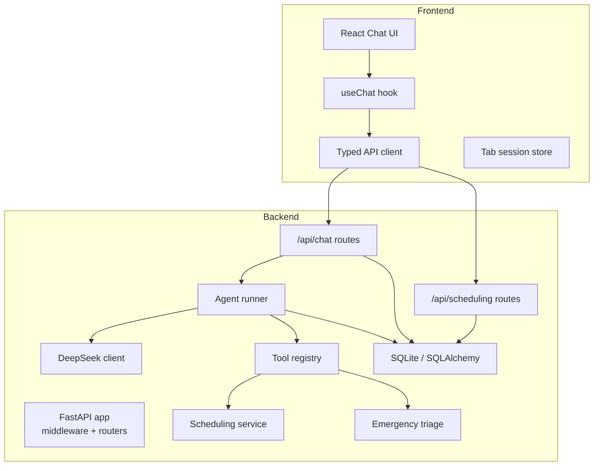
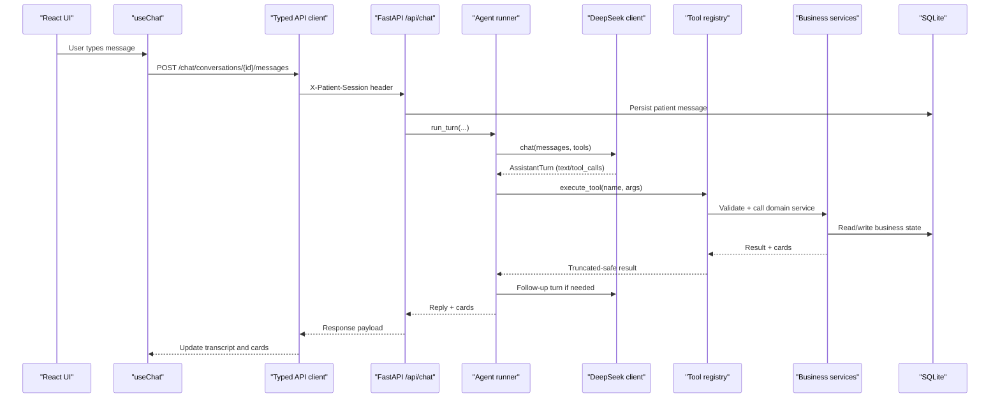
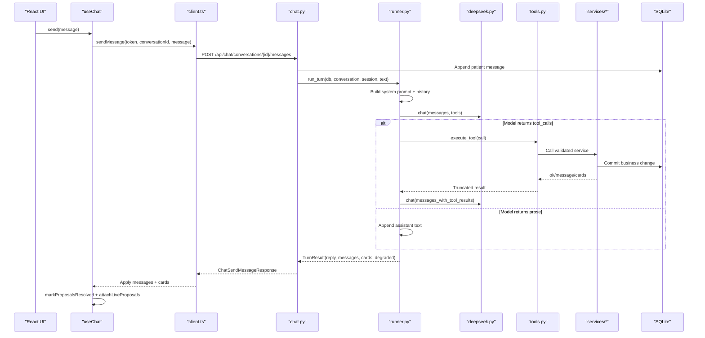
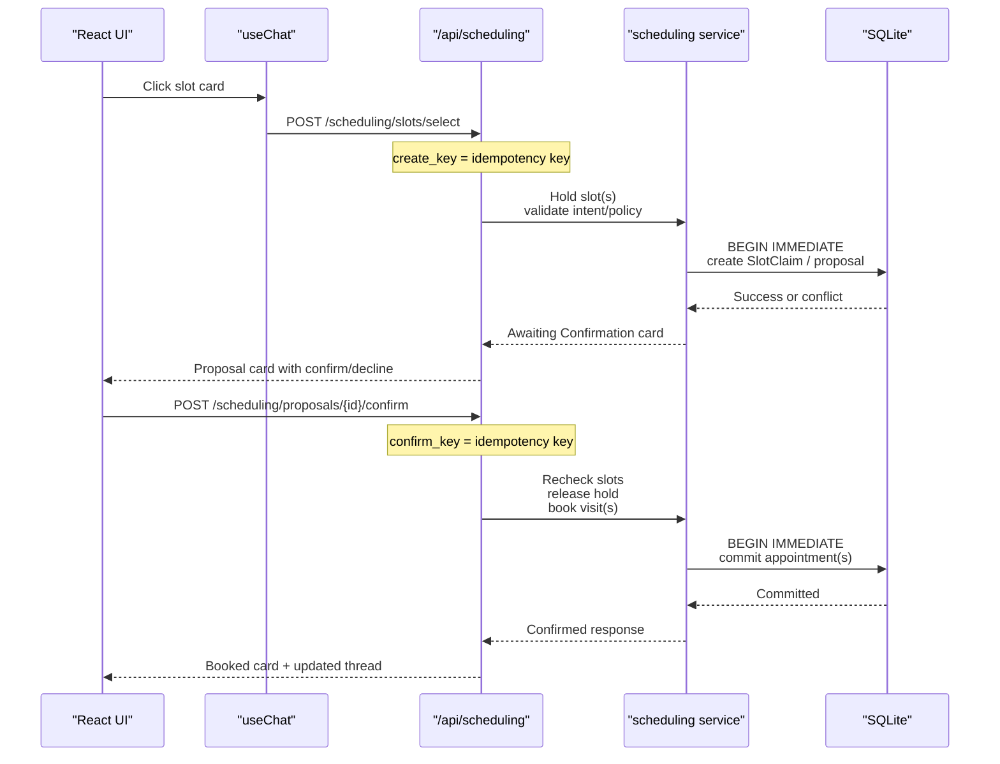
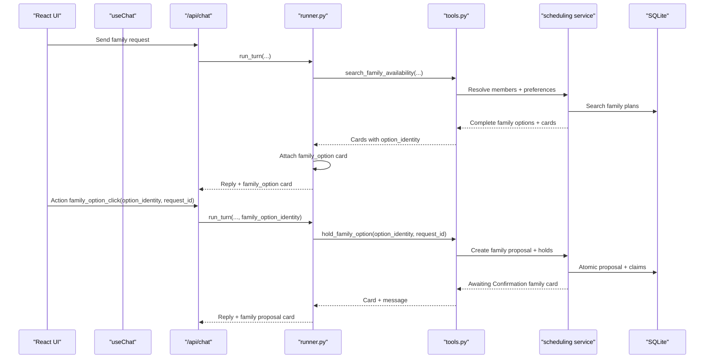
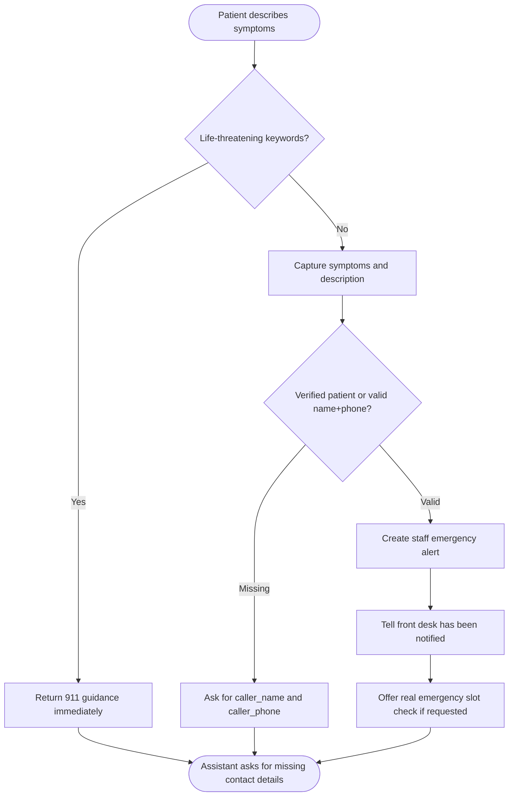
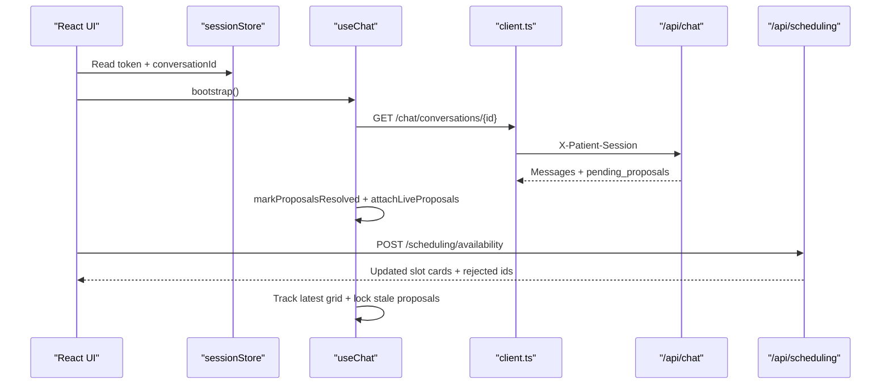
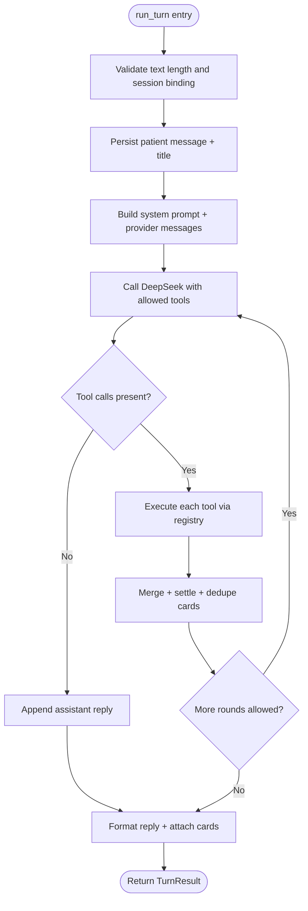
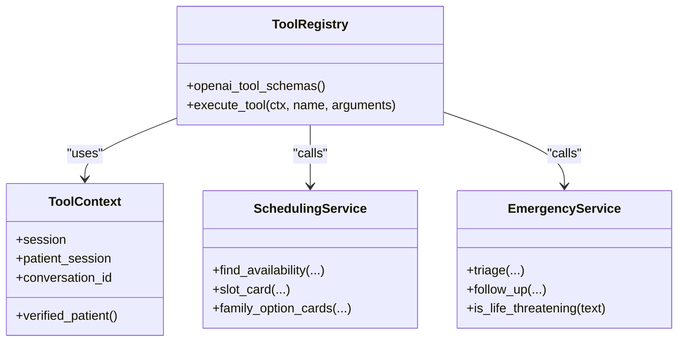
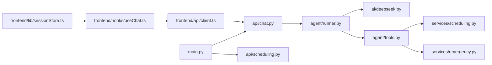

# Component Interactions

<cite>
**Referenced Files in This Document**
- [README.md](file://README.md)
- [main.py](file://backend/app/main.py)
- [chat.py](file://backend/app/api/chat.py)
- [runner.py](file://backend/app/agent/runner.py)
- [deepseek.py](file://backend/app/ai/deepseek.py)
- [tools.py](file://backend/app/agent/tools.py)
- [scheduling.py](file://backend/app/services/scheduling.py)
- [emergency.py](file://backend/app/services/emergency.py)
- [client.ts](file://frontend/src/api/client.ts)
- [useChat.ts](file://frontend/src/hooks/useChat.ts)
- [sessionStore.ts](file://frontend/src/lib/sessionStore.ts)
</cite>

## Table of Contents
1. [Introduction](#introduction)
2. [Project Structure](#project-structure)
3. [Core Components](#core-components)
4. [Architecture Overview](#architecture-overview)
5. [Detailed Component Analysis](#detailed-component-analysis)
6. [Dependency Analysis](#dependency-analysis)
7. [Performance Considerations](#performance-considerations)
8. [Troubleshooting Guide](#troubleshooting-guide)
9. [Conclusion](#conclusion)

## Introduction
This document explains how the dental receptionist system turns a patient message into an AI-driven conversation, tool execution, and database update. It covers:
- The React frontend session and chat flow.
- FastAPI endpoints for sessions, conversations, feedback, and scheduling actions.
- The agent runner orchestrating DeepSeek tool calls, conversation state, and fallback behavior.
- Service-layer domains for scheduling, patient management, and emergency triage.
- Sequence diagrams for appointment booking, family coordination, and emergency escalation.
- Error propagation, retries, and idempotency across components.

## Project Structure
The repository is split into a Python FastAPI backend and a React frontend:
- Backend: API routes, agent runner, AI client, tools, services, models, and SQLite persistence.
- Frontend: typed API client, chat hook, card actions, clinic data helpers, and tab-scoped session storage.

**Diagram sources**
- [main.py:202-252](file://backend/app/main.py#L202-L252)
- [chat.py:111-274](file://backend/app/api/chat.py#L111-L274)
- [runner.py:171-406](file://backend/app/agent/runner.py#L171-L406)
- [deepseek.py:178-329](file://backend/app/ai/deepseek.py#L178-L329)
- [tools.py:703-740](file://backend/app/agent/tools.py#L703-L740)
- [scheduling.py:393-716](file://backend/app/services/scheduling.py#L393-L716)
- [emergency.py:258-366](file://backend/app/services/emergency.py#L258-L366)
- [client.ts:226-307](file://frontend/src/api/client.ts#L226-L307)
- [useChat.ts:271-749](file://frontend/src/hooks/useChat.ts#L271-L749)

**Section sources**
- [README.md:52-70](file://README.md#L52-L70)
- [README.md:305-337](file://README.md#L305-L337)

## Core Components
- FastAPI application: request ID middleware, CORS, exception handlers, router registration, and startup bootstrap.
- Patient chat API: session creation, conversation list/start/restore, message sending, feedback, and reset.
- Agent runner: bounded tool loop, prompt assembly, tool dispatch, result merging, card attachment, and fallback replies.
- DeepSeek client: OpenAI-compatible HTTP client with timeouts, retries, DSML parsing, and typed errors.
- Tool registry: Pydantic-validated tool schemas, context-bound handlers, and safe truncation of large results.
- Scheduling service: availability search, proposal holds, confirmation transactions, family plans, and slot cards.
- Emergency triage: keyword-based life-threatening detection, contact validation, alert creation, and follow-up handling.
- Frontend client: typed requests, headers, error mapping, and scheduling action payloads.
- Chat hook: boot/restore, optimistic send, live proposal reconciliation, retry, and feedback submission.
- Session store: tab-scoped token, conversation pointer, reset generation, and reset notice.

**Section sources**
- [main.py:45-179](file://backend/app/main.py#L45-L179)
- [chat.py:111-347](file://backend/app/api/chat.py#L111-L347)
- [runner.py:171-406](file://backend/app/agent/runner.py#L171-L406)
- [deepseek.py:31-64](file://backend/app/ai/deepseek.py#L31-L64)
- [tools.py:41-127](file://backend/app/agent/tools.py#L41-L127)
- [scheduling.py:69-134](file://backend/app/services/scheduling.py#L69-L134)
- [emergency.py:117-148](file://backend/app/services/emergency.py#L117-L148)
- [client.ts:94-131](file://frontend/src/api/client.ts#L94-L131)
- [useChat.ts:271-749](file://frontend/src/hooks/useChat.ts#L271-L749)
- [sessionStore.ts:1-30](file://frontend/src/lib/sessionStore.ts#L1-L30)

## Architecture Overview
The patient message path is intentionally layered:
- The frontend owns UI state and sends messages through a typed client.
- FastAPI validates inputs, resolves the session, persists the patient message, and delegates to the runner.
- The runner builds prompts, calls DeepSeek, executes validated tools, and persists tool results and final text.
- Services enforce identity, scheduling rules, transactions, and emergency policy.
- The UI reconciles server-provided cards with live proposals and handles stale or settled states.

**Diagram sources**
- [chat.py:233-274](file://backend/app/api/chat.py#L233-L274)
- [runner.py:171-406](file://backend/app/agent/runner.py#L171-L406)
- [deepseek.py:205-329](file://backend/app/ai/deepseek.py#L205-L329)
- [tools.py:703-740](file://backend/app/agent/tools.py#L703-L740)
- [scheduling.py:393-716](file://backend/app/services/scheduling.py#L393-L716)

## Detailed Component Analysis

### Patient Message Submission to Final Reply
This sequence shows one complete assistant turn from the React UI through FastAPI, the runner, DeepSeek, tools, and back to the UI.

**Diagram sources**
- [useChat.ts:548-623](file://frontend/src/hooks/useChat.ts#L548-L623)
- [client.ts:265-301](file://frontend/src/api/client.ts#L265-L301)
- [chat.py:233-274](file://backend/app/api/chat.py#L233-L274)
- [runner.py:171-406](file://backend/app/agent/runner.py#L171-L406)
- [deepseek.py:205-329](file://backend/app/ai/deepseek.py#L205-L329)
- [tools.py:703-740](file://backend/app/agent/tools.py#L703-L740)

**Section sources**
- [useChat.ts:548-623](file://frontend/src/hooks/useChat.ts#L548-L623)
- [client.ts:265-301](file://frontend/src/api/client.ts#L265-L301)
- [chat.py:233-274](file://backend/app/api/chat.py#L233-L274)
- [runner.py:171-406](file://backend/app/agent/runner.py#L171-L406)

### Appointment Booking Workflow
A typical booking involves availability search, hold creation, explicit confirmation, and transactional commit.

**Diagram sources**
- [client.ts:370-416](file://frontend/src/api/client.ts#L370-L416)
- [scheduling.py:238-295](file://backend/app/services/scheduling.py#L238-L295)
- [scheduling.py:597-716](file://backend/app/services/scheduling.py#L597-L716)

**Section sources**
- [client.ts:370-416](file://frontend/src/api/client.ts#L370-L416)
- [scheduling.py:238-295](file://backend/app/services/scheduling.py#L238-L295)
- [scheduling.py:597-716](file://backend/app/services/scheduling.py#L597-L716)

### Family Coordination Workflow
Family bookings require multiple participants, coordinated contiguous or nearby options, and one atomic confirmation.

**Diagram sources**
- [runner.py:153-169](file://backend/app/agent/runner.py#L153-L169)
- [runner.py:409-557](file://backend/app/agent/runner.py#L409-L557)
- [tools.py:549-559](file://backend/app/agent/tools.py#L549-L559)
- [scheduling.py:341-390](file://backend/app/services/scheduling.py#L341-L390)
- [scheduling.py:719-792](file://backend/app/services/scheduling.py#L719-L792)

**Section sources**
- [runner.py:153-169](file://backend/app/agent/runner.py#L153-L169)
- [runner.py:409-557](file://backend/app/agent/runner.py#L409-L557)
- [tools.py:549-559](file://backend/app/agent/tools.py#L549-L559)
- [scheduling.py:341-390](file://backend/app/services/scheduling.py#L341-L390)
- [scheduling.py:719-792](file://backend/app/services/scheduling.py#L719-L792)

### Emergency Escalation Workflow
Life-threatening symptoms bypass registration and scheduling; other urgent reports require callback details and create staff alerts.

**Diagram sources**
- [emergency.py:219-232](file://backend/app/services/emergency.py#L219-L232)
- [emergency.py:258-366](file://backend/app/services/emergency.py#L258-L366)
- [emergency.py:390-455](file://backend/app/services/emergency.py#L390-L455)

**Section sources**
- [emergency.py:219-232](file://backend/app/services/emergency.py#L219-L232)
- [emergency.py:258-366](file://backend/app/services/emergency.py#L258-L366)
- [emergency.py:390-455](file://backend/app/services/emergency.py#L390-L455)

### Session Management and Real-Time Updates
The frontend maintains a tab-scoped session and restores threads on load. Real-time updates come from:
- Restore endpoint returning persisted messages plus pending proposals.
- Availability refresh endpoint revalidating slot grids.
- Live proposal reconciliation marking expired or superseded cards inactive.

**Diagram sources**
- [sessionStore.ts:70-138](file://frontend/src/lib/sessionStore.ts#L70-L138)
- [useChat.ts:356-443](file://frontend/src/hooks/useChat.ts#L356-L443)
- [useChat.ts:445-514](file://frontend/src/hooks/useChat.ts#L445-L514)
- [client.ts:259-301](file://frontend/src/api/client.ts#L259-L301)
- [client.ts:439-464](file://frontend/src/api/client.ts#L439-L464)

**Section sources**
- [sessionStore.ts:1-30](file://frontend/src/lib/sessionStore.ts#L1-L30)
- [sessionStore.ts:70-138](file://frontend/src/lib/sessionStore.ts#L70-L138)
- [useChat.ts:356-443](file://frontend/src/hooks/useChat.ts#L356-L443)
- [useChat.ts:445-514](file://frontend/src/hooks/useChat.ts#L445-L514)
- [client.ts:259-301](file://frontend/src/api/client.ts#L259-L301)
- [client.ts:439-464](file://frontend/src/api/client.ts#L439-L464)

### Agent Runner Orchestration and Fallbacks
The runner enforces safety and stability:
- Bounded tool rounds and per-round tool-call limits.
- Safe assistant text when model or tool failures occur.
- Card deduplication, settlement, and live proposal merging.
- Time-reask logic that replays or refreshes availability without double-booking.

**Diagram sources**
- [runner.py:171-406](file://backend/app/agent/runner.py#L171-L406)
- [runner.py:409-557](file://backend/app/agent/runner.py#L409-L557)
- [runner.py:560-719](file://backend/app/agent/runner.py#L560-L719)

**Section sources**
- [runner.py:171-406](file://backend/app/agent/runner.py#L171-L406)
- [runner.py:409-557](file://backend/app/agent/runner.py#L409-L557)
- [runner.py:560-719](file://backend/app/agent/runner.py#L560-L719)

### Service Layer Interactions Across Domains
- Patient management tools validate and normalize names, phones, and insurance choices before creating or updating records.
- Scheduling service composes date parsing, availability search, proposal holds, and atomic confirmation.
- Emergency triage classifies severity, validates callback details, and raises staff alerts.

**Diagram sources**
- [tools.py:41-127](file://backend/app/agent/tools.py#L41-L127)
- [tools.py:703-740](file://backend/app/agent/tools.py#L703-L740)
- [scheduling.py:393-716](file://backend/app/services/scheduling.py#L393-L716)
- [emergency.py:258-366](file://backend/app/services/emergency.py#L258-L366)

**Section sources**
- [tools.py:41-127](file://backend/app/agent/tools.py#L41-L127)
- [tools.py:703-740](file://backend/app/agent/tools.py#L703-L740)
- [scheduling.py:393-716](file://backend/app/services/scheduling.py#L393-L716)
- [emergency.py:258-366](file://backend/app/services/emergency.py#L258-L366)

## Dependency Analysis
Key dependency relationships:
- FastAPI app registers routers and installs observability middleware.
- Chat API depends on runner, conversation services, and patient session services.
- Runner depends on DeepSeek client, tool registry, and business services.
- Tools depend on validated argument models and services like scheduling and emergency.
- Frontend client depends on typed responses and uses AbortController for cancellation.
- useChat hook coordinates session restore, optimistic messaging, and live proposal reconciliation.

**Diagram sources**
- [main.py:202-252](file://backend/app/main.py#L202-L252)
- [chat.py:111-274](file://backend/app/api/chat.py#L111-L274)
- [runner.py:171-406](file://backend/app/agent/runner.py#L171-L406)
- [deepseek.py:178-329](file://backend/app/ai/deepseek.py#L178-L329)
- [tools.py:703-740](file://backend/app/agent/tools.py#L703-L740)
- [scheduling.py:393-716](file://backend/app/services/scheduling.py#L393-L716)
- [emergency.py:258-366](file://backend/app/services/emergency.py#L258-L366)
- [client.ts:226-307](file://frontend/src/api/client.ts#L226-L307)
- [useChat.ts:271-749](file://frontend/src/hooks/useChat.ts#L271-L749)
- [sessionStore.ts:70-138](file://frontend/src/lib/sessionStore.ts#L70-L138)

**Section sources**
- [main.py:202-252](file://backend/app/main.py#L202-L252)
- [chat.py:111-274](file://backend/app/api/chat.py#L111-L274)
- [runner.py:171-406](file://backend/app/agent/runner.py#L171-L406)
- [deepseek.py:178-329](file://backend/app/ai/deepseek.py#L178-L329)
- [tools.py:703-740](file://backend/app/agent/tools.py#L703-L740)
- [scheduling.py:393-716](file://backend/app/services/scheduling.py#L393-L716)
- [emergency.py:258-366](file://backend/app/services/emergency.py#L258-L366)
- [client.ts:226-307](file://frontend/src/api/client.ts#L226-L307)
- [useChat.ts:271-749](file://frontend/src/hooks/useChat.ts#L271-L749)
- [sessionStore.ts:70-138](file://frontend/src/lib/sessionStore.ts#L70-L138)

## Performance Considerations
- DeepSeek client uses bounded retries with exponential backoff for transient failures and strict timeouts.
- Runner limits tool rounds and tool calls per round to prevent runaway loops.
- Tool results are truncated safely while preserving interactive cards and decision fields.
- Scheduling uses immediate transactions and uniqueness constraints to avoid double-booking under contention.
- Frontend avoids unnecessary network calls by reconciling restored transcripts with live proposals.

[No sources needed since this section provides general guidance]

## Troubleshooting Guide
Common issues and their handling:
- Database busy or integrity errors: FastAPI returns structured error codes and hints to refresh or retry.
- DeepSeek timeout or rate limit: Client retries briefly; runner returns a degraded message without claiming success.
- Stale or superseded cards: Frontend marks non-pending proposals inactive and re-checks availability.
- Session invalidation: Frontend detects 401/404, clears local pointers, and starts a fresh session.
- Emergency triage missing contact details: Assistant asks for name and phone before filing an alert.

**Section sources**
- [main.py:124-179](file://backend/app/main.py#L124-L179)
- [deepseek.py:31-64](file://backend/app/ai/deepseek.py#L31-L64)
- [deepseek.py:205-249](file://backend/app/ai/deepseek.py#L205-L249)
- [runner.py:264-292](file://backend/app/agent/runner.py#L264-L292)
- [useChat.ts:200-204](file://frontend/src/hooks/useChat.ts#L200-L204)
- [useChat.ts:592-616](file://frontend/src/hooks/useChat.ts#L592-L616)
- [emergency.py:151-180](file://backend/app/services/emergency.py#L151-L180)

## Conclusion
The system separates conversational interpretation from deterministic business logic. The React frontend manages user experience and session state, FastAPI exposes typed endpoints, the runner orchestrates AI tool calls safely, and services enforce identity, scheduling correctness, and emergency policy. Retries, idempotency keys, transactions, and card reconciliation ensure robustness even when external APIs fail or schedules change between offer and confirmation.

[No sources needed since this section summarizes without analyzing specific files]