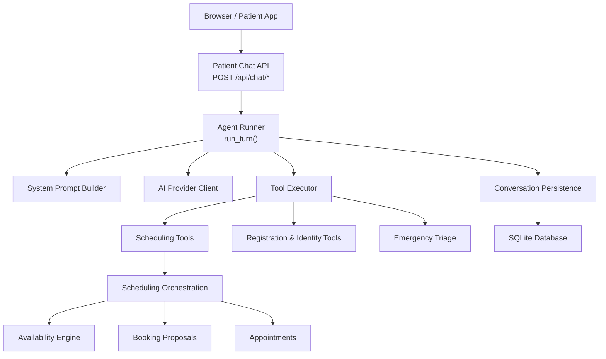
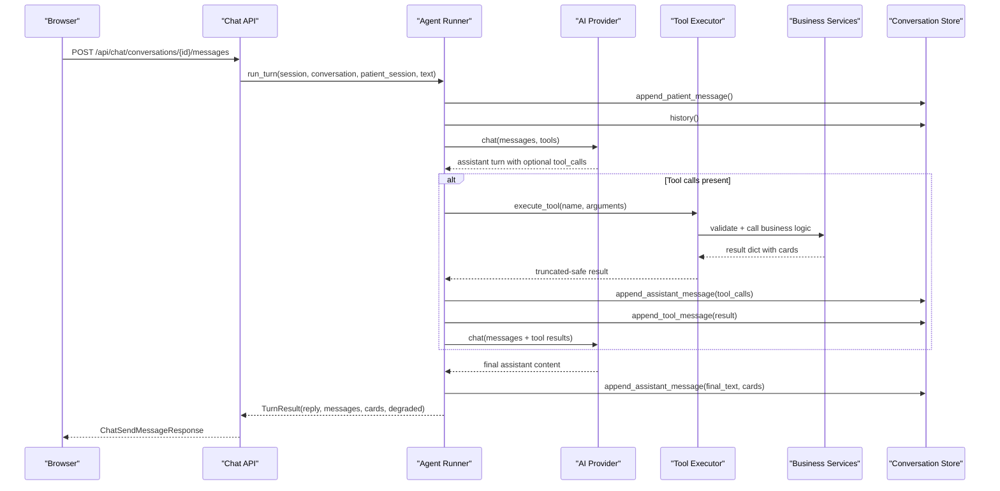
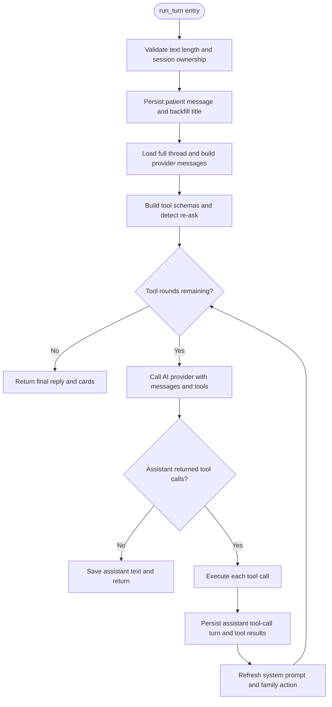
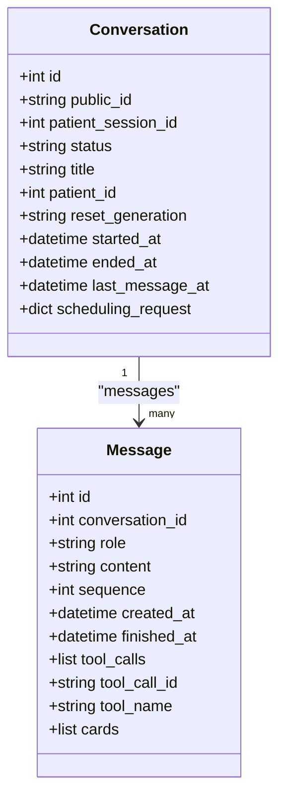
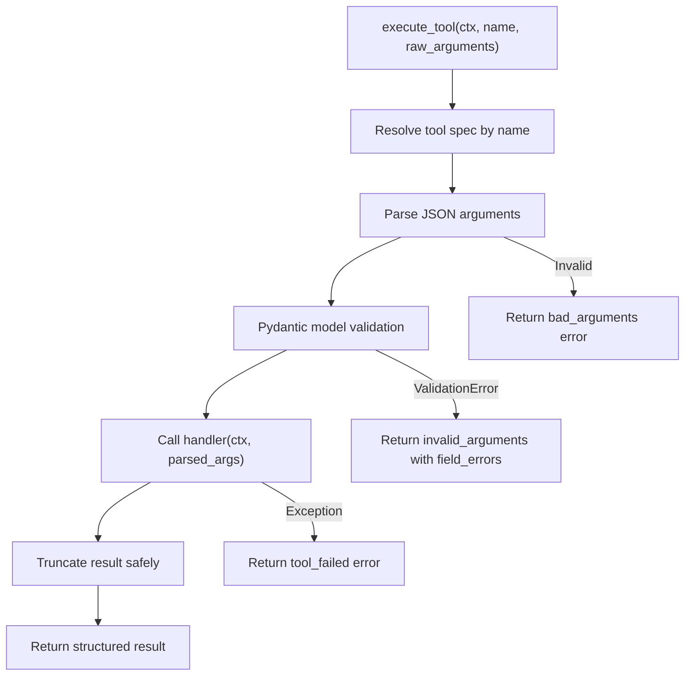
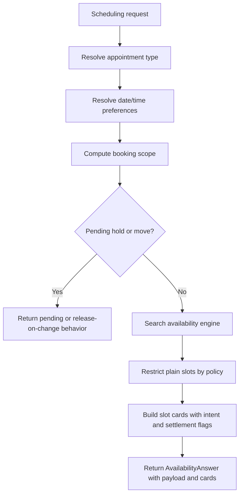
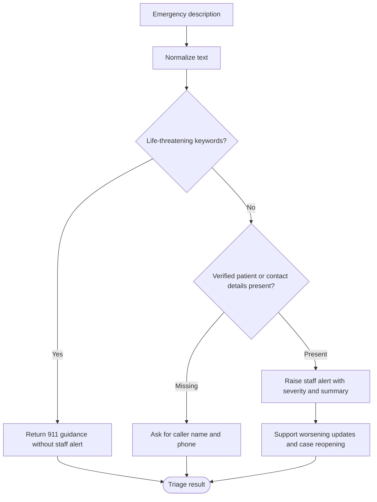
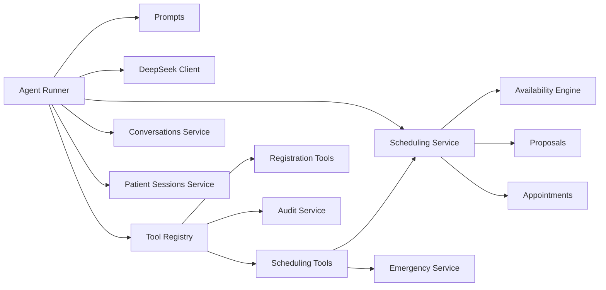

# Conversation Flow

<cite>
**Referenced Files in This Document**
- [runner.py](file://backend/app/agent/runner.py)
- [chat.py](file://backend/app/api/chat.py)
- [conversations.py](file://backend/app/services/conversations.py)
- [conversations_model.py](file://backend/app/models/conversations.py)
- [tools.py](file://backend/app/agent/tools.py)
- [scheduling_tools.py](file://backend/app/agent/scheduling_tools.py)
- [prompts.py](file://backend/app/agent/prompts.py)
- [scheduling_service.py](file://backend/app/services/scheduling.py)
- [emergency_service.py](file://backend/app/services/emergency.py)
- [patient_sessions.py](file://backend/app/services/patient_sessions.py)
- [audit.py](file://backend/app/services/audit.py)
</cite>

## Table of Contents
1. [Introduction](#introduction)
2. [Project Structure](#project-structure)
3. [Core Components](#core-components)
4. [Architecture Overview](#architecture-overview)
5. [Detailed Component Analysis](#detailed-component-analysis)
6. [Dependency Analysis](#dependency-analysis)
7. [Performance Considerations](#performance-considerations)
8. [Troubleshooting Guide](#troubleshooting-guide)
9. [Conclusion](#conclusion)

## Introduction
This document explains the conversation flow architecture for a dental practice chat system. A patient message enters through a REST endpoint, is persisted, and then processed by an agent runner that coordinates AI interpretation with deterministic business operations. The runner builds a provider-compatible message thread, calls the AI model with tool schemas, executes validated tools, persists tool results, and returns a final assistant reply along with interactive UI cards.

The design separates three concerns:
- Conversation state management and persistence
- AI orchestration and prompt construction
- Deterministic tool execution over scheduling, registration, emergencies, and staff handoff

Conversation history is stored as a full transcript so the same sequence can be replayed to the model on every turn. Interactive cards are attached to turns so a refresh or replay shows the same options that were visible when they were produced.

## Project Structure
The relevant backend components live under `backend/app`:
- API layer exposes patient chat endpoints and runs one assistant turn per message.
- Agent layer contains the runner, prompts, and tool definitions.
- Services layer implements scheduling, availability, proposals, emergency triage, audit trails, and session management.
- Models define conversations, messages, feedback, and related entities.

**Diagram sources**
- [chat.py:111-163](file://backend/app/api/chat.py#L111-L163)
- [chat.py:233-274](file://backend/app/api/chat.py#L233-L274)
- [runner.py:171-406](file://backend/app/agent/runner.py#L171-L406)
- [tools.py:703-739](file://backend/app/agent/tools.py#L703-L739)
- [scheduling_tools.py:474-552](file://backend/app/agent/scheduling_tools.py#L474-L552)
- [scheduling_service.py:393-716](file://backend/app/services/scheduling.py#L393-L716)
- [conversations.py:218-331](file://backend/app/services/conversations.py#L218-L331)

**Section sources**
- [chat.py:1-49](file://backend/app/api/chat.py#L1-49)
- [runner.py:1-55](file://backend/app/agent/runner.py#L1-L55)

## Core Components
- **Patient Chat API**: Creates sessions, starts or resumes conversations, restores threads, sends messages, records feedback, and resets within-session state.
- **Agent Runner**: Executes one turn per patient message, manages tool rounds, handles re-asks, attaches cards, enforces emergency notices, and ensures safe fallback replies.
- **Tool Layer**: Validates arguments with Pydantic models, resolves identity from authenticated context, and delegates to deterministic services.
- **Scheduling Service**: Orchestrates availability searches, family plans, proposal holds, confirmations, reschedules, cancellations, and card rendering.
- **Emergency Service**: Classifies life-threatening symptoms, captures contact details, raises alerts, and supports follow-ups.
- **Conversation Persistence**: Stores patient messages, assistant turns, tool results, and cards; reconstructs provider-compatible message sequences.
- **Session Management**: Issues opaque tokens, hashes them, scopes conversations to sessions, and binds verified patients only through explicit registration or lookup.

**Section sources**
- [chat.py:111-347](file://backend/app/api/chat.py#L111-L347)
- [runner.py:124-406](file://backend/app/agent/runner.py#L124-L406)
- [tools.py:41-127](file://backend/app/agent/tools.py#L41-L127)
- [scheduling_service.py:69-191](file://backend/app/services/scheduling.py#L69-L191)
- [emergency_service.py:117-149](file://backend/app/services/emergency.py#L117-L149)
- [conversations.py:41-138](file://backend/app/services/conversations.py#L41-L138)
- [patient_sessions.py:38-115](file://backend/app/services/patient_sessions.py#L38-L115)

## Architecture Overview
The conversation flow follows a strict phase pattern:
1. Authenticate the current patient session.
2. Persist the incoming patient message.
3. Load the full thread in order.
4. Build the system prompt and provider messages.
5. Call the AI model with available tools.
6. Execute requested tools through validated service functions.
7. Persist each assistant tool-call turn and its matching tool result.
8. Call the AI model again with tool results.
9. Persist the final assistant text and attach cards.
10. Return the reply, visible messages, and cards to the client.

**Diagram sources**
- [chat.py:233-274](file://backend/app/api/chat.py#L233-L274)
- [runner.py:171-406](file://backend/app/agent/runner.py#L171-L406)
- [runner.py:409-557](file://backend/app/agent/runner.py#L409-L557)
- [tools.py:703-739](file://backend/app/agent/tools.py#L703-L739)
- [conversations.py:218-331](file://backend/app/services/conversations.py#L218-L331)

## Detailed Component Analysis

### Agent Runner
The runner is the central orchestrator for one patient message. It validates input length, loads history, constructs the system prompt, prepares tool schemas, and runs a bounded loop over AI tool calls. It also handles special cases such as time re-asks, family option actions, emergency notices, card deduplication, and settled grids.

Key responsibilities:
- Enforce maximum tool rounds and tool calls per round.
- Detect whether the patient is asking to see times again rather than changing the day.
- Restrict tools during a fresh availability re-ask to prevent accidental historical card selection.
- Persist assistant turns and tool results immediately so failures do not leave dangling tool calls.
- Refresh system prompt mid-turn if verification changes.
- Attach cards to the correct assistant turn using a turn floor.
- Normalize prose and ensure emergency notices are explicitly stated when required.

**Diagram sources**
- [runner.py:171-406](file://backend/app/agent/runner.py#L171-L406)
- [runner.py:409-557](file://backend/app/agent/runner.py#L409-L557)

**Section sources**
- [runner.py:51-88](file://backend/app/agent/runner.py#L51-L88)
- [runner.py:132-139](file://backend/app/agent/runner.py#L132-L139)
- [runner.py:171-406](file://backend/app/agent/runner.py#L171-L406)
- [runner.py:409-557](file://backend/app/agent/runner.py#L409-L557)
- [runner.py:567-799](file://backend/app/agent/runner.py#L567-L799)

### Conversation State Management
Conversation state is stored as rows in `conversations` and `messages`. Each turn has a role, ordered sequence, timestamps, and optional metadata for tool calls. Cards are persisted alongside assistant turns so a restored thread replays the same UI state.

Important behaviors:
- Public IDs are generated server-side; every read/write goes through the patient session.
- Messages are appended with increasing sequence numbers.
- Assistant turns may carry tool calls and cards; tool results are separate rows linked by tool call ID.
- History reconstruction converts internal roles into provider-compatible messages, pairing tool results with their assistant calls.
- Visible messages exclude internal tool payloads and strip internal family-action instructions from patient messages.

**Diagram sources**
- [conversations_model.py:39-84](file://backend/app/models/conversations.py#L39-L84)
- [conversations_model.py:87-123](file://backend/app/models/conversations.py#L87-L123)

**Section sources**
- [conversations_model.py:1-16](file://backend/app/models/conversations.py#L1-L16)
- [conversations_model.py:39-123](file://backend/app/models/conversations.py#L39-L123)
- [conversations.py:218-331](file://backend/app/services/conversations.py#L218-L331)
- [conversations.py:334-366](file://backend/app/services/conversations.py#L334-L366)

### Tool Execution Pipeline
Tools are declared with Pydantic argument models and handlers. The executor:
- Resolves the tool by name.
- Parses and validates JSON arguments.
- Calls the handler with a request-scoped `ToolContext` containing the database session, authenticated patient session, and conversation ID.
- Truncates large results while preserving decision fields and cards.
- Never lets validation or handler exceptions escape the loop; failures become structured tool results.

Identity is never taken from model arguments. Tools that need to know who is speaking read `ToolContext`, which the runner populates from the authenticated session only.

**Diagram sources**
- [tools.py:703-739](file://backend/app/agent/tools.py#L703-L739)
- [tools.py:617-700](file://backend/app/agent/tools.py#L617-L700)

**Section sources**
- [tools.py:1-11](file://backend/app/agent/tools.py#L1-L11)
- [tools.py:41-53](file://backend/app/agent/tools.py#L41-L53)
- [tools.py:123-127](file://backend/app/agent/tools.py#L123-L127)
- [tools.py:493-614](file://backend/app/agent/tools.py#L493-L614)
- [tools.py:703-739](file://backend/app/agent/tools.py#L703-L739)

### Scheduling Orchestration
The scheduling service is the deterministic workflow layer between tools and primitives. It composes date resolution, availability search, proposal handling, appointment changes, and card generation. Returned dicts include a `cards` list describing what the UI should render.

Key concepts:
- `Requester` carries the verified patient, session, and conversation.
- `find_availability` resolves preferences, checks booking scope, handles pending holds, searches real slots, and produces slot cards.
- Family requests produce complete same-day plans as `family_option` cards.
- Proposal creation holds slots; confirmation commits them atomically.
- Rescheduling uses a dedicated path that retires the original appointment and books the replacement.
- Card identities and settlement state prevent duplicate offers and stale grids.

**Diagram sources**
- [scheduling_service.py:69-191](file://backend/app/services/scheduling.py#L69-L191)
- [scheduling_service.py:393-716](file://backend/app/services/scheduling.py#L393-L716)

**Section sources**
- [scheduling_service.py:1-12](file://backend/app/services/scheduling.py#L1-L12)
- [scheduling_service.py:69-191](file://backend/app/services/scheduling.py#L69-L191)
- [scheduling_service.py:238-295](file://backend/app/services/scheduling.py#L238-L295)
- [scheduling_service.py:393-716](file://backend/app/services/scheduling.py#L393-L716)

### Emergency Handling
Emergency handling uses keyword-driven Python classification rather than leaving safety decisions to the model. Life-threatening symptoms trigger immediate guidance to call emergency services before any registration or scheduling. Non-life-threatening reports require caller name and phone number unless a verified patient is already speaking. Reports raise staff alerts and support follow-ups that reopen resolved cases when appropriate.

**Diagram sources**
- [emergency_service.py:219-232](file://backend/app/services/emergency.py#L219-L232)
- [emergency_service.py:258-366](file://backend/app/services/emergency.py#L258-L366)
- [emergency_service.py:458-517](file://backend/app/services/emergency.py#L458-L517)

**Section sources**
- [emergency_service.py:1-31](file://backend/app/services/emergency.py#L1-L31)
- [emergency_service.py:46-113](file://backend/app/services/emergency.py#L46-L113)
- [emergency_service.py:117-149](file://backend/app/services/emergency.py#L117-L149)
- [emergency_service.py:219-366](file://backend/app/services/emergency.py#L219-L366)
- [emergency_service.py:458-517](file://backend/app/services/emergency.py#L458-L517)

### Typical Conversation Patterns

#### Registration Pattern
A new patient provides name, phone, date of birth, and insurance or self-pay. The registration tool normalizes inputs, validates fields, creates the patient record, marks the session verified, and returns registration completeness and missing fields. If duplicates or household patterns are detected, the tool provides hints without exposing chart details.

Flow highlights:
- Validation errors guide the next question instead of failing the whole turn.
- Verification is bound to the session only after successful registration.
- Insurance choice is described deterministically by practice policies.

**Section sources**
- [tools.py:72-81](file://backend/app/agent/tools.py#L72-L81)
- [tools.py:221-284](file://backend/app/agent/tools.py#L221-L284)
- [tools.py:164-189](file://backend/app/agent/tools.py#L164-L189)

#### Scheduling Pattern
A verified patient asks for availability. The runner detects whether this is a fresh search or a re-ask. The scheduling tool resolves visit type, preferences, and booking scope, then returns slot cards. The patient selects a slot, which triggers a proposal hold. Confirmation commits the booking atomically.

Flow highlights:
- Re-asks reuse stored scheduling requests when possible.
- Slot cards carry intent, settlement state, and request identity.
- Pending holds prevent duplicate bookings and stale offers.

**Section sources**
- [scheduling_tools.py:59-113](file://backend/app/agent/scheduling_tools.py#L59-L113)
- [scheduling_tools.py:474-552](file://backend/app/agent/scheduling_tools.py#L474-L552)
- [scheduling_service.py:393-716](file://backend/app/services/scheduling.py#L393-L716)
- [runner.py:76-88](file://backend/app/agent/runner.py#L76-L88)

#### Family Scheduling Pattern
When multiple people are involved, the system uses family availability to propose complete same-day plans. Each plan is a card containing one slot per person. Holding a family option requires the exact option identity from the clicked card, preventing the model from selecting a historical option.

Flow highlights:
- Family plans prefer back-to-back visits.
- One confirmation books everyone or nobody.
- Option identity is enforced by the runner and tool layer.

**Section sources**
- [scheduling_tools.py:260-313](file://backend/app/agent/scheduling_tools.py#L260-L313)
- [scheduling_service.py:341-390](file://backend/app/services/scheduling.py#L341-L390)
- [runner.py:153-168](file://backend/app/agent/runner.py#L153-L168)
- [runner.py:721-744](file://backend/app/agent/runner.py#L721-L744)

#### Emergency Handling Pattern
If symptoms suggest a medical emergency, the system immediately advises calling emergency services. For non-life-threatening cases, it collects caller name and phone, raises a staff alert, and offers to check genuine emergency availability. Follow-up messages update or reopen the existing case.

Flow highlights:
- Classification is deterministic and conservative.
- Contact details are session-scoped and normalized.
- Staff alerts capture severity, summary, and callback information.

**Section sources**
- [emergency_service.py:219-366](file://backend/app/services/emergency.py#L219-L366)
- [emergency_service.py:458-517](file://backend/app/services/emergency.py#L458-L517)
- [runner.py:567-594](file://backend/app/agent/runner.py#L567-L594)

### Conversation Persistence, Replay, and Audit Trail

#### Persistence and Replay
Every turn is persisted so the thread can be replayed exactly as it happened. The conversation store reconstructs provider-compatible messages by pairing assistant tool calls with their tool results. When restoring a conversation, the API reconciles proposal cards and settles superseded grids so a reload shows actionable holds but not stale offers.

Key behaviors:
- `to_provider_messages` skips internal system/staff rows and pairs tool results with assistant calls.
- `visible_messages` projects only patient and assistant output for the browser.
- `resume_for_session` transfers an existing thread to a newly issued session for the same patient under the same reset generation.

**Section sources**
- [conversations.py:1-14](file://backend/app/services/conversations.py#L1-L14)
- [conversations.py:100-138](file://backend/app/services/conversations.py#L100-L138)
- [conversations.py:265-331](file://backend/app/services/conversations.py#L265-L331)
- [conversations.py:354-366](file://backend/app/services/conversations.py#L354-L366)
- [chat.py:207-230](file://backend/app/api/chat.py#L207-L230)
- [chat.py:72-98](file://backend/app/api/chat.py#L72-L98)

#### Audit Trail Generation
Audit records are append-only entries tied to actions, actors, entities, and conversations. They include reset generation and visibility flags. Booking-related writes use a pair of audit rows: a hold row inside the transaction and a commit trailer after the transaction succeeds, preventing failed transactions from masquerading as confirmed bookings.

Key behaviors:
- Details are serialized deterministically.
- Trailer commitment is checked separately to ensure durability.
- Audits are used for sensitive operations such as linking family members.

**Section sources**
- [audit.py:1-55](file://backend/app/services/audit.py#L1-L55)
- [tools.py:407-414](file://backend/app/agent/tools.py#L407-L414)

## Dependency Analysis
The runner depends on:
- Prompts for system instruction and persona.
- DeepSeek client for AI calls.
- Tool registry for OpenAI-compatible function schemas.
- Conversation persistence for history and message projection.
- Scheduling services for availability, proposals, and appointments.
- Patient session services for verified identity.

The tool layer depends on:
- Pydantic for argument validation.
- Practice policies and clinic facts.
- Scheduling orchestration for deterministic business outcomes.
- Emergency triage for safety-critical flows.
- Audit logging for compliance-sensitive mutations.

**Diagram sources**
- [runner.py:25-47](file://backend/app/agent/runner.py#L25-L47)
- [tools.py:25-30](file://backend/app/agent/tools.py#L25-L30)
- [scheduling_tools.py:27-49](file://backend/app/agent/scheduling_tools.py#L27-L49)
- [scheduling_service.py:25-62](file://backend/app/services/scheduling.py#L25-L62)

**Section sources**
- [runner.py:25-47](file://backend/app/agent/runner.py#L25-L47)
- [tools.py:25-30](file://backend/app/agent/tools.py#L25-L30)
- [scheduling_tools.py:27-49](file://backend/app/agent/scheduling_tools.py#L27-L49)
- [scheduling_service.py:25-62](file://backend/app/services/scheduling.py#L25-L62)

## Performance Considerations
- The runner limits AI round-trips and tool fan-out to avoid runaway loops.
- Tool results are truncated to keep payloads manageable while preserving UI-relevant cards.
- Blocking AI calls and SQLite writes are executed off the event loop via a thread pool.
- Conversation history is fully replayed per turn, so long threads increase provider payload size; this is intentional for fidelity but should be monitored.
- Card deduplication and settlement logic prevent redundant UI work and stale offers.

[No sources needed since this section provides general guidance]

## Troubleshooting Guide
Common issues and how the system responds:
- Empty or too-long patient messages: the runner trims or rejects empty input at the API layer.
- AI provider failure: the runner logs the failure, persists a short friendly assistant message, and marks the turn as degraded.
- Unknown tool or malformed arguments: the tool executor returns structured errors with guidance fields.
- Stale or duplicated cards: the runner merges and deduplicates cards, settles grids that are already held or booked, and replays earlier slot grids for re-asks.
- Missing emergency notice: the runner adds a front-desk acknowledgment when an emergency-style handoff card is present.
- Failed tool execution: unexpected exceptions are caught and converted into safe tool results.

**Section sources**
- [chat.py:246-251](file://backend/app/api/chat.py#L246-L251)
- [runner.py:264-292](file://backend/app/agent/runner.py#L264-L292)
- [runner.py:597-637](file://backend/app/agent/runner.py#L597-L637)
- [runner.py:721-761](file://backend/app/agent/runner.py#L721-L761)
- [tools.py:703-739](file://backend/app/agent/tools.py#L703-L739)

## Conclusion
The conversation flow architecture separates AI interpretation from deterministic business logic. The agent runner coordinates the AI model with validated tools, while conversation persistence guarantees faithful replay and consistent UI state. Scheduling and emergency workflows are implemented as explicit, auditable services that protect against hallucination, duplication, and unsafe assumptions. This design makes the system robust for registration, scheduling, family coordination, and emergency handling while preserving a clear audit trail and reliable replay semantics.