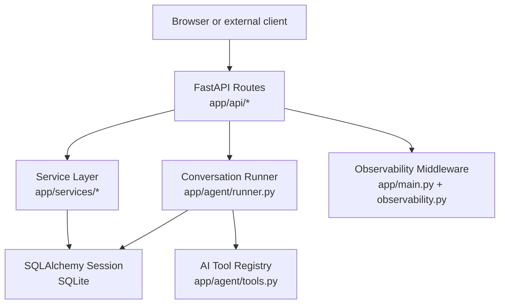
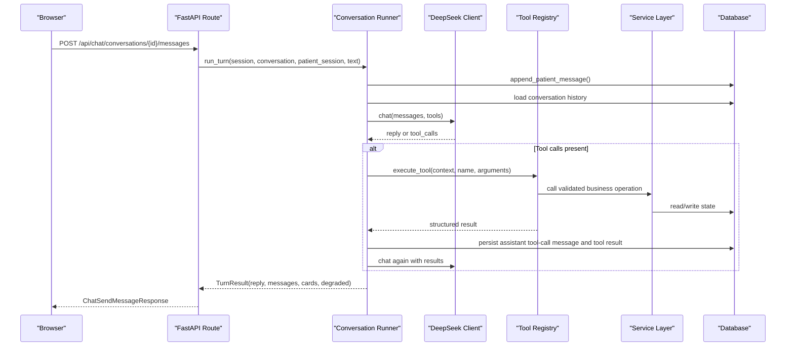
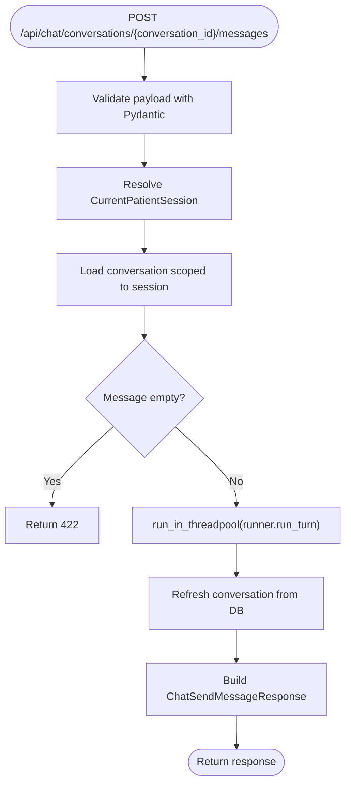
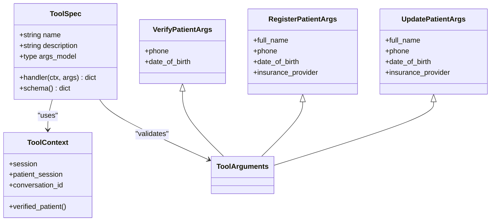
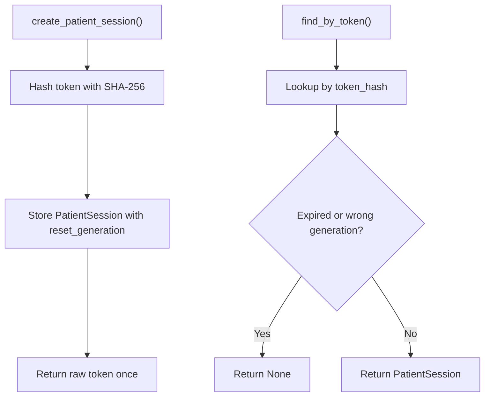
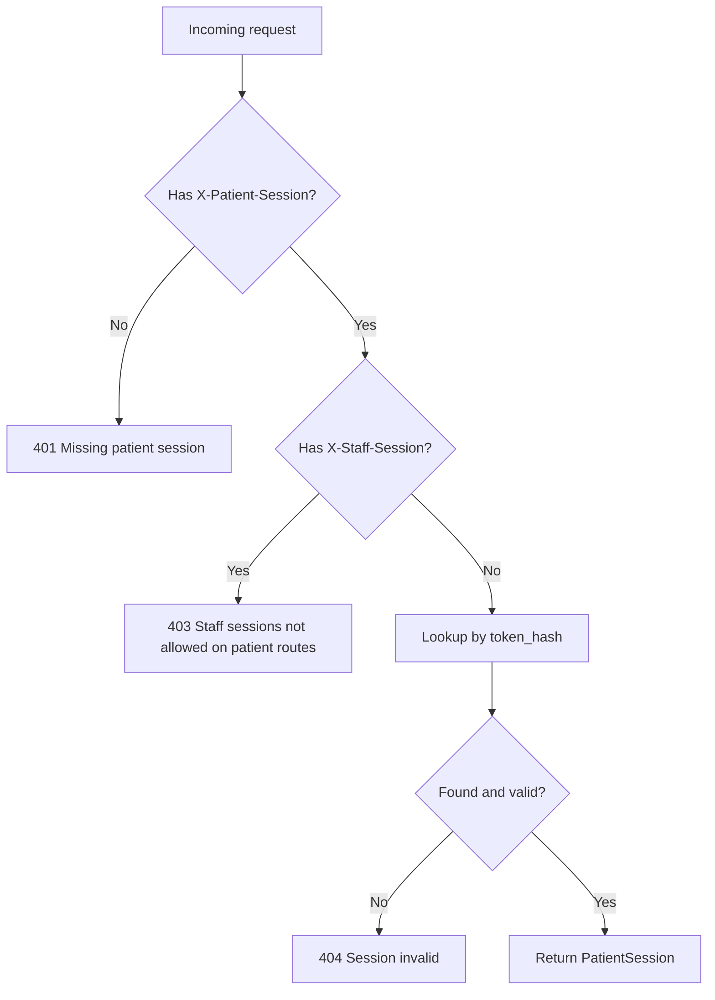
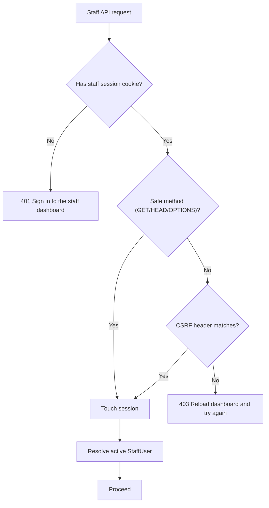
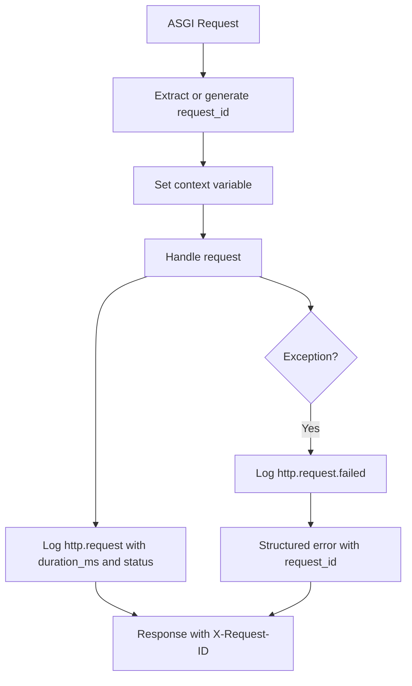
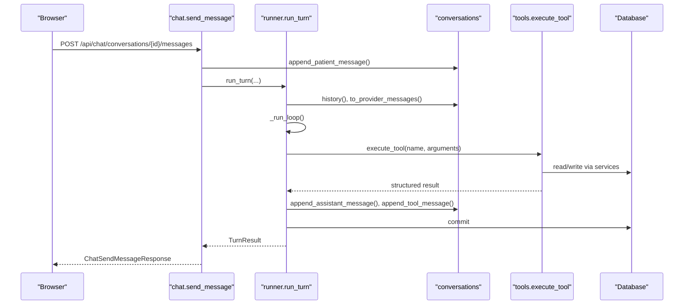
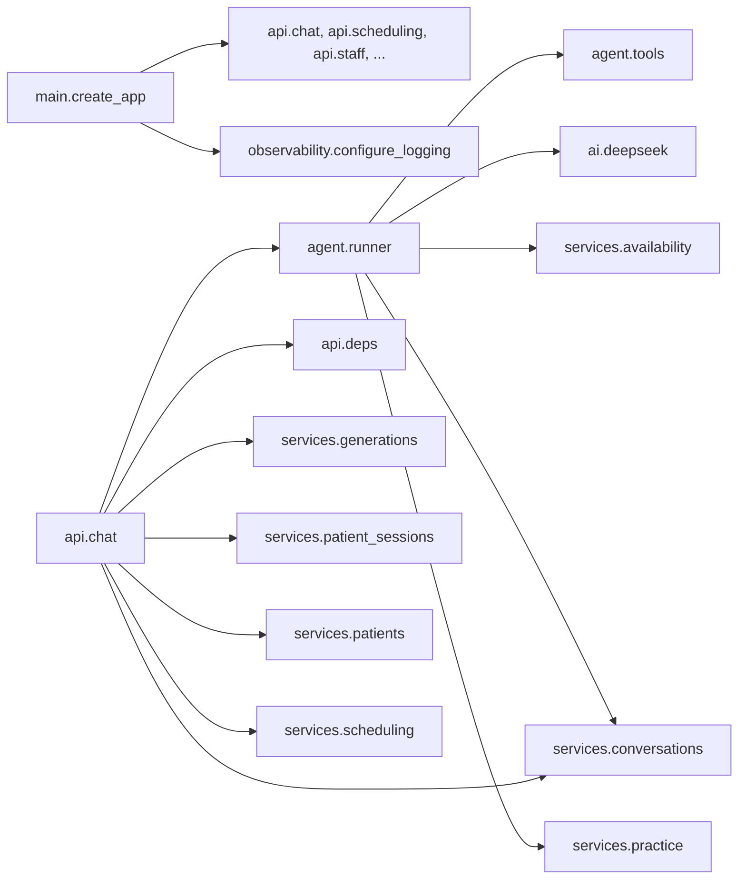

# Core Concepts

<cite>
**Referenced Files in This Document**
- [main.py](file://backend/app/main.py)
- [observability.py](file://backend/app/observability.py)
- [chat.py](file://backend/app/api/chat.py)
- [deps.py](file://backend/app/api/deps.py)
- [runner.py](file://backend/app/agent/runner.py)
- [tools.py](file://backend/app/agent/tools.py)
- [conversations.py](file://backend/app/services/conversations.py)
- [patient_sessions.py](file://backend/app/services/patient_sessions.py)
- [sessions.py](file://backend/app/models/sessions.py)
- [conversations_model.py](file://backend/app/models/conversations.py)
- [schemas.py](file://backend/app/schemas.py)
</cite>

## Table of Contents
1. [Introduction](#introduction)
2. [Project Structure](#project-structure)
3. [Core Components](#core-components)
4. [Architecture Overview](#architecture-overview)
5. [Detailed Component Analysis](#detailed-component-analysis)
6. [Dependency Analysis](#dependency-analysis)
7. [Performance Considerations](#performance-considerations)
8. [Troubleshooting Guide](#troubleshooting-guide)
9. [Conclusion](#conclusion)

## Introduction
This document explains the core architectural concepts of the Oral-B Dental Care AI Receptionist backend. The system uses a layered architecture that separates HTTP routing from business logic, and deterministic service operations from AI interpretation. FastAPI routes receive requests, validate inputs through Pydantic schemas, delegate to service layers, and orchestrate an AI runner that calls validated tools against the database. Patient and staff authentication are handled with separate session models: patients use an opaque token header, while staff use cookie-based sessions protected by CSRF headers. Observability is built into the application factory with request ID tracking, structured JSON logging, and consistent error responses.

## Project Structure
The relevant backend code is organized under `backend/app`:
- `api` contains FastAPI routers for patient chat, scheduling, clinic info, health, demo, and staff endpoints.
- `agent` contains the conversation runner and tool definitions exposed to the AI model.
- `services` contains deterministic business logic for conversations, availability, booking policy, scheduling, security, and more.
- `models` defines SQLAlchemy ORM entities such as sessions, conversations, messages, patients, and proposals.
- `observability.py` provides structured logging, request ID context, and domain event helpers.
- `main.py` creates the FastAPI application, installs middleware, registers routers, and configures error handling.

**Diagram sources**
- [main.py:45-108](file://backend/app/main.py#L45-L108)
- [chat.py:111-274](file://backend/app/api/chat.py#L111-L274)
- [runner.py:171-406](file://backend/app/agent/runner.py#L171-L406)
- [tools.py:493-614](file://backend/app/agent/tools.py#L493-L614)
- [observability.py:144-183](file://backend/app/observability.py#L144-L183)

**Section sources**
- [main.py:202-252](file://backend/app/main.py#L202-L252)
- [chat.py:1-49](file://backend/app/api/chat.py#L1-L49)

## Core Components
The system is built around five core components:

| Component | Responsibility | Key Files |
|---|---|---|
| Application Factory | Creates FastAPI, installs observability middleware, CORS, exception handlers, and route registration | [main.py](file://backend/app/main.py) |
| API Layer | Validates requests, enforces session ownership, delegates to services and runner | [chat.py](file://backend/app/api/chat.py), [deps.py](file://backend/app/api/deps.py) |
| Service Layer | Encapsulates deterministic business logic for conversations, sessions, patients, scheduling, and security | [conversations.py](file://backend/app/services/conversations.py), [patient_sessions.py](file://backend/app/services/patient_sessions.py) |
| AI Runner and Tools | Orchestrates provider calls, executes validated tools, persists assistant turns and tool results | [runner.py](file://backend/app/agent/runner.py), [tools.py](file://backend/app/agent/tools.py) |
| Observability | Provides request IDs, structured JSON logs, sensitive-field scrubbing, and domain events | [observability.py](file://backend/app/observability.py) |

**Section sources**
- [main.py:45-187](file://backend/app/main.py#L45-L187)
- [chat.py:111-347](file://backend/app/api/chat.py#L111-L347)
- [runner.py:1-55](file://backend/app/agent/runner.py#L1-L55)
- [tools.py:1-33](file://backend/app/agent/tools.py#L1-L33)
- [observability.py:1-30](file://backend/app/observability.py#L1-L30)

## Architecture Overview
The layered architecture follows a clear separation of concerns:

1. **HTTP layer**: FastAPI routes parse and validate payloads using Pydantic schemas. They do not contain business logic; they resolve dependencies, enforce authorization, and call services or the runner.
2. **Service layer**: Pure Python functions operate on SQLAlchemy sessions. They implement rules such as verification, registration, conversation persistence, availability checks, and proposal management.
3. **AI layer**: The runner builds provider messages, calls the DeepSeek-compatible client, executes tools through a registry, and persists every turn so the thread can be replayed exactly.
4. **Persistence layer**: SQLAlchemy models represent sessions, conversations, messages, patients, and proposals. Conversations store full history including tool calls and results.
5. **Observability layer**: A raw ASGI middleware captures request timing, status codes, endpoint labels, and request IDs. Structured JSON logs include scrubbed fields and never leak secrets or private patient data.

**Diagram sources**
- [chat.py:233-274](file://backend/app/api/chat.py#L233-L274)
- [runner.py:171-406](file://backend/app/agent/runner.py#L171-L406)
- [runner.py:409-557](file://backend/app/agent/runner.py#L409-L557)
- [tools.py:703-739](file://backend/app/agent/tools.py#L703-L739)

## Detailed Component Analysis

### Layered API-to-Service Delegation
FastAPI routes are thin controllers. For example, the patient message endpoint validates the payload, loads the conversation scoped to the authenticated session, runs one assistant turn off the event loop, and returns a response shaped by public Pydantic schemas. It does not directly query the database for conversation history or build provider prompts.

Key responsibilities:
- Validate input with `ChatSendMessageRequest`.
- Resolve `CurrentPatientSession` and `DbSession` through FastAPI dependencies.
- Load the conversation only if it belongs to the current session.
- Run the synchronous runner in a thread pool because it performs blocking work.
- Return a response that excludes internal metadata like tool payloads.

**Diagram sources**
- [chat.py:233-274](file://backend/app/api/chat.py#L233-L274)
- [schemas.py:236-273](file://backend/app/schemas.py#L236-L273)

**Section sources**
- [chat.py:233-274](file://backend/app/api/chat.py#L233-L274)
- [schemas.py:131-273](file://backend/app/schemas.py#L131-L273)

### Tool Pattern for AI Capabilities
Each AI capability is implemented as a tool with:
- A descriptive name.
- A human-readable description for the model.
- A Pydantic argument model that forbids extra fields.
- A handler function that receives a request-scoped `ToolContext` and validated arguments.
- A structured result dictionary that may include `ok`, `error`, `message`, `cards`, and other decision fields.

This pattern ensures that hallucinated or malformed arguments are caught before any database mutation. Errors become recoverable tool results rather than unhandled exceptions.

**Diagram sources**
- [tools.py:41-121](file://backend/app/agent/tools.py#L41-L121)
- [tools.py:493-588](file://backend/app/agent/tools.py#L493-L588)

Important implementation details:
- `ToolContext` carries the SQLAlchemy session, patient session, and conversation ID. It is built by the runner from authenticated state, never from model arguments.
- Argument models inherit from `ToolArguments`, which forbids extra fields.
- Handlers return dictionaries with consistent success/error shapes.
- `execute_tool` parses JSON arguments, validates them with Pydantic, calls the handler, catches unexpected exceptions, and truncates large results without dropping interactive cards.

**Section sources**
- [tools.py:1-33](file://backend/app/agent/tools.py#L1-L33)
- [tools.py:41-121](file://backend/app/agent/tools.py#L41-L121)
- [tools.py:493-614](file://backend/app/agent/tools.py#L493-L614)
- [tools.py:703-739](file://backend/app/agent/tools.py#L703-L739)

### Service Layer Abstraction
The service layer provides clean interfaces between API endpoints and business logic. For conversations, the service handles:
- Creating conversations scoped to a patient session.
- Resuming a conversation for a verified session bound to the same patient.
- Appending patient messages, assistant messages, and tool results.
- Reconstructing provider-compatible message sequences.
- Producing client-safe projections that exclude internal tool payloads.

For patient sessions, the service handles:
- Issuing random tokens.
- Storing only the SHA-256 hash of the token.
- Resolving sessions by token hash, expiration, and reset generation.
- Marking sessions as verified only through explicit registration or lookup flows.

**Diagram sources**
- [patient_sessions.py:50-85](file://backend/app/services/patient_sessions.py#L50-L85)
- [sessions.py:35-76](file://backend/app/models/sessions.py#L35-L76)

**Section sources**
- [conversations.py:41-138](file://backend/app/services/conversations.py#L41-L138)
- [conversations.py:158-262](file://backend/app/services/conversations.py#L158-L262)
- [conversations.py:285-391](file://backend/app/services/conversations.py#L285-L391)
- [patient_sessions.py:38-85](file://backend/app/services/patient_sessions.py#L38-L85)
- [sessions.py:35-76](file://backend/app/models/sessions.py#L35-L76)

### Session-Based Authentication Model

#### Patient Sessions
Patients authenticate via the `X-Patient-Session` header. The dependency resolver:
- Rejects staff credentials on patient routes.
- Requires the header.
- Looks up the session by hashed token.
- Returns a 404 when the token is unknown or invalid, avoiding leakage about expiration versus nonexistence.

A patient session is separate from staff sessions and is tied to a reset generation. After a demo reset, previously issued tokens cannot resume old threads unless the new session is verified as the same patient.

**Diagram sources**
- [deps.py:27-51](file://backend/app/api/deps.py#L27-L51)
- [patient_sessions.py:71-85](file://backend/app/services/patient_sessions.py#L71-L85)

**Section sources**
- [deps.py:1-51](file://backend/app/api/deps.py#L1-L51)
- [patient_sessions.py:1-15](file://backend/app/services/patient_sessions.py#L1-L15)
- [patient_sessions.py:71-85](file://backend/app/services/patient_sessions.py#L71-L85)
- [sessions.py:1-18](file://backend/app/models/sessions.py#L1-L18)

#### Staff Sessions and CSRF Protection
Staff authentication uses an HttpOnly cookie plus a CSRF header for unsafe methods. The dependency resolver:
- Resolves the staff session from the cookie.
- Rejects missing or inactive staff users.
- Requires a matching CSRF header for non-safe methods.
- Touches the session to keep it alive.

This design prevents cross-site request forgery because a malicious page cannot set the HttpOnly cookie or the required CSRF header.

**Diagram sources**
- [deps.py:67-98](file://backend/app/api/deps.py#L67-L98)

**Section sources**
- [deps.py:54-98](file://backend/app/api/deps.py#L54-L98)

### Observability Framework
The observability framework provides:
- Per-request request IDs propagated through context variables.
- Incoming request ID support via `X-Request-ID`.
- Response header injection of the request ID.
- Structured JSON logging with scrubbed sensitive fields.
- Domain event helpers for availability searches, proposals, bookings, conflicts, tool execution, and DeepSeek status.
- Consistent error responses that include a stable error code and the request ID.

**Diagram sources**
- [main.py:45-108](file://backend/app/main.py#L45-L108)
- [observability.py:76-106](file://backend/app/observability.py#L76-L106)
- [observability.py:109-141](file://backend/app/observability.py#L109-L141)

**Section sources**
- [main.py:45-187](file://backend/app/main.py#L45-L187)
- [observability.py:1-30](file://backend/app/observability.py#L1-L30)
- [observability.py:76-106](file://backend/app/observability.py#L76-L106)
- [observability.py:144-183](file://backend/app/observability.py#L144-L183)

### Practical Example: Patient Message Flow
This section traces how a patient message moves through the system from HTTP request to database persistence.

1. The browser sends `POST /api/chat/conversations/{conversation_id}/messages` with `X-Patient-Session`.
2. FastAPI validates the payload using `ChatSendMessageRequest`.
3. The dependency resolver resolves the current patient session and database session.
4. The route loads the conversation scoped to the session.
5. The runner appends the patient message and backfills the conversation title if appropriate.
6. The runner loads the full message history and converts it to provider format.
7. The runner calls the DeepSeek client with tools.
8. If the model requests tools, the runner executes them through the tool registry.
9. Each tool validates arguments, calls service logic, and writes to the database.
10. Assistant tool-call messages and tool result messages are persisted.
11. The runner calls the provider again with results until the model returns prose or reaches limits.
12. Cards produced by tools are attached to the assistant turn and reconciled with live proposals.
13. The route returns a response containing the reply, visible messages, cards, session state, and degradation flag.

**Diagram sources**
- [chat.py:233-274](file://backend/app/api/chat.py#L233-L274)
- [runner.py:171-406](file://backend/app/agent/runner.py#L171-L406)
- [runner.py:409-557](file://backend/app/agent/runner.py#L409-L557)
- [conversations.py:165-262](file://backend/app/services/conversations.py#L165-L262)
- [tools.py:703-739](file://backend/app/agent/tools.py#L703-L739)

**Section sources**
- [chat.py:233-274](file://backend/app/api/chat.py#L233-L274)
- [runner.py:171-406](file://backend/app/agent/runner.py#L171-L406)
- [conversations.py:165-262](file://backend/app/services/conversations.py#L165-L262)
- [tools.py:703-739](file://backend/app/agent/tools.py#L703-L739)

## Dependency Analysis
The main application depends on routers, configuration, observability, and bootstrap utilities. The chat router depends on the agent runner, API dependencies, conversation services, generation services, patient session services, patient services, and scheduling services. The runner depends on prompts, reply formatting, tool schemas, the DeepSeek client, conversation persistence, and multiple service modules.

**Diagram sources**
- [main.py:15-28](file://backend/app/main.py#L15-L28)
- [main.py:239-244](file://backend/app/main.py#L239-L244)
- [chat.py:22-47](file://backend/app/api/chat.py#L22-L47)
- [runner.py:35-47](file://backend/app/agent/runner.py#L35-L47)

**Section sources**
- [main.py:15-28](file://backend/app/main.py#L15-L28)
- [main.py:239-244](file://backend/app/main.py#L239-L244)
- [chat.py:22-47](file://backend/app/api/chat.py#L22-L47)
- [runner.py:35-47](file://backend/app/agent/runner.py#L35-L47)

## Performance Considerations
- Blocking AI and database work is moved off the event loop using `run_in_threadpool` for the conversation runner.
- The runner bounds tool rounds and tool calls per round to prevent infinite loops.
- Conversation history is persisted so the model can replay exact turns without summarization.
- Tool results are truncated to protect context size while preserving interactive cards.
- Availability re-asks avoid redundant searches and stale card selection.
- Database errors are mapped to user-friendly responses with retry hints where appropriate.

[No sources needed since this section provides general guidance]

## Troubleshooting Guide
Common operational signals and their meanings:

| Symptom | Likely Cause | Recommended Action |
|---|---|---|
| 401 Missing patient session | No `X-Patient-Session` header | Start a new session via `/api/chat/sessions`. |
| 404 Session invalid | Token expired, reset-generation mismatch, or unknown token | Restart the flow; do not treat this as a password failure. |
| 403 Staff sessions on patient route | Wrong credential type used | Use patient tokens for chat; use staff cookies and CSRF for staff routes. |
| 409 Conflict | Unique constraint or idempotency conflict | Refresh state and retry. |
| 503 Database unavailable | Transient SQLite lock or connection issue | Retry after a short delay; the response includes `Retry-After`. |
| 500 Internal error | Unexpected exception outside normal error paths | Inspect logs using the `request_id` from the response. |
| Degraded assistant reply | DeepSeek provider failure or timeout | Treat as a temporary failure; the runner persists a safe fallback message. |

Error responses consistently include:
- A human-readable `detail`.
- A stable machine-readable `error` code.
- The `request_id` for log correlation.

**Section sources**
- [deps.py:27-51](file://backend/app/api/deps.py#L27-L51)
- [main.py:110-179](file://backend/app/main.py#L110-L179)
- [runner.py:264-292](file://backend/app/agent/runner.py#L264-L292)

## Conclusion
The Oral-B Dental Care AI Receptionist backend uses a disciplined layered architecture. HTTP routes stay thin, service logic stays deterministic, and AI capabilities are exposed through validated tools. Patient and staff authentication are separated, with CSRF protection for staff actions. Every conversation turn is persisted so the system can replay history faithfully, and observability ties each request together with structured logs and request IDs. This design makes the system easier to test, debug, extend, and operate safely in production.

[No sources needed since this section summarizes without analyzing specific files]