# Deployment Architecture

<cite>
**Referenced Files in This Document**
- [README.md](file://README.md)
- [Makefile](file://Makefile)
- [docker-compose.yml](file://docker-compose.yml)
- [docker-compose.dev.yml](file://docker-compose.dev.yml)
- [backend/Dockerfile](file://backend/Dockerfile)
- [frontend/Dockerfile](file://frontend/Dockerfile)
- [frontend/nginx.conf](file://frontend/nginx.conf)
- [backend/server.py](file://backend/server.py)
- [backend/app/main.py](file://backend/app/main.py)
- [backend/app/config.py](file://backend/app/config.py)
- [backend/app/db.py](file://backend/app/db.py)
- [backend/app/bootstrap.py](file://backend/app/bootstrap.py)
- [backend/app/api/health.py](file://backend/app/api/health.py)
</cite>

## Table of Contents
1. [Introduction](#introduction)
2. [Project Structure](#project-structure)
3. [Core Components](#core-components)
4. [Architecture Overview](#architecture-overview)
5. [Detailed Component Analysis](#detailed-component-analysis)
6. [Dependency Analysis](#dependency-analysis)
7. [Performance Considerations](#performance-considerations)
8. [Troubleshooting Guide](#troubleshooting-guide)
9. [Conclusion](#conclusion)
10. [Appendices](#appendices)

## Introduction
This document describes the deployment architecture for the dental receptionist system. It explains how Docker Compose orchestrates a FastAPI backend, a React frontend served by nginx, and an SQLite database persisted on a named volume. It also covers development versus production containerization, nginx reverse proxy routing, environment variable management, database initialization, health checks, scaling considerations, monitoring, and operational procedures.

The system exposes:
- A patient-facing React application.
- A staff dashboard within the same frontend.
- A FastAPI backend with OpenAPI documentation.
- An nginx reverse proxy that serves static assets and forwards API requests to the backend.

## Project Structure
At deployment time, the repository is composed of two main runtime services plus persistent storage:
- Backend service: Python 3.12 FastAPI application built from `backend/Dockerfile`.
- Frontend service: Static React build served by nginx from `frontend/Dockerfile`, using `frontend/nginx.conf` for routing.
- Persistent data: SQLite database stored under `/app/data` inside the backend container and mounted via the `clinic-data` named volume.

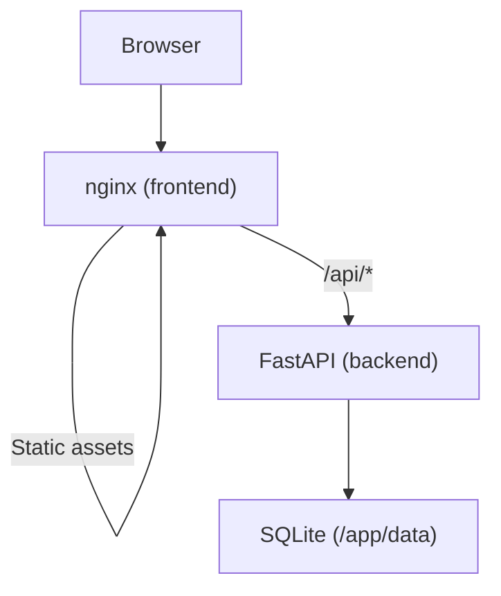

**Diagram sources**
- [frontend/nginx.conf:1-51](file://frontend/nginx.conf#L1-L51)
- [docker-compose.yml:12-46](file://docker-compose.yml#L12-L46)
- [backend/Dockerfile:16-23](file://backend/Dockerfile#L16-L23)

**Section sources**
- [docker-compose.yml:1-51](file://docker-compose.yml#L1-L51)
- [backend/Dockerfile:1-24](file://backend/Dockerfile#L1-L24)
- [frontend/Dockerfile:1-25](file://frontend/Dockerfile#L1-L25)
- [frontend/nginx.conf:1-51](file://frontend/nginx.conf#L1-L51)

## Core Components
- Backend image: Built from `backend/Dockerfile`, installs Python dependencies, copies application code, exposes port 8000, and runs `server.py`.
- Frontend image: Built from `frontend/Dockerfile`, builds the React app with Vite, then serves it with nginx on port 80.
- Reverse proxy configuration: `frontend/nginx.conf` serves SPA assets, caches hashed assets, proxies `/api/*` and OpenAPI paths to the backend, and provides SPA fallback.
- Compose orchestration: `docker-compose.yml` defines the backend and frontend services, ports, volumes, health check, startup ordering, and restart policy.
- Development overlay: `docker-compose.dev.yml` replaces baked commands with hot-reload behavior for both backend and frontend while preserving topology and data volume.

Key responsibilities:
- Backend: HTTP API, database bootstrap, schema migrations, seed data, observability middleware, CORS, and exception handling.
- Frontend: Static site delivery and request routing through nginx.
- Compose: Service lifecycle, dependency ordering, port exposure, health checks, and persistent storage.

**Section sources**
- [backend/Dockerfile:1-24](file://backend/Dockerfile#L1-L24)
- [frontend/Dockerfile:1-25](file://frontend/Dockerfile#L1-L25)
- [frontend/nginx.conf:1-51](file://frontend/nginx.conf#L1-L51)
- [docker-compose.yml:1-51](file://docker-compose.yml#L1-L51)
- [docker-compose.dev.yml:1-84](file://docker-compose.dev.yml#L1-L84)

## Architecture Overview
The deployed topology consists of three primary layers:
- Client layer: Browser accessing the frontend at port 8080.
- Edge layer: nginx serving static files and proxying API calls.
- Application layer: FastAPI backend with SQLite persistence.

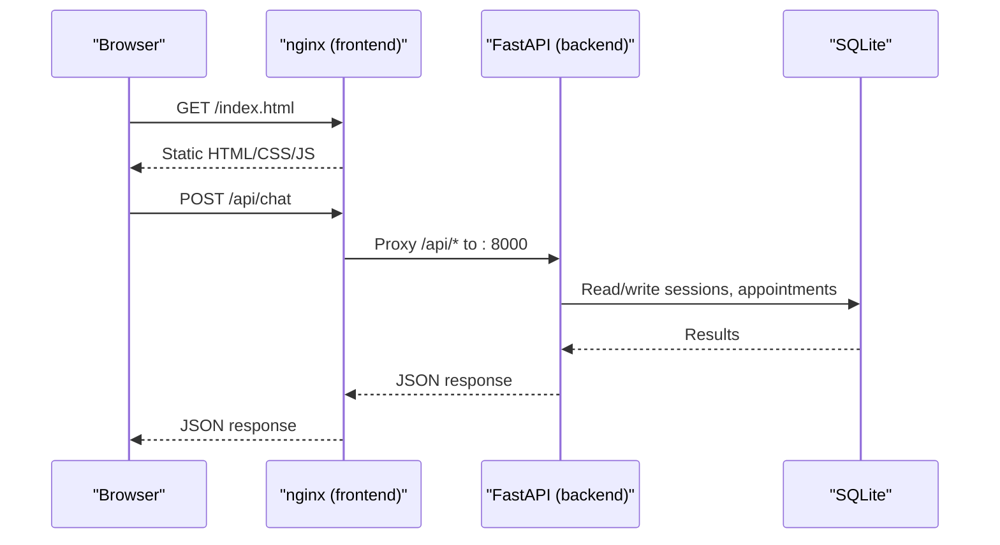

**Diagram sources**
- [frontend/nginx.conf:14-22](file://frontend/nginx.conf#L14-L22)
- [backend/server.py:5-14](file://backend/server.py#L5-L14)
- [backend/app/db.py:52-64](file://backend/app/db.py#L52-L64)

## Detailed Component Analysis

### Docker Compose Orchestration
The base compose file defines:
- Backend service:
  - Build context: `./backend`.
  - Image tag: `dental-receptionist-backend:local`.
  - Environment: `.env` injected into the backend only.
  - Volume: `clinic-data:/app/data` for SQLite persistence.
  - Port: `8000:8000`.
  - Health check: HTTP probe against `/api/health`.
  - Restart policy: `unless-stopped`.
- Frontend service:
  - Build context: `./frontend`.
  - Image tag: `dental-receptionist-frontend:local`.
  - Dependency: waits for backend health.
  - Port: `8080:80`.
  - Restart policy: `unless-stopped`.
- Named volume: `clinic-data` mapped to `dental-receptionist-clinic-data`.

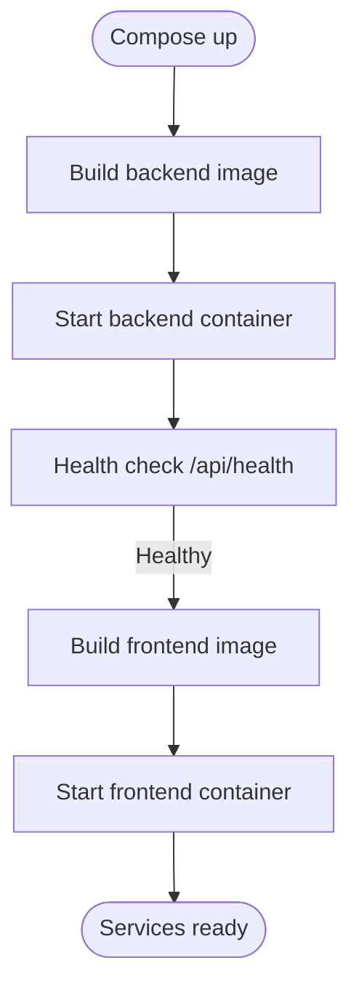

**Diagram sources**
- [docker-compose.yml:12-46](file://docker-compose.yml#L12-L46)
- [backend/app/api/health.py:23-57](file://backend/app/api/health.py#L23-L57)

**Section sources**
- [docker-compose.yml:1-51](file://docker-compose.yml#L1-L51)

### Backend Container and Runtime
- Base image: `python:3.12-slim`.
- Dependencies installed from `requirements.txt`.
- Application code copied into `/app`.
- Data directory created and exposed as a Docker volume.
- Entry point: `server.py` starts uvicorn on host `0.0.0.0` and port from `PORT` or default `8000`.
- Startup behavior: FastAPI creates missing tables, applies additive migrations, ensures generation metadata, and seeds an empty database automatically.

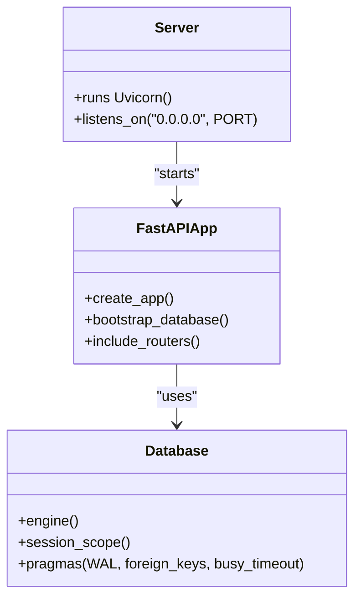

**Diagram sources**
- [backend/Dockerfile:10-23](file://backend/Dockerfile#L10-L23)
- [backend/server.py:5-14](file://backend/server.py#L5-L14)
- [backend/app/main.py:202-252](file://backend/app/main.py#L202-L252)
- [backend/app/db.py:40-64](file://backend/app/db.py#L40-L64)

**Section sources**
- [backend/Dockerfile:1-24](file://backend/Dockerfile#L1-L24)
- [backend/server.py:1-15](file://backend/server.py#L1-L15)
- [backend/app/main.py:202-252](file://backend/app/main.py#L202-L252)
- [backend/app/bootstrap.py:34-66](file://backend/app/bootstrap.py#L34-L66)
- [backend/app/db.py:40-64](file://backend/app/db.py#L40-L64)

### Frontend Container and Nginx Proxy
- Build stage: Installs Node.js and npm, installs dependencies, and builds the React app into `/app/dist`.
- Runtime stage: Uses `nginx:1.27-alpine`, copies built assets and `nginx.conf`.
- Routing rules:
  - Serve static assets under `/assets/` with long-lived cache headers.
  - SPA fallback to `/index.html`.
  - Proxy `/api/*` to backend at `http://backend:8000`.
  - Proxy `/docs`, `/redoc`, and `/openapi.json` to backend for OpenAPI access.

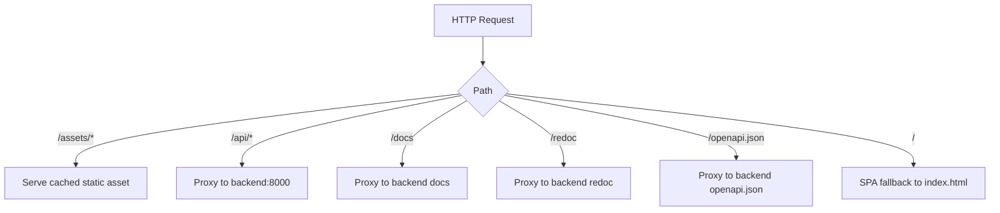

**Diagram sources**
- [frontend/Dockerfile:16-24](file://frontend/Dockerfile#L16-L24)
- [frontend/nginx.conf:1-51](file://frontend/nginx.conf#L1-L51)

**Section sources**
- [frontend/Dockerfile:1-25](file://frontend/Dockerfile#L1-L25)
- [frontend/nginx.conf:1-51](file://frontend/nginx.conf#L1-L51)

### Environment Variable Management
- The project intentionally supports exactly three DeepSeek-related environment variables.
- Variables are read by the backend only; they are not passed to the frontend build or bundle.
- Settings loader precedence: process environment overrides `.env` file values, which override defaults.
- Database path defaults to `/app/data/clinic.db` inside the container, backed by the mounted volume.

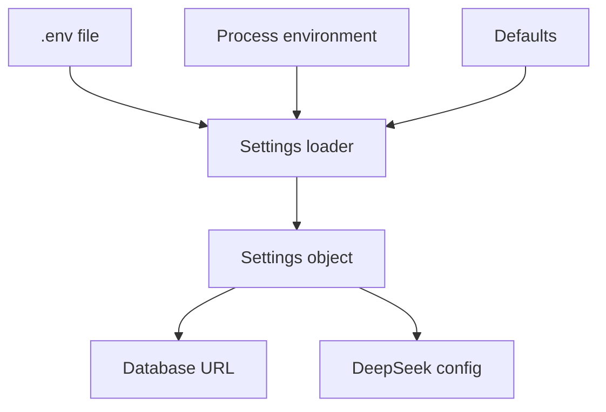

**Diagram sources**
- [backend/app/config.py:27-41](file://backend/app/config.py#L27-L41)
- [backend/app/config.py:44-84](file://backend/app/config.py#L44-L84)

**Section sources**
- [backend/app/config.py:1-90](file://backend/app/config.py#L1-L90)
- [docker-compose.yml:18-21](file://docker-compose.yml#L18-L21)

### Database Initialization and Persistence
- On startup, FastAPI calls bootstrap routines to create missing tables and apply additive migrations.
- If the database is empty, demo fixtures are seeded automatically.
- SQLite uses WAL mode, foreign keys enabled, and a busy timeout for concurrency safety.
- The database file and sidecars are stored under `/app/data`, persisted via the `clinic-data` named volume.

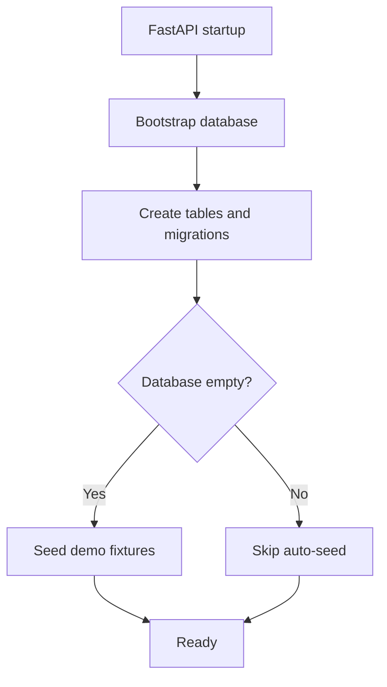

**Diagram sources**
- [backend/app/main.py:246-252](file://backend/app/main.py#L246-L252)
- [backend/app/bootstrap.py:34-66](file://backend/app/bootstrap.py#L34-L66)
- [backend/app/db.py:40-64](file://backend/app/db.py#L40-L64)

**Section sources**
- [backend/app/bootstrap.py:1-67](file://backend/app/bootstrap.py#L1-L67)
- [backend/app/db.py:1-134](file://backend/app/db.py#L1-L134)
- [docker-compose.yml:20-21](file://docker-compose.yml#L20-L21)

### Health Checks and Observability
- Backend health endpoint returns status, version, timestamps, database state, schema version, reset generation, and seeding status.
- Compose health check probes `/api/health` with retry and start period parameters.
- Observability middleware adds request IDs, timing, structured logging, and standardized error responses.

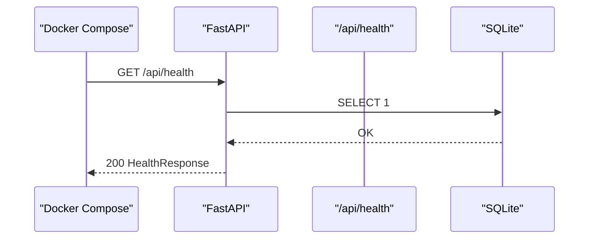

**Diagram sources**
- [docker-compose.yml:24-33](file://docker-compose.yml#L24-L33)
- [backend/app/api/health.py:23-57](file://backend/app/api/health.py#L23-L57)
- [backend/app/main.py:45-108](file://backend/app/main.py#L45-L108)

**Section sources**
- [backend/app/api/health.py:1-58](file://backend/app/api/health.py#L1-L58)
- [backend/app/main.py:45-108](file://backend/app/main.py#L45-L108)
- [docker-compose.yml:24-33](file://docker-compose.yml#L24-L33)

### Development vs Production Environments
- Production:
  - Bakes source into images.
  - Runs compiled frontend assets via nginx.
  - Runs backend via `server.py`.
- Development:
  - Mounts working tree directories into containers.
  - Backend uses uvicorn reload with explicit watch directories.
  - Frontend runs Vite dev server on port 5173 with API proxy target set to backend service.
  - Overrides published ports so only the dev frontend port is exposed.

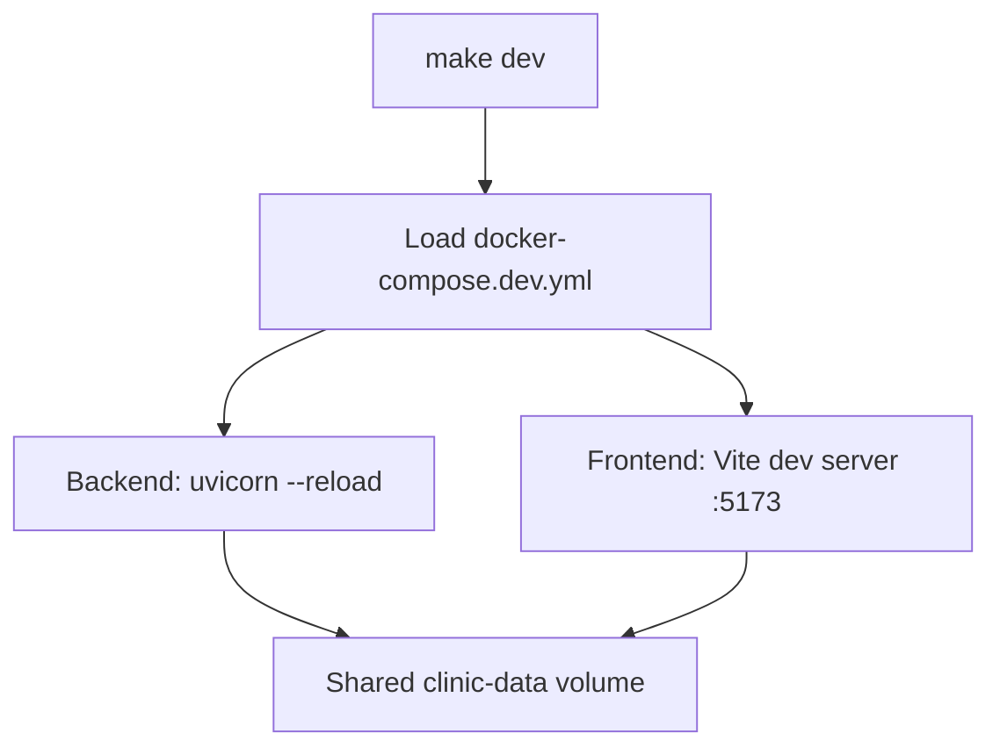

**Diagram sources**
- [docker-compose.dev.yml:1-20](file://docker-compose.dev.yml#L1-L20)
- [docker-compose.dev.yml:22-57](file://docker-compose.dev.yml#L22-L57)
- [docker-compose.dev.yml:58-84](file://docker-compose.dev.yml#L58-L84)

**Section sources**
- [docker-compose.dev.yml:1-84](file://docker-compose.dev.yml#L1-L84)

## Dependency Analysis
Service relationships and external dependencies:
- Frontend depends on backend being healthy before starting.
- Backend depends on SQLite persistence and optional DeepSeek integration via environment variables.
- Nginx routes client traffic to backend APIs and serves static assets.

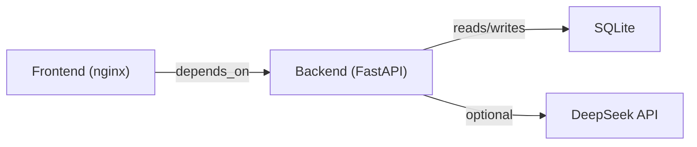

**Diagram sources**
- [docker-compose.yml:41-46](file://docker-compose.yml#L41-L46)
- [backend/app/config.py:27-41](file://backend/app/config.py#L27-L41)

**Section sources**
- [docker-compose.yml:12-46](file://docker-compose.yml#L12-L46)
- [backend/app/config.py:1-90](file://backend/app/config.py#L1-L90)

## Performance Considerations
- Static asset caching: nginx aggressively caches hashed assets under `/assets/` with immutable headers.
- Gzip compression: enabled for common web content types.
- Connection pragmas: SQLite uses WAL mode, foreign keys, and busy timeout to improve concurrency and reliability.
- Health checks: Compose health checks prevent frontend startup until backend is healthy, reducing cold-start errors.
- Development hot reload: Backend reloads on file changes; frontend uses polling to ensure reliable hot reload across macOS bind mounts.

[No sources needed since this section provides general guidance]

## Troubleshooting Guide
Common operational tasks and diagnostics:
- View logs: Use Makefile targets to follow backend and frontend logs.
- Check backend health: Use `make backend-status` to curl `/api/health`.
- Access API docs: Swagger UI is available at `/docs`; OpenAPI schema at `/openapi.json`.
- Seed data: Use `make seed` to insert missing fixtures without deleting existing records.
- Reset demo database: Use `make reset-demo` to stop writers, recreate the database, reseed, and restart services.
- Inspect database: Use `make shell-db` to open sqlite3 prompt on the clinic database.
- Clean volumes: Use `make clean-volumes` to remove containers and the clinic data volume (destructive).

Operational notes:
- Health endpoint returns degraded status when database probe fails but process remains up.
- Exception handlers return structured error responses with request IDs and stable error codes.
- Database integrity conflicts return conflict responses to allow client refresh and retry.

**Section sources**
- [Makefile:33-105](file://Makefile#L33-L105)
- [backend/app/api/health.py:23-57](file://backend/app/api/health.py#L23-L57)
- [backend/app/main.py:110-179](file://backend/app/main.py#L110-L179)

## Conclusion
The dental receptionist system deploys a clear separation between frontend and backend, with nginx acting as the single entry point for clients. Docker Compose manages service lifecycle, health checks, and persistent storage. The backend initializes and seeds the database on first run, while the frontend serves static assets and proxies API calls. Development and production environments share the same topology, differing primarily in how source code is delivered and whether hot reload is enabled. Operational procedures are streamlined through Makefile targets, and health checks provide reliable readiness signals for orchestration.

[No sources needed since this section summarizes without analyzing specific files]

## Appendices

### Deployment Topology Diagram
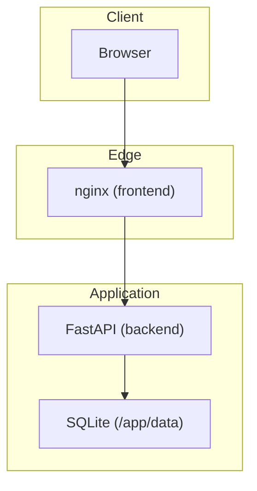

**Diagram sources**
- [frontend/nginx.conf:1-51](file://frontend/nginx.conf#L1-L51)
- [docker-compose.yml:12-46](file://docker-compose.yml#L12-L46)
- [backend/Dockerfile:16-23](file://backend/Dockerfile#L16-L23)

### Scaling Considerations
- Move transactional data to PostgreSQL while preserving constraints for slot claims, idempotency, and tenant ownership.
- Add explicit clinic tenancy to every query.
- Run stateless backend replicas with a defined distributed booking strategy.
- Use durable background jobs for alerts, retries, reconciliation, and dead-letter handling.
- Add metrics, traces, centralized structured logs, latency monitoring, and on-call runbooks.
- Apply tenant and user rate limits, model concurrency budgets, request limits, and cost controls.
- Integrate with EHR or practice-management systems through idempotent adapters and reconciliation.
- Add privacy controls, encryption and key management, retention, access reviews, backup testing, and operational security review.
- Use staged deployment, migration checks, feature flags, backups, and tested rollback.

**Section sources**
- [README.md:275-291](file://README.md#L275-L291)

### Operational Procedures Summary
- Start production: `make up`.
- Start development: `make dev`.
- Follow logs: `make logs`, `make backend-logs`, `make frontend-logs`.
- Seed data: `make seed`.
- Reset demo: `make reset-demo`.
- Inspect database: `make shell-db`.
- Clean volumes: `make clean-volumes`.

**Section sources**
- [Makefile:33-105](file://Makefile#L33-L105)
- [README.md:95-111](file://README.md#L95-L111)