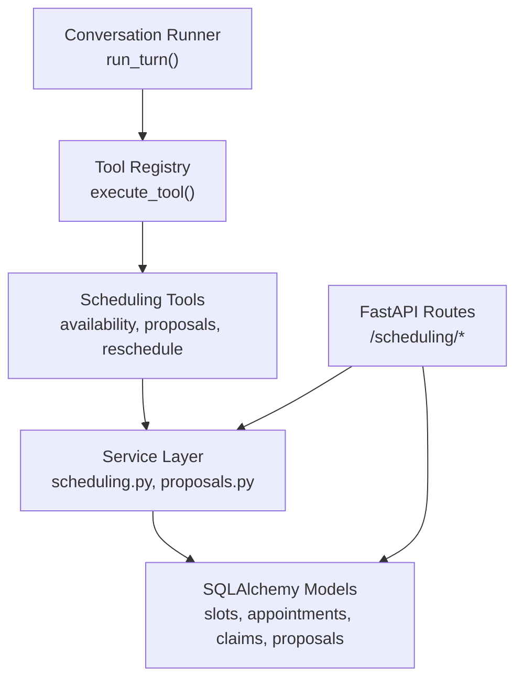
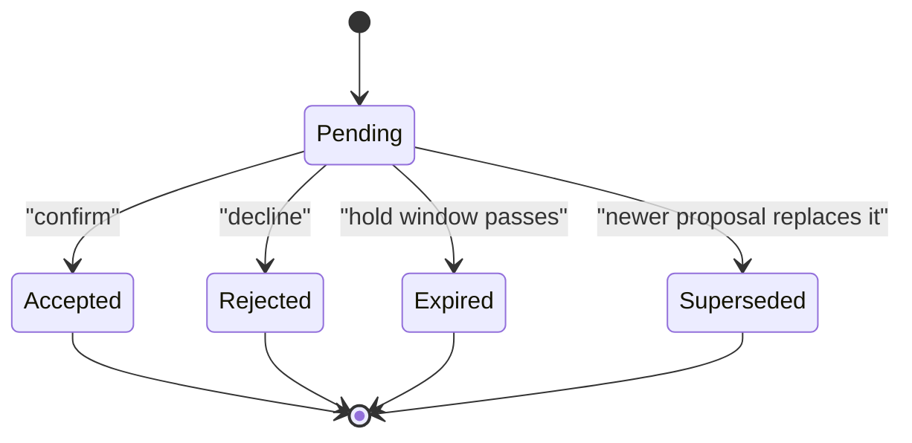
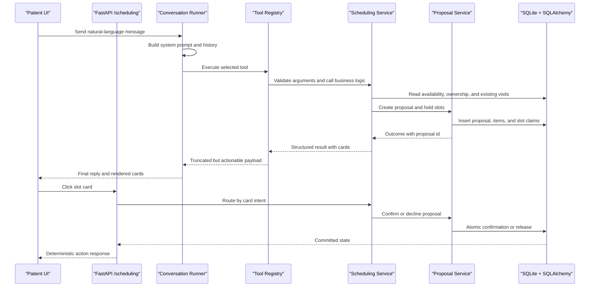
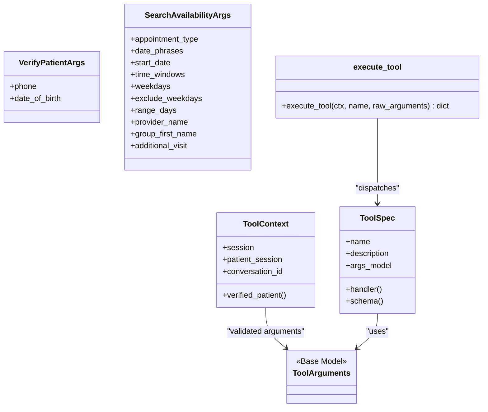
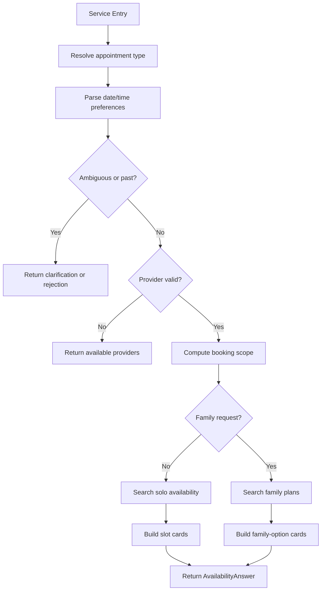
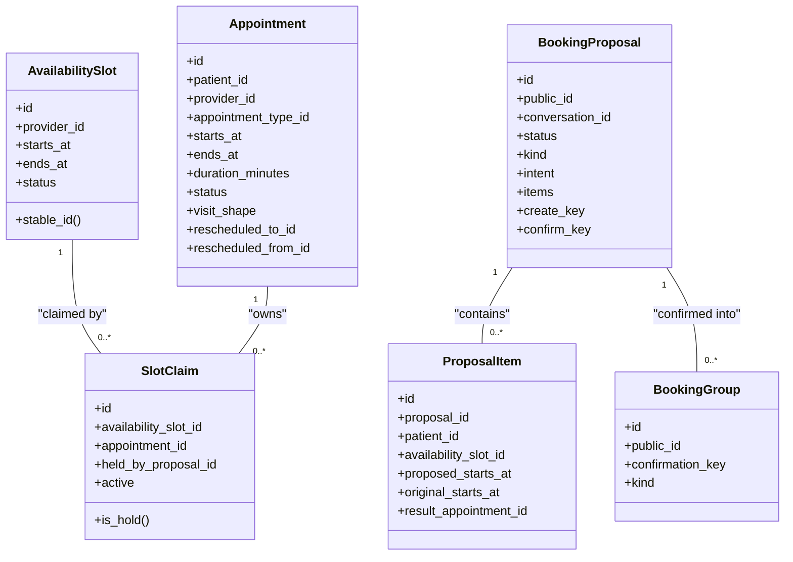
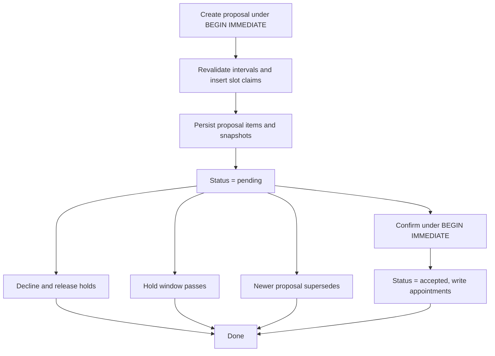
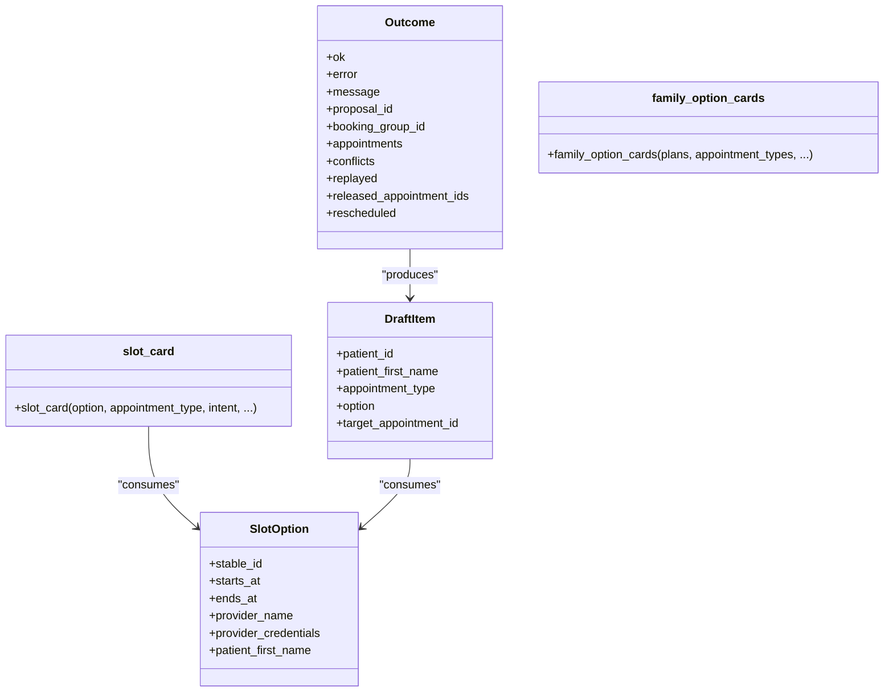
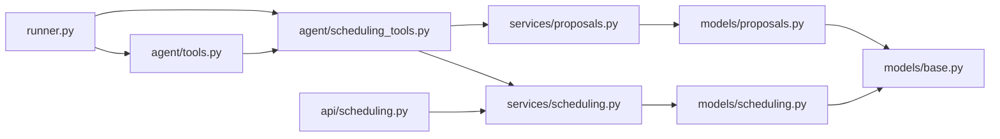

# Design Patterns

<cite>
**Referenced Files in This Document**
- [tools.py](file://backend/app/agent/tools.py)
- [scheduling_tools.py](file://backend/app/agent/scheduling_tools.py)
- [runner.py](file://backend/app/agent/runner.py)
- [scheduling.py](file://backend/app/services/scheduling.py)
- [proposals.py](file://backend/app/services/proposals.py)
- [scheduling.py](file://backend/app/api/scheduling.py)
- [scheduling.py](file://backend/app/models/scheduling.py)
- [proposals.py](file://backend/app/models/proposals.py)
- [base.py](file://backend/app/models/base.py)
</cite>

## Table of Contents
1. [Introduction](#introduction)
2. [Project Structure](#project-structure)
3. [Core Components](#core-components)
4. [Architecture Overview](#architecture-overview)
5. [Detailed Component Analysis](#detailed-component-analysis)
6. [Dependency Analysis](#dependency-analysis)
7. [Performance Considerations](#performance-considerations)
8. [Troubleshooting Guide](#troubleshooting-guide)
9. [Conclusion](#conclusion)

## Introduction
This document explains the key design patterns that make the dental receptionist system safe, testable, and understandable:

- Tool Pattern: each AI capability is a named tool with Pydantic input validation, deterministic service execution, and structured output formatting.
- Service Layer Pattern: FastAPI endpoints call services; services compose availability, proposals, appointments, emergencies, and audit logic without exposing database internals to the model or UI.
- Repository Pattern through SQLAlchemy models: domain entities such as slots, appointments, claims, proposals, and groups are modeled declaratively and accessed through typed sessions.
- State Machine Pattern: appointment lifecycle, proposal lifecycle, and conversation state transitions are explicit and enforced by enums, constraints, and transactional checks.
- Factory Pattern: slot cards, family-option cards, and proposal-related data structures are created by focused factory helpers so the UI and tools share one source of truth for card shapes.

The goal is to keep the AI assistant fluent while ensuring that identity, scheduling correctness, concurrency, and persistence remain deterministic and auditable.

## Project Structure
The relevant backend layers are:

- Agent layer: prompts, runner, base tools, and scheduling tools.
- API layer: FastAPI routes for chat and deterministic scheduling actions.
- Services layer: business orchestration for patients, availability, proposals, appointments, emergencies, and staff handoff.
- Models layer: SQLAlchemy entities and shared enums/mixins.

**Diagram sources**
- [runner.py:171-406](file://backend/app/agent/runner.py#L171-L406)
- [tools.py:493-614](file://backend/app/agent/tools.py#L493-L614)
- [scheduling_tools.py:474-682](file://backend/app/agent/scheduling_tools.py#L474-L682)
- [scheduling.py:393-716](file://backend/app/services/scheduling.py#L393-L716)
- [proposals.py:282-529](file://backend/app/services/proposals.py#L282-L529)
- [scheduling.py:216-554](file://backend/app/api/scheduling.py#L216-L554)
- [scheduling.py:37-239](file://backend/app/models/scheduling.py#L37-L239)
- [proposals.py:35-236](file://backend/app/models/proposals.py#L35-L236)

**Section sources**
- [runner.py:1-23](file://backend/app/agent/runner.py#L1-L23)
- [tools.py:1-11](file://backend/app/agent/tools.py#L1-L11)
- [scheduling.py:1-12](file://backend/app/services/scheduling.py#L1-L12)
- [scheduling.py:1-12](file://backend/app/models/scheduling.py#L1-L12)

## Core Components
This section maps the five requested patterns to concrete implementation points.

### Tool Pattern
Each tool is a `ToolSpec` with:
- A stable name.
- A human-readable description.
- A Pydantic argument model.
- A handler that receives `ToolContext` and validated arguments.
- A uniform result dictionary containing `ok`, optional error fields, messages, and interactive `cards`.

Benefits in the dental scheduling domain:
- The model cannot bypass registration, verification, ownership, or booking rules because handlers delegate to services.
- Bad dates, phone numbers, names, or missing fields become structured errors instead of exceptions.
- Large tool results are truncated safely so the conversation loop remains bounded while preserving clickable cards.

Key implementation anchors:
- Base tool registry and execution pipeline.
- Registration, verification, practice info, and child-linking tools.
- Scheduling tools for availability, proposals, reschedules, cancellations, family options, emergencies, and staff requests.

**Section sources**
- [tools.py:493-614](file://backend/app/agent/tools.py#L493-L614)
- [tools.py:703-739](file://backend/app/agent/tools.py#L703-L739)
- [tools.py:123-126](file://backend/app/agent/tools.py#L123-L126)
- [tools.py:617-700](file://backend/app/agent/tools.py#L617-L700)
- [scheduling_tools.py:59-360](file://backend/app/agent/scheduling_tools.py#L59-L360)

### Service Layer Pattern
Services encapsulate business workflows:
- `services.scheduling` orchestrates availability search, request persistence, family coordination, proposal creation, confirmation, and card rendering.
- `services.proposals` owns proposal creation, holds, rejection, supersession, and atomic confirmation.
- API routes only resolve sessions, validate payloads, and delegate to services.

Benefits:
- Deterministic operations are reusable by both the conversational agent and the direct UI endpoints.
- Database schema details stay inside models and services.
- Error responses carry consistent `ok`, `error`, `message`, and `cards` fields.

**Section sources**
- [scheduling.py:1-12](file://backend/app/services/scheduling.py#L1-L12)
- [scheduling.py:393-716](file://backend/app/services/scheduling.py#L393-L716)
- [proposals.py:1-46](file://backend/app/services/proposals.py#L1-L46)
- [scheduling.py:216-554](file://backend/app/api/scheduling.py#L216-L554)

### Repository Pattern through SQLAlchemy Models
Domain objects are declared with SQLAlchemy:
- `AvailabilitySlot`: 30-minute provider intervals with status and stability guarantees.
- `Appointment`: booked, cancelled, completed, or rescheduled visits with reschedule history links.
- `SlotClaim`: active reservation for either an appointment or a pending proposal, protected by partial unique indexes.
- `BookingProposal` and `ProposalItem`: what the patient is about to book, snapshotting proposed times and original appointment context.
- `BookingGroup`: everything confirmed together, including idempotent confirmation keys.

Benefits:
- Overlap protection is enforced at the database level through uniqueness constraints.
- Reschedule history preserves the original time, provider, and duration even after movement.
- Proposal snapshots let the UI render exactly what the patient saw while confirmation revalidates live slots.

**Section sources**
- [scheduling.py:37-79](file://backend/app/models/scheduling.py#L37-L79)
- [scheduling.py:81-172](file://backend/app/models/scheduling.py#L81-L172)
- [scheduling.py:175-239](file://backend/app/models/scheduling.py#L175-L239)
- [proposals.py:35-141](file://backend/app/models/proposals.py#L35-L141)
- [proposals.py:144-199](file://backend/app/models/proposals.py#L144-L199)
- [proposals.py:202-236](file://backend/app/models/proposals.py#L202-L236)

### State Machine Pattern
State machines appear in three places:

1. Appointment states: `booked`, `cancelled`, `completed`, `rescheduled`.
2. Proposal states: `pending`, `accepted`, `rejected`, `expired`, `superseded`.
3. Conversation and message roles: active/closed conversations and patient/assistant/staff/system roles.

Transitions are enforced by:
- Enum constraints on columns.
- Transactional revalidation before writes.
- Explicit handling of reschedule replacements versus new bookings.
- Hold expiry that releases slots without treating a lapsed hold as a declined choice.

**Diagram sources**
- [base.py:66-74](file://backend/app/models/base.py#L66-L74)
- [proposals.py:35-141](file://backend/app/models/proposals.py#L35-L141)
- [proposals.py:216-274](file://backend/app/services/proposals.py#L216-L274)
- [proposals.py:638-740](file://backend/app/services/proposals.py#L638-L740)

**Section sources**
- [base.py:56-74](file://backend/app/models/base.py#L56-L74)
- [proposals.py:216-274](file://backend/app/services/proposals.py#L216-L274)
- [proposals.py:638-740](file://backend/app/services/proposals.py#L638-L740)

### Factory Pattern
Factory helpers create consistent UI-facing structures:

- `slot_card`: builds a single clickable time card with intent, stability, timing, provider, and settlement metadata.
- `family_option_cards`: builds one card per complete family plan, wrapping multiple slot cards.
- `DraftItem` and `Outcome`: factory-like dataclasses used when constructing proposals and reporting confirmation results.

Benefits:
- Tools and API routes produce identical card shapes.
- Intent semantics (new booking vs reschedule) are attached at creation time rather than inferred later.
- Snapshot fields preserve what the patient saw while live revalidation protects correctness.

**Section sources**
- [scheduling.py:238-295](file://backend/app/services/scheduling.py#L238-L295)
- [scheduling.py:341-390](file://backend/app/services/scheduling.py#L341-L390)
- [proposals.py:95-122](file://backend/app/services/proposals.py#L95-L122)

## Architecture Overview
The end-to-end flow shows how the patterns cooperate during a typical scheduling interaction.

**Diagram sources**
- [runner.py:171-406](file://backend/app/agent/runner.py#L171-L406)
- [runner.py:409-557](file://backend/app/agent/runner.py#L409-L557)
- [tools.py:703-739](file://backend/app/agent/tools.py#L703-L739)
- [scheduling_tools.py:474-682](file://backend/app/agent/scheduling_tools.py#L474-L682)
- [scheduling.py:393-716](file://backend/app/services/scheduling.py#L393-L716)
- [proposals.py:282-529](file://backend/app/services/proposals.py#L282-L529)
- [scheduling.py:256-362](file://backend/app/api/scheduling.py#L256-L362)
- [scheduling.py:456-487](file://backend/app/api/scheduling.py#L456-L487)

## Detailed Component Analysis

### Tool Pattern Implementation
The tool pattern separates language interpretation from deterministic execution.

**Diagram sources**
- [tools.py:41-58](file://backend/app/agent/tools.py#L41-L58)
- [tools.py:62-120](file://backend/app/agent/tools.py#L62-L120)
- [tools.py:493-508](file://backend/app/agent/tools.py#L493-L508)
- [tools.py:703-739](file://backend/app/agent/tools.py#L703-L739)
- [scheduling_tools.py:59-113](file://backend/app/agent/scheduling_tools.py#L59-L113)

Concrete example references:
- Registration and verification tools normalize names and phones, reject ambiguous dates, and mark the session verified only after successful lookup or registration.
- Availability tools return structured availability with `cards`, never letting the model invent open times.
- Proposal tools route between new bookings and reschedules based on stored state and explicit card intent.

**Section sources**
- [tools.py:164-284](file://backend/app/agent/tools.py#L164-L284)
- [tools.py:465-485](file://backend/app/agent/tools.py#L465-L485)
- [scheduling_tools.py:474-682](file://backend/app/agent/scheduling_tools.py#L474-L682)

### Service Layer Pattern Implementation
The service layer composes lower-level primitives into patient-facing workflows.

**Diagram sources**
- [scheduling.py:393-716](file://backend/app/services/scheduling.py#L393-L716)
- [scheduling.py:719-792](file://backend/app/services/scheduling.py#L719-L792)

Concrete example references:
- `find_availability` resolves preferences, enforces registration completeness, computes booking scope, handles family coordination, and returns cards describing real SQLite-backed slots.
- `slot_card` and `family_option_cards` ensure every card carries enough context for the UI to act deterministically.

**Section sources**
- [scheduling.py:393-716](file://backend/app/services/scheduling.py#L393-L716)
- [scheduling.py:238-390](file://backend/app/services/scheduling.py#L238-L390)

### Repository Pattern Implementation
SQLAlchemy models define the load-bearing structure of scheduling data.

**Diagram sources**
- [scheduling.py:37-79](file://backend/app/models/scheduling.py#L37-L79)
- [scheduling.py:81-172](file://backend/app/models/scheduling.py#L81-L172)
- [scheduling.py:175-239](file://backend/app/models/scheduling.py#L175-L239)
- [proposals.py:35-141](file://backend/app/models/proposals.py#L35-L141)
- [proposals.py:144-199](file://backend/app/models/proposals.py#L144-L199)
- [proposals.py:202-236](file://backend/app/models/proposals.py#L202-L236)

Concrete example references:
- `AvailabilitySlot.stable_id` derives a non-secret identifier from provider and start time.
- `Appointment.rescheduled_from_id` and `rescheduled_to_id` preserve move history.
- `SlotClaim` uses partial unique indexes so only one active claim exists per slot, whether held by an appointment or a proposal.

**Section sources**
- [scheduling.py:37-239](file://backend/app/models/scheduling.py#L37-L239)
- [proposals.py:35-236](file://backend/app/models/proposals.py#L35-L236)

### State Machine Pattern Implementation
The state machine governs proposal lifecycles and appointment states.

**Diagram sources**
- [proposals.py:282-529](file://backend/app/services/proposals.py#L282-L529)
- [proposals.py:638-740](file://backend/app/services/proposals.py#L638-L740)
- [base.py:66-74](file://backend/app/models/base.py#L66-L74)

Concrete example references:
- Creation validates kind, intent, target appointments, item count, and patient uniqueness before holding slots.
- Confirmation revalidates under a write lock, releases holds, creates appointments, and records idempotent outcomes.
- Expiry releases holds without treating the choice as rejected; confirmation can still succeed if the slot remains open.

**Section sources**
- [proposals.py:282-529](file://backend/app/services/proposals.py#L282-L529)
- [proposals.py:638-740](file://backend/app/services/proposals.py#L638-L740)
- [proposals.py:216-274](file://backend/app/services/proposals.py#L216-L274)

### Factory Pattern Implementation
Factory helpers centralize card construction and outcome shaping.

**Diagram sources**
- [scheduling.py:238-295](file://backend/app/services/scheduling.py#L238-L295)
- [scheduling.py:341-390](file://backend/app/services/scheduling.py#L341-L390)
- [proposals.py:95-122](file://backend/app/services/proposals.py#L95-L122)

Concrete example references:
- `slot_card` attaches `intent`, `settled`, `require_open`, and provider credentials so the UI knows whether a click books, moves, or merely observes.
- `family_option_cards` wraps multiple slot cards into one family plan card with option identity and back-to-back metadata.
- `Outcome` standardizes success, conflict, replay, and reschedule information returned by proposal operations.

**Section sources**
- [scheduling.py:238-390](file://backend/app/services/scheduling.py#L238-L390)
- [proposals.py:95-122](file://backend/app/services/proposals.py#L95-L122)

## Dependency Analysis
The following diagram shows how components depend on each other across layers.

**Diagram sources**
- [runner.py:171-406](file://backend/app/agent/runner.py#L171-L406)
- [tools.py:493-614](file://backend/app/agent/tools.py#L493-L614)
- [scheduling_tools.py:474-682](file://backend/app/agent/scheduling_tools.py#L474-L682)
- [scheduling.py:393-716](file://backend/app/services/scheduling.py#L393-L716)
- [proposals.py:282-529](file://backend/app/services/proposals.py#L282-L529)
- [scheduling.py:216-554](file://backend/app/api/scheduling.py#L216-L554)
- [scheduling.py:37-239](file://backend/app/models/scheduling.py#L37-L239)
- [proposals.py:35-236](file://backend/app/models/proposals.py#L35-L236)
- [base.py:56-74](file://backend/app/models/base.py#L56-L74)

**Section sources**
- [runner.py:171-406](file://backend/app/agent/runner.py#L171-L406)
- [tools.py:493-614](file://backend/app/agent/tools.py#L493-L614)
- [scheduling_tools.py:474-682](file://backend/app/agent/scheduling_tools.py#L474-L682)
- [scheduling.py:393-716](file://backend/app/services/scheduling.py#L393-L716)
- [proposals.py:282-529](file://backend/app/services/proposals.py#L282-L529)
- [scheduling.py:216-554](file://backend/app/api/scheduling.py#L216-L554)
- [scheduling.py:37-239](file://backend/app/models/scheduling.py#L37-L239)
- [proposals.py:35-236](file://backend/app/models/proposals.py#L35-L236)
- [base.py:56-74](file://backend/app/models/base.py#L56-L74)

## Performance Considerations
- Bounded tool rounds and calls prevent uncontrolled LLM loops.
- Read-only availability searches avoid blocking writers while the model thinks.
- Short hold windows reduce calendar blockage when a patient changes their mind.
- Result truncation keeps tool payloads within conversation limits while preserving interactive cards.
- Idempotent creation and confirmation keys allow safe retries without duplicate bookings.
- Partial unique indexes on slot claims provide load-bearing overlap protection at the database level.

[No sources needed since this section provides general guidance]

## Troubleshooting Guide
Common issues and their pattern-based safeguards:

- Unknown tool or bad arguments: the tool executor parses JSON, validates against Pydantic models, and returns structured errors instead of raising.
- Stale slot selection: the `/scheduling/availability` refresh endpoint re-validates slot ids and returns rejected ids plus fresh cards.
- Double booking attempt: `BEGIN IMMEDIATE` transactions and unique active-slot constraints fail fast; conflicts are reported as slot-taken rather than silently succeeding.
- Lapsed hold: expired holds are released, but the proposal remains confirmable; confirmation rechecks live availability.
- Wrong proposal kind: confirming a reschedule card through the booking path returns a helpful redirect to the correct confirmation tool.
- Unverified access: API routes require a verified patient session before scheduling actions.

**Section sources**
- [tools.py:703-739](file://backend/app/agent/tools.py#L703-L739)
- [scheduling.py:365-453](file://backend/app/api/scheduling.py#L365-L453)
- [proposals.py:490-511](file://backend/app/services/proposals.py#L490-L511)
- [proposals.py:216-274](file://backend/app/services/proposals.py#L216-L274)
- [scheduling.py:456-487](file://backend/app/api/scheduling.py#L456-L487)

## Conclusion
The dental receptionist system uses well-known patterns to separate concerns:

- The Tool Pattern makes AI capabilities explicit, validated, and safe.
- The Service Layer Pattern centralizes scheduling and proposal logic behind deterministic APIs.
- The Repository Pattern through SQLAlchemy models defines clear, constraint-backed data boundaries.
- The State Machine Pattern makes appointment and proposal lifecycles inspectable and correct.
- The Factory Pattern ensures UI cards and outcomes are constructed consistently.

Together, these patterns keep the conversational experience fluent while protecting the most important property: no wrong appointment.