# System Architecture

<cite>
**Referenced Files in This Document**
- [README.md](file://README.md)
- [docker-compose.yml](file://docker-compose.yml)
- [frontend/nginx.conf](file://frontend/nginx.conf)
- [backend/server.py](file://backend/server.py)
- [backend/app/main.py](file://backend/app/main.py)
- [backend/app/config.py](file://backend/app/config.py)
- [backend/app/db.py](file://backend/app/db.py)
- [backend/app/ai/deepseek.py](file://backend/app/ai/deepseek.py)
- [backend/app/models/base.py](file://backend/app/models/base.py)
- [backend/app/models/sessions.py](file://backend/app/models/sessions.py)
- [backend/app/services/security.py](file://backend/app/services/security.py)
- [backend/app/api/chat.py](file://backend/app/api/chat.py)
- [backend/app/agent/tools.py](file://backend/app/agent/tools.py)
- [backend/app/agent/runner.py](file://backend/app/agent/runner.py)
- [backend/app/services/conversations.py](file://backend/app/services/conversations.py)
</cite>

## Table of Contents
1. [Introduction](#introduction)
2. [Project Structure](#project-structure)
3. [Core Components](#core-components)
4. [Architecture Overview](#architecture-overview)
5. [Detailed Component Analysis](#detailed-component-analysis)
6. [Dependency Analysis](#dependency-analysis)
7. [Performance Considerations](#performance-considerations)
8. [Troubleshooting Guide](#troubleshooting-guide)
9. [Conclusion](#conclusion)

## Introduction
The Oral-B Dental Care AI Receptionist is a prototype system that lets patients interact with a conversational React interface to register, verify identity, ask clinic questions, and manage appointments. A separate staff React dashboard shares the same SQLite database for appointment views, pending requests, emergency alerts, and operational actions. The FastAPI backend owns validation, authorization, scheduling, and persistence; DeepSeek provides natural-language interpretation through an OpenAI-compatible chat API. SQLAlchemy models represent the deterministic domain state.

The design intentionally separates AI interpretation from deterministic business logic. The model may interpret intent and request allowed tools, but it cannot assert identity, invent policy, or commit bookings directly. Pydantic validates tool arguments, services enforce rules and transactions, and SQLite constraints provide load-bearing integrity.

**Section sources**
- [README.md:1-6](file://README.md#L1-L6)
- [README.md:40-69](file://README.md#L40-L69)

## Project Structure
The repository is organized into three main layers:

- Frontend: React application served by nginx, proxying `/api` to the backend.
- Backend: FastAPI application exposing patient and staff endpoints, orchestrating AI and deterministic services.
- Persistence: SQLite database managed by SQLAlchemy with WAL mode, foreign keys, and connection-scoped pragmas.

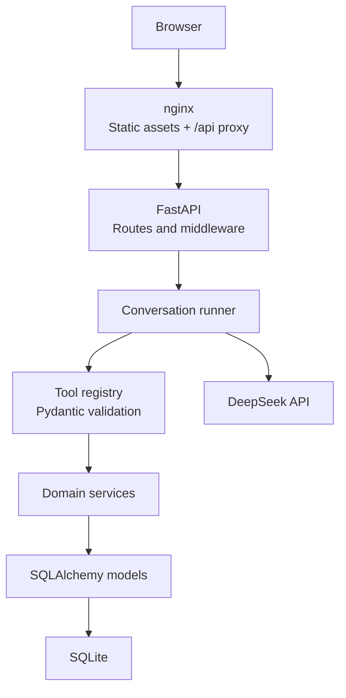

**Diagram sources**
- [frontend/nginx.conf:1-51](file://frontend/nginx.conf#L1-L51)
- [backend/server.py:5-14](file://backend/server.py#L5-L14)
- [backend/app/main.py:202-251](file://backend/app/main.py#L202-L251)
- [backend/app/agent/runner.py:171-235](file://backend/app/agent/runner.py#L171-L235)
- [backend/app/agent/tools.py:703-739](file://backend/app/agent/tools.py#L703-L739)
- [backend/app/db.py:52-64](file://backend/app/db.py#L52-L64)
- [backend/app/ai/deepseek.py:205-249](file://backend/app/ai/deepseek.py#L205-L249)

**Section sources**
- [README.md:305-337](file://README.md#L305-L337)
- [docker-compose.yml:1-51](file://docker-compose.yml#L1-L51)

## Core Components
- Patient chat session management creates opaque tokens, persists conversations, and scopes access through `PatientSession`.
- Conversation runner builds prompts, calls DeepSeek, executes validated tools, and persists assistant turns and cards.
- Tool registry defines capabilities with Pydantic argument schemas and handlers that call deterministic services.
- Services encapsulate scheduling, availability, patient registration, verification, emergencies, audit logging, and practice information.
- Database layer configures SQLite engine, sessions, pragmas, and transaction boundaries.
- Configuration reads DeepSeek settings and database path without leaking secrets.

Key responsibilities:
- FastAPI routes handle HTTP contracts, authentication headers, and response shaping.
- Runner enforces bounded tool loops and safe fallback behavior.
- Tools enforce input validation and ownership checks before calling services.
- Services implement deterministic business rules and atomic operations.
- Models define enums, timestamps, and relationships.
- Database utilities ensure WAL mode, foreign keys, busy timeouts, and clean session scoping.

**Section sources**
- [backend/app/api/chat.py:1-12](file://backend/app/api/chat.py#L1-L12)
- [backend/app/agent/runner.py:1-23](file://backend/app/agent/runner.py#L1-L23)
- [backend/app/agent/tools.py:1-11](file://backend/app/agent/tools.py#L1-L11)
- [backend/app/db.py:1-6](file://backend/app/db.py#L1-L6)
- [backend/app/config.py:1-10](file://backend/app/config.py#L1-L10)

## Architecture Overview
The system follows a layered architecture:

- Presentation layer: React UIs for patients and staff.
- API layer: FastAPI routers for chat, scheduling, staff, health, and demo endpoints.
- Orchestration layer: Conversation runner coordinating AI and tools.
- Capability layer: Tool registry providing typed, validated functions.
- Domain service layer: Deterministic business logic for patients, scheduling, emergencies, audits, and practice data.
- Persistence layer: SQLAlchemy models over SQLite.
- External integration: DeepSeek chat-completions client with retries and typed errors.

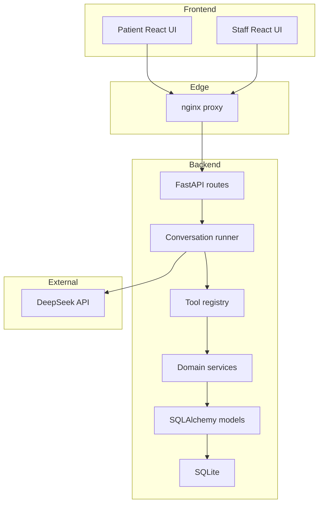

**Diagram sources**
- [frontend/nginx.conf:12-22](file://frontend/nginx.conf#L12-L22)
- [backend/app/main.py:239-244](file://backend/app/main.py#L239-L244)
- [backend/app/agent/runner.py:409-557](file://backend/app/agent/runner.py#L409-L557)
- [backend/app/agent/tools.py:493-614](file://backend/app/agent/tools.py#L493-L614)
- [backend/app/db.py:52-64](file://backend/app/db.py#L52-L64)
- [backend/app/ai/deepseek.py:178-249](file://backend/app/ai/deepseek.py#L178-L249)

## Detailed Component Analysis

### Patient Chat Flow
A patient message flows through FastAPI, conversation persistence, AI interpretation, tool execution, and final response rendering.

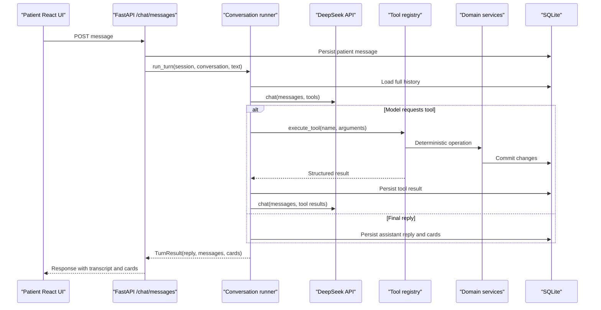

**Diagram sources**
- [backend/app/api/chat.py:233-274](file://backend/app/api/chat.py#L233-L274)
- [backend/app/agent/runner.py:171-235](file://backend/app/agent/runner.py#L171-L235)
- [backend/app/agent/runner.py:409-557](file://backend/app/agent/runner.py#L409-L557)
- [backend/app/agent/tools.py:703-739](file://backend/app/agent/tools.py#L703-L739)
- [backend/app/services/conversations.py:165-183](file://backend/app/services/conversations.py#L165-L183)

**Section sources**
- [backend/app/api/chat.py:233-274](file://backend/app/api/chat.py#L233-L274)
- [backend/app/agent/runner.py:171-235](file://backend/app/agent/runner.py#L171-L235)
- [backend/app/agent/runner.py:409-557](file://backend/app/agent/runner.py#L409-L557)

### Tool Pattern and Validation
Tools are declared with Pydantic argument models and executed through a central registry. Arguments arrive as JSON strings from the provider and are validated before any service is called. Unknown tools, malformed arguments, and validation failures return structured error payloads rather than raising exceptions.

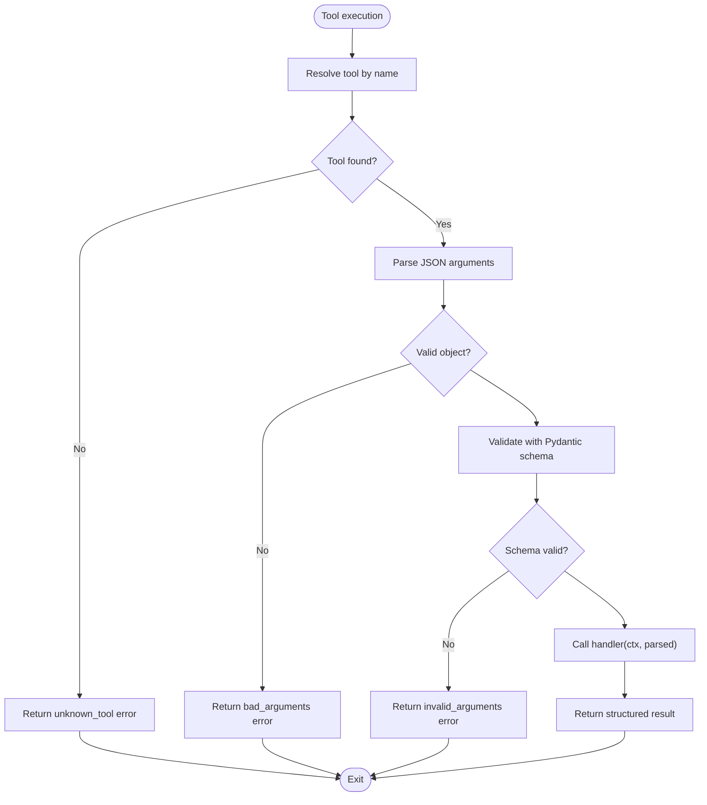

**Diagram sources**
- [backend/app/agent/tools.py:703-739](file://backend/app/agent/tools.py#L703-L739)
- [backend/app/agent/tools.py:493-614](file://backend/app/agent/tools.py#L493-L614)

**Section sources**
- [backend/app/agent/tools.py:1-11](file://backend/app/agent/tools.py#L1-L11)
- [backend/app/agent/tools.py:703-739](file://backend/app/agent/tools.py#L703-L739)

### Service Layer Abstraction
Services encapsulate deterministic operations such as patient registration, verification, scheduling, availability, emergencies, audits, and practice information. They receive a SQLAlchemy session and context, perform validation, enforce business rules, and commit changes under explicit transaction boundaries.

Examples include:
- Registration normalization and duplicate detection.
- Verification marking a session as verified only after successful lookup.
- Scheduling holds, proposals, confirmation transactions, and rescheduling semantics.
- Emergency triage producing staff alerts without external notifications.
- Audit recording for sensitive mutations.

**Section sources**
- [backend/app/agent/tools.py:164-284](file://backend/app/agent/tools.py#L164-L284)
- [backend/app/agent/tools.py:287-462](file://backend/app/agent/tools.py#L287-L462)
- [backend/app/agent/tools.py:465-485](file://backend/app/agent/tools.py#L465-L485)

### Session Management and CSRF Protection
Patient sessions use opaque tokens. The browser sends `X-Patient-Session`, and routes resolve conversations scoped to that session. Tokens are hashed before storage so a database leak cannot be replayed.

Staff sessions use server-side sessions with HttpOnly cookies and CSRF protection for writes. CORS is configured to allow specific development origins and headers while keeping credentials disabled for patient routes.

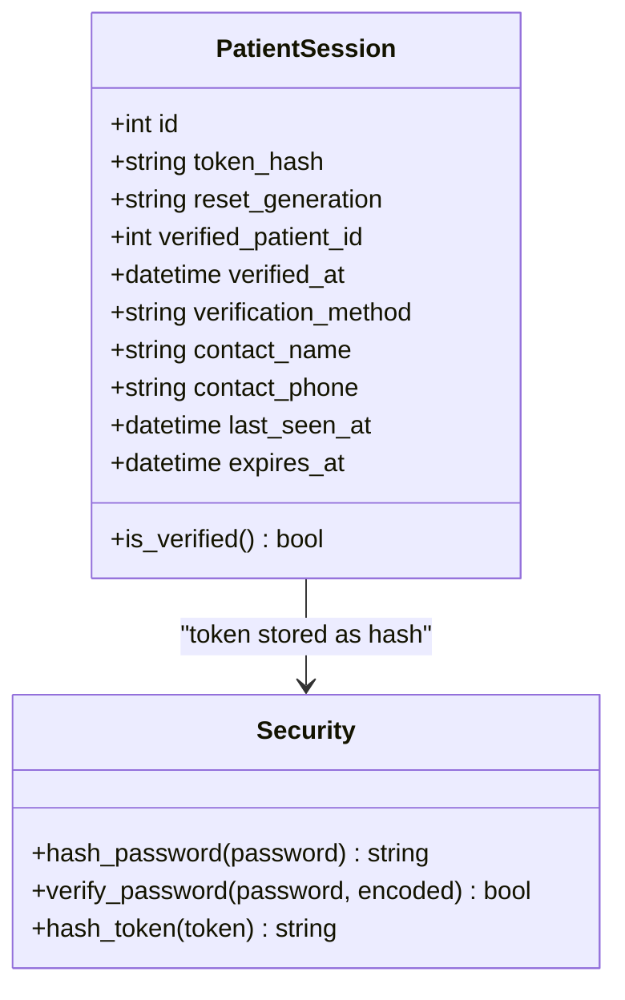

**Diagram sources**
- [backend/app/models/sessions.py:35-76](file://backend/app/models/sessions.py#L35-L76)
- [backend/app/services/security.py:18-46](file://backend/app/services/security.py#L18-L46)
- [backend/app/main.py:222-237](file://backend/app/main.py#L222-L237)

**Section sources**
- [backend/app/models/sessions.py:1-18](file://backend/app/models/sessions.py#L1-L18)
- [backend/app/models/sessions.py:35-76](file://backend/app/models/sessions.py#L35-L76)
- [backend/app/services/security.py:1-47](file://backend/app/services/security.py#L1-L47)
- [backend/app/main.py:222-237](file://backend/app/main.py#L222-L237)

### Conversation Persistence and Replay
Conversations persist every turn, including assistant messages, tool calls, and tool results. The runner reconstructs provider-compatible messages for DeepSeek, ensuring tool results are paired with their assistant turns. Cards attached to assistant turns survive refreshes and are reconciled with live proposal state.

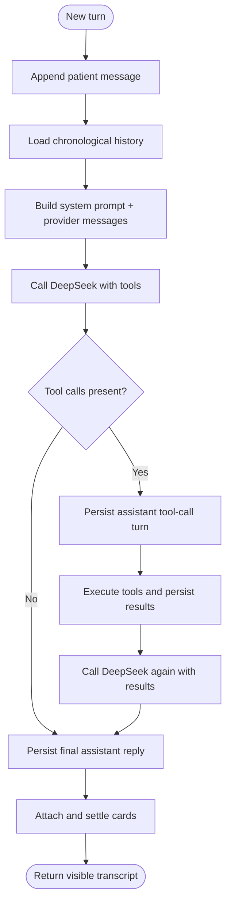

**Diagram sources**
- [backend/app/agent/runner.py:171-235](file://backend/app/agent/runner.py#L171-L235)
- [backend/app/agent/runner.py:409-557](file://backend/app/agent/runner.py#L409-L557)
- [backend/app/services/conversations.py:218-262](file://backend/app/services/conversations.py#L218-L262)
- [backend/app/services/conversations.py:285-331](file://backend/app/services/conversations.py#L285-L331)

**Section sources**
- [backend/app/services/conversations.py:1-14](file://backend/app/services/conversations.py#L1-L14)
- [backend/app/services/conversations.py:218-262](file://backend/app/services/conversations.py#L218-L262)
- [backend/app/services/conversations.py:285-331](file://backend/app/services/conversations.py#L285-L331)

### Deployment Topology
Docker Compose runs the FastAPI backend and React frontend. The backend exposes port 8000 internally and is health-checked. The frontend container depends on a healthy backend and exposes port 8080. nginx serves static assets, proxies `/api` to the backend, and forwards Swagger UI paths. SQLite data lives on a named volume so restarts preserve records.

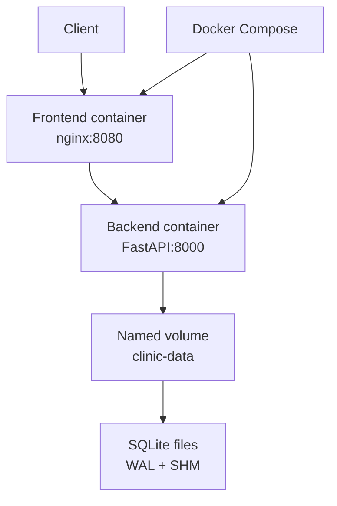

**Diagram sources**
- [docker-compose.yml:10-51](file://docker-compose.yml#L10-L51)
- [frontend/nginx.conf:1-51](file://frontend/nginx.conf#L1-L51)
- [backend/app/config.py:22-41](file://backend/app/config.py#L22-L41)
- [backend/app/db.py:108-118](file://backend/app/db.py#L108-L118)

**Section sources**
- [docker-compose.yml:1-51](file://docker-compose.yml#L1-L51)
- [frontend/nginx.conf:1-51](file://frontend/nginx.conf#L1-L51)
- [backend/app/config.py:22-41](file://backend/app/config.py#L22-L41)
- [backend/app/db.py:108-118](file://backend/app/db.py#L108-L118)

### Data Models and Enums
SQLAlchemy models define core entities and shared enums. Base types include UTC-aware timestamps, slot statuses, appointment statuses, proposal statuses, conversation states, message roles, staff roles, alert categories, and request types. These enums support deterministic state transitions and UI labeling.

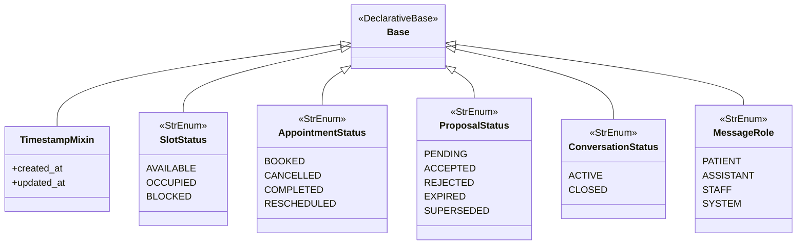

**Diagram sources**
- [backend/app/models/base.py:13-120](file://backend/app/models/base.py#L13-L120)

**Section sources**
- [backend/app/models/base.py:1-120](file://backend/app/models/base.py#L1-L120)

### AI Integration and Error Handling
The DeepSeek client implements strict timeouts, exponential backoff for transient failures, typed exceptions, and no logging of API keys or prompt contents. It normalizes responses into `AssistantTurn` objects, supports both standard tool calls and DSML markup, and emits observability metrics.

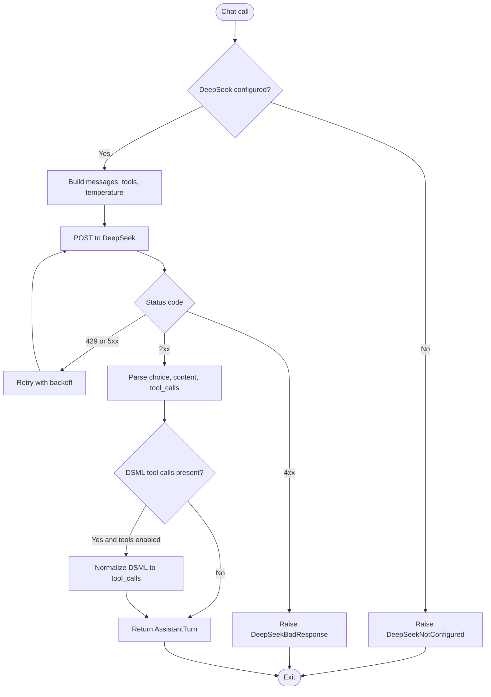

**Diagram sources**
- [backend/app/ai/deepseek.py:38-64](file://backend/app/ai/deepseek.py#L38-L64)
- [backend/app/ai/deepseek.py:205-249](file://backend/app/ai/deepseek.py#L205-L249)
- [backend/app/ai/deepseek.py:251-329](file://backend/app/ai/deepseek.py#L251-L329)

**Section sources**
- [backend/app/ai/deepseek.py:1-12](file://backend/app/ai/deepseek.py#L1-L12)
- [backend/app/ai/deepseek.py:205-249](file://backend/app/ai/deepseek.py#L205-L249)
- [backend/app/ai/deepseek.py:251-329](file://backend/app/ai/deepseek.py#L251-L329)

### Observability, Audit Logging, and Error Handling
FastAPI middleware adds request IDs, timing, structured logs, and consistent error responses. Database exceptions map to user-safe codes like conflict, unavailable, or internal error. DeepSeek failures are logged with type-only details and surfaced as degraded replies. Audit logging records sensitive mutations such as linking family members.

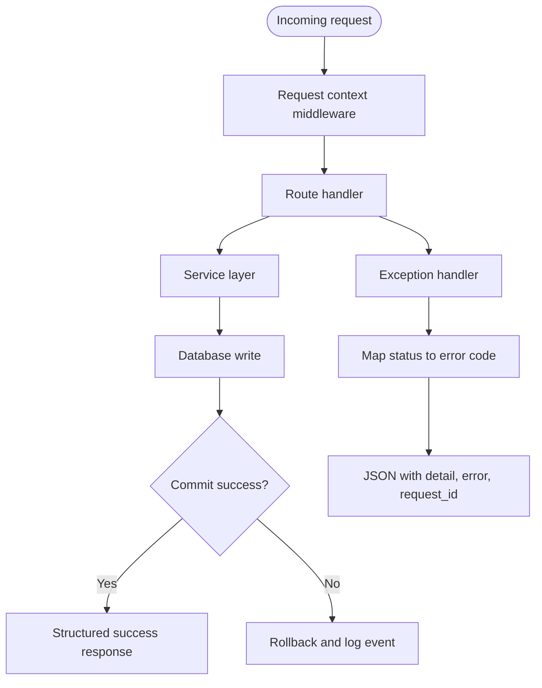

**Diagram sources**
- [backend/app/main.py:45-179](file://backend/app/main.py#L45-L179)
- [backend/app/agent/runner.py:264-292](file://backend/app/agent/runner.py#L264-L292)
- [backend/app/agent/tools.py:753-760](file://backend/app/agent/tools.py#L753-L760)

**Section sources**
- [backend/app/main.py:45-179](file://backend/app/main.py#L45-L179)
- [backend/app/agent/runner.py:264-292](file://backend/app/agent/runner.py#L264-L292)
- [backend/app/agent/tools.py:753-760](file://backend/app/agent/tools.py#L753-L760)

## Dependency Analysis
The following diagram shows how components depend on each other during a typical patient message flow.

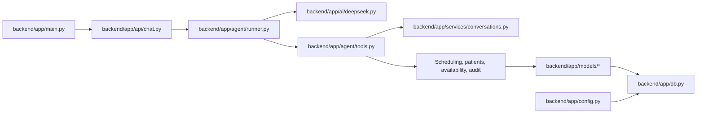

**Diagram sources**
- [backend/app/api/chat.py:233-274](file://backend/app/api/chat.py#L233-L274)
- [backend/app/agent/runner.py:171-235](file://backend/app/agent/runner.py#L171-L235)
- [backend/app/ai/deepseek.py:205-249](file://backend/app/ai/deepseek.py#L205-L249)
- [backend/app/agent/tools.py:703-739](file://backend/app/agent/tools.py#L703-L739)
- [backend/app/services/conversations.py:218-262](file://backend/app/services/conversations.py#L218-L262)
- [backend/app/db.py:52-64](file://backend/app/db.py#L52-L64)
- [backend/app/main.py:202-251](file://backend/app/main.py#L202-L251)
- [backend/app/config.py:69-84](file://backend/app/config.py#L69-L84)

**Section sources**
- [backend/app/api/chat.py:233-274](file://backend/app/api/chat.py#L233-L274)
- [backend/app/agent/runner.py:171-235](file://backend/app/agent/runner.py#L171-L235)
- [backend/app/agent/tools.py:703-739](file://backend/app/agent/tools.py#L703-L739)
- [backend/app/services/conversations.py:218-262](file://backend/app/services/conversations.py#L218-L262)
- [backend/app/db.py:52-64](file://backend/app/db.py#L52-L64)
- [backend/app/main.py:202-251](file://backend/app/main.py#L202-L251)
- [backend/app/config.py:69-84](file://backend/app/config.py#L69-L84)

## Performance Considerations
- DeepSeek client uses connect, read, and total timeouts with bounded retries and jitter to avoid amplifying transient failures.
- Conversation runner limits tool rounds and tool calls per round to prevent runaway loops.
- SQLite uses WAL mode, foreign keys, and busy timeout for safer concurrent reads and writes.
- NullPool avoids pooled connection handles during database recreation.
- Tool results are truncated to keep payloads within bounded sizes while preserving interactive cards.
- Health checks and dependency ordering ensure the frontend waits for a healthy backend.

[No sources needed since this section provides general guidance]

## Troubleshooting Guide
Common issues and mitigations:
- DeepSeek not configured: The assistant returns a degraded message indicating online assistance is unavailable.
- DeepSeek timeouts or rate limits: Bounded retries surface a friendly retry message; continued failure degrades gracefully.
- Database busy or locked: Returns a 503 with a retry hint; SQL text is never exposed.
- Integrity constraint violations: Returns a 409 conflict so clients refetch instead of assuming success.
- Stale or expired proposals: Confirmation revalidates availability; conflicts produce safe errors without claiming success.
- Session mismatch: Conversation lookup is scoped to the current patient session; guessing a conversation ID fails safely.
- Reset generation mismatch: Old browser state is invalidated after a demo reset.

Operational checks:
- Use the health endpoint to verify backend readiness.
- Follow backend and frontend logs via Docker Compose.
- Inspect SQLite files and sidecars when resetting the demo database.

**Section sources**
- [backend/app/ai/deepseek.py:44-64](file://backend/app/ai/deepseek.py#L44-L64)
- [backend/app/main.py:124-179](file://backend/app/main.py#L124-L179)
- [backend/app/api/chat.py:101-108](file://backend/app/api/chat.py#L101-L108)
- [docker-compose.yml:24-34](file://docker-compose.yml#L24-L34)

## Conclusion
The Oral-B Dental Care AI Receptionist demonstrates a practical balance between AI-driven conversation and deterministic safety. FastAPI routes expose typed APIs, the runner orchestrates bounded AI tool loops, tools validate inputs, services enforce business rules, and SQLite constraints protect critical state. The deployment topology keeps the system self-contained and inspectable, making it suitable for assessment and demonstration while leaving clear paths for production scaling.

[No sources needed since this section summarizes without analyzing specific files]