# Testing Strategy

<cite>
**Referenced Files in This Document**   
- [pyproject.toml](file://backend/pyproject.toml)
- [conftest.py](file://backend/tests/conftest.py)
- [test_search_after_decline.py](file://backend/tests/test_search_after_decline.py)
- [test_reschedule_workflow.py](file://backend/tests/test_reschedule_workflow.py)
- [test_family_scheduling_request.py](file://backend/tests/test_family_scheduling_request.py)
- [test_emergency_contact.py](file://backend/tests/test_emergency_contact.py)
- [test_deepseek_dsml.py](file://backend/tests/test_deepseek_dsml.py)
- [e2e_demo.py](file://backend/scripts/e2e_demo.py)
- [demo.py](file://backend/app/services/demo.py)
- [seed_fixtures.py](file://backend/app/seed_fixtures.py)
- [seed.py](file://backend/app/services/seed.py)
</cite>

## Update Summary
**Changes Made**   
- Updated End-to-End Demo Script section to reflect the comprehensive 7-scenario testing suite
- Added detailed coverage of all e2e scenarios including patient registration, booking flows, emergency triage, and privacy checks
- Enhanced architecture overview to show the complete testing pyramid
- Updated dependency analysis to include the new e2e demo script
- Expanded troubleshooting guide with e2e-specific guidance

## Table of Contents
1. [Introduction](#introduction)
2. [Project Structure](#project-structure)
3. [Core Components](#core-components)
4. [Architecture Overview](#architecture-overview)
5. [Detailed Component Analysis](#detailed-component-analysis)
6. [Dependency Analysis](#dependency-analysis)
7. [Performance Considerations](#performance-considerations)
8. [Troubleshooting Guide](#troubleshooting-guide)
9. [Conclusion](#conclusion)
10. [Appendices](#appendices)

## Introduction
This document describes the testing strategy for the dental scheduling system. It covers unit tests, integration tests, and comprehensive end-to-end scenarios; explains the pytest configuration, shared fixtures, database setup, and mock strategies for external dependencies such as DeepSeek; documents critical workflow coverage including patient registration, appointment booking, family coordination, emergency triage, and staff operations; and provides guidance for writing new tests, debugging failures, maintaining reliability, performance testing, and continuous integration practices.

The test suite is intentionally layered across three tiers:
- **Unit and service-layer tests** validate business logic against isolated SQLite databases without network dependencies.
- **Integration-style tests** drive tools, proposals, availability, and state transitions through the real service layer.
- **Comprehensive end-to-end scenarios** exercise the running API through realistic user interactions, including AI-driven conversations, real scheduling flows, family coordination, emergency handling, and privacy checks.

## Project Structure
The backend test infrastructure lives under `backend/tests`, with shared fixtures in `conftest.py` and per-workflow test modules. The comprehensive end-to-end harness is a standalone script under `backend/scripts` that drives the live chat endpoint through seven distinct scenarios. Seed data and demo statistics are defined in `app/seed_fixtures.py`, `app/services/seed.py`, and `app/services/demo.py`. Pytest configuration is declared in `backend/pyproject.toml`.

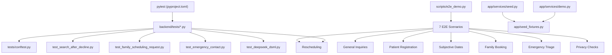

**Diagram sources**
- [pyproject.toml:22-30](file://backend/pyproject.toml#L22-L30)
- [conftest.py:1-137](file://backend/tests/conftest.py#L1-L137)
- [test_search_after_decline.py:1-152](file://backend/tests/test_search_after_decline.py#L1-L152)
- [test_reschedule_workflow.py:1-1247](file://backend/tests/test_reschedule_workflow.py#L1-L1247)
- [test_family_scheduling_request.py:1-593](file://backend/tests/test_family_scheduling_request.py#L1-L593)
- [test_emergency_contact.py:1-258](file://backend/tests/test_emergency_contact.py#L1-L258)
- [test_deepseek_dsml.py:1-95](file://backend/tests/test_deepseek_dsml.py#L1-L95)
- [e2e_demo.py:1-406](file://backend/scripts/e2e_demo.py#L1-L406)
- [demo.py:1-161](file://backend/app/services/demo.py#L1-L161)
- [seed_fixtures.py:1-592](file://backend/app/seed_fixtures.py#L1-L592)
- [seed.py:1-723](file://backend/app/services/seed.py#L1-L723)

**Section sources**
- [pyproject.toml:1-31](file://backend/pyproject.toml#L1-L31)
- [conftest.py:1-137](file://backend/tests/conftest.py#L1-L137)
- [e2e_demo.py:1-406](file://backend/scripts/e2e_demo.py#L1-L406)

## Core Components
This section summarizes the primary testing components and their responsibilities.

- **Pytest configuration**
  - Test discovery path: `backend/tests`.
  - Python path includes both the project root and the tests directory so that bare imports like `from conftest import SEARCH_PHRASE` work.
  - Import mode is set to `importlib` to support cross-module fixture imports without top-level name collisions.

- **Shared scenario fixture**
  - Creates a throwaway SQLite database per test run.
  - Sets up a provider, appointment type, verified patient session, conversation, and a two-week grid of open slots.
  - Temporarily replaces the application's engine, session factory, and path helpers so all services write to the isolated database.

- **Workflow-specific fixtures**
  - Some tests define their own lightweight fixtures (`db`, `world_session`) to control database lifecycle and world state precisely.

- **Comprehensive end-to-end demo harness**
  - A non-pytest script that drives the live chat endpoint through seven distinct scenarios: general inquiries, patient registration, subjective date handling, rescheduling, family booking, emergency triage, and privacy checks.
  - Uses stable assertions on replies and cards rather than brittle exact text matching.
  - Tracks failures and returns nonzero exit codes for CI integration.

- **Seed fixtures and demo statistics**
  - Deterministic seed definitions describe providers, patients, families, appointments, staff, alerts, pending requests, conversations, and proposals.
  - Idempotent seeding creates only missing rows and tracks counts.
  - Demo status aggregates public, non-sensitive metrics for health and readiness checks.

**Section sources**
- [pyproject.toml:22-30](file://backend/pyproject.toml#L22-L30)
- [conftest.py:39-137](file://backend/tests/conftest.py#L39-L137)
- [test_reschedule_workflow.py:106-294](file://backend/tests/test_reschedule_workflow.py#L106-L294)
- [e2e_demo.py:40-137](file://backend/scripts/e2e_demo.py#L40-L137)
- [seed_fixtures.py:1-592](file://backend/app/seed_fixtures.py#L1-L592)
- [seed.py:79-134](file://backend/app/services/seed.py#L79-L134)
- [demo.py:64-161](file://backend/app/services/demo.py#L64-L161)

## Architecture Overview
The testing architecture separates concerns across layers with clear boundaries between unit tests, integration tests, and comprehensive end-to-end scenarios:

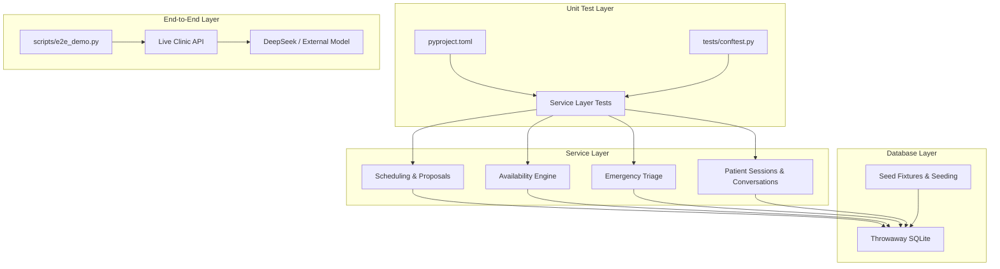

**Diagram sources**
- [pyproject.toml:22-30](file://backend/pyproject.toml#L22-L30)
- [conftest.py:39-137](file://backend/tests/conftest.py#L39-L137)
- [test_reschedule_workflow.py:301-336](file://backend/tests/test_reschedule_workflow.py#L301-L336)
- [test_family_scheduling_request.py:114-143](file://backend/tests/test_family_scheduling_request.py#L114-L143)
- [test_emergency_contact.py:51-97](file://backend/tests/test_emergency_contact.py#L51-L97)
- [e2e_demo.py:139-372](file://backend/scripts/e2e_demo.py#L139-L372)
- [seed.py:79-134](file://backend/app/services/seed.py#L79-L134)

## Detailed Component Analysis

### Pytest Configuration and Test Infrastructure
- **Discovery and paths**
  - `pythonpath` includes both the project root and `tests`, enabling direct imports from `conftest`.
  - `testpaths` points at `tests`.
  - `addopts` enables `--import-mode=importlib`, which is required when tests import other test modules by dotted path.

- **Shared fixture behavior**
  - The `scenario` fixture builds an isolated SQLite database using `tmp_path`.
  - It injects a fresh SQLAlchemy engine and session factory into the application's database module.
  - It also patches `get_engine` and `database_path` so internal helpers resolve the temporary file.
  - It seeds a provider, specialty, appointment type, verified patient session, conversation, and a two-week slot grid.
  - It restores previous database references in a `finally` block and disposes the engine.

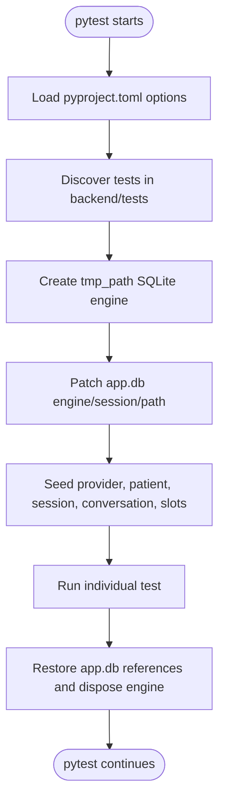

**Diagram sources**
- [pyproject.toml:22-30](file://backend/pyproject.toml#L22-L30)
- [conftest.py:39-137](file://backend/tests/conftest.py#L39-L137)

**Section sources**
- [pyproject.toml:22-30](file://backend/pyproject.toml#L22-L30)
- [conftest.py:39-137](file://backend/tests/conftest.py#L39-L137)

### Database Setup and Fixture Seeding
- **Throwaway databases**
  - Tests use `sqlite+pysqlite` URIs bound to files under `tmp_path`.
  - Engines are created via `create_db_engine`, preserving production pragmas such as WAL and busy timeout where applicable.
  - Global database accessors are temporarily replaced so services do not accidentally write to the project database.

- **Seed fixtures**
  - `seed_fixtures.py` defines deterministic data structures for providers, patients, families, appointment types, upcoming and past appointments, staff, alerts, pending requests, conversations, and proposals.
  - `seed.py` applies these fixtures idempotently, skipping existing rows and tracking counters.
  - Seeding generates a rolling horizon of availability slots and backfills historical slots needed by past appointments.
  - A manifest records fixture set, version, checksum, and application time.

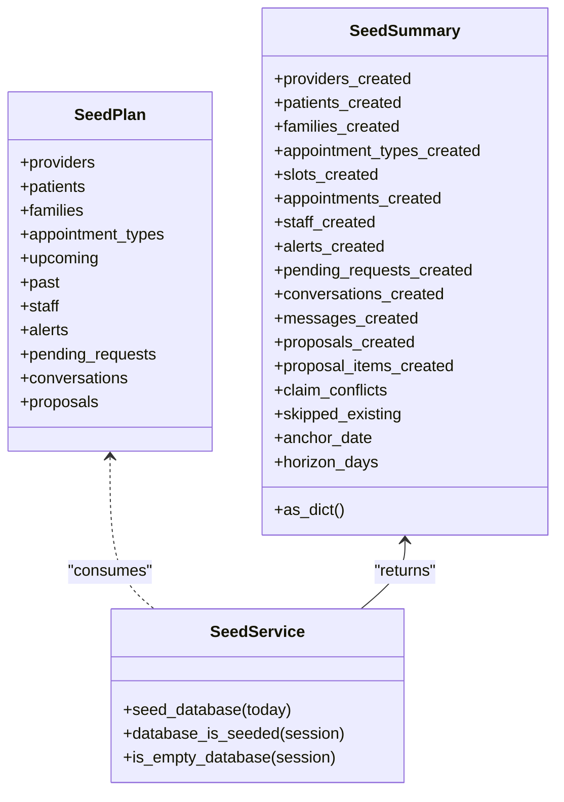

**Diagram sources**
- [seed_fixtures.py:557-592](file://backend/app/seed_fixtures.py#L557-L592)
- [seed.py:79-134](file://backend/app/services/seed.py#L79-L134)

**Section sources**
- [seed_fixtures.py:1-592](file://backend/app/seed_fixtures.py#L1-L592)
- [seed.py:79-134](file://backend/app/services/seed.py#L79-L134)
- [seed.py:339-433](file://backend/app/services/seed.py#L339-L433)
- [seed.py:436-515](file://backend/app/services/seed.py#L436-L515)

### Mock Strategies for External Dependencies
- **DeepSeek DSML parsing**
  - Tests verify that native DSML tool-call responses are normalized into valid JSON arguments.
  - Plain content without tool calls is preserved unchanged.
  - Tool promotion is gated by whether tools were offered in the request.
  - The HTTP client is patched with `unittest.mock.patch` to avoid network calls.

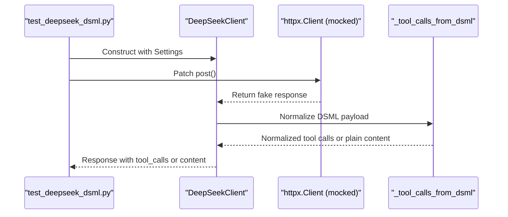

**Diagram sources**
- [test_deepseek_dsml.py:12-40](file://backend/tests/test_deepseek_dsml.py#L12-L40)
- [test_deepseek_dsml.py:62-95](file://backend/tests/test_deepseek_dsml.py#L62-L95)

**Section sources**
- [test_deepseek_dsml.py:1-95](file://backend/tests/test_deepseek_dsml.py#L1-L95)

### Comprehensive End-to-End Demo Script
The comprehensive end-to-end demo script is designed as a realistic scenario runner covering seven distinct workflows. It connects to a running clinic API and exercises the complete system through realistic user interactions:

#### Seven Core Scenarios

1. **General Inquiries** - Tests unregistered visitor interactions for insurance plans, self-pay options, location, and hours
2. **Patient Registration** - Validates complete new patient flow from registration through booking and cancellation
3. **Subjective Date Handling** - Exercises natural language date resolution including "later next week," "early next month," and invalid dates
4. **Rescheduling** - Tests existing patient verification and appointment rescheduling workflows
5. **Family Booking** - Validates multi-member family scheduling with back-to-back appointments
6. **Emergency Triage** - Tests emergency symptom reporting, callback collection, and escalation procedures
7. **Privacy Checks** - Ensures unverified visitors cannot access other patients' chart information

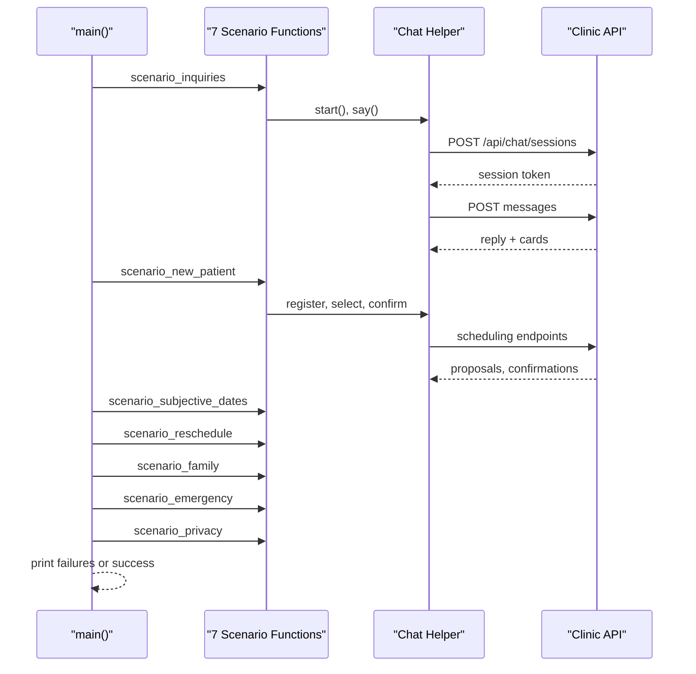

**Diagram sources**
- [e2e_demo.py:375-401](file://backend/scripts/e2e_demo.py#L375-L401)
- [e2e_demo.py:139-372](file://backend/scripts/e2e_demo.py#L139-L372)

**Section sources**
- [e2e_demo.py:1-406](file://backend/scripts/e2e_demo.py#L1-L406)

### Critical Workflow Coverage

#### Patient Registration and Booking
- **End-to-end scenario**
  - Starts a new chat session.
  - Registers a new patient through conversational input.
  - Offers slot cards for a cleaning.
  - Selects a slot to create a proposal.
  - Confirms the proposal to book the appointment.
  - Verifies idempotent replay of confirmation.
  - Exercises cancellation flow after booking.

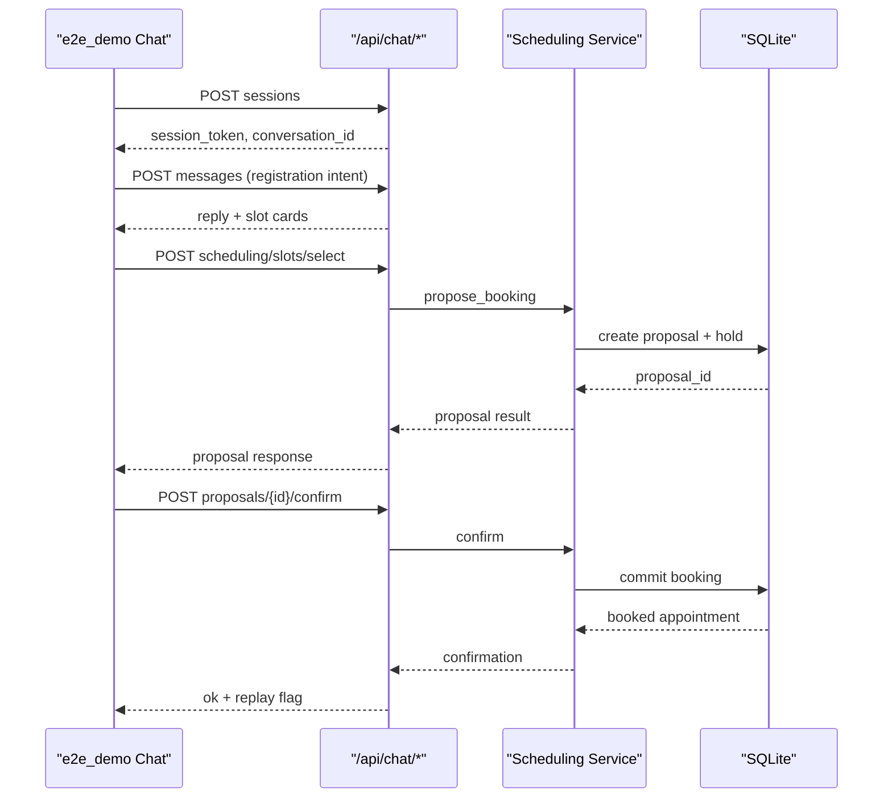

**Diagram sources**
- [e2e_demo.py:173-222](file://backend/scripts/e2e_demo.py#L173-L222)
- [e2e_demo.py:92-125](file://backend/scripts/e2e_demo.py#L92-L125)

**Section sources**
- [e2e_demo.py:173-222](file://backend/scripts/e2e_demo.py#L173-L222)

#### Subjective Date Handling
- The end-to-end script validates natural-language date resolution:
  - "Later next week" and "early next month."
  - Follow-up refinement to afternoon preference.
  - Rejection of impossible dates such as the 32nd of a month.

**Section sources**
- [e2e_demo.py:225-261](file://backend/scripts/e2e_demo.py#L225-L261)

#### Rescheduling
- Service-layer tests cover the complete reschedule workflow:
  - Successful move: original becomes rescheduled, replacement becomes booked, original slot freed, exactly one active appointment.
  - Decline and expiry: original remains untouched.
  - Conflict at confirmation: original stays booked, proposal remains pending.
  - Concurrent confirms: one moves the visit, the other replays.
  - Repeated confirmation: replays without creating duplicates.
  - Rollback: failure after releasing claims restores everything.
  - Routing and ownership: rescheduling uses its own tool and cannot consume another patient's appointment.

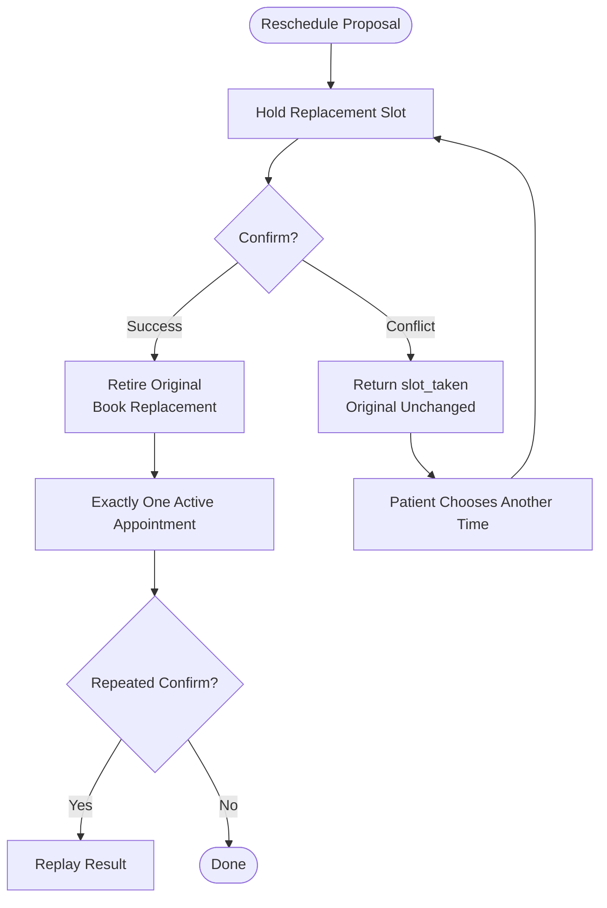

**Diagram sources**
- [test_reschedule_workflow.py:394-487](file://backend/tests/test_reschedule_workflow.py#L394-L487)
- [test_reschedule_workflow.py:627-701](file://backend/tests/test_reschedule_workflow.py#L627-L701)
- [test_reschedule_workflow.py:738-786](file://backend/tests/test_reschedule_workflow.py#L738-L786)

**Section sources**
- [test_reschedule_workflow.py:1-1247](file://backend/tests/test_reschedule_workflow.py#L1-L1247)

#### Family Coordination
- Service-layer tests cover family scheduling requests:
  - Extending an existing request without dropping the parent.
  - Expanding to every authorized child while keeping the requester.
  - Reusing an active hold for repeated selection.
  - Confirming family options books every household member.
  - Superseding older proposals when selecting different options.
  - Retiring old requests and holds when changing dates.
  - Refreshing alternative days while preserving stored requirements.
  - Escalation paths when availability fails.
  - Back-to-back multi-member search preferences and fallback behavior.

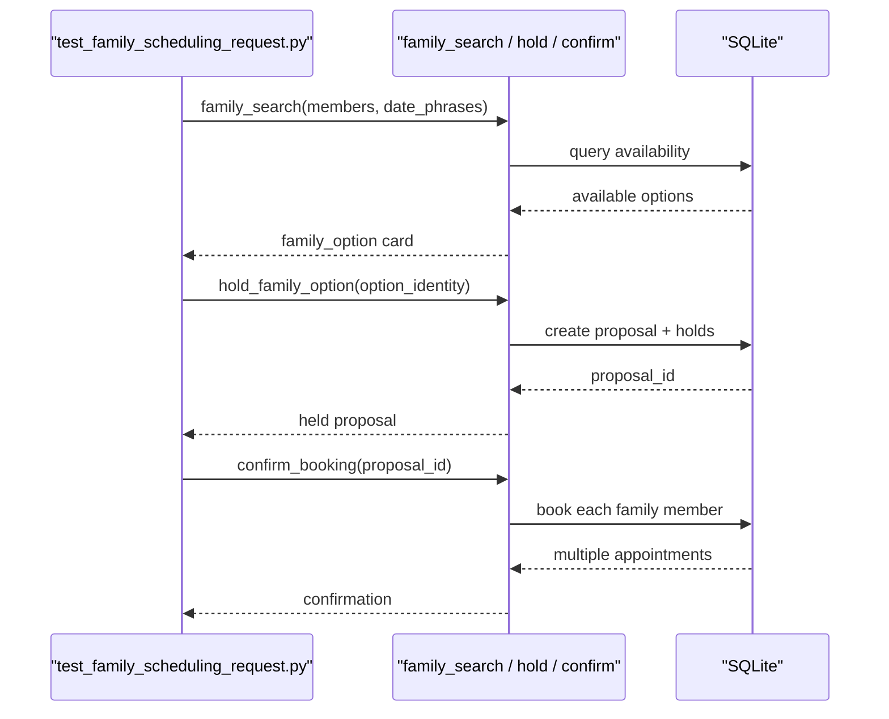

**Diagram sources**
- [test_family_scheduling_request.py:114-143](file://backend/tests/test_family_scheduling_request.py#L114-L143)
- [test_family_scheduling_request.py:173-206](file://backend/tests/test_family_scheduling_request.py#L173-L206)
- [test_family_scheduling_request.py:208-257](file://backend/tests/test_family_scheduling_request.py#L208-L257)
- [test_family_scheduling_request.py:259-305](file://backend/tests/test_family_scheduling_request.py#L259-L305)

**Section sources**
- [test_family_scheduling_request.py:1-593](file://backend/tests/test_family_scheduling_request.py#L1-L593)

#### Emergency Triage
- Tests enforce that emergency reports require contact details unless life-threatening.
- They assert that alerts include callback information and do not inadvertently verify the session.
- They verify follow-ups update the same alert and can reopen resolved cases.
- They ensure life-threatening reports bypass front-desk alerts and provide emergency guidance.
- They validate the staff board displays caller information correctly.

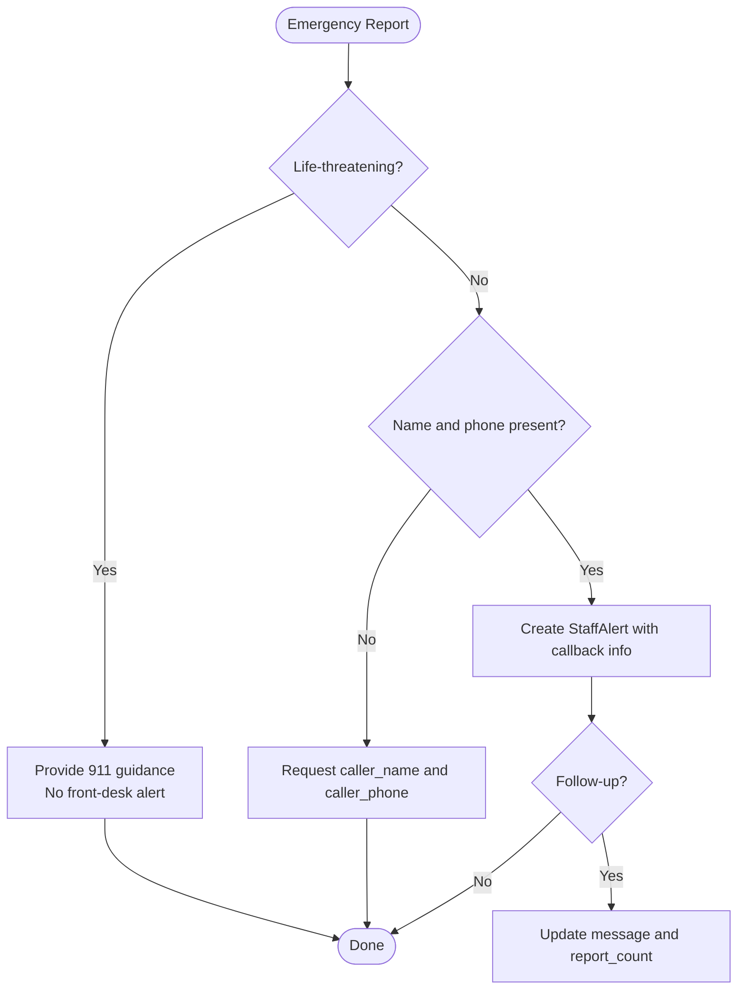

**Diagram sources**
- [test_emergency_contact.py:51-97](file://backend/tests/test_emergency_contact.py#L51-L97)
- [test_emergency_contact.py:109-161](file://backend/tests/test_emergency_contact.py#L109-L161)
- [test_emergency_contact.py:163-189](file://backend/tests/test_emergency_contact.py#L163-L189)

**Section sources**
- [test_emergency_contact.py:1-258](file://backend/tests/test_emergency_contact.py#L1-L258)

#### Privacy Checks
- The end-to-end script verifies that unverified visitors cannot read another patient's chart.
- Replies must refuse without verification and must not leak rescheduled appointment details or insurance names.

**Section sources**
- [e2e_demo.py:360-372](file://backend/scripts/e2e_demo.py#L360-L372)

## Dependency Analysis
The test modules depend on shared fixtures, service-layer functions, and model state. The most important dependency relationships are:

- `conftest.py` provides `scenario` used by several workflow tests.
- `test_search_after_decline.py` depends on `SEARCH_PHRASE` from `conftest` and exercises scheduling availability and proposal lifecycle.
- `test_reschedule_workflow.py` defines its own `db` and `world_session` fixtures to simulate concurrent database transactions and atomic state transitions.
- `test_family_scheduling_request.py` exercises family search, holds, supersession, refresh, and escalation paths.
- `test_emergency_contact.py` exercises triage validation, alert creation, follow-up updates, and staff board output.
- `test_deepseek_dsml.py` mocks HTTP calls and validates DSML normalization.
- `e2e_demo.py` orchestrates the complete system through seven distinct scenarios requiring a live API server.

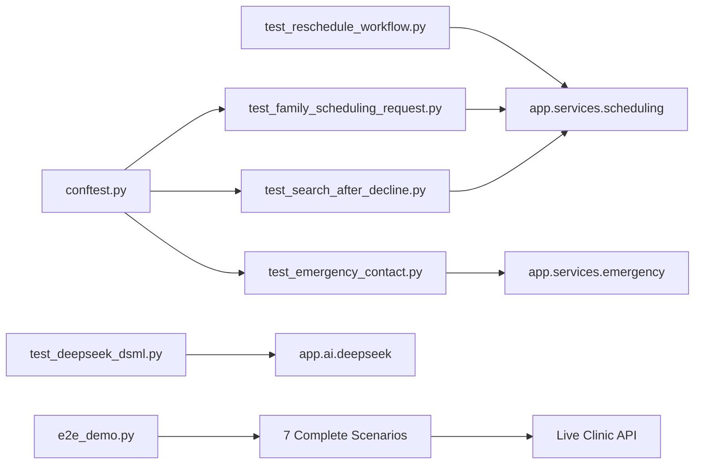

**Diagram sources**
- [conftest.py:39-137](file://backend/tests/conftest.py#L39-L137)
- [test_search_after_decline.py:19-25](file://backend/tests/test_search_after_decline.py#L19-L25)
- [test_reschedule_workflow.py:301-336](file://backend/tests/test_reschedule_workflow.py#L301-L336)
- [test_family_scheduling_request.py:114-143](file://backend/tests/test_family_scheduling_request.py#L114-L143)
- [test_emergency_contact.py:17-21](file://backend/tests/test_emergency_contact.py#L17-L21)
- [test_deepseek_dsml.py:8-9](file://backend/tests/test_deepseek_dsml.py#L8-L9)
- [e2e_demo.py:375-401](file://backend/scripts/e2e_demo.py#L375-L401)

**Section sources**
- [test_search_after_decline.py:1-152](file://backend/tests/test_search_after_decline.py#L1-L152)
- [test_reschedule_workflow.py:1-1247](file://backend/tests/test_reschedule_workflow.py#L1-L1247)
- [test_family_scheduling_request.py:1-593](file://backend/tests/test_family_scheduling_request.py#L1-L593)
- [test_emergency_contact.py:1-258](file://backend/tests/test_emergency_contact.py#L1-L258)
- [test_deepseek_dsml.py:1-95](file://backend/tests/test_deepseek_dsml.py#L1-L95)
- [e2e_demo.py:1-406](file://backend/scripts/e2e_demo.py#L1-L406)

## Performance Considerations
- **Use small, focused fixtures**
  - Prefer minimal worlds: one provider, one patient, and a narrow slot window when possible.
  - Avoid seeding the full demo dataset inside unit tests; reserve it for end-to-end or integration runs.

- **Control time deterministically**
  - Freeze clinic time where availability decisions matter, as seen in family scheduling tests.
  - Use explicit dates instead of relying on the current day.

- **Avoid unnecessary network calls**
  - Mock external clients such as DeepSeek when testing parsing or routing logic.
  - Keep e2e demo runs separate from fast unit suites.

- **Database isolation**
  - Ensure every test uses a fresh `tmp_path` SQLite file.
  - Dispose engines and restore global database accessors in teardown.

- **Concurrency testing**
  - Use threads and barriers to simulate concurrent confirmations, but keep thread count low to avoid flaky CI timeouts.

- **End-to-end performance**
  - The comprehensive e2e demo script should be run separately from unit tests due to its reliance on a live API server.
  - Consider parallelizing independent scenarios if the API supports it.
  - Monitor API response times during e2e runs to identify performance regressions.

[No sources needed since this section provides general guidance]

## Troubleshooting Guide
Common issues and how to address them:

- **Tests fail because they write to the project database**
  - Verify that the test fixture creates a temporary engine and patches `app.db._engine`, `_session_factory`, `get_engine`, and `database_path`.
  - Confirm that the fixture restores previous values in a `finally` block.

- **Flaky date-related tests**
  - Pin `BOOKING_DAY` or freeze `clinic_today` and `clinic_now`.
  - Use explicit ISO dates in search phrases.

- **Missing slots or unavailable grids**
  - Ensure the fixture or helper inserts enough `AvailabilitySlot` rows for the requested days.
  - Check that weekends are skipped when appropriate and that slot durations match `SLOT_MINUTES`.

- **Unexpected proposal state**
  - Inspect pending proposals, expired holds, and slot claims.
  - Use helpers like `release_expired_holds` and `find_by_public_id` to inspect state.

- **DeepSeek mocking failures**
  - Patch `httpx.Client` and return a structured response with `choices`, `finish_reason`, and `message.tool_calls`.
  - Assert both normalized tool calls and plain content paths.

- **End-to-end demo failures**
  - Check the base URL and server health before running scenarios.
  - Review printed replies and cards for each scenario step.
  - Reset the demo database after running the script if it mutates seeded state.
  - Verify that the API server has sufficient resources and is not rate-limited.

- **Scenario-specific issues**
  - **Registration failures**: Ensure the API is properly configured with patient registration enabled.
  - **Date resolution problems**: Verify that the AI model is responding correctly to natural language queries.
  - **Family booking issues**: Check that family relationships are properly established in the seed data.
  - **Emergency triage failures**: Confirm that emergency protocols are properly configured in the system.

**Section sources**
- [conftest.py:42-58](file://backend/tests/conftest.py#L42-L58)
- [conftest.py:130-137](file://backend/tests/conftest.py#L130-L137)
- [test_search_after_decline.py:28-56](file://backend/tests/test_search_after_decline.py#L28-L56)
- [test_family_scheduling_request.py:108-112](file://backend/tests/test_family_scheduling_request.py#L108-L112)
- [test_deepseek_dsml.py:62-95](file://backend/tests/test_deepseek_dsml.py#L62-L95)
- [e2e_demo.py:375-401](file://backend/scripts/e2e_demo.py#L375-L401)

## Conclusion
The testing strategy combines deterministic unit tests, service-layer integration tests, and a comprehensive end-to-end demo covering seven distinct scenarios. Shared fixtures isolate the database, seed data is idempotent and reproducible, and external dependencies are mocked where necessary. Critical workflows -- registration, booking, rescheduling, family coordination, emergency triage, and privacy -- are covered explicitly across all testing layers. For ongoing maintenance, prefer small fixtures, frozen time, explicit dates, isolated databases, and targeted mocks. Performance and CI should separate fast unit tests from heavier end-to-end runs, with the comprehensive e2e demo providing confidence in complete user workflows.

[No sources needed since this section summarizes without analyzing specific files]

## Appendices

### Writing New Tests
- Place workflow tests under `backend/tests`.
- Use `conftest.scenario` when you need a verified patient, conversation, and slot grid.
- Define local fixtures when you need precise control over database lifecycle or world state.
- Freeze clinic time for availability-dependent tests.
- Mock external APIs with `unittest.mock` when testing parsing or routing.
- Add assertions about both user-facing replies/cards and underlying state such as proposals, appointments, and slot claims.
- For end-to-end scenarios, consider adding new scenario functions to `e2e_demo.py` following the established pattern.

**Section sources**
- [conftest.py:39-137](file://backend/tests/conftest.py#L39-L137)
- [test_reschedule_workflow.py:106-129](file://backend/tests/test_reschedule_workflow.py#L106-L129)
- [test_family_scheduling_request.py:108-112](file://backend/tests/test_family_scheduling_request.py#L108-L112)
- [test_deepseek_dsml.py:62-95](file://backend/tests/test_deepseek_dsml.py#L62-L95)
- [e2e_demo.py:139-372](file://backend/scripts/e2e_demo.py#L139-L372)

### Test Data Management and Cleanup
- Seed fixtures are defined declaratively and applied idempotently.
- Seeding skips existing rows and tracks counters.
- Demo status exposes non-sensitive aggregate metrics.
- End-to-end scripts may mutate the live database; reset the demo database after runs.
- Each e2e scenario creates unique patient identifiers to avoid conflicts between runs.

**Section sources**
- [seed_fixtures.py:1-592](file://backend/app/seed_fixtures.py#L1-L592)
- [seed.py:79-134](file://backend/app/services/seed.py#L79-L134)
- [demo.py:1-161](file://backend/app/services/demo.py#L1-L161)
- [e2e_demo.py:1-13](file://backend/scripts/e2e_demo.py#L1-L13)
- [e2e_demo.py:27-29](file://backend/scripts/e2e_demo.py#L27-L29)

### Continuous Integration Practices
- Run pytest with the configured options so imports resolve correctly.
- Separate fast unit tests from end-to-end demo runs.
- Provide environment variables for the demo script when needed (for example, model keys).
- Reset the demo database before or after e2e runs to maintain deterministic state.
- Fail the pipeline if the demo script reports scenario failures.
- Monitor e2e scenario execution times to detect performance regressions.
- Consider running e2e scenarios in parallel if the API supports concurrent requests.

**Section sources**
- [pyproject.toml:22-30](file://backend/pyproject.toml#L22-L30)
- [e2e_demo.py:375-401](file://backend/scripts/e2e_demo.py#L375-L401)