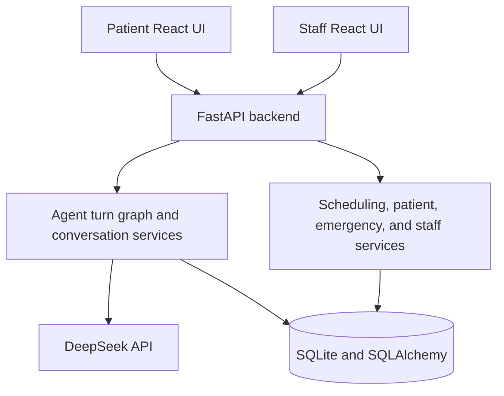

# Oral-B Dental Care AI Receptionist

A fictional dental practice receptionist. Patients use a conversational React UI to register, verify identity, ask clinic questions, and book cleaning, checkup, or emergency appointments; staff use a separate dashboard over the same SQLite database. The model interprets language, but Python and SQLite own validation, authorization, scheduling, and every state change. Clinic data and credentials are demonstration fixtures, not real practice data.

## Features

**Patient**

- Conversational chat with persisted history.
- Registration, and identity verification before any record or scheduling is exposed.
- Cleaning, checkup, and emergency requests; natural-language dates in the clinic timezone.
- Provider, type, and time preferences; clickable availability cards that create a proposal and never book by themselves.
- Explicit confirmation before any booking, reschedule, or cancellation.
- Answers on insurance, self-pay, membership, financing, payment, hours, location, and policies from configured data.
- A rateable final assistant turn (thumbs up, or thumbs down with an optional comment) surfaced in staff.

**Complex scheduling**

- Family bookings with a separate patient, type, duration, and provider eligibility per member.
- Coordinated back-to-back options when the requested shape can be satisfied.
- One atomic confirmation per family proposal.
- Booking-policy checks that stop an existing visit or pending request from silently becoming an extra one.

**Staff**

- Demo auth with server-side sessions, an HttpOnly cookie, and CSRF protection for writes.
- Appointment and patient views, pending/handoff queue, and an emergency alert board.
- Conversation feedback: positive share, counts, and the rated reply with any comment.
- Create, reschedule, cancel, and complete appointments; the dashboard refreshes after mutations.

## Technology stack

| Area        | Technology                                              | Why                                                   |
| ----------- | ------------------------------------------------------ | ----------------------------------------------------- |
| Frontend    | React 18, TypeScript, Vite, Lucide React               | Typed client for chat, cards, and staff screens.      |
| Backend     | Python 3.12, FastAPI, Pydantic                         | Typed APIs and deterministic workflow boundaries.     |
| Agent       | LangGraph 1.2 (compiled StateGraph, no checkpointer)   | Bounded turn routing between model rounds and tools.  |
| AI          | DeepSeek (OpenAI-compatible chat API)                  | Natural-language interpretation and tool selection.   |
| Persistence | SQLite, SQLAlchemy 2 (WAL, foreign keys)               | Compact, inspectable relational store.                |
| Runtime     | Docker Compose, nginx                                  | Reproducible backend and frontend startup.            |

The model-facing surface is small: appointment decisions stay in Python and SQLite, where the state transitions are inspectable.

## Architecture



Both UIs are separate frontend paths that call the same FastAPI. For each message, FastAPI resolves the session token, loads the session-owned conversation, persists the message, and builds chronological history plus clinic facts and tools. A compiled LangGraph turn graph (ingest, model round, tools, finalize) drives the turn: DeepSeek picks a tool, Pydantic validates its arguments, a deterministic service runs, and results return to the next round under a bounded budget. The reply and structured cards are persisted and rendered by React. The model cannot assert identity, invent policy, or confirm a booking, and direct card actions call deterministic endpoints rather than the model.

## Getting started

```bash
git clone https://github.com/gokulkaarthicks/dental-chatbot.git
cd dental-chatbot
cp .env.example .env
```

Put the DeepSeek key in `.env` (read by the backend container only):

```dotenv
DEEPSEEK_API_KEY=your_key_here
DEEPSEEK_MODEL=deepseek-flash
DEEPSEEK_BASE_URL=https://api.deepseek.com
```

Start it:

```bash
docker compose up --build -d
```

- Patient chat: [http://localhost:8080](http://localhost:8080)
- Staff dashboard: [http://localhost:8080/staff](http://localhost:8080/staff) (seeded login `root` / `root`)
- API: [http://localhost:8000](http://localhost:8000) · Swagger: [/docs](http://localhost:8000/docs) · Health: [/api/health](http://localhost:8000/api/health)

## Demo database and commands

Startup creates the schema and seeds an empty database: providers, patients in family groups, appointment types, 60 days of availability, appointments, staff, pending requests and alerts, conversations, proposals, and audit/idempotency rows. Seed keys make reseeding idempotent.

| Command                        | Behavior                                                                     |
| ------------------------------ | --------------------------------------------------------------------------- |
| `make seed`                    | Inserts missing fixtures without deleting existing records.                 |
| `make reset-demo`              | Recreates the DB, reseeds, issues a new reset generation, restarts services. |
| `make demo-status`             | Prints the fixture summary as JSON.                                         |
| `make backend-logs` / `make frontend-logs` | Follows service logs.                                            |
| `docker compose up --build -d` | Builds and starts both services.                                            |
| `docker compose down`          | Stops services and preserves the named volume.                              |

SQLite lives on the named `dental-receptionist-clinic-data` volume, so a restart preserves records. `make reset-demo` deletes the database and its sidecars and invalidates old sessions, proposals, and idempotency rows. `docker compose down -v` also removes the volume.

## Clinics and tenancy

The demo ships more than one clinic, and the API is tenant-aware. `GET /api/clinic` lists the active clinics; every other request picks one with the `X-Clinic` header, which takes either a slug or a numeric id, and falls back to the default clinic when the header is absent.

A credential outranks the header. A patient or staff token belongs to exactly one clinic, so once one is presented it *is* the tenant authority -- otherwise a leaked token could be replayed against any clinic. Presenting a token under a different clinic's header returns `403` rather than a misleading `404`.

Isolation is enforced below the service layer, not by remembering to add a filter:
`before_flush` rejects a clinic-owned row that is inserted, updated, or deleted under another clinic's session, and a `do_orm_execute` hook scopes every select to the session's tenant. Core `session.execute(delete(...))` never populates `session.deleted`, so the demo reset's admin-level wipe is deliberately outside that net and scopes itself.

## Core workflows

- **Registration:** collect name, US phone, date of birth, and insurance; normalizers reject malformed or ambiguous input, and a patient is created only when required fields are valid.
- **Booking:** the agent derives type, date window, provider, and time. Availability filters business hours, eligibility, duration, existing appointments, staff blocks, and active claims, all in the clinic's own timezone (each tenant carries its own, so the demo's second clinic runs on a different clock and grid than the first). Slot cards create a 2-minute hold; the patient must confirm; "Change" releases the hold immediately; confirmation rechecks live availability before writing.
- **Existing patients:** verify with registration identity, then list, reschedule, or cancel; ownership is checked before any change.
- **Family:** each member is tracked independently. A verified patient may book for anyone in the same household, but others' history and insurance stay private without their own verification. One card, one atomic confirmation, rollback on conflict.
- **Emergency:** Python triage checks symptoms first. Life-threatening indicators get immediate 911/ER guidance before registration or search; other urgent reports need a callback name and valid US phone and create a staff alert. No external notification is implemented.
- **Inquiries:** insurance, payment, hours, location, and contact answers come from configured policy data; the assistant relays facts rather than inventing coverage or prices.

## Reliability and integrity

Availability is 30-minute provider slots consumed contiguously. `SlotClaim` links an appointment or proposal to each interval, and a database uniqueness constraint allows only one active claim per slot, the load-bearing overlap protection.

Proposals run under `BEGIN IMMEDIATE`, revalidate intervals, and record holds. Holds last 2 minutes (`HOLD_MINUTES`) and release early on a new search or "Change"; an expired hold frees the slot but leaves the proposal, which may still be confirmed after a fresh recheck or reports a conflict if taken. Confirmation takes another `BEGIN IMMEDIATE`, revalidates, releases holds, writes the appointment or family group, and marks the proposal accepted: all-or-nothing, rolling back on failure.

Client and confirmation keys make retries idempotent, so replaying an accepted confirmation returns the committed result. Stale, superseded, and rejected cards leave the actionable UI. Rescheduling names the verified appointment it replaces: success marks the original `rescheduled`, preserves its history, and creates a new row via `rescheduled_from_id`; rejection, expiry, or conflict leaves the original booked.

## Conversations

Sessions use opaque tokens; messages and tool-call records live in SQLite and are sent to DeepSeek every turn (history is not summarized or trimmed). Refresh restores the thread from SQLite with live pending proposals so cards reconcile with database state, and a new conversation starts a fresh thread without deleting history. A reset-generation mismatch invalidates old browser state, sessions, and proposals. The last assistant turn can be rated; a thumbs-down takes an optional comment stored against that message and shown at `/staff#/feedback`.

## Error handling

- Invalid fields return validation feedback with no partial records.
- Unavailable, conflicting, expired, or stale actions return a safe error and require a fresh action.
- Duplicate clicks and confirmation retries use idempotency records.
- DeepSeek timeouts and transient 5xx failures use bounded retries; continued failure returns a degraded fallback, never a false success.
- Database and transaction failures roll back; booking success is returned only after a post-commit read-back.
- Expired or reset sessions require a new session; staff sessions cannot access patient routes.

Structured logs include request IDs and event names; API keys and patient details are scrubbed.

## Testing

```bash
cd backend
pytest
```

This requires Python 3.12 and the backend dependencies. To set up locally:

```bash
python3.12 -m venv .venv
source .venv/bin/activate
python -m pip install -r backend/requirements.txt pytest ruff
```

The push hook runs **ruff auto-fix → ruff check → pytest**; install it once per clone with `make hooks`. Auto-fixable issues are folded into the push, failures abort it, and a single push can bypass with `git push --no-verify`.

| Command      | Behavior                                             |
| ------------ | ---------------------------------------------------- |
| `make hooks` | Installs the `pre-push` hook into `.git/hooks`.      |
| `make check` | Runs the same gate manually.                         |
| `make lint`  | Auto-fixes and reports backend lint issues.          |
| `make test`  | Runs backend tests only.                             |

The scripted end-to-end check drives a running server through the scenarios with the real model (inquiries, registration and booking, subjective dates, rescheduling, family booking, emergency triage, cancellation, privacy):

```bash
# with the containers running and DEEPSEEK_API_KEY set
python backend/scripts/e2e_demo.py --base http://localhost:8000
```

It writes appointments into the demo database; run `make reset-demo` afterwards.

## Design decisions

One conversational agent, because the receptionist needs one coherent workflow: FastAPI tools are the language boundary, and deterministic services enforce identity, appointment rules, transactions, and authorization. SQLite keeps the demo self-contained and inspectable. Correctness (identity, atomic bookings, concurrency, and recoverable failure) ranks above extra AI capability.

| Priority | Focus                                              | Reason                                                    |
| -------- | -------------------------------------------------- | --------------------------------------------------------- |
| 1        | Identity and authorization                         | Records must not be exposed to the wrong session.         |
| 1        | Deterministic booking and rescheduling             | A fluent answer is not useful if database state is wrong. |
| 1        | Holds, conflict checks, idempotency, and rollback  | Actions can be retried or race with another writer.       |
| 2        | Conversation persistence and cards                 | Multi-turn scheduling needs recoverable context.          |
| 2        | Staff handoff and emergency alerts                 | Exceptions need a visible operational path.               |
| 3        | Additional assistant capabilities                  | Useful only after core scheduling is trustworthy.         |

Load-bearing: deterministic booking, identity and household authorization, atomic family confirmation, emergency escalation, idempotent retries, and a staff-visible exception queue. Nice-to-have but compounding: persisted conversations, clickable availability, hold expiry, and the staff dashboard.

Key failure modes and mitigations: double-booking and stale-card confirmations are blocked by unique active claims, `BEGIN IMMEDIATE` revalidation, fresh-availability checks, and idempotency keys; chart leaks are blocked by phone plus date-of-birth verification and session-scoped lookup, with the household link granting booking but not read; model outages degrade to a message that never claims success plus a staff follow-up path; and under-triaged emergencies are caught by Python red-flag checks before registration.

## Production scaling

This runs a handful of demo clinics on one SQLite database. Every clinic-owned
row carries `clinic_id`, selects are scoped to the request's tenant by a
`do_orm_execute` hook, and `before_flush` rejects a row written or deleted under
another clinic's session. A request picks its tenant with an `X-Clinic` header
(slug or numeric id); a real patient or staff token outranks the header, since a
credential belongs to exactly one clinic. For hundreds of locations and 10,000+
daily conversations I would: move transactional data to PostgreSQL while keeping
the same constraints; harden the tenant defaults further (row-level security, not
just the ORM hook); make timezone, hours, holidays, types, provider rules, and
policies versioned config; replace demo credentials with managed identity, MFA,
RBAC, and revocation; run stateless replicas with a distributed booking strategy;
make alerts and retries durable background jobs; add metrics, traces, and
on-call runbooks; apply per-tenant rate and cost limits; integrate EHR through
idempotent adapters; and add privacy controls, staged rollout, and tested
rollback. These are proposed changes, not capabilities claimed by this
repository.

## Limitations

- The clinic, patients, providers, appointments, policies, and contact details are fictional fixtures.
- `root` / `root` is demo-only and has no production identity system or MFA.
- SQLite and one named Docker volume are not multi-location write infrastructure.
- There is no live EHR integration; insurance answers are configured text, not eligibility checks.
- There is no real payment processing or voice calling; emergency alerts are stored for staff review with no external SMS, paging, or emergency-service integration.
- DeepSeek is required for normal conversation; the fallback cannot replace receptionist workflow.

## Repository structure

```text
.
├── backend/
│   ├── app/
│   │   ├── agent/       # LangGraph turn graph, prompts, tool registry + domains
│   │   ├── ai/          # DeepSeek client and provider errors
│   │   ├── api/         # chat, scheduling, staff, health, clinic, demo routes
│   │   ├── models/      # SQLAlchemy models and state enums
│   │   ├── services/    # patients, conversations, availability, booking, staff, alerts
│   │   ├── cli.py       # seed, reset-demo, demo-status
│   │   ├── db.py        # engine and SQLite pragmas
│   │   ├── migrations.py
│   │   ├── seed_templates.py  # clinic facts as literals (seeding path only)
│   │   ├── seed_fixtures.py   # providers, patients, availability, appointments
│   │   └── seed_tenants.py    # one row plan per demo clinic
│   ├── tests/           # backend automated tests
│   ├── scripts/         # migration check + end-to-end demo script
│   ├── pyproject.toml   # ruff + pytest configuration
│   ├── Dockerfile
│   └── requirements.txt
├── frontend/
│   ├── src/
│   │   ├── api/         # typed patient and staff clients
│   │   ├── components/  # shared UI and appointment cards
│   │   ├── hooks/       # chat, session, reset-generation, API hooks
│   │   ├── lib/         # pure helpers: card types, live cards, clinic, staff formatting
│   │   ├── pages/       # chat, overview, and the staff dashboard under staff/
│   │   └── styles/      # design tokens + patient chat and card styles
│   ├── Dockerfile
│   └── nginx.conf
├── scripts/             # pre-push lint + test gate (git hooks)
├── Makefile
├── docker-compose.yml
├── docker-compose.dev.yml
└── .env.example
```

The three `seed_*.py` modules sit at the `app/` root rather than in `services/`
because they hold literal demo data, not behaviour: `seed_templates.py` (clinic
facts), `seed_fixtures.py` (providers, patients, availability), and
`seed_tenants.py` (the tenant plans). `services/seed.py` and
`services/reset.py` are the code that writes them. `pyproject.toml` enforces
the split with a banned-import rule, so request-time code cannot read the
template literals and pin every clinic to one tenant's answers.

The staff dashboard keeps its hook and stylesheet beside it
(`pages/staff/useStaffData.ts`, `pages/staff/staff.css`) rather than in `hooks/`
and `styles/`: both are scoped to that one surface, and `staff.css` prefixes
every selector with `sd-` so it cannot leak into the patient chat.

## Demo video

https://www.loom.com/share/de046be08c204110959007fedcd38d00