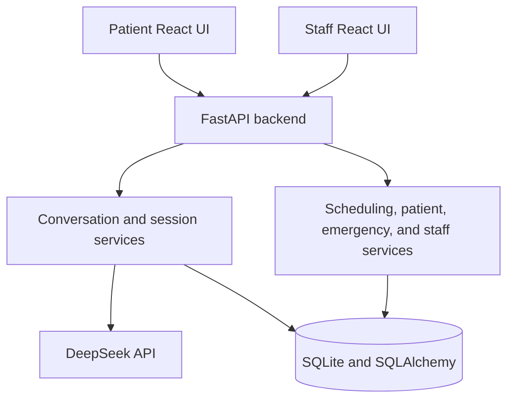

# Oral-B Dental Care AI Receptionist

This repository contains a fictional dental practice receptionist for Oral-B Dental Care in San Francisco. Patients use a conversational React interface to register, verify their identity, ask clinic questions, and manage cleaning, checkup, and emergency appointments. The receptionist understands natural language, but the backend owns validation, authorization, scheduling, and database changes.

Staff use a separate dashboard backed by the same SQLite database. It provides appointment and patient views, pending requests, emergency alerts, and staff actions such as booking, rescheduling, cancelling, and completing appointments. The clinic data and credentials are demonstration fixtures, not real practice data.

## Features

### Patient experience

- Conversational patient interface with persisted conversation history.
- New-patient registration with name, phone, date of birth, insurance, and validation.
- Existing-patient verification before patient records or scheduling are exposed.
- Cleaning, general checkup, and emergency appointment requests.
- Natural-language date and time preferences in the clinic timezone.
- Provider, appointment-type, and time preferences.
- Clickable availability cards. Selecting a card creates a proposal and does not book by itself.
- Explicit confirmation before a booking, reschedule, or cancellation is committed.
- Appointment listing, rescheduling, and cancellation after verification.
- Answers about insurance, self-pay, payment methods, hours, location, and clinic policies from configured practice data.

### Complex scheduling

- Family bookings with a separate patient, appointment type, duration, and provider eligibility for each participant.
- Coordinated contiguous, back-to-back options when the requested family shape can be satisfied.
- One confirmation transaction for a family proposal. The requested participant count is preserved.
- Booking-policy checks that prevent an existing patient or pending request from silently becoming an additional visit.

### Staff operations

- Demo staff authentication with server-side sessions, an HttpOnly session cookie, and CSRF protection for writes.
- Appointment and patient records from the same database used by patient chat.
- Pending request and handoff queue.
- Emergency alert board with acknowledgement and resolution actions.
- Staff appointment creation, rescheduling, cancellation, and completion.
- Dashboard refresh after staff mutations so the displayed state follows the database.

## Technology stack

| Area | Technology | Why it is used here |
| --- | --- | --- |
| Frontend | React 18, TypeScript, Vite, Lucide React | Typed client for chat, cards, clinic overview, and staff screens. |
| Backend | Python 3.12, FastAPI, Pydantic | Typed HTTP APIs and deterministic workflow boundaries. |
| AI | DeepSeek API through its OpenAI-compatible chat interface | Natural-language interpretation and tool selection. |
| Persistence | SQLite, SQLAlchemy 2, SQLite WAL and foreign keys | Compact relational persistence for the assessment demo. |
| Runtime | Docker Compose, nginx | Reproducible backend and frontend startup. |

The model-facing surface is small. Appointment decisions stay in Python and SQLite, where the state transitions are inspectable.

## Architecture



The patient and staff interfaces are separate frontend paths, but both call FastAPI. Services cover conversations, patient sessions, registration, verification, scheduling, emergencies, staff authentication, and handoff. SQLAlchemy models cover patients, providers, appointment types, availability, slot claims, appointments, booking groups, proposals, conversations, sessions, alerts, requests, audit records, and idempotency records.

For a patient message, FastAPI resolves the opaque session token, loads the session-owned conversation, persists the incoming message, and builds the full chronological history with clinic facts and tools. DeepSeek interprets the request and may request a tool. Pydantic validates its arguments, FastAPI executes the deterministic service, and tool results return to the bounded conversation loop. The final response and structured cards are persisted and rendered by React.

The model decides how to interpret language and which allowed tool to request. It cannot assert identity, invent clinic policy, or confirm a booking. Direct card actions call deterministic scheduling endpoints instead of making another model request.

## Getting started

```bash
git clone <repository-url>
cd dental-resonate
cp .env.example .env
```

Put the DeepSeek key in `.env`:

```dotenv
DEEPSEEK_API_KEY=your_key_here
DEEPSEEK_MODEL=deepseek-flash
DEEPSEEK_BASE_URL=https://api.deepseek.com
```

The key is read by the backend container only. Start the application with:

```bash
docker compose up --build -d
```

Open http://localhost:8080 for patient chat and http://localhost:8080/staff for the staff dashboard. The seeded demo login is `root` / `root`. The backend is at http://localhost:8000, Swagger UI is at http://localhost:8000/docs, and health is at http://localhost:8000/api/health. The frontend nginx proxy also exposes Swagger UI at http://localhost:8080/docs.

## Demo database and development commands

Startup creates the schema and seeds an empty database. Fixtures contain three providers, eight patients in two family groups, three appointment types, 60 days of 30-minute availability per provider, six upcoming appointments, three completed visits, staff records, pending requests and alerts, conversations, proposals, audit rows, and idempotency rows. Seed keys make repeated seeding idempotent.

| Command | Behavior |
| --- | --- |
| `make seed` | Inserts missing fixtures without deleting existing records. |
| `make reset-demo` | Stops writers, recreates the database, reseeds, issues a new reset generation, and restarts services. |
| `make demo-status` | Prints the fixture summary as JSON. |
| `make backend-logs` | Follows backend logs. |
| `make frontend-logs` | Follows frontend logs. |
| `docker compose up --build -d` | Builds and starts both services. |
| `docker compose logs -f` | Follows both services. |
| `docker compose ps` | Shows service status. |
| `docker compose down` | Stops services and preserves the named volume. |

An ordinary restart preserves records because SQLite is stored on the named `dental-receptionist-clinic-data` volume. `make reset-demo` deletes the database and its WAL and shared-memory sidecars, recreates the schema, and invalidates prior conversation IDs, patient sessions, staff sessions, pending proposals, and idempotency records. `docker compose down -v` also removes the volume.

## Core workflows

### New patient registration

The receptionist collects a name, US phone number, date of birth, and insurance choice. Backend validators normalize names and phones, reject malformed or ambiguous dates, and accept configured plans or self-pay. A patient is created only after required fields are valid. Scheduling becomes available after registration.

### Appointment booking

The agent identifies appointment type, date window, provider preference, and time preference. Availability filters business hours, provider eligibility, duration, existing appointments, staff blocks, and active claims. Natural-language dates use `America/Los_Angeles`; ambiguous and impossible dates are surfaced.

The UI displays slots as cards. A click creates a pending proposal and holds the time for 2 minutes. The patient must confirm. Asking for other times ("Change") releases the hold immediately rather than at the end of the window. Confirmation rechecks the slots and writes the appointment only after the recheck succeeds.

### Existing patients

Existing patients verify with the registration identity fields required by the workflow. A verified patient can list upcoming appointments, request a reschedule, or request cancellation. The backend checks ownership before changing a target appointment.

### Family scheduling

The conversation tracks each family member independently. Each item has its patient, appointment type, duration, provider constraints, and slot. The scheduler preserves the requested participant count and confirms the complete family proposal atomically. A conflict rolls back the whole group.

### Emergency escalation

Python triage checks symptoms. Airway or other life-threatening indicators receive immediate 911 or emergency-room guidance before registration, verification, or availability search. Other urgent reports require a callback name and valid US phone number, then create a staff alert. Alerts are stored for staff review; no external notification is implemented.

### General inquiries

Insurance, self-pay, payment, hours, location, and contact answers come from configured clinic policies and insurance data. The assistant is instructed to relay those facts rather than invent coverage or prices.

## Scheduling reliability and data integrity

Availability is represented as 30-minute provider slots. Appointment types consume contiguous slots. `SlotClaim` joins an appointment or proposal to each interval, and a database uniqueness constraint permits only one active claim per slot. Service checks provide useful messages; the database constraint is the load-bearing overlap protection.

Proposal creation runs under `BEGIN IMMEDIATE`, revalidates intervals, and records active holds. Holds last 2 minutes (`HOLD_MINUTES`) and are released earlier whenever the patient changes their mind: a new search, or a "Change" click, hands the time back in the same turn. A hold window passing frees the interval but not the choice — the card stays confirmable, and confirmation revalidates the interval before booking it. Confirmation uses another `BEGIN IMMEDIATE`, revalidates all intervals, releases holds, creates the appointment or appointments, and marks the proposal accepted. A failure rolls back the transaction.

Client create keys and confirmation keys provide idempotent retries. Replaying an accepted confirmation returns the committed result rather than creating another booking. Stale cards and expired proposals are rejected and removed from the actionable UI. A conflict cannot produce a success response.

Rescheduling is distinct from a new booking. A reschedule proposal names the verified appointment it replaces. Successful confirmation marks the original `rescheduled`, preserves its historical time and provider, and creates a new booked row linked through `rescheduled_from_id`. Old claims are released in the same transaction. A rejection, expiry, or conflict leaves the original booked. An explicitly requested additional visit does not cancel the existing appointment.

Family confirmation writes all members in one transaction. Patient ownership is checked for the requesting conversation, and booking policy prevents a second active visit unless an additional visit was explicitly requested. These guarantees depend on the current SQLite transactions and constraints, not distributed booking coordination.

## Conversation management

Patient sessions use opaque tokens. Conversations and messages are stored in SQLite and linked to their owning session. Full chronological history, including tool-call records needed by the runner, is sent to DeepSeek on every turn. The current implementation does not summarize or automatically trim history.

Refresh restores the conversation from SQLite. The server returns live pending proposals so cards can be reconciled with database state. Starting a new conversation creates a separate thread without deleting prior history. A reset-generation mismatch invalidates old browser state, sessions, and proposals. Session-scoped lookup prevents access by guessing a conversation ID.

## Error handling and fallback behavior

- Invalid registration fields return validation feedback without partial patient records.
- Unavailable, conflicting, expired, or stale scheduling actions return a safe error and require a fresh action.
- Duplicate card clicks and confirmation retries use idempotency records.
- DeepSeek timeout and transient 5xx failures use bounded retries. Continued failure returns a degraded fallback rather than claiming success.
- Database and transaction failures roll back writes. Booking success is returned only after post-commit read-back.
- Expired or reset-invalid sessions require a new session. Staff sessions are separate and cannot access patient routes.
- Life-threatening symptoms receive immediate emergency guidance. Other alerts are filed only when callback details are valid.

Structured logs include request IDs and operational event names. API keys and patient details are excluded or scrubbed from logged fields.

## Testing and validation

[`MANUAL_VALIDATION.md`](./MANUAL_VALIDATION.md) is the acceptance checklist for registration, booking, existing-patient management, dates, family scheduling, emergencies, persistence, staff operations, concurrency, idempotency, recovery, and database integrity. [`DEMO_SCRIPT.md`](./DEMO_SCRIPT.md) provides a reviewer walkthrough.

Automated backend tests are in `backend/tests` and can be run with:

```bash
cd backend
pytest
```

### Pre-push quality gate

Every `git push` runs the same gate: **ruff auto-fix → ruff check → pytest**. If lint errors remain that ruff cannot fix, or any test fails, the push is aborted and nothing reaches the remote. Auto-fixable issues are fixed and folded into the commit being pushed, so they never block you.

Install the hook once per clone (it is not committed to `.git`):

```bash
make hooks      # same as: bash scripts/install-git-hooks.sh
```

| Command | Behavior |
| --- | --- |
| `make hooks` | Installs the `pre-push` hook into `.git/hooks`. |
| `make check` | Runs the exact same gate manually (lint auto-fix + pytest). |
| `make lint` | Auto-fixes and reports backend lint issues. |
| `make test` | Runs backend tests only. |

The hook needs `ruff` and `pytest` on a Python it can find (a `.venv` in the repo, or `python3`). Emergency bypass for a single push: `git push --no-verify`.

No current pass count is claimed because tests were not run for this documentation-only update. A short manual review is: register and book a patient, refresh and inspect the restored conversation, reschedule a seeded appointment and verify the original is inactive, confirm a family proposal, report an urgent symptom, and acknowledge the resulting alert from `/staff`.

## Engineering decisions and prioritization

I used one conversational agent because the receptionist needs one coherent workflow. FastAPI tools provide the language boundary, while deterministic services enforce identity, appointment rules, transactions, and authorization. SQLite keeps the assessment self-contained and inspectable. Conversation persistence supports multi-turn scheduling and refresh. The staff dashboard provides human handoff. Booking correctness, stale-state handling, concurrency, and recoverable failures take priority over additional AI capabilities.

| Priority | Feature | Reason |
| --- | --- | --- |
| 1 | Identity and authorization | Records must not be exposed to the wrong session. |
| 1 | Deterministic booking and rescheduling | A fluent answer is not useful if database state is wrong. |
| 1 | Holds, conflict checks, idempotency, and rollback | Actions can be retried or race with another writer. |
| 2 | Conversation persistence and cards | Multi-turn scheduling needs recoverable context and explicit confirmation. |
| 2 | Staff handoff and emergency alerts | Exceptions need a visible operational path. |
| 3 | Additional assistant capabilities | Useful only after core scheduling is trustworthy. |

## Production scaling considerations

The current application is a single-clinic prototype. For hundreds of locations and more than 10,000 daily conversations, I would:

- Move transactional data to PostgreSQL while preserving constraints for slot claims, idempotency, and tenant ownership.
- Add explicit clinic tenancy to every patient, schedule, conversation, staff, and audit query.
- Store clinic-specific timezone, hours, holidays, appointment types, provider rules, and policies as versioned configuration.
- Replace demo credentials with managed identity, MFA, role-based permissions, session revocation, and audit review.
- Run stateless backend replicas with a defined distributed booking strategy.
- Use durable background jobs for alerts, retries, reconciliation, and dead-letter handling.
- Add metrics, traces, centralized structured logs, latency monitoring, and on-call runbooks.
- Apply tenant and user rate limits, DeepSeek concurrency budgets, request limits, and cost controls.
- Integrate with EHR or practice-management systems through idempotent adapters and reconciliation.
- Add privacy controls, encryption and key management, retention, access reviews, backup testing, and operational security review.
- Use staged deployment, migration checks, feature flags, backups, and tested rollback.

These are proposed production changes, not capabilities claimed by this repository.

## Current limitations

- The clinic, patients, providers, appointments, policies, and contact details are fictional fixtures.
- The `root` / `root` login is demo-only and has no production identity system or MFA.
- SQLite and one named Docker volume are not multi-location write infrastructure.
- There is no live EHR or practice-management integration.
- Insurance answers are configured policy text, not live eligibility verification.
- There is no real payment processing or voice calling interface.
- Emergency alerts are stored for staff review, with no external SMS, email, paging, or emergency-service integration.
- DeepSeek is required for normal conversation; the fallback cannot replace receptionist workflow.

## Repository structure

```text
.
├── backend/
│   ├── app/
│   │   ├── agent/              # prompts, tools, scheduling tools, turn runner
│   │   ├── ai/                 # DeepSeek client and provider errors
│   │   ├── api/                # chat, scheduling, staff, health, clinic, demo routes
│   │   ├── models/              # SQLAlchemy domain models and state enums
│   │   ├── services/            # patients, conversations, availability, booking, staff, alerts
│   │   ├── cli.py               # seed, reset-demo, demo-status
│   │   ├── db.py                # engine and SQLite pragmas
│   │   ├── migrations.py        # startup schema reconciliation
│   │   └── seed_fixtures.py     # reproducible demo records
│   ├── tests/                   # backend automated tests
│   ├── scripts/                 # migration check + phase-3 smoke script
│   ├── pyproject.toml           # ruff + pytest configuration
│   ├── Dockerfile
│   └── requirements.txt
├── frontend/
│   ├── src/
│   │   ├── api/                 # typed patient and staff clients
│   │   ├── components/          # shared UI and appointment cards
│   │   ├── hooks/               # chat, session, reset-generation, API hooks
│   │   └── pages/               # chat, overview, staff login, dashboard
│   ├── Dockerfile
│   └── nginx.conf
├── scripts/                     # pre-push lint + test gate (git hooks)
├── DEMO_SCRIPT.md
├── MANUAL_VALIDATION.md
├── Makefile
├── docker-compose.yml
└── .env.example
```

## Demo Video

Demo video link will be added here.
